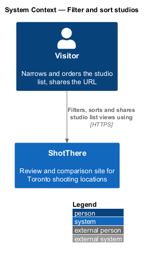
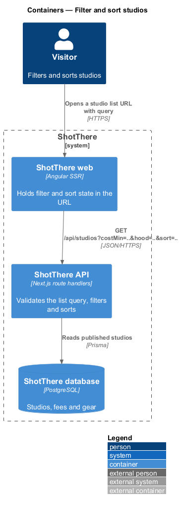
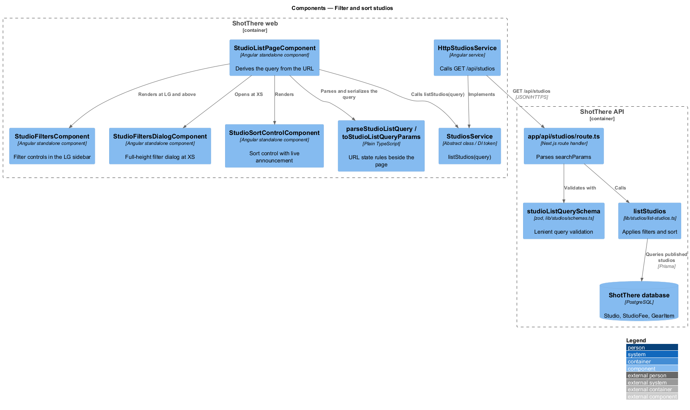
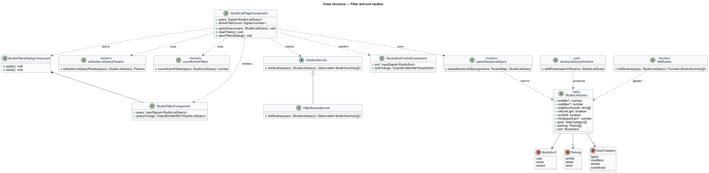
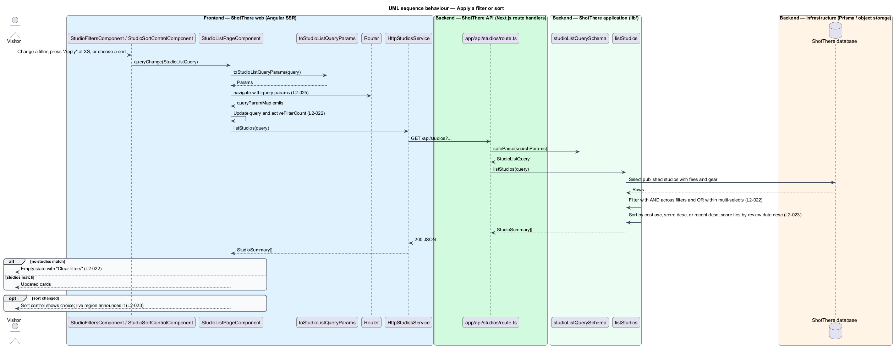
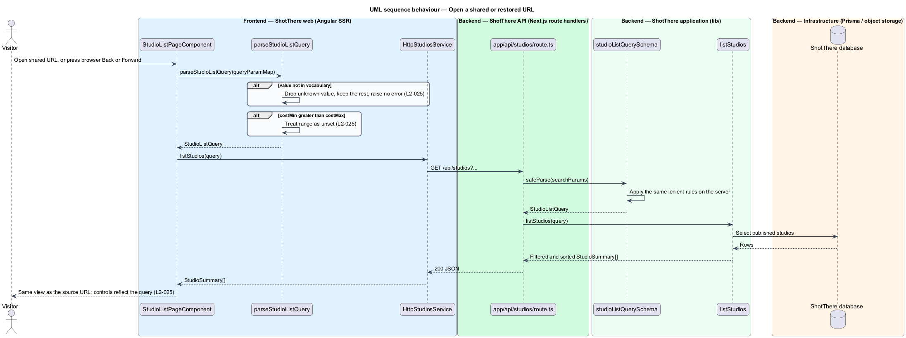

# Filter and sort studios

## Overview

ShotThere lists every published rental studio in Toronto on the studio list page, described in the `list-studios` feature. This feature lets a visitor narrow that list with filters and reorder it with a sort. It also keeps both in the URL, so a filtered view can be shared, bookmarked and revisited with browser Back and Forward.

- **studio filter** — named criterion that removes studios from the list, such as cost range, neighbourhood or parking
- **active filter set** — collection of studio filters the visitor has currently applied
- **list query** — URL query string that encodes the active filter set and the sort
- **all-in cost** — server-computed price of a standard 2-hour shoot including fees (`allInCost2h`)

Filters combine with AND. Values selected within one multi-select filter combine with OR. The sort orders by all-in cost ascending, overall score descending, or most recent review descending. Score ties order by review date descending.

The URL is the single source of filter and sort state. The page reads the list query, sends it to the API, and writes it back when the visitor changes a control. Invalid values in the URL are ignored without an error. The server applies the filters and the sort and remains the authority for every rule.

## Description

The slice extends the studio list page and the `GET /api/studios` endpoint from `list-studios`.

- **`StudioListQuery`** — type in `features/studios/studio-list-page/studio-list-query.ts`. Fields are `costMin`, `costMax`, `neighbourhoods`, `naturalLight`, `cycWall`, `minSpaceSqm`, `gear`, `parking` and `sort`.
- **`StudioSort`** — type `'cost' | 'score' | 'recent'` in its own file. The default is `'recent'`.
- **`parseStudioListQuery`** — plain TypeScript function in `parse-studio-list-query.ts` beside the page. It turns `ParamMap` into a `StudioListQuery`. It drops unknown values and treats a cost minimum greater than the maximum as an unset range (`L2-025`).
- **`toStudioListQueryParams`** — plain TypeScript function in `to-studio-list-query-params.ts`. It serializes a `StudioListQuery` into query parameters and omits defaults.
- **`countActiveFilters`** — plain TypeScript function in `count-active-filters.ts`. It returns the number of active filters for the filters control badge.
- **Query parameter names** — `costMin`, `costMax`, `hood` (repeated), `light`, `cyc`, `space`, `gear` (repeated), `parking` and `sort`. The neighbourhood vocabulary is `<TO SUPPLY>`.
- **`StudioListPageComponent`** — extended to derive a `query` signal from `ActivatedRoute.queryParamMap` through `parseStudioListQuery`. Each query change calls `StudiosService.listStudios(query)`. Each control change calls `Router.navigate` with `toStudioListQueryParams`, so Back and Forward restore earlier views.
- **`StudioFiltersComponent`** — standalone component in `features/studios/studio-filters/` holding the filter controls. At LG and above the page shows it in a sidebar beside the list.
- **`StudioFiltersDialogComponent`** — standalone component in `features/studios/studio-filters-dialog/`. At XS the filters control opens it as a full-height dialog with "Apply" and a close control. It uses the UI framework's accessible dialog primitive; the framework is `<TO SUPPLY>`. Behaviour at SM and MD is `<TO SUPPLY>`.
- **`StudioSortControlComponent`** — standalone component in `features/studios/studio-sort-control/`. It reflects the chosen sort. A polite live region announces the change (`L2-023`).
- **Empty state** — when no studio matches, the page explains that no studios match and offers "Clear filters", which navigates to the list with no filter parameters.
- **`StudiosService.listStudios(query: StudioListQuery)`** — the contract from `list-studios` gains the query argument. `HttpStudiosService` sends it as `GET /api/studios` query parameters.
- **`studioListQuerySchema`** — zod schema in `lib/studios/schemas.ts`. It drops unknown enum values, coerces numbers and unsets an inverted cost range, mirroring the client rules.
- **`app/api/studios/route.ts`** — parses `searchParams` with `studioListQuerySchema` and passes the result to `listStudios`.
- **`listStudios(query)`** — in `lib/studios/list-studios.ts`. It applies the filters with AND and multi-select values with OR. It sorts by `allInCost2h` ascending, `overallScore` descending, or review date descending, breaking score ties by review date descending.
- **Filter data sources** — `Studio` fields for neighbourhood, natural light by time of day, cyc wall, usable space and parking, and `GearItem` categories for included gear. Exact Prisma field names are `<TO SUPPLY>` from the schema.
- **Filter evaluation placement** — `allInCost2h` and `overallScore` are server-computed, so `listStudios` filters and sorts in memory after computing them. The catalogue size this rests on is `<TO SUPPLY>`.

## Requirements

The feature realizes the following level-2 (L2) requirements. Each L2 requirement refines a level-1 (L1) requirement, cited by identifier.

| L2 ID | Refines (L1) | Requirement |
|-------|--------------|-------------|
| `L2-022` | `L1-004` | The studio list shall offer filters for all-in cost range (minimum and maximum), neighbourhood (multi-select), natural light (at least medium at any time of day), cyc wall (yes), usable space (minimum square metres), included gear (multi-select from lights, modifiers, stands, backdrops), and parking (on-site, street, none). Filters shall combine with AND; multi-select values within a filter shall combine with OR. |
| `L2-023` | `L1-004` | The studio list shall sort by all-in cost (ascending), overall score (descending), or most recent review (descending). |
| `L2-025` | `L1-004` | The current filters, sort, and list type shall be encoded in the URL query string so that the same URL reproduces the same view, and browser back and forward shall restore previous views. |

The studio list and spot list are separate routes, so the route path carries the list type for these pages. The map view carries its own `type` parameter, described in `view-locations-map`.

## Diagrams

### System context

A visitor filters and sorts studios on ShotThere and may share the resulting URL with another visitor.

### Containers

The web app turns the URL into a list query and sends it to the ShotThere API, which filters and sorts the published studios from the database.

### Components

On the frontend, plain TypeScript functions beside the page parse and serialize the list query. On the backend, the zod schema validates the query before `listStudios` applies it.

### Class structure

`StudioListPageComponent` derives a `StudioListQuery` from the URL through `parseStudioListQuery`. The filter, dialog and sort components emit changes that the page writes back to the URL.

### Behaviour — apply a filter or sort

A control change becomes a URL navigation. The new URL drives the API request, the empty state, and the sort announcement.

### Behaviour — open a shared or restored URL

A shared link, or browser Back and Forward, yields a list query that is parsed leniently. Unknown values are dropped and an inverted cost range is unset.

