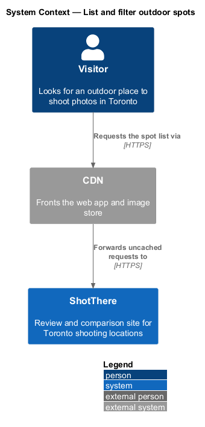
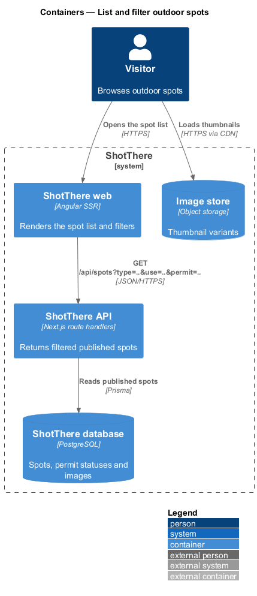
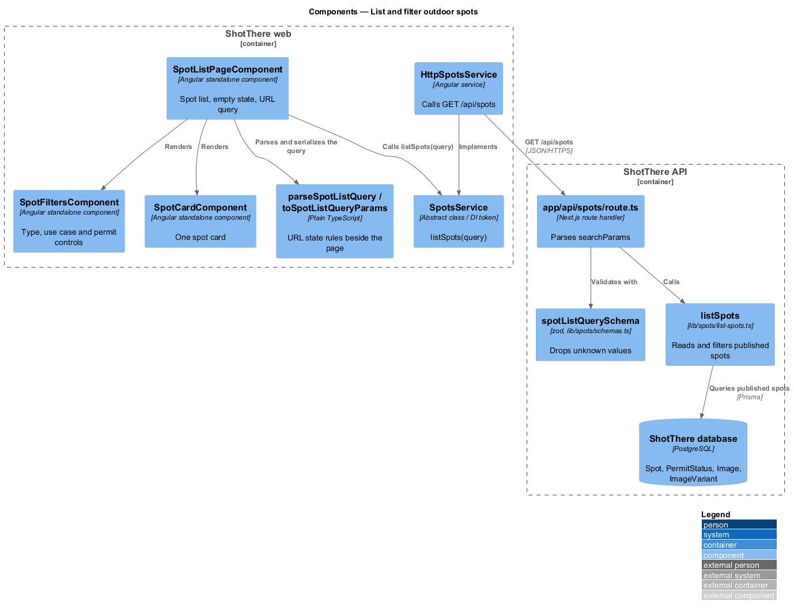
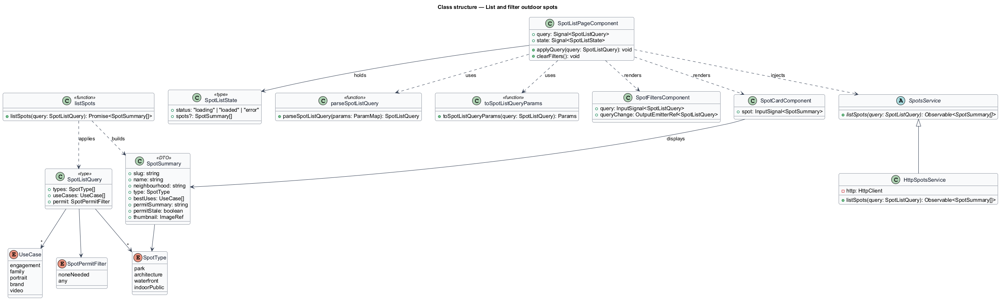
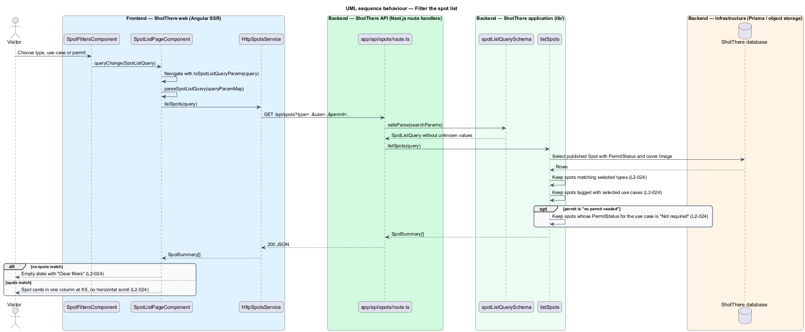

# List and filter outdoor spots

## Overview

ShotThere reviews outdoor places to shoot photos in Toronto as well as rental studios. This feature is the public list of outdoor spots, with filters that narrow it by kind of place, intended shoot and permit need.

- **outdoor spot** — public place reviewed first-hand as a photo location, such as a park or waterfront
- **spot type** — category of an outdoor spot: park, architecture, waterfront or indoor public
- **use case** — kind of shoot a spot suits: engagement, family, portrait, brand or video
- **permit summary** — short statement of whether a shoot at the spot requires a permit, taken from its dated `PermitStatus`
- **spot card** — summary tile linking to one spot page, showing name, neighbourhood, type, best uses, permit summary and thumbnail

Only published spots appear. Filters combine with AND. The permit filter keeps spots whose permit status is "Not required" for the selected use case, or keeps all spots when set to "any". A filter combination that matches nothing shows an empty state with "Clear filters".

## Description

The slice mirrors the studio list in `list-studios` and `filter-and-sort-studios`, applied to outdoor spots.

- **`SpotListPageComponent`** — standalone page component in `frontend/src/app/features/spots/spot-list-page/`. It derives a `query` signal from the URL, holds a `SpotListState` signal, and renders a single-column card list at XS with no horizontal scroll.
- **`SpotListState`** — discriminated union type for `loading`, `loaded` and `error`, in its own file beside the page.
- **`SpotCardComponent`** — standalone component in `features/spots/spot-card/` that renders one `SpotSummary` as a link to the spot page.
- **`SpotFiltersComponent`** — standalone component in `features/spots/spot-filters/` with the type, use case and permit controls. Its placement at each width is `<TO SUPPLY>` from the mocks.
- **`SpotListQuery`** — type in `spot-list-query.ts` beside the page with `types`, `useCases` and `permit`.
- **`SpotPermitFilter`** — type `'none-needed' | 'any'` in its own file. The default is `'any'`.
- **`parseSpotListQuery`** and **`toSpotListQueryParams`** — plain TypeScript functions beside the page. They read and write the query parameters `type` (repeated), `use` (repeated) and `permit`, dropping unknown values.
- **Empty state** — when no spot matches, the page shows a message and "Clear filters", which navigates to the list with no filter parameters.
- **`SpotsService`** — abstract class and DI token in `libs/api/src/lib/spots/spots.service.ts`. It declares `listSpots(query: SpotListQuery): Observable<SpotSummary[]>`.
- **`HttpSpotsService`** — implementation in `http-spots.service.ts` that calls `GET /api/spots`. The app registers `{ provide: SpotsService, useClass: HttpSpotsService }`.
- **`SpotSummary`** — DTO type in `libs/api` with `slug`, `name`, `neighbourhood`, `type`, `bestUses`, `permitSummary`, `permitStale` and `thumbnail` (`ImageRef`).
- **`spotListQuerySchema`** — zod schema in `lib/spots/schemas.ts` that drops unknown values.
- **`app/api/spots/route.ts`** — Next.js `GET` route handler. It parses `searchParams` with `spotListQuerySchema` and calls `listSpots`.
- **`lib/spots/list-spots.ts`** — `listSpots(query)` application function. It reads published `Spot` rows with their `PermitStatus` rows and cover `Image`, then applies the filters.
- **Permit filter rule** — `PermitStatus` holds one status per shoot kind. The mapping from use case to shoot kind is `<TO SUPPLY>`; the spec example maps "family" to the portrait-shoot status. The rule when "no permit needed" is set without a use case is `<TO SUPPLY>`.
- **Prisma models** — `Spot`, `PermitStatus`, `Image` and `ImageVariant`.

## Requirements

The feature realizes the following level-2 (L2) requirement. It refines a level-1 (L1) requirement, cited by identifier.

| L2 ID | Refines (L1) | Requirement |
|-------|--------------|-------------|
| `L2-024` | `L1-004` | The spot list shall show every published spot as a card with name, neighbourhood, type, best uses, permit summary, and thumbnail, and shall offer filters by type (park, architecture, waterfront, indoor public), use case (engagement, family, portrait, brand, video), and permit requirement (no permit needed for the selected use case, or any). |

## Diagrams

### System context

A visitor browses outdoor spots on ShotThere. The CDN fronts the web app and the card thumbnails.

### Containers

The web app sends the spot list query to the ShotThere API, which reads published spots and permit statuses from the database. Thumbnails load from the image store.

### Components

`SpotListPageComponent` depends on the `SpotsService` contract. `HttpSpotsService` calls the route handler, which validates the query and delegates to `listSpots`.

### Class structure

The page derives a `SpotListQuery` through `parseSpotListQuery` and renders a `SpotCardComponent` per `SpotSummary`. `HttpSpotsService` extends `SpotsService`.

### Behaviour — filter the spot list

A filter change becomes a URL navigation and a new API request. `listSpots` applies the type, use case and permit filters, and the page shows cards or the empty state.

