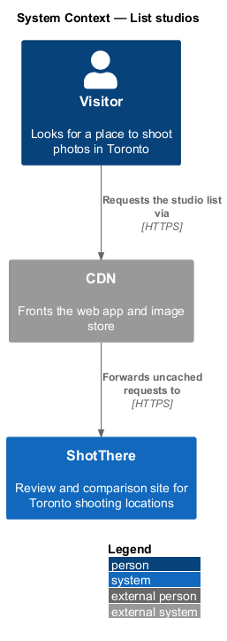
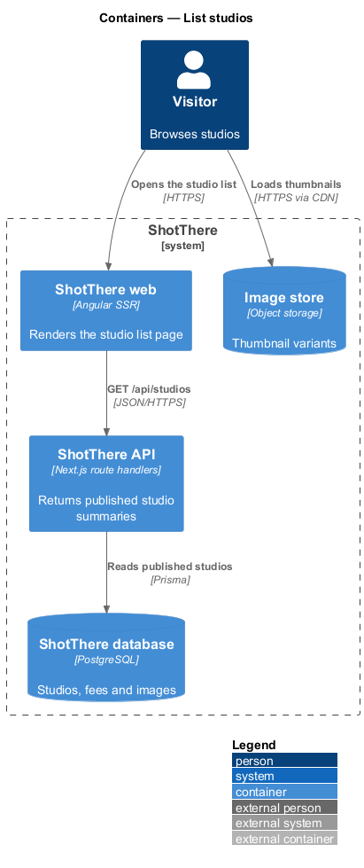
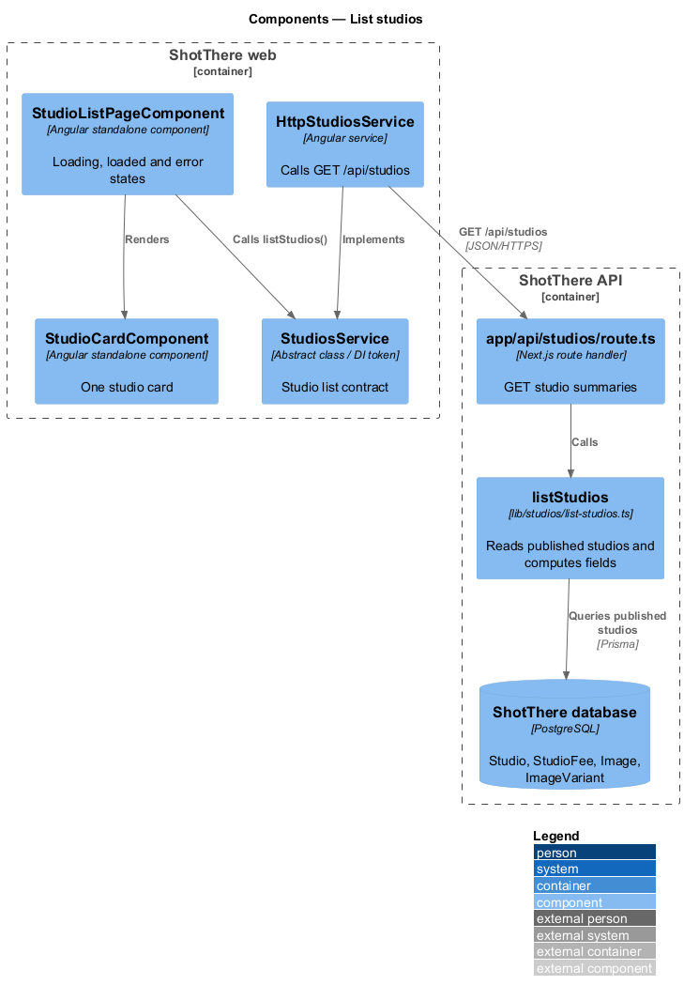
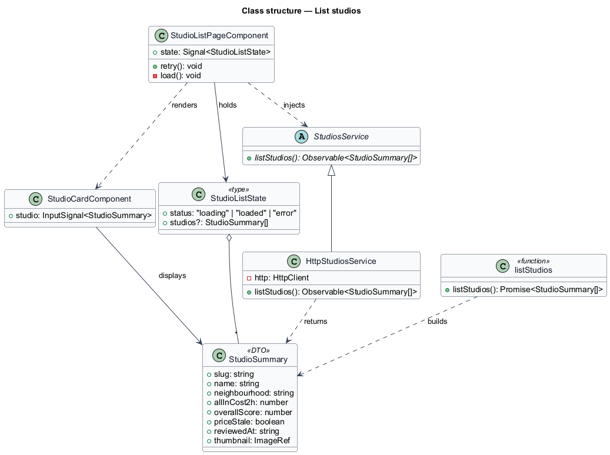
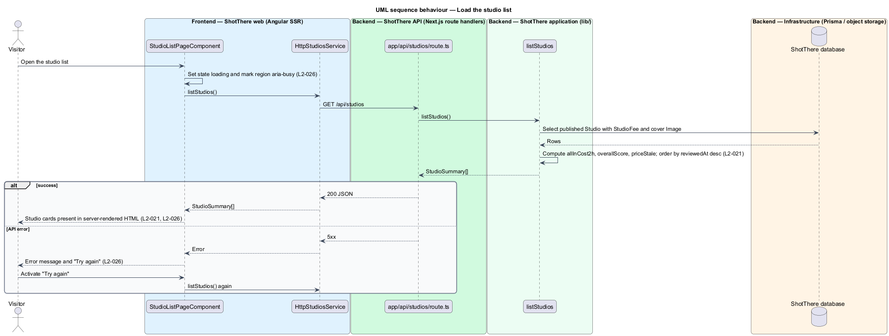

# List studios

## Overview

ShotThere is a review and comparison site for places to shoot photos in Toronto. A *published studio* is a rental studio whose review is live on the public site. Draft studios never appear in public responses. This feature is the public studio list, the entry point of the browse subsystem.

The list shows each published studio as a *studio card*.

- **studio card** — summary tile linking to one studio page, showing name, neighbourhood, all-in cost, overall score, thumbnail and stale indicator
- **all-in cost** — server-computed price of a standard 2-hour shoot including fees (`allInCost2h`)
- **stale pricing** — pricing last verified more than 183 days before today (`priceStale`)

Without parameters, the list orders studios by review date, newest first. The page renders on the server, so the initial list arrives in the HTML. While the client fetches data, the page shows skeleton placeholders. When the fetch fails, it shows an error message with a retry action. Filters and sorting belong to the `filter-and-sort-studios` feature.

## Description

The slice runs from the Angular list page to the `Studio` table.

- **`StudioListPageComponent`** — standalone page component in `frontend/src/app/features/studios/studio-list-page/`. It holds a `state` signal of type `StudioListState`. It renders cards in a grid of 1 column at XS, 2 at SM and 3 at LG and above, and marks the list region `aria-busy` while loading.
- **`StudioCardComponent`** — standalone presentational component in `features/studios/studio-card/`. It renders one `StudioSummary` as a link to the studio page. It shows the "Prices may be out of date" indicator when `priceStale` is `true`.
- **`StudioListState`** — discriminated union type `{ status: 'loading' } | { status: 'loaded'; studios: StudioSummary[] } | { status: 'error' }`, in its own file beside the page.
- **`routes.ts`** — `features/studios/routes.ts` registers the page. The path and page title come from the central app paths and titles module.
- **`StudiosService`** — abstract class and DI token in `libs/api/src/lib/studios/studios.service.ts`. It declares `listStudios(): Observable<StudioSummary[]>`.
- **`HttpStudiosService`** — implementation in `http-studios.service.ts` that calls `GET /api/studios`. The app registers `{ provide: StudiosService, useClass: HttpStudiosService }`.
- **Hydration transfer** — the `HttpClient` transfer cache reuses the server-side response during hydration, so the client does not refetch the initial list.
- **`StudioSummary`** — DTO type in `libs/api` with `slug`, `name`, `neighbourhood`, `allInCost2h`, `overallScore`, `priceStale`, `reviewedAt` and `thumbnail` (`ImageRef`).
- **`app/api/studios/route.ts`** — Next.js `GET` route handler in `backend/`. It calls `listStudios` and returns a JSON array of `StudioSummary`.
- **`lib/studios/list-studios.ts`** — `listStudios()` application function. It reads published `Studio` rows with their `StudioFee` rows and cover `Image`. It computes `allInCost2h`, `overallScore` and `priceStale`, then orders by review date descending.
- **Prisma models** — `Studio`, `StudioFee`, `Image` and `ImageVariant`. Thumbnail URLs point at the 480 variant behind the CDN.
- **Loading and error UI** — the page shows skeleton cards while loading. The skeleton count is `<TO SUPPLY>`. On failure it shows an error message and a "Try again" button that calls `listStudios()` again.

## Requirements

The feature realizes the following level-2 (L2) requirements. Each L2 requirement refines a level-1 (L1) requirement, cited by identifier.

| L2 ID | Refines (L1) | Requirement |
|-------|--------------|-------------|
| `L2-021` | `L1-004` | The studio list shall show every published studio as a card with name, neighbourhood, all-in cost, overall score, a thumbnail, and a stale indicator when pricing is stale, defaulting to sort by most recent review. |
| `L2-026` | `L1-004` | Lists shall show a loading state while data is fetched and an error state with a retry action when the fetch fails. |

## Diagrams

### System context

A visitor browses studios on ShotThere. The CDN fronts the web app and the card thumbnails.

### Containers

The Angular SSR web app requests the studio list from the ShotThere API, which reads the database. Thumbnails load from the image store.

### Components

`StudioListPageComponent` depends on the `StudiosService` contract. `HttpStudiosService` calls the route handler, which delegates to `listStudios`.

### Class structure

The page holds a `StudioListState` and renders a `StudioCardComponent` for each `StudioSummary`. `HttpStudiosService` extends the abstract `StudiosService`.

### Behaviour — load the studio list

The server renders the initial list into the HTML (`L2-026`). A failed fetch shows the error state, and "Try again" repeats the request.

