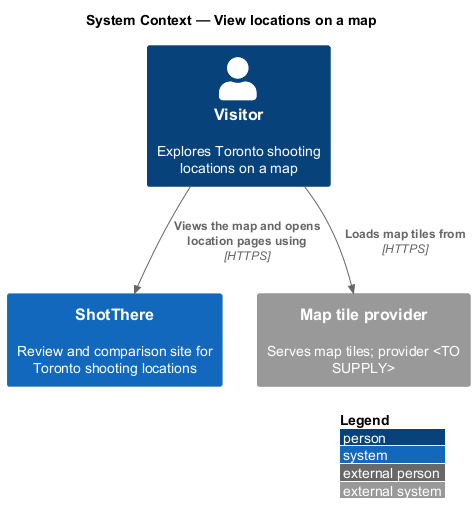
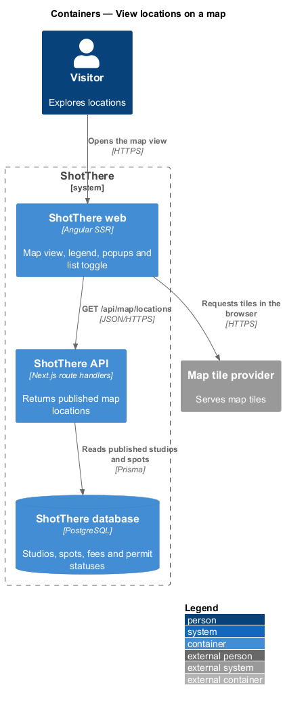
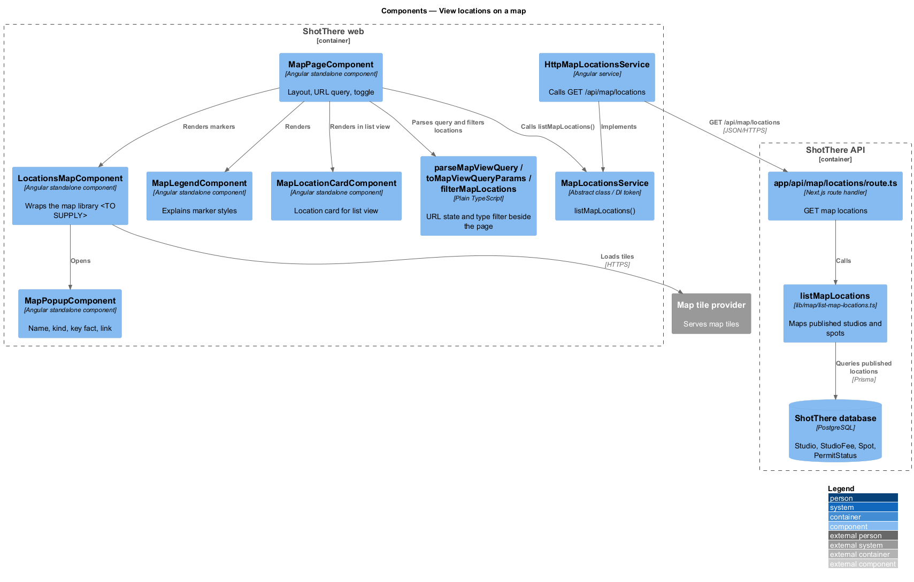
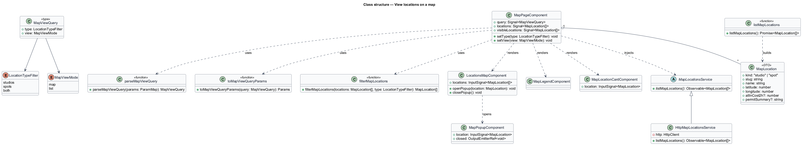
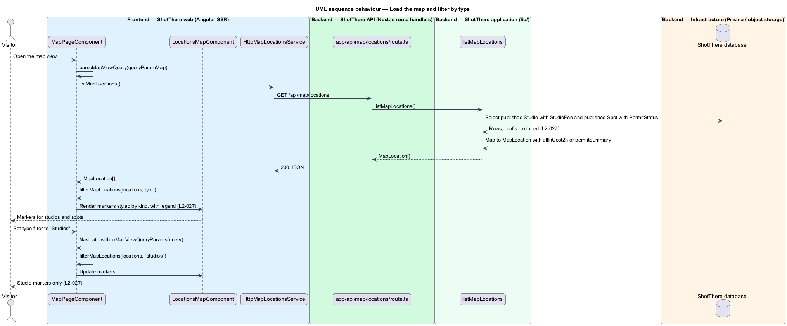
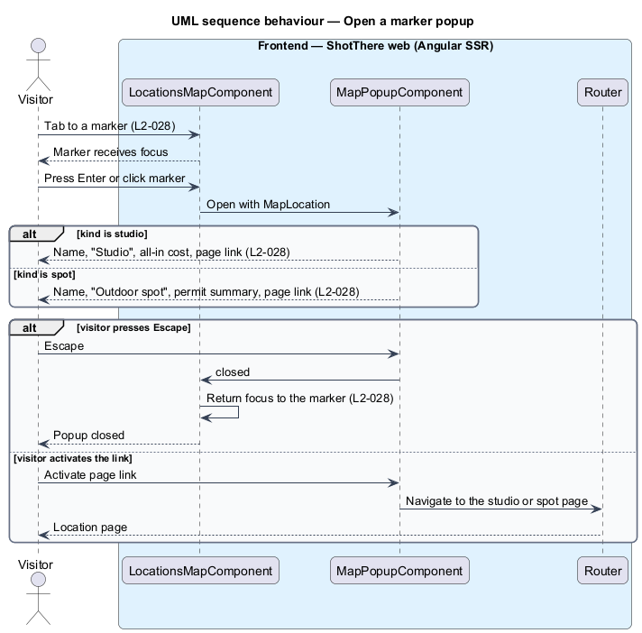
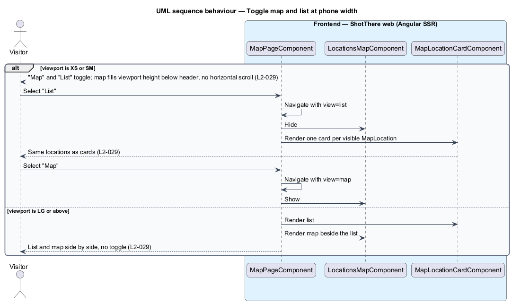

# View locations on a map

## Overview

ShotThere reviews two kinds of location in Toronto: rental studios and outdoor spots. This feature is the map view, a single interactive map that shows every published location at once. From the map, a visitor opens any location's page.

- **location** — published studio or published outdoor spot
- **marker** — focusable point on the map for one location, styled by location kind
- **legend** — key on the map view that explains the studio and spot marker styles
- **marker popup** — panel opened from a marker that shows the location's name, kind, key fact and a link to its page
- **key fact** — single summary value in a popup: all-in cost for a studio, permit summary for a spot
- **view toggle** — "Map" and "List" control shown at XS and SM that switches between the map and a card list

A type filter limits the markers to studios, spots or both. The type filter and the view toggle live in the URL query string. Draft locations never reach the map, because the API returns published locations only. At LG and above, the list and the map sit side by side without a toggle.

## Description

The slice adds one page and one endpoint.

- **`MapPageComponent`** — standalone page component in `frontend/src/app/features/map/map-page/`. It derives `type` and `view` from the URL, holds the locations in a signal, and lays out the toggle, legend, list and map. At XS and SM the map fills the viewport height below the header with no horizontal scroll.
- **`LocationsMapComponent`** — standalone component in `features/map/locations-map/` that wraps the map library. The library is `<TO SUPPLY>`. It renders one marker per `MapLocation` as a focusable element activatable with Enter. It runs in the browser only; the server render shows the list.
- **`MapPopupComponent`** — standalone component in `features/map/map-popup/` with name, kind label, key fact and page link. Escape closes it and returns focus to its marker.
- **`MapLegendComponent`** — standalone component in `features/map/map-legend/` that explains the two marker styles.
- **`MapLocationCardComponent`** — standalone component in `features/map/map-location-card/` that renders one `MapLocation` as a card for the list view.
- **`MapViewQuery`** — type in `map-view-query.ts` beside the page with `type` (`LocationTypeFilter`) and `view` (`MapViewMode`).
- **`LocationTypeFilter`** — type `'studios' | 'spots' | 'both'` in its own file. The default is `'both'`.
- **`MapViewMode`** — type `'map' | 'list'` in its own file. The default is `'map'`.
- **`parseMapViewQuery`** and **`toMapViewQueryParams`** — plain TypeScript functions beside the page. They read and write the query parameters `type` and `view`, dropping unknown values.
- **`filterMapLocations`** — plain TypeScript function in `filter-map-locations.ts` beside the page. It applies the type filter to the loaded locations, so the filter does not refetch.
- **`MapLocationsService`** — abstract class and DI token in `libs/api/src/lib/map/map-locations.service.ts`. It declares `listMapLocations(): Observable<MapLocation[]>`.
- **`HttpMapLocationsService`** — implementation in `http-map-locations.service.ts` that calls `GET /api/map/locations`. The app registers `{ provide: MapLocationsService, useClass: HttpMapLocationsService }`.
- **`MapLocation`** — DTO type in `libs/api` with `kind` (`'studio' | 'spot'`), `slug`, `name`, `latitude`, `longitude`, `allInCost2h` for studios and `permitSummary` for spots.
- **`app/api/map/locations/route.ts`** — Next.js `GET` route handler that calls `listMapLocations`.
- **`lib/map/list-map-locations.ts`** — `listMapLocations()` application function. It reads published `Studio` and `Spot` rows and maps them to `MapLocation`. Studio rows include `StudioFee` to compute `allInCost2h`; spot rows include `PermitStatus` to build the permit summary.
- **Map tiles** — the map library loads tiles from an external map tile provider. The provider is `<TO SUPPLY>`.
- **Marker styles** — the visual difference between studio and spot markers is `<TO SUPPLY>` from the mocks and design system.

## Requirements

The feature realizes the following level-2 (L2) requirements. Each L2 requirement refines a level-1 (L1) requirement, cited by identifier.

| L2 ID | Refines (L1) | Requirement |
|-------|--------------|-------------|
| `L2-027` | `L1-005` | The map view shall show a marker for every published studio and outdoor spot, distinguishing the two types, with a filter to show studios only, spots only, or both. |
| `L2-028` | `L1-005` | Activating a marker shall open a popup with the location's name, type, and key fact (all-in cost for studios, permit summary for spots), and a link to the location's page. |
| `L2-029` | `L1-005` | At XS and SM the map view shall offer a toggle between map and list, and the map shall fill the viewport height below the header. |

## Diagrams

### System context

A visitor explores locations on the ShotThere map. The visitor's browser loads map tiles from an external map tile provider.

### Containers

The web app requests published locations from the ShotThere API, which reads studios and spots from the database. Tiles come from the map tile provider.

### Components

`MapPageComponent` composes the map, legend, popup and card components and depends on the `MapLocationsService` contract. The route handler delegates to `listMapLocations`.

### Class structure

The page derives a `MapViewQuery` from the URL and filters `MapLocation` values with `filterMapLocations`. `HttpMapLocationsService` extends `MapLocationsService`.

### Behaviour — load the map and filter by type

The page loads all published locations once and draws one marker per location. A type filter change updates the URL and filters the markers on the client.

### Behaviour — open a marker popup

Enter or a pointer activates a marker and opens its popup. Escape closes the popup and returns focus to the marker.

### Behaviour — toggle map and list at phone width

At XS and SM the view toggle switches between the map and the card list. The choice is held in the URL.

