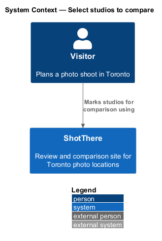
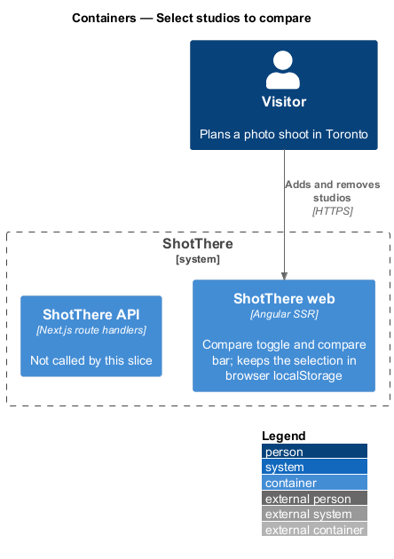
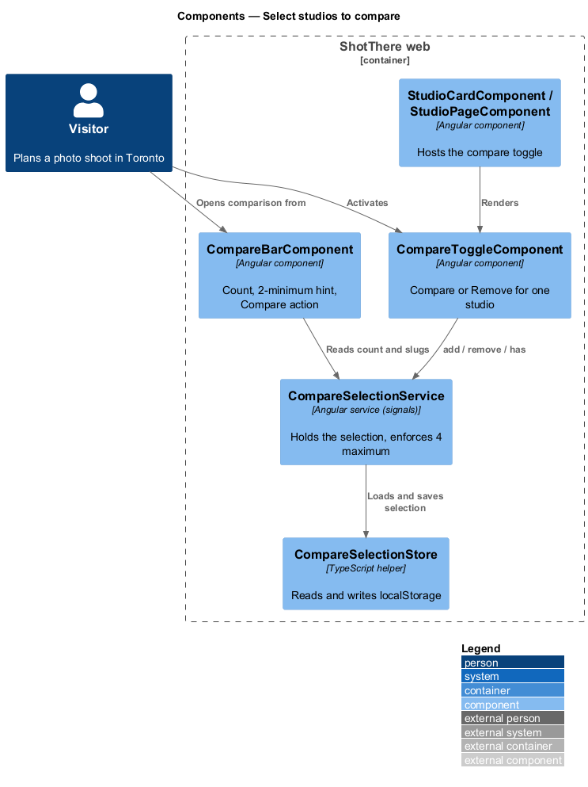
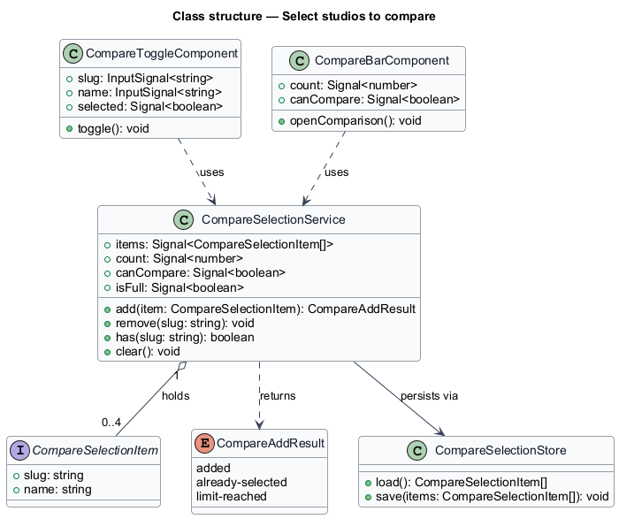
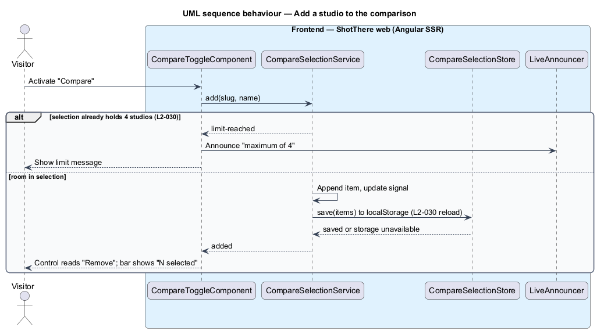
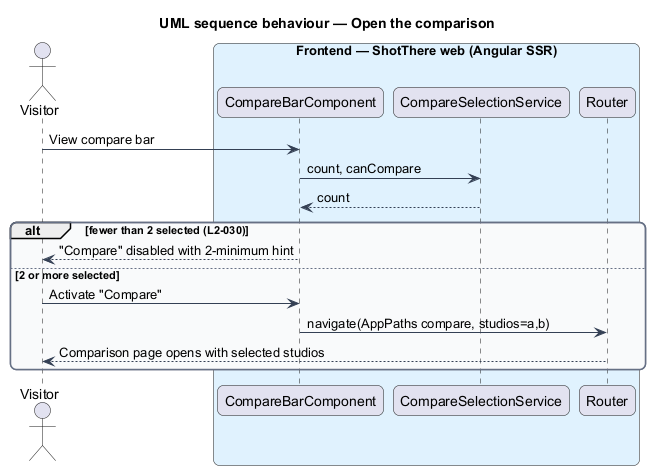

# Select studios to compare

## Overview

ShotThere is a review and comparison site for places to shoot photos in Toronto. Each studio is reviewed first-hand with the same measurements, so studios compare side by side. This feature lets a visitor build the set of studios that the comparison page then shows.

- **comparison selection** — ordered list of up to 4 studio slugs that a visitor has marked for side-by-side review
- **compare bar** — persistent strip fixed to the bottom of the viewport that shows the selection count and opens the comparison
- **compare toggle** — button on a studio card or studio page that adds the studio to, or removes it from, the comparison selection

The selection lives only in the visitor's browser. It persists in `localStorage`, so it survives a reload, and it never reaches the server. Opening the comparison navigates to `/compare?studios=a,b`, which the view-comparison feature renders. The selection accepts at most 4 studios and opens the comparison only when it holds at least 2.

## Description

The slice is frontend-only. It adds no endpoint and no database change.

- **`CompareSelectionService`** — injectable service in `core`. It holds the selection as a signal of `CompareSelectionItem[]`, exposes `count`, `canCompare` (2 or more) and `isFull` (4), and offers `add`, `remove`, `has` and `clear`. `add` returns `CompareAddResult` and refuses a fifth studio.
- **`CompareSelectionStore`** — plain TypeScript helper in `core` that reads and writes the selection under the `localStorage` key `<TO SUPPLY>`. It guards every access with `try`/`catch` and skips storage during server rendering, so the selection starts empty when storage is unavailable.
- **`CompareSelectionItem`** — interface with `slug: string` and `name: string`. The name lets the bar and announcements label the studio without a server call.
- **`CompareAddResult`** — type alias `'added' | 'already-selected' | 'limit-reached'`.
- **`CompareToggleComponent`** — standalone component in `features/compare`. It takes `slug` and `name` inputs and renders "Compare" or "Remove" from `CompareSelectionService.has`. On `'limit-reached'` it raises the localized 4-maximum warning through `ToastService`; the shell's single toast region announces it and the library dismisses it on its normal schedule, independently of later selection changes. `StudioCardComponent` and `StudioPageComponent` place it.
- **`CompareBarComponent`** — standalone component rendered once by the app shell. It shows "N selected" when the selection is not empty. Its "Compare" action is disabled with a hint below 2 studios. When enabled, it navigates to the compare path from the central `AppPaths`, with `studios` set to the slugs joined by commas.
- **`compare-bar.css`** — fixes the bar to the bottom at XS, pads it with `env(safe-area-inset-bottom)`, and sets a matching bottom padding on the shell content so the bar never covers the end of the page.
- All user-facing text ("Compare", "Remove", "N selected", the 2-minimum hint, the 4-maximum message) is marked for Angular i18n.

## Requirements

The feature realizes the following level-2 (L2) requirements. Each L2 requirement refines a level-1 (L1) requirement, cited by identifier.

| L2 ID | Refines (L1) | Requirement |
|-------|--------------|-------------|
| `L2-030` | `L1-006` | The system shall let a visitor add a studio to a comparison from its list card or its page, shall show the number selected in a persistent compare bar, and shall open the comparison when two or more studios are selected. The selection shall be limited to 4 studios and shall persist in the browser across reloads. |

## Diagrams

### System context

The visitor marks studios for comparison on ShotThere. No external system takes part.

### Containers

The selection stays inside the ShotThere web container and its browser storage. This slice does not call the ShotThere API.

### Components

`CompareToggleComponent` and `CompareBarComponent` both read and change the selection through `CompareSelectionService`, which persists it through `CompareSelectionStore`.

### Class structure

`CompareSelectionService` holds `CompareSelectionItem` values and returns `CompareAddResult`. Both components depend on the service, never on the store.

### Behaviour — add a studio to the comparison

The toggle asks the service to add the studio. The service refuses a fifth studio (`L2-030`) without changing the selection, and the toggle raises a warning through `ToastService`. The shell's toast region renders and announces the warning, which auto-dismisses under the library rule. Otherwise, the service updates the signal and writes `localStorage`.

### Behaviour — open the comparison

The bar enables "Compare" only at 2 or more studios and then navigates to the compare path with the slugs in order.

