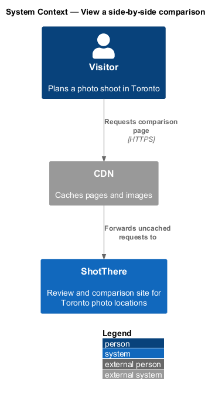
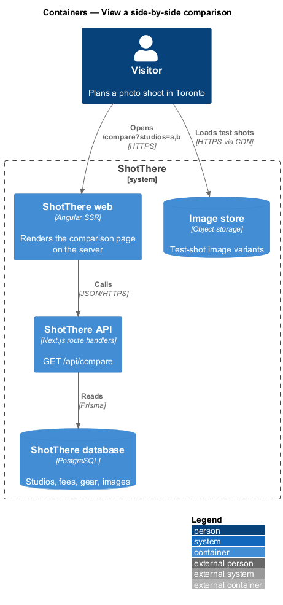
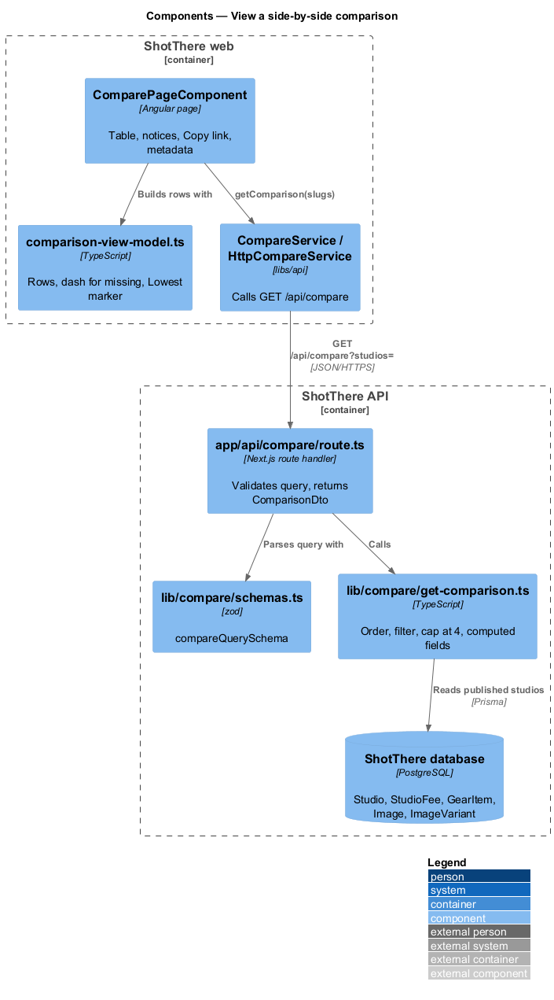
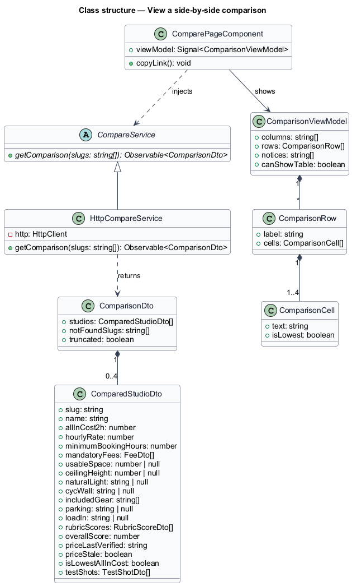
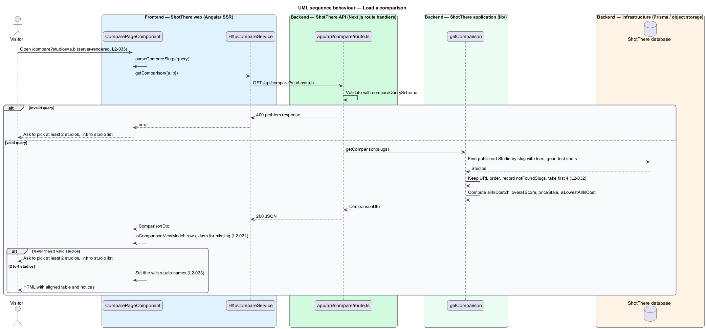
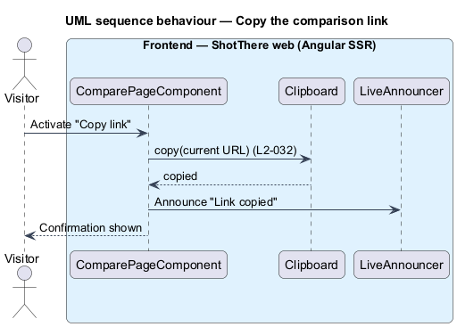

# View a side-by-side comparison

## Overview

ShotThere reviews each studio with the same measurements and test setup. The comparison page puts 2 to 4 studios next to each other so those measurements line up row by row.

- **comparison** — server-built set of 2 to 4 published studios, in URL order, with their comparable values
- **comparison URL** — address `/compare?studios=a,b` whose `studios` parameter lists studio slugs in display order
- **row-label column** — fixed first column that names each compared attribute
- **all-in cost** — server-computed `allInCost2h`, the price of a 2-hour booking including mandatory fees

The URL is the only input, so a comparison opened in a new session shows the same studios in the same order. Unknown or draft slugs are dropped with a notice. The page renders on the server, so the table and a title naming the studios are present without JavaScript.

## Description

The slice runs from the comparison page to the database.

- **`ComparePageComponent`** — standalone page in `features/compare`, routed from `features/compare/routes.ts` at the compare path in `AppPaths`. It reads `studios` from the query string, calls `CompareService`, and renders the table, notices and "Copy link".
- **`comparison-view-model.ts`** — plain TypeScript beside the page. `toComparisonViewModel(dto)` builds `ComparisonRow[]` in the order of `L2-031`, formats each `ComparisonCell`, substitutes "—" for missing optional values, and marks the lowest all-in cost with a visual marker and the text "Lowest".
- **`compare-url.ts`** — `parseCompareSlugs(value)` beside the page. It splits the query value into trimmed, non-empty slugs.
- **`compare-page.css`** — wraps the table in a horizontal scroll container, makes the row-label column `position: sticky`, and sets each studio column to at least 160px at XS. At LG and above, 4 columns fit without scrolling.
- **`CompareService`** — abstract class and DI token in `libs/api` (`compare.service.ts`) with `getComparison(slugs: string[]): Observable<ComparisonDto>`.
- **`HttpCompareService`** — implementation in `http-compare.service.ts`; it calls `GET /api/compare?studios=a,b`. The app registers `{ provide: CompareService, useClass: HttpCompareService }`.
- **Copy link** — the page copies the current URL with the CDK `Clipboard` and announces the confirmation through `LiveAnnouncer`.
- **Metadata** — the page sets the title from the central page-title helper with all compared studio names and sets a description through `Meta`.
- **`app/api/compare/route.ts`** — `GET` handler. It validates the query with `compareQuerySchema` and returns `ComparisonDto` as JSON.
- **`lib/compare/schemas.ts`** — zod `compareQuerySchema` that turns the `studios` value into a slug array.
- **`lib/compare/get-comparison.ts`** — `getComparison(slugs)` loads published studios by slug through Prisma, keeps URL order, takes the first 4 found, and reports `notFoundSlugs` and `truncated`. It computes `allInCost2h`, `overallScore` and `priceStale`, and sets `isLowestAllInCost` on the cheapest studio or studios.
- **Prisma models** — `Studio`, `StudioFee`, `GearItem`, `Image` and `ImageVariant` (standard test shots).
- **`ComparisonDto`** — `studios: ComparedStudioDto[]`, `notFoundSlugs: string[]`, `truncated: boolean`.
- **`ComparedStudioDto`** — slug, name, `allInCost2h`, hourly rate, minimum booking, mandatory fees, usable space, ceiling height, natural light by time of day, cyc wall, included gear, parking, load-in, rubric scores, `overallScore`, price last-verified date, `priceStale`, `isLowestAllInCost` and `testShots`.
- **Notices** — fewer than 2 valid studios shows a message asking for at least 2, with a link to the studio list. Unknown slugs and more than 4 slugs each show a message. The API answers `200` in all three cases.
- The cap of 4 applies to valid slugs: `getComparison` filters unknown and draft slugs first, then truncates, as `L2-032` criterion 4 states.

## Requirements

The feature realizes the following level-2 (L2) requirements. Each L2 requirement refines a level-1 (L1) requirement, cited by identifier.

| L2 ID | Refines (L1) | Requirement |
|-------|--------------|-------------|
| `L2-031` | `L1-006` | The comparison page shall present the selected studios as aligned columns with rows for all-in cost, hourly rate, minimum booking, mandatory fees, usable space, ceiling height, natural light by time of day, cyc wall, included gear, parking, load-in, each rubric score, overall score, price last-verified date, and standard test shots, with row labels in a fixed first column. |
| `L2-032` | `L1-006` | Every comparison shall be reproducible from its URL, which encodes the studio slugs, and shall offer a "Copy link" action. |
| `L2-033` | `L1-006` | The comparison page shall be server-rendered for the studios in its URL and shall carry page metadata naming the compared studios. |

## Diagrams

### System context

The visitor opens a comparison on ShotThere. The CDN fronts the page and the test-shot images.

### Containers

The web container renders the page on the server and calls the API, which reads studios from the database. Test-shot images load from the image store.

### Components

`ComparePageComponent` calls `CompareService`; the route handler validates the query and delegates to `getComparison`.

### Class structure

`HttpCompareService` extends `CompareService` and returns `ComparisonDto`. The page turns it into `ComparisonRow` values through `toComparisonViewModel`.

### Behaviour — load a comparison

The server renders the page from the URL slugs (`L2-033`). `getComparison` keeps URL order, drops unknown slugs and caps at 4 (`L2-032`).

### Behaviour — copy the comparison link

"Copy link" writes the current URL to the clipboard and announces the confirmation (`L2-032`).

