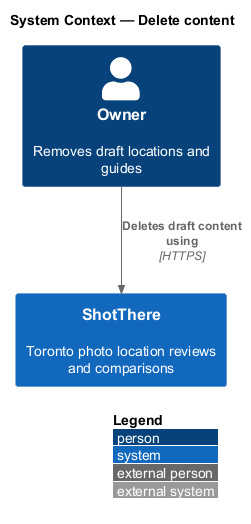
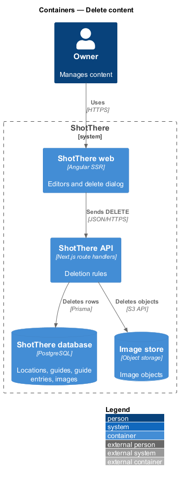
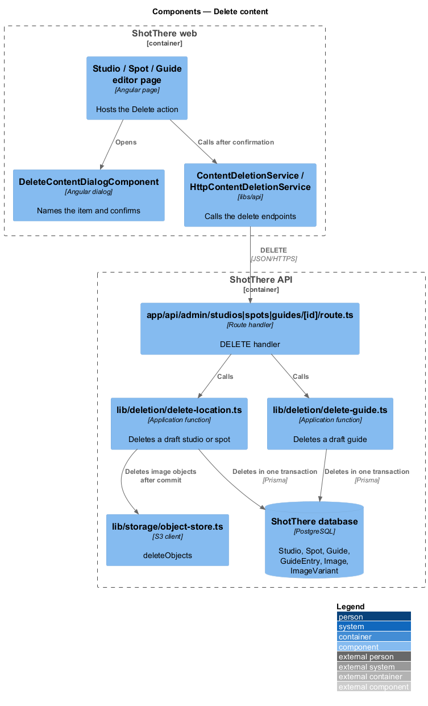
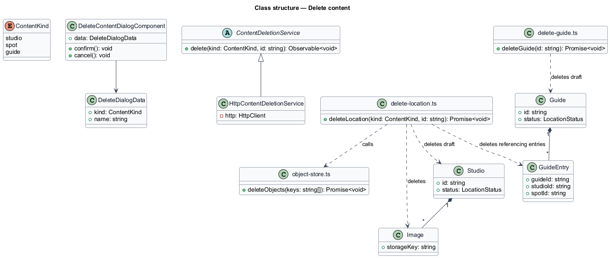
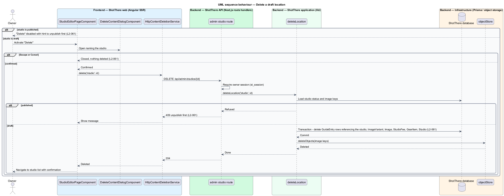

# Delete content

## Overview

ShotThere content consists of locations (studios and outdoor spots) and guides.

- **guide** — curated "best for" list of locations, made of guide entries
- **guide entry** — row in a guide that points at one studio or outdoor spot

This feature lets the owner delete a draft location or a draft guide.
Deletion is permanent, so the owner confirms in a dialog that names the item.
Published items cannot be deleted directly. The owner unpublishes first, which
the `publish-and-unpublish-location` design covers.

Deleting a location also deletes its images and any guide entries that point at
it. The guides themselves remain. The Delete action sits in the studio, spot and
guide editors (`edit-studio`, `edit-outdoor-spot`, `edit-guide`). After
deletion the owner returns to the matching admin list (`list-admin-content`).

## Description

Frontend (`frontend/`):

- **`ContentDeletionService`** (`libs/api/src/deletion/content-deletion.service.ts`) — abstract class and DI token with `delete(kind, id)`.
- **`HttpContentDeletionService`** (`http-content-deletion.service.ts`) — sends `DELETE` to the matching admin endpoint.
- **`DeleteContentDialogComponent`** (`features/admin/deletion/`) — accessible confirmation dialog built on the UI framework's dialog primitive. It receives `DeleteDialogData` and names the item in its heading. Escape and Cancel close it without deleting (L2-061).
- **`delete-eligibility.ts`** — plain TypeScript returning whether Delete is enabled and the i18n-marked hint "Unpublish before deleting" for published items.
- **Editor integration** — each editor shows "Delete", disabled with the hint when published. On success it navigates to the list path from the central app paths and shows a confirmation notification.

Backend (`backend/`):

- **`DELETE` handlers** in `app/api/admin/studios/[id]/route.ts`, `app/api/admin/spots/[id]/route.ts` and `app/api/admin/guides/[id]/route.ts`. Each requires the owner session and returns 204, 404 or 409.
- **`lib/deletion/delete-location.ts`** — `deleteLocation(kind, id)` refuses a published location with 409. Otherwise one Prisma transaction deletes the referencing `GuideEntry` rows, `ImageVariant`, `Image`, the child rows (`StudioFee`, `GearItem` or `PermitStatus`) and the location. After commit it calls `deleteObjects` for the image keys.
- **`lib/deletion/delete-guide.ts`** — `deleteGuide(id)` refuses a published guide with 409. Otherwise it deletes the guide and its entries in one transaction.
- **`lib/storage/object-store.ts`** — `deleteObjects(keys)`, shared with the `upload-and-arrange-images` design. Handling of an object delete that fails after commit is `<TO SUPPLY>`.

## Requirements

The feature realizes the following level-2 (L2) requirement, which refines the
level-1 (L1) requirement cited.

| L2 ID | Refines (L1) | Requirement |
|-------|--------------|-------------|
| `L2-061` | `L1-014` | The system shall let the owner delete a draft location or guide after confirming in a dialog that names the item. Published items shall be unpublished before deletion. |

## Diagrams

### System context

The owner deletes draft content through ShotThere. No external system takes
part.

### Containers

The API deletes rows from the database and image objects from the image store.

### Components

The editors confirm through `DeleteContentDialogComponent` and call
`ContentDeletionService`. The route handlers delegate to the `lib/deletion`
functions.

### Class structure

`HttpContentDeletionService` implements the contract. `deleteLocation` removes
the location, its images and its referencing guide entries.

### Behaviour — delete a draft location

A published location keeps Delete disabled, and the server also refuses it.
A confirmed draft is deleted in one transaction, then its image objects are
removed.

