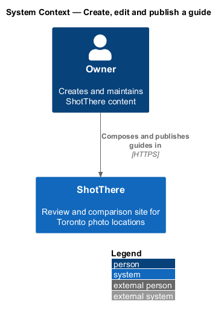
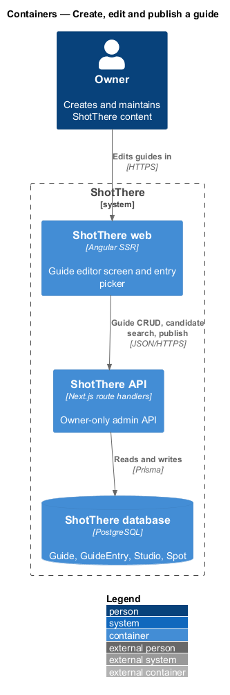
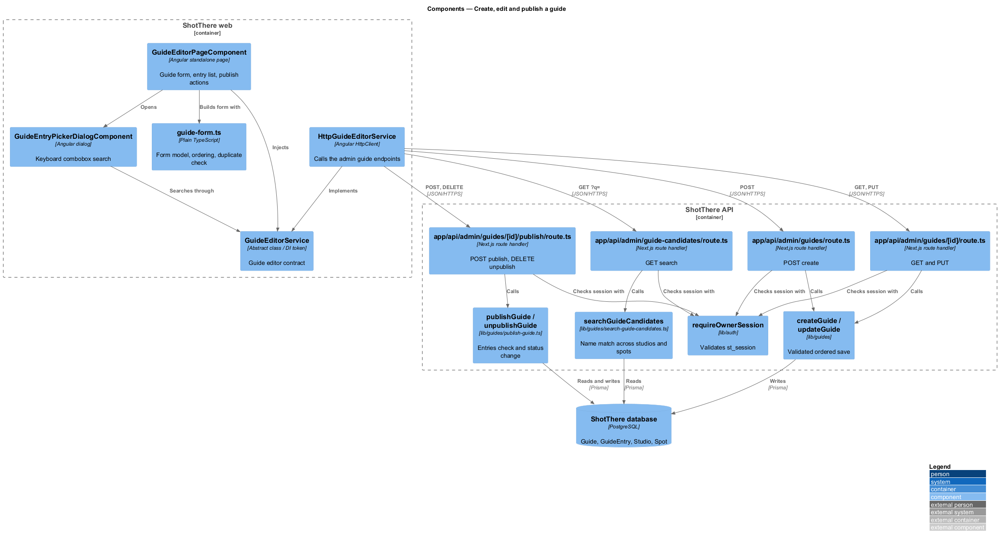
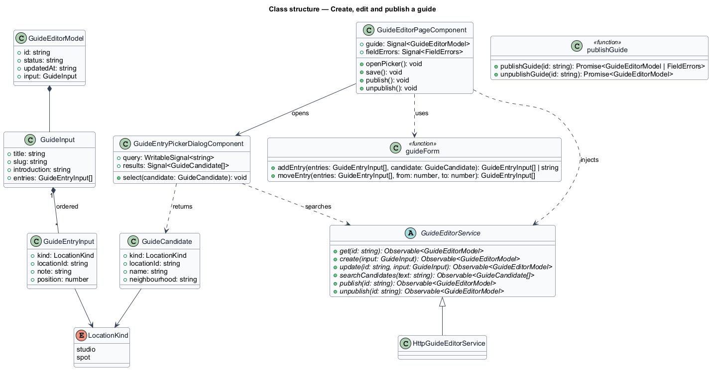
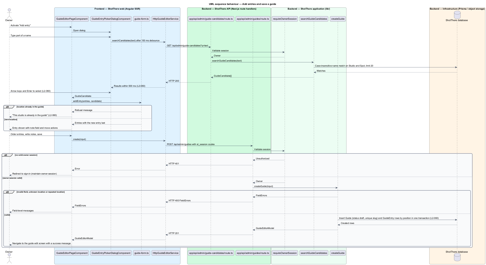
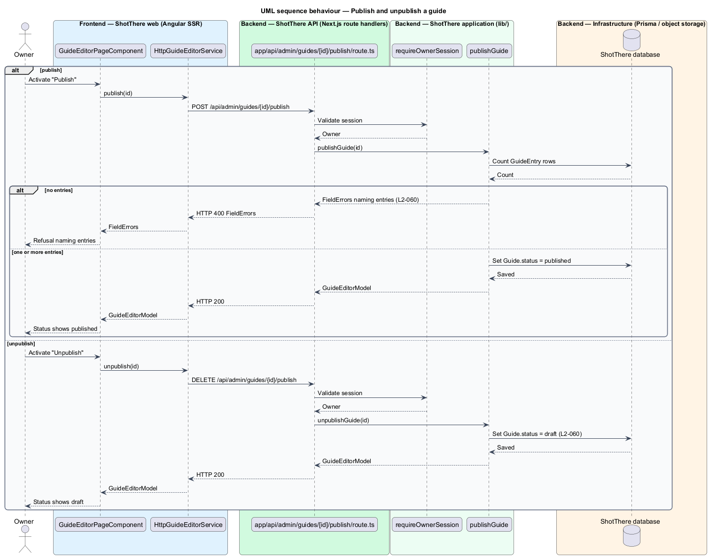

# Create, edit and publish a guide

## Overview

ShotThere reviews studios and outdoor spots in Toronto. A *guide* is an editorial article that collects reviewed locations around a theme, such as studios for small product shoots. Each guide has a title, a slug, an introduction and an ordered list of entries. A *guide entry* is one reference to a studio or spot, carrying an *editor's note*: a short owner-written explanation of why the location belongs in the guide.

The *guide editor* is an owner-only screen for creating a guide or changing an existing one. It is a screen of its own, reached from the dashboard or an administration list, because the project rules forbid inline forms in pages. New guides save in `draft` status, meaning visitors cannot see them.

Entries are added through the *entry picker*: a dialog with a search box that lists matching studios and spots as the owner types. A location may appear only once in a guide. The owner orders entries with move-up and move-down actions.

The owner publishes and unpublishes a guide from the same screen. A guide with no entries cannot be published. Studio and spot publishing belongs to `publish-and-unpublish-location`; guide publishing is designed here. Deletion belongs to `delete-content` and unsaved-changes protection to `protect-unsaved-changes`. Access requires an owner session from `owner-access/maintain-owner-session`.

## Description

- **`GuideEditorPageComponent`** — standalone Angular page in `frontend/src/app/features/admin/guide-editor/`. It serves the new-guide and edit paths, with paths and titles from the central app paths. It shows title, slug, introduction and the entry list with note fields, move actions, remove actions, and "Publish" or "Unpublish" by status.
- **`guide-form.ts`** — plain TypeScript beside the page. It builds the typed form model and maps it to and from `GuideInput`. It also adds, moves and removes entries and refuses a duplicate location with "This studio is already in the guide" or the spot equivalent.
- **`GuideEntryPickerDialogComponent`** — standalone dialog in the same folder, opened with the UI framework's accessible dialog primitive. It holds a combobox; arrow keys move through results, Enter selects, and Escape closes. It debounces typing by 150 ms and returns the chosen `GuideCandidate`.
- **`guide-editor-messages.ts`** — i18n-marked messages and mapping of server `FieldErrors` (from `edit-studio`), including the publish refusal naming `entries`.
- **`GuideEditorService`** — abstract class in `libs/api/src/guide-editor.service.ts` and its own DI token. It declares `get(id)`, `create(input)`, `update(id, input)`, `searchCandidates(text)`, `publish(id)` and `unpublish(id)`.
- **`HttpGuideEditorService`** — implementation in `libs/api/src/http-guide-editor.service.ts`. The app registers `{ provide: GuideEditorService, useClass: HttpGuideEditorService }`.
- **`GuideInput`, `GuideEntryInput`, `GuideEditorModel`, `GuideCandidate`** — DTO types in `libs/api`, one file each. An entry carries `kind` (`studio` or `spot`), `locationId`, `note` and `position`.
- **`app/api/admin/guides/route.ts`** — `POST` create. **`app/api/admin/guides/[id]/route.ts`** — `GET` and `PUT`. **`app/api/admin/guides/[id]/publish/route.ts`** — `POST` publishes, `DELETE` unpublishes. **`app/api/admin/guide-candidates/route.ts`** — `GET ?q=` search. Each calls `requireOwnerSession` first and returns HTTP 401 without a valid `st_session` cookie.
- **`lib/guides/schemas.ts`** — zod `guideInputSchema`. It requires a title, a slug in URL-safe form, entries with a known `kind`, and no repeated `kind` and `locationId` pair.
- **`lib/guides/create-guide.ts` and `lib/guides/update-guide.ts`** — validate, confirm every referenced studio or spot exists, and write `Guide` and `GuideEntry` rows in order in one transaction. Create sets `status` to `draft` and resolves slug collisions with `assignUniqueSlug` from `edit-studio`.
- **`lib/guides/get-guide-for-edit.ts`** — reads one guide of any status with entries and location names.
- **`lib/guides/search-guide-candidates.ts`** — case-insensitive name match across `Studio` and `Spot`, draft and published, limited to 20 results. It returns within the 500 ms budget; an index on name supports it.
- **`lib/guides/publish-guide.ts`** — `publishGuide` refuses with `FieldErrors` naming `entries` when the guide has none, otherwise sets `published`; `unpublishGuide` sets `draft`. Public cache refresh follows the same mechanism as `publish-and-unpublish-location`.
- **Prisma models** — `Guide` (title, slug, introduction, status) and `GuideEntry` (guide, studio or spot reference, note, position), with a unique constraint on guide and location.

## Requirements

The feature realizes the following level-2 (L2) requirement, which refines the cited level-1 (L1) requirement.

| L2 ID | Refines (L1) | Requirement |
|-------|--------------|-------------|
| `L2-060` | `L1-014` | The owner shall be able to create and edit guides with a title, slug, introduction and an ordered list of entries, each referencing a studio or spot and carrying an editor's note, and publish or unpublish them. A new guide shall save in `draft` status with entries in the chosen order; a repeated location shall be refused; publishing a guide with no entries shall be refused naming `entries`; the entry picker shall list matching studios and spots within 500 ms and be keyboard selectable. |

## Diagrams

### System context

The owner composes and publishes guides in ShotThere; no external system takes part.

### Containers

The web app sends guide input, candidate searches and publish requests to the API, which reads and writes the database.

### Components

The page and the picker dialog use one service contract. Four route files check the session and delegate to the guide functions.

### Class structure

`GuideInput` composes ordered `GuideEntryInput` rows; the picker returns a `GuideCandidate` that becomes a new entry.

### Behaviour — add entries and save

The picker searches as the owner types and refuses a repeated location before it reaches the list. The server repeats the duplicate check and saves the entries in order.

### Behaviour — publish and unpublish

The server refuses to publish a guide with no entries and names `entries`; otherwise it changes the status.

