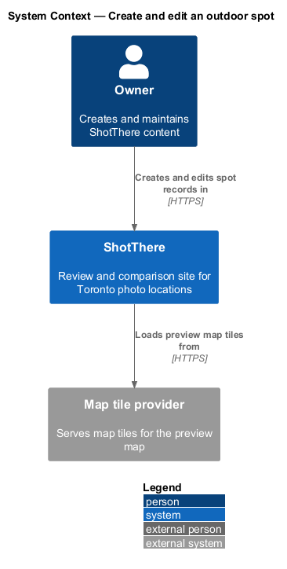
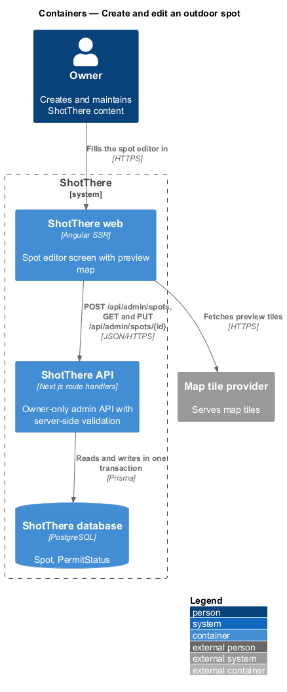
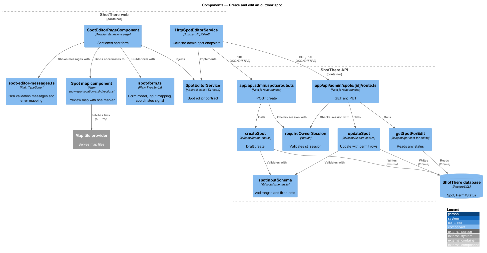
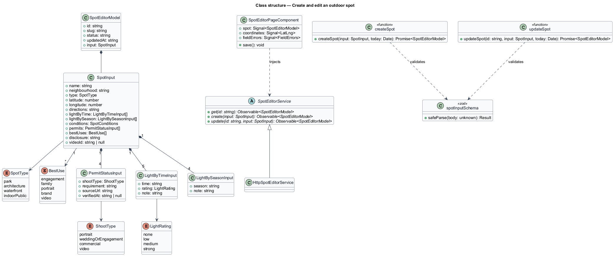
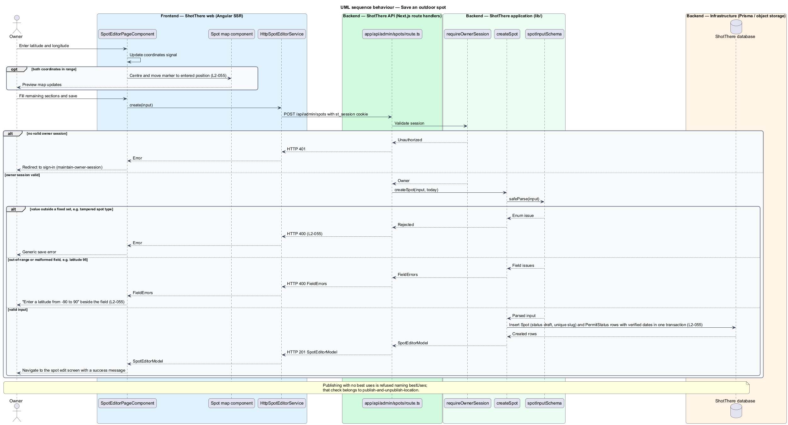

# Create and edit an outdoor spot

## Overview

ShotThere reviews places to shoot photos in Toronto, including free outdoor locations. An *outdoor spot* is a public place reviewed for photography, such as a park, a building exterior, a waterfront or an indoor public space. The *owner* is the single signed-in person who maintains all content.

The *spot editor* is an owner-only screen for creating a spot record or changing an existing one. It is a screen of its own, reached from the dashboard or an administration list, because the project rules forbid inline forms in pages. New spots save in `draft` status, meaning visitors cannot see them.

The form covers basics, coordinates, directions, light by time of day and season, practical conditions, permit status, best uses, disclosure and video ID. *Permit status* is a per-shoot-type statement of whether a permit is needed, with a link to the official source and the date the owner last verified it. The shoot types are portrait, wedding or engagement, commercial and video. *Best uses* are the photography types the spot suits, chosen from a fixed set: engagement, family, portrait, brand and video.

The server is the authority for every rule. It rejects values outside fixed sets with HTTP 400 and refuses out-of-range values with field-level messages. A *preview map* beside the coordinates shows the entered position as the owner types.

Other features own adjacent parts of the screen: `upload-and-arrange-images` (sample shots), `set-episode-video` (video ID validation), `publish-and-unpublish-location` (including the `bestUses` publish check), `delete-content` and `protect-unsaved-changes`. Access requires an owner session from `owner-access/maintain-owner-session`.

## Description

- **`SpotEditorPageComponent`** — standalone Angular page in `frontend/src/app/features/admin/spot-editor/`. It serves the new-spot and edit paths, with paths and titles from the central app paths. It groups the form under collapsible section headings and lays out one column at XS.
- **`spot-form.ts`** — plain TypeScript beside the page. It builds the typed form model, maps a `SpotEditorModel` into the form and back into a `SpotInput`, and exposes the coordinates as a signal.
- **`spot-editor-messages.ts`** — plain TypeScript beside the page with i18n-marked messages such as "Enter a latitude from -90 to 90". It maps server field errors onto form controls.
- **Preview map** — the spot map component from `outdoor-spots/show-spot-location-and-directions`, bound to the coordinates signal. It re-centres and moves its single marker whenever both coordinates are valid. It draws tiles from the map tile provider; the provider is `<TO SUPPLY>`.
- **`SpotEditorService`** — abstract class in `libs/api/src/spot-editor.service.ts` and its own DI token. It declares `get(id)`, `create(input)` and `update(id, input)`.
- **`HttpSpotEditorService`** — implementation in `libs/api/src/http-spot-editor.service.ts`. It calls `POST /api/admin/spots`, `GET /api/admin/spots/{id}` and `PUT /api/admin/spots/{id}` with credentials. The app registers `{ provide: SpotEditorService, useClass: HttpSpotEditorService }`.
- **`SpotInput`, `PermitStatusInput`, `LightByTimeInput`, `LightBySeasonInput`, `SpotEditorModel`, `SpotType`, `BestUse`, `ShootType`** — DTO and enum types in `libs/api`, one file each. `FieldErrors` comes from `edit-studio`.
- **`app/api/admin/spots/route.ts`** — `POST` handler for create. **`app/api/admin/spots/[id]/route.ts`** — `GET` and `PUT` handlers. Each calls `requireOwnerSession` first and returns HTTP 401 without a valid `st_session` cookie. Values outside a fixed set return HTTP 400; range and format errors return HTTP 400 with `FieldErrors`.
- **`lib/spots/schemas.ts`** — zod `spotInputSchema`. It limits latitude to -90 to 90 and longitude to -180 to 180. It uses `z.enum` for spot type (park, architecture, waterfront, indoor public), best uses, shoot types, light ratings (none, low, medium, strong) and crowd ratings (low, medium, high). It requires `http` or `https` permit source links and refuses a future permit verified date. Draft saves accept an empty `bestUses`.
- **`lib/spots/create-spot.ts`** — validates, assigns a unique slug with `lib/slugs/assign-unique-slug.ts` from `edit-studio`, sets `status` to `draft` and writes `Spot` and `PermitStatus` rows in one transaction. Each permit verified date defaults to today unless supplied.
- **`lib/spots/update-spot.ts`** — validates and updates the spot and its `PermitStatus` rows in one transaction. It writes a permit verified date only when the input carries it. When the spot is already published, it calls `lib/publishing/check-publishable.ts` and refuses a save that removes a standard-data-set field. The same `PUT` body carries the video field and image order and alt text, applied by `applyImageOrder` from `upload-and-arrange-images`. Publishing itself uses `app/api/admin/spots/[id]/publish/route.ts`.
- **`lib/spots/get-spot-for-edit.ts`** — reads one spot of any status with its permit rows.
- **Prisma models** — `Spot` (coordinates, directions, light, conditions, best uses, disclosure, video ID, status, slug) and `PermitStatus` (shoot type, requirement, source URL, verified date). `permitStale` stays server-computed.
- **Permit requirement values** — "Required" and "Not required" come from the spot page requirements; any further value is `<TO SUPPLY>`.

## Requirements

The feature realizes the following level-2 (L2) requirement, which refines the cited level-1 (L1) requirement.

| L2 ID | Refines (L1) | Requirement |
|-------|--------------|-------------|
| `L2-055` | `L1-014` | The owner shall be able to create and edit an outdoor spot through a form covering basics, coordinates, directions, light by time and season, practical conditions, permit status per shoot type with source link and verified date, best uses, disclosure and video ID. An out-of-range latitude shall be refused with a field message, a value outside a fixed set shall be rejected with HTTP 400, publishing without best uses shall be refused naming `bestUses`, and a preview map shall follow the entered coordinates. |

## Diagrams

### System context

The owner maintains spot records in ShotThere. The preview map loads tiles from the map tile provider.

### Containers

The web app sends spot input to the API, which validates it and writes the spot and its permit rows. The browser fetches map tiles directly from the tile provider.

### Components

The page uses plain TypeScript helpers for form mapping and messages, and binds the preview map to the coordinates signal. Both route files check the session and delegate to the spot functions, which share one zod schema.

### Class structure

`SpotInput` composes permit rows and light ratings and refers to the fixed-set enums. The service contract returns `SpotEditorModel` on success.

### Behaviour — save a spot

The preview map follows valid coordinates as the owner types. On save, the server rejects tampered enum values with HTTP 400 and out-of-range values with field messages, then writes the spot as a draft.

