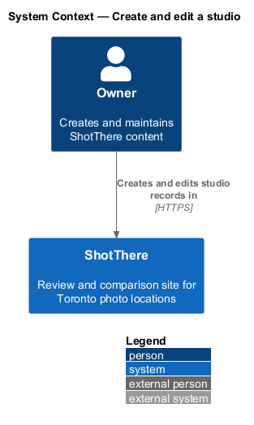
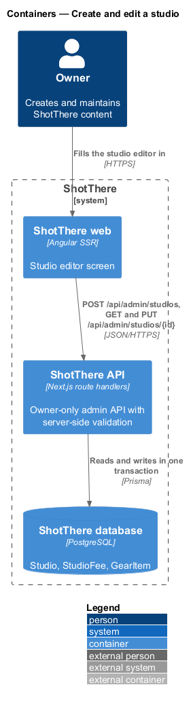
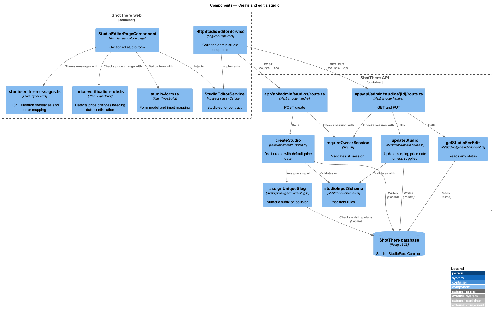
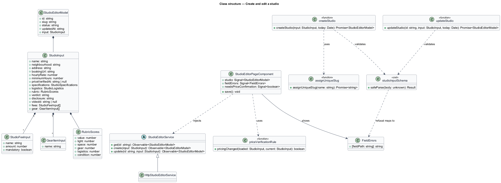
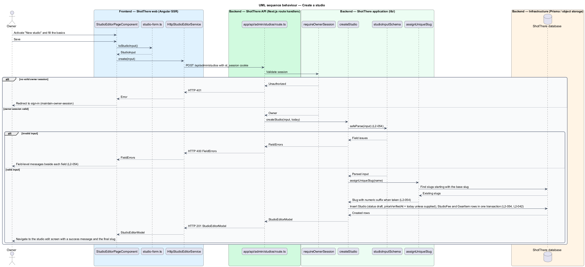
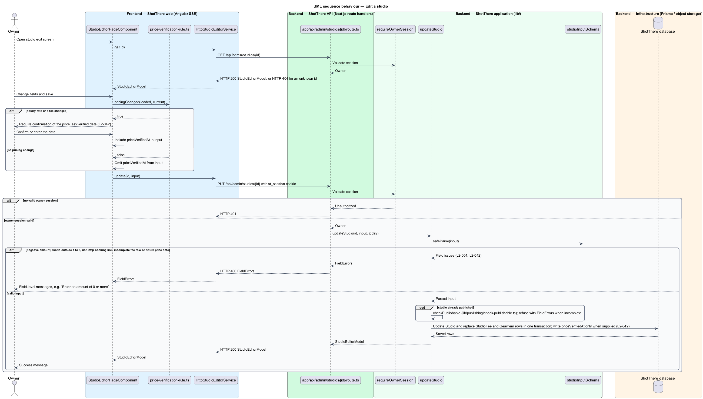

# Create and edit a studio

## Overview

ShotThere reviews rental photo studios in Toronto. The *owner* is the single signed-in person who maintains all content. A *studio record* is the stored review of one rental studio: basics, pricing and fees, measured specifications, gear, logistics, rubric scores, verdict, disclosure and video ID.

The *studio editor* is an owner-only screen for creating a studio record or changing an existing one. It is a screen of its own, reached from the dashboard or an administration list, because the project rules forbid inline forms in pages. New studios save in `draft` status, meaning visitors cannot see them.

The server is the authority for every rule. It validates each save and returns *field-level messages*: one message per invalid field, shown beside that field. Examples include a negative hourly rate, a rubric score outside 1 to 5, and a booking link that is not an `http` or `https` URL.

A *slug* is the URL-safe name that identifies a studio in public addresses. On create, the server derives the slug from the name and appends a numeric suffix when the slug is already taken.

The *price last-verified date* is the date the owner last confirmed the studio's prices. It defaults to the creation date, changes only when the owner sets it, and cannot lie in the future. When the owner edits the hourly rate or fees, the editor asks the owner to confirm that date before saving.

Other features own adjacent parts of the screen: `upload-and-arrange-images` (gallery and test shots), `set-episode-video` (video ID validation), `publish-and-unpublish-location`, `delete-content` and `protect-unsaved-changes`. Access requires an owner session from `owner-access/maintain-owner-session`.

## Description

- **`StudioEditorPageComponent`** — standalone Angular page in `frontend/src/app/features/admin/studio-editor/`. It serves both the new-studio path and the edit path, with paths and titles from the central app paths. It groups the form under collapsible section headings: Basics, Pricing and fees, Specifications, Gear, Logistics, Rubric, Verdict, Disclosure and Video. At XS the form is one column and every control is at least 24px tall.
- **`studio-form.ts`** — plain TypeScript beside the page. It builds the typed Angular form model, maps a `StudioEditorModel` into the form and back into a `StudioInput`, and adds or removes fee and gear rows.
- **`studio-editor-messages.ts`** — plain TypeScript beside the page holding i18n-marked validation messages, such as "Enter an amount of 0 or more" and "Enter a whole number from 1 to 5". It maps server field errors onto form controls.
- **`price-verification-rule.ts`** — plain TypeScript beside the page. It reports whether `hourlyRate` or any fee changed since load. When it does, the editor requires the owner to confirm `priceVerifiedAt` before saving.
- **`StudioEditorService`** — abstract class in `libs/api/src/studio-editor.service.ts` and its own DI token. It declares `get(id)`, `create(input)` and `update(id, input)`.
- **`HttpStudioEditorService`** — implementation in `libs/api/src/http-studio-editor.service.ts`. It calls `POST /api/admin/studios`, `GET /api/admin/studios/{id}` and `PUT /api/admin/studios/{id}` with credentials. The app registers `{ provide: StudioEditorService, useClass: HttpStudioEditorService }`.
- **`StudioInput`, `StudioFeeInput`, `GearItemInput`, `StudioEditorModel`, `FieldErrors`** — DTO types in `libs/api`, one file each. `FieldErrors` maps a field path such as `fees.0.amount` to a message.
- **`app/api/admin/studios/route.ts`** — `POST` handler for create. **`app/api/admin/studios/[id]/route.ts`** — `GET` and `PUT` handlers. Each calls `requireOwnerSession` first and returns HTTP 401 without a valid `st_session` cookie. Invalid input returns HTTP 400 with `FieldErrors`; an unknown id returns HTTP 404.
- **`lib/studios/schemas.ts`** — zod `studioInputSchema`. It enforces amounts of 0 or more, rubric scores as whole numbers from 1 to 5, `http` or `https` booking links, and fee rows with a name, an amount and a mandatory flag. It also refuses a `priceVerifiedAt` after today. Draft saves require only the basics; the standard data set is checked at publish time by `publish-and-unpublish-location`.
- **`lib/studios/create-studio.ts`** — validates, assigns a unique slug, sets `status` to `draft` and sets `priceVerifiedAt` to today unless the owner supplied a date. It writes `Studio`, `StudioFee` and `GearItem` rows in one transaction.
- **`lib/studios/update-studio.ts`** — validates and replaces the studio's fields, fees and gear in one transaction. It writes `priceVerifiedAt` only when the input carries it, so unrelated edits keep the stored date. When the studio is already published, it calls `lib/publishing/check-publishable.ts` and refuses a save that removes a standard-data-set field. The same `PUT` body carries the video field and image order and alt text, applied by `applyImageOrder` from `upload-and-arrange-images`.
- **`lib/studios/get-studio-for-edit.ts`** — reads one studio of any status with its fees and gear.
- **`lib/slugs/assign-unique-slug.ts`** — derives a slug from the name and appends `-2`, `-3` and onward until no row holds it.
- **Prisma models** — `Studio` (including `slug`, `status`, `priceVerifiedAt`, six rubric score columns), `StudioFee` (name, amount, mandatory flag, order) and `GearItem`. `allInCost2h` and `overallScore` stay server-computed and are not editable.
- **Field list** — the exact column list for specifications and logistics follows the studio page requirements in `docs/specs/L2.md`; units for space and ceiling height are `<TO SUPPLY>`.

## Requirements

The feature realizes the following level-2 (L2) requirements. Each refines the cited level-1 (L1) requirement.

| L2 ID | Refines (L1) | Requirement |
|-------|--------------|-------------|
| `L2-054` | `L1-014` | The owner shall be able to create and edit a studio through a form covering basics, pricing and fees, measured specifications, gear, logistics, rubric scores, verdict, disclosure and video ID, with server-side validation and field-level messages. A new studio shall save in `draft` status; a slug collision on create shall resolve with a numeric suffix shown to the owner; at XS the form shall be one column under collapsible section headings with controls at least 24px tall. |
| `L2-042` | `L1-010` | Studio pricing shall store a last-verified date that the owner sets explicitly, that defaults to the date of creation, and that unrelated edits do not change. Editing the hourly rate shall require confirmation of that date, and a future date shall be refused. |

## Diagrams

### System context

The owner maintains studio records in ShotThere; no external system takes part in this slice.

### Containers

The web app sends studio input to the API, which validates it and writes the studio, its fees and its gear to the database.

### Components

The page uses plain TypeScript helpers for form mapping, messages and the price rule. On the server, both route files check the session and delegate to the studio functions, which share one zod schema.

### Class structure

`StudioInput` composes fee and gear rows. The service contract returns `StudioEditorModel` on success and `FieldErrors` on refusal.

### Behaviour — create a studio

The server validates the basics, assigns a unique slug, saves the studio as a draft with today's price date, and the page moves to the edit screen.

### Behaviour — edit a studio

A price change prompts the owner to confirm the price date. The server refuses invalid input with field-level messages and keeps the stored price date when the input omits it.

