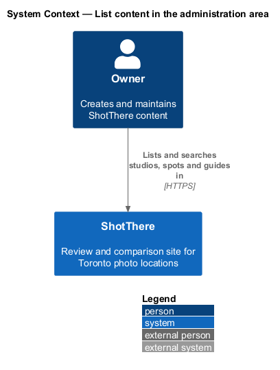
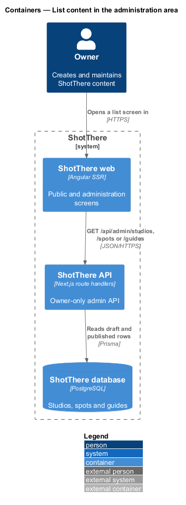
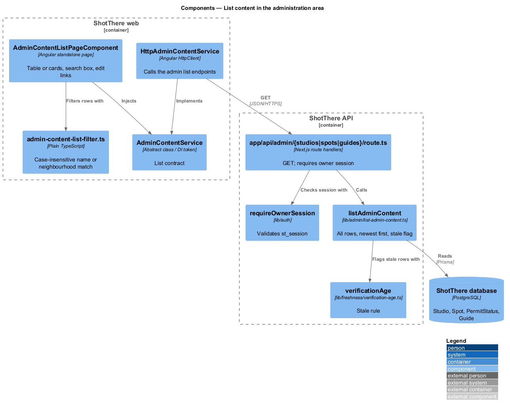
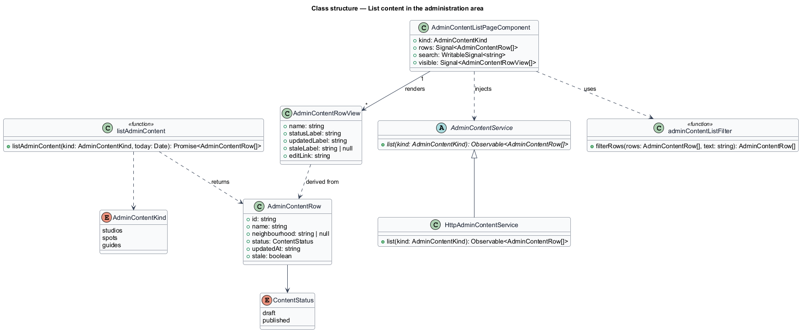
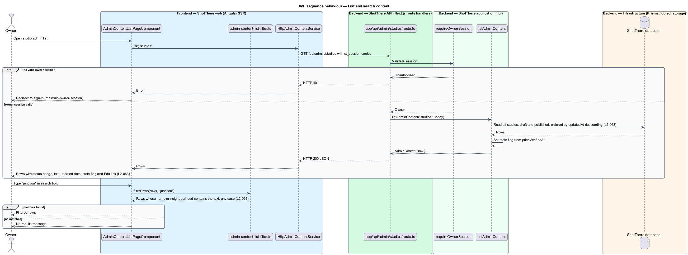

# List content in the administration area

## Overview

ShotThere is a review site for Toronto photo locations. The *owner* is the single signed-in person who maintains all content through the *administration area*, a set of owner-only screens.

An *administration list screen* is an owner-only screen that lists every item of one content type, published or draft. Three such screens exist: studios, outdoor spots and guides. Each row shows the item's name, status, last-updated date and stale flag, with a link to its editor.

The *status* of an item is either `draft` (saved, hidden from visitors) or `published` (visible to visitors). A *stale flag* marks a studio whose price data, or a spot whose permit data, was last verified more than 183 days ago. Guides carry no verification date and show no stale flag.

A search box narrows the list to items whose name or neighbourhood contains the typed text, ignoring case. The editor screens belong to `edit-studio`, `edit-outdoor-spot` and `edit-guide`. Access requires an owner session from `owner-access/maintain-owner-session`.

## Description

- **`AdminContentListPageComponent`** — standalone Angular page in `frontend/src/app/features/admin/content-list/`. One component serves all three lists; the route data supplies the `AdminContentKind`. It holds rows and the search text in signals and renders a table at wider breakpoints and one card per row at XS.
- **`admin-content-list-filter.ts`** — plain TypeScript beside the page. It filters loaded rows by case-insensitive substring match on name or neighbourhood. The full list loads once per screen, so filtering runs in the browser.
- **`AdminContentRowView`** — view model type beside the page with the status badge label, formatted last-updated date, stale flag label and edit link built from the central app paths.
- **`AdminContentService`** — abstract class in `libs/api/src/admin-content.service.ts` and its own DI token. It declares `list(kind: AdminContentKind): Observable<AdminContentRow[]>`.
- **`HttpAdminContentService`** — implementation in `libs/api/src/http-admin-content.service.ts`. It calls `GET /api/admin/studios`, `GET /api/admin/spots` or `GET /api/admin/guides` with credentials. The app registers `{ provide: AdminContentService, useClass: HttpAdminContentService }`.
- **`AdminContentRow`, `AdminContentKind`** — DTO types in `libs/api`, one file each. A row carries `id`, `name`, `neighbourhood` (null for guides), `status`, `updatedAt` and `stale`.
- **Routes** — three entries in `features/admin/routes.ts`, one per kind, with paths and titles from the central app paths and the owner route guard from `maintain-owner-session`.
- **`app/api/admin/studios/route.ts`, `app/api/admin/spots/route.ts`, `app/api/admin/guides/route.ts`** — Next.js `GET` handlers. Each calls `requireOwnerSession` and returns HTTP 401 without a valid `st_session` cookie. The same files hold the `POST` handlers designed in the editor features.
- **`lib/admin/list-admin-content.ts`** — application function. It reads every row of the requested kind, draft and published, sorted by `updatedAt` descending. It sets `stale` with `lib/freshness/verification-age.ts` from `view-admin-dashboard`.
- **Prisma models** — `Studio`, `Spot`, `PermitStatus` and `Guide`, read only.

## Requirements

The feature realizes the following level-2 (L2) requirement, which refines the cited level-1 (L1) requirement.

| L2 ID | Refines (L1) | Requirement |
|-------|--------------|-------------|
| `L2-063` | `L1-014` | The administration area shall list studios, spots and guides with status, last-updated date, stale flags and a search box, with links to edit. Lists shall sort by last updated, newest first; search shall match name or neighbourhood without regard to case; at XS each row shall be a card showing name, status and stale flag with an "Edit" action. |

## Diagrams

### System context

The owner browses content lists inside ShotThere; no external system takes part.

### Containers

The web app requests one list per content type from the API, which reads all rows from the database.

### Components

One page component serves the three lists through one service contract. Each route handler checks the owner session and delegates to `listAdminContent`.

### Class structure

The page holds `AdminContentRow` values from the service and derives `AdminContentRowView` values through the filter and view model.

### Behaviour — list and search content

The handler returns every row sorted newest first. Typing in the search box filters the loaded rows in the browser without another request.

