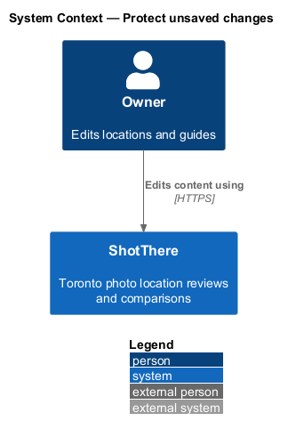
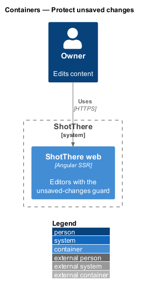
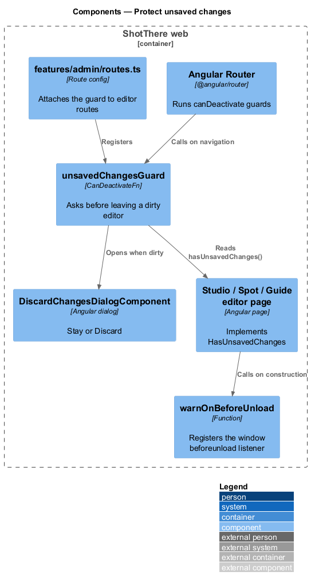
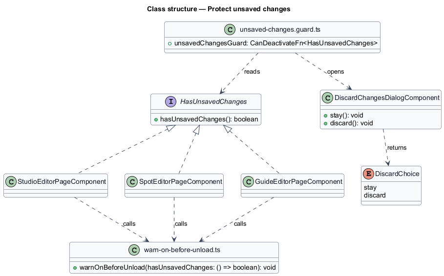
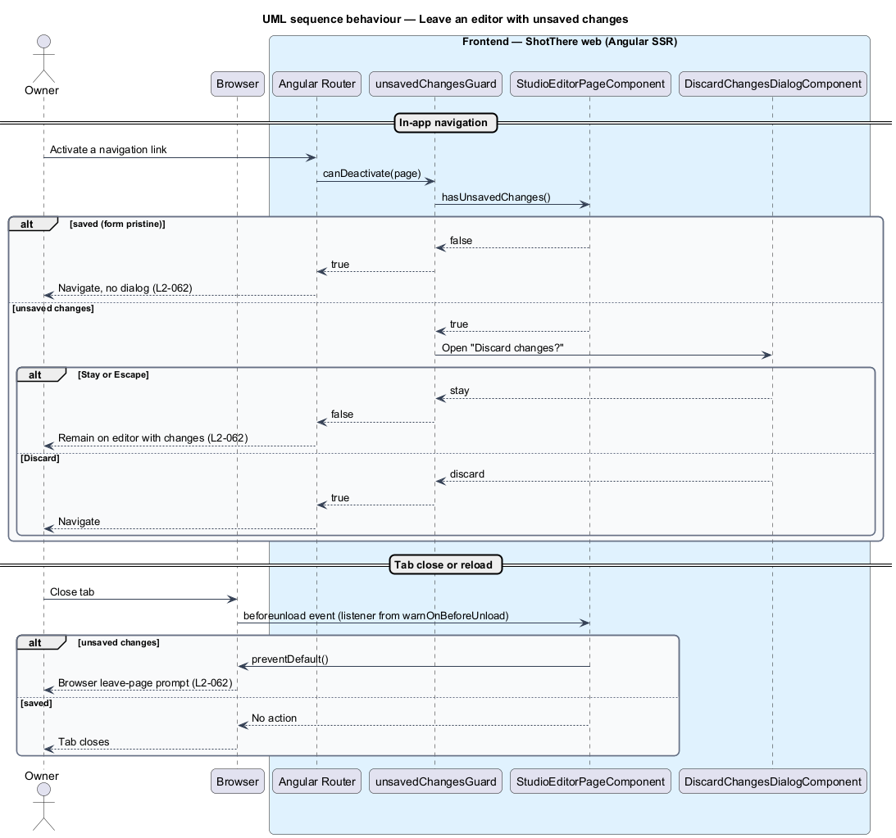

# Protect unsaved changes

## Overview

The owner edits studios, outdoor spots and guides in editor pages. An edit is
lost if the owner leaves the page before saving.

- **unsaved change** — edit to an editor field that differs from the last saved state
- **in-app navigation** — route change inside the Angular app, such as activating a link
- **leave-page prompt** — confirmation the browser itself shows before a tab closes or reloads

This feature warns the owner before either kind of departure while unsaved
changes exist. For in-app navigation, a dialog offers "Stay" or "Discard". For
closing or reloading the tab, the browser shows its own leave-page prompt.

The feature is frontend only and makes no API call. The editors it protects
belong to the `edit-studio`, `edit-outdoor-spot` and `edit-guide` designs.

## Description

Frontend (`frontend/`):

- **`HasUnsavedChanges`** (`core/navigation/has-unsaved-changes.ts`) — interface with `hasUnsavedChanges(): boolean`. Each editor page implements it, returning `true` while its form is dirty and not yet saved.
- **`unsavedChangesGuard`** (`core/navigation/unsaved-changes.guard.ts`) — `CanDeactivateFn<HasUnsavedChanges>`. It returns `true` when nothing is unsaved. Otherwise it opens `DiscardChangesDialogComponent` and returns an `Observable<boolean>` of the choice.
- **`DiscardChangesDialogComponent`** (`core/navigation/`) — accessible dialog built on the UI framework's dialog primitive, with i18n-marked text. "Stay" and Escape keep the owner on the editor; "Discard" allows navigation (L2-062).
- **`warnOnBeforeUnload`** (`core/navigation/warn-on-before-unload.ts`) — called in an editor's injection context with a `hasUnsavedChanges` callback. It adds a `window` `beforeunload` listener that calls `preventDefault()` while changes are unsaved, and removes it through `DestroyRef`. It does nothing during server rendering.
- **Route registration** — `features/admin/routes.ts` adds `canDeactivate: [unsavedChangesGuard]` to each editor route.
- **Editor integration** — after a successful save, each editor marks its form pristine, so a later navigation shows no dialog.

## Requirements

The feature realizes the following level-2 (L2) requirement, which refines the
level-1 (L1) requirement cited.

| L2 ID | Refines (L1) | Requirement |
|-------|--------------|-------------|
| `L2-062` | `L1-014` | Editors shall warn the owner before navigating away with unsaved changes. |

## Diagrams

### System context

Only the owner and ShotThere take part. The behaviour stays inside the
browser.

### Containers

The web app alone carries the feature. The C4 component view below holds the
detail.

### Components

The router runs `unsavedChangesGuard`, which reads the editor and opens the
dialog. Each editor registers the `beforeunload` listener.

### Class structure

The three editor pages implement `HasUnsavedChanges`. The guard depends only on
that interface.

### Behaviour — leave an editor with unsaved changes

In-app navigation goes through the guard and dialog. Closing the tab goes
through the `beforeunload` listener and the browser prompt.

