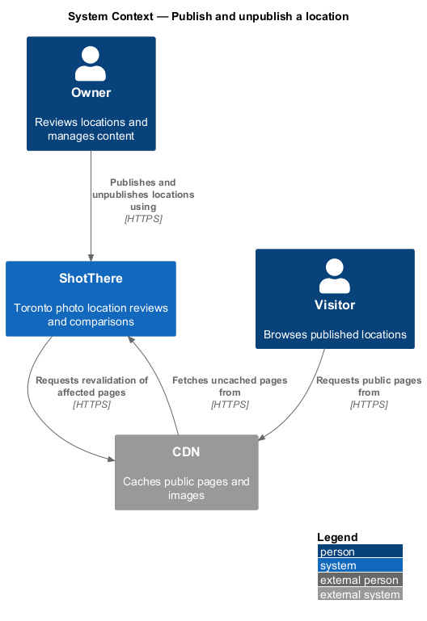
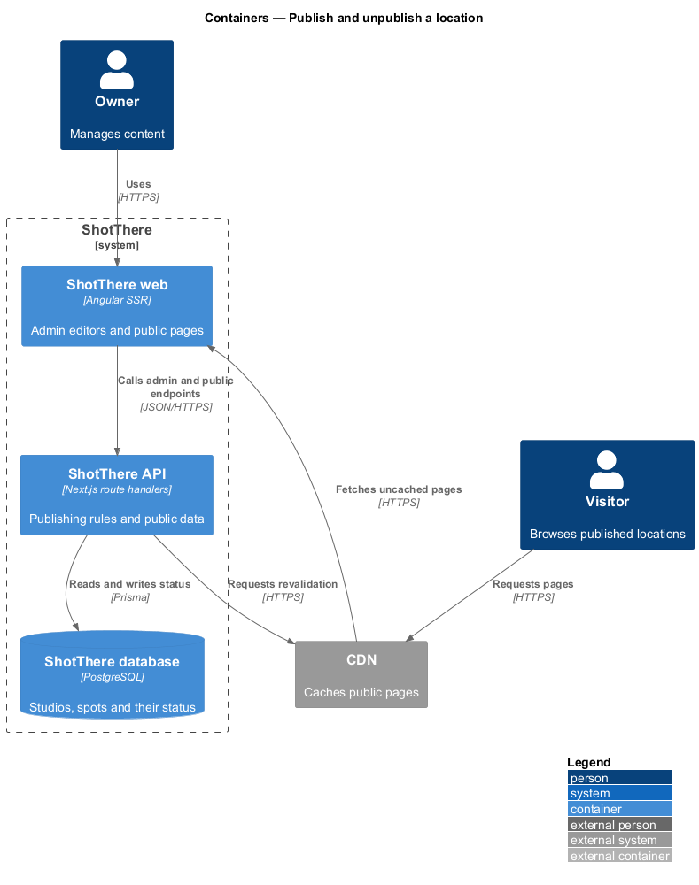
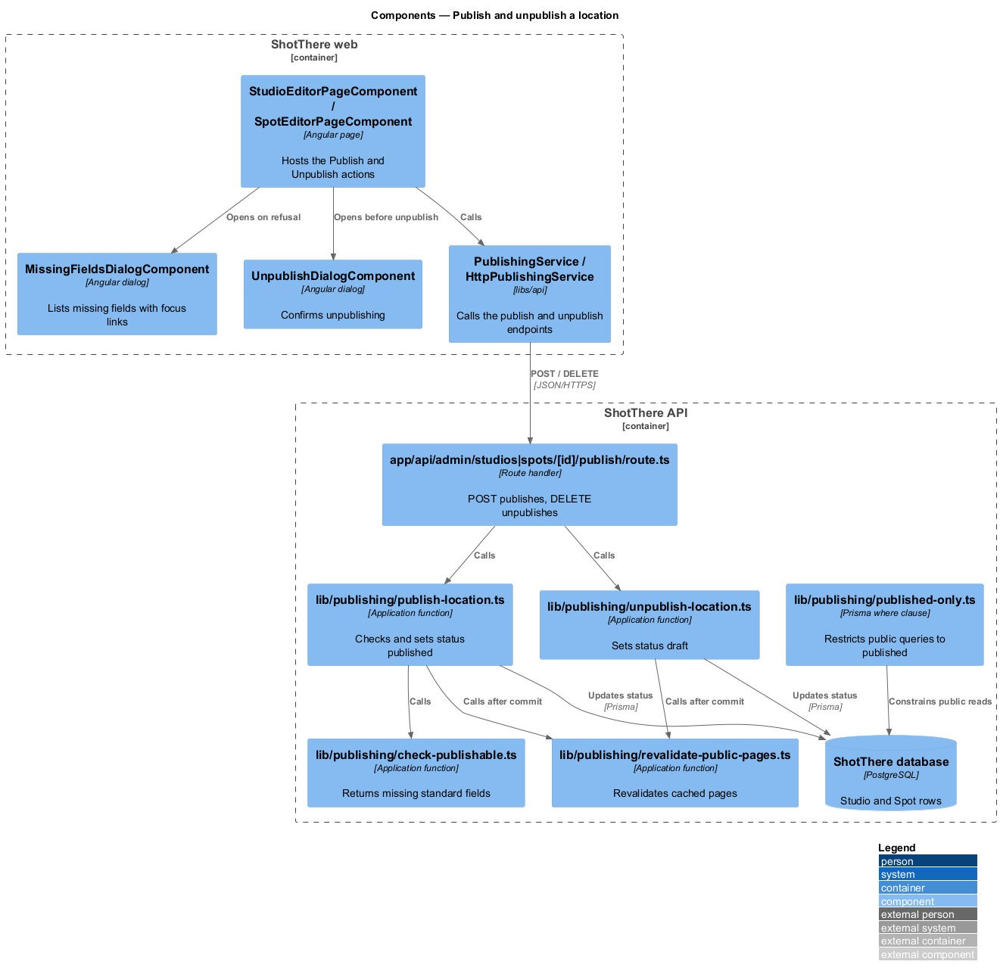
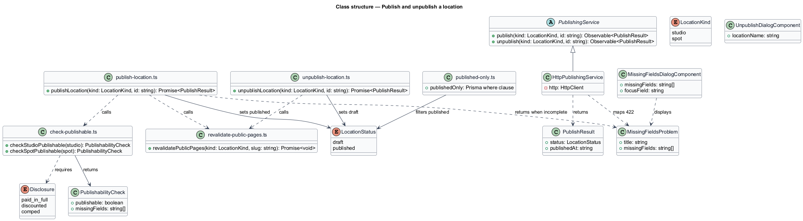
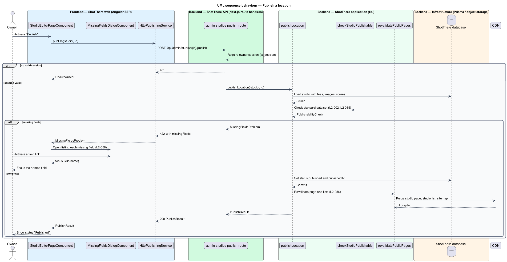
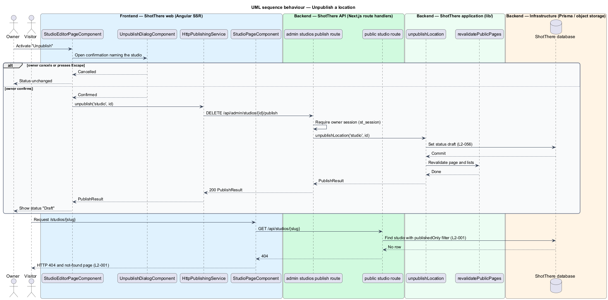

# Publish and unpublish a location

## Overview

ShotThere lists Toronto photo locations that the owner has shot first-hand. A
*location* is either a studio or an outdoor spot. Each location carries a
status:

- **draft** — location status in which content is hidden from visitors and editable by the owner
- **published** — location status in which content is visible on the public site

This feature moves a location between the two statuses. Publishing is gated by
the *standard data set*.

- **standard data set** — fixed list of fields every location of a kind shall hold before it is published

For studios the set covers identity, pricing, space, light, test and gallery
images, all six rubric scores, verdict and disclosure. For outdoor spots it
covers identity, coordinates, access, light, sample shots, permit details and a
best use.

- **disclosure** — statement of how the owner paid for a visit, one of `paid_in_full`, `discounted` or `comped`

The public site never exposes a draft. Pages and lists sit behind a CDN, so a
status change also triggers revalidation of cached pages.

- **revalidation** — request to the CDN to discard cached copies of the pages a status change affects

The Publish and Unpublish actions sit in the studio and outdoor spot editors,
which the `edit-studio` and `edit-outdoor-spot` designs describe. This feature
adds the actions, the dialogs, the publishing endpoints and the published-only
rule for public reads.

## Description

Frontend (`frontend/`):

- **`PublishingService`** (`libs/api/src/publishing/publishing.service.ts`) — abstract class and DI token with `publish(kind, id)` and `unpublish(kind, id)`.
- **`HttpPublishingService`** (`http-publishing.service.ts`) — calls the publish endpoints. It maps HTTP 422 to a `MissingFieldsProblem`.
- **`MissingFieldsDialogComponent`** (`features/admin/publishing/`) — accessible dialog listing each missing field. Each entry is a link that closes the dialog and focuses the matching editor field (L2-056).
- **`missing-field-labels.ts`** — plain TypeScript map from field key (for example `ceilingHeight`) to an i18n-marked label and the editor control id.
- **`UnpublishDialogComponent`** — confirmation dialog naming the location. Escape and Cancel leave the status unchanged.
- **Editor integration** — `StudioEditorPageComponent` and `SpotEditorPageComponent` show "Publish" on drafts and "Unpublish" on published locations, then reflect the returned status.

Backend (`backend/`):

- **`app/api/admin/studios/[id]/publish/route.ts`** and **`app/api/admin/spots/[id]/publish/route.ts`** — `POST` publishes and `DELETE` unpublishes. Both require the owner session (`st_session`) and return 401 without it.
- **`lib/publishing/check-publishable.ts`** — `checkStudioPublishable` and `checkSpotPublishable` return a `PublishabilityCheck` with the missing field keys, such as `ceilingHeight`, `permitSourceUrl` and `disclosure` (L2-002, L2-045).
- **`lib/publishing/publish-location.ts`** — `publishLocation(kind, id)` loads the location with relations, runs the check, and either returns a `MissingFieldsProblem` (HTTP 422) or sets `status = 'published'` and `publishedAt`.
- **`lib/publishing/unpublish-location.ts`** — `unpublishLocation(kind, id)` sets `status = 'draft'`.
- **`lib/publishing/revalidate-public-pages.ts`** — `revalidatePublicPages(kind, slug)` requests revalidation of the location page, its kind's list, the map data, comparisons, guides and the sitemap. The CDN purge interface is `<TO SUPPLY>`. Public lists carry a cache lifetime of at most 60 seconds, so a missed purge still converges within the L2-056 limit.
- **`lib/publishing/published-only.ts`** — `publishedOnly`, the Prisma `where` fragment `{ status: 'published' }`. Every public read in `lib/studios`, `lib/spots`, `lib/guides`, the sitemap and structured data applies it (L2-001). A missing row yields HTTP 404.
- **Save-time guard** — the studio and spot save functions (owned by `edit-studio` and `edit-outdoor-spot`) call the same check when the location is published. A save that clears a standard field is refused with the field named, and the stored value stays (L2-002).
- **Disclosure rule** — `disclosureSchema` in `lib/publishing/schemas.ts` is a zod schema. It accepts `paid_in_full`, `discounted` or `comped` and requires `disclosureProvider` for `discounted` and `comped` (L2-045).

Data (`prisma/schema.prisma`): `Studio` and `Spot` hold `status` (`LocationStatus` enum), `publishedAt`, `disclosure` (`Disclosure` enum) and `disclosureProvider`.

## Requirements

The feature realizes the following level-2 (L2) requirements. Each refines the
level-1 (L1) requirement cited.

| L2 ID | Refines (L1) | Requirement |
|-------|--------------|-------------|
| `L2-056` | `L1-014` | The system shall let the owner publish a draft that meets the standard data set and unpublish a published location, with the public site reflecting the change on the next request. |
| `L2-002` | `L1-001` | The system shall not let a location be published until every field in its standard data set is present, using the studio and outdoor spot sets defined in the specification. |
| `L2-045` | `L1-011` | Every location shall store a disclosure value from the set `paid_in_full`, `discounted`, `comped`, and shall store the provider name for `discounted` and `comped`. Publishing shall require a disclosure. |
| `L2-001` | `L1-001` | The public site shall expose only locations whose status is `published`. Draft locations shall not appear in lists, maps, comparisons, guides, rain-backup lists, sitemaps or structured data, and their pages shall not be reachable by URL. |

## Diagrams

### System context

The owner changes status through ShotThere. Visitors reach public pages through
the CDN, which ShotThere asks to revalidate after each change.

### Containers

The web app calls the API, which writes status to the database and requests
revalidation from the CDN.

### Components

The editors call `PublishingService`. The route handlers delegate to the
`lib/publishing` functions, and `publishedOnly` constrains every public read.

### Class structure

`HttpPublishingService` implements the `PublishingService` contract. The
publish function depends on the check and on revalidation.

### Behaviour — publish a location

The server checks the standard data set. An incomplete location returns HTTP
422 and opens the missing-fields dialog; a complete one is published and its
pages revalidated.

### Behaviour — unpublish a location

After confirmation the location returns to draft. The next visitor request for
its page receives HTTP 404.

