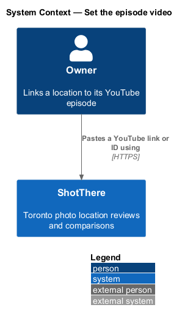
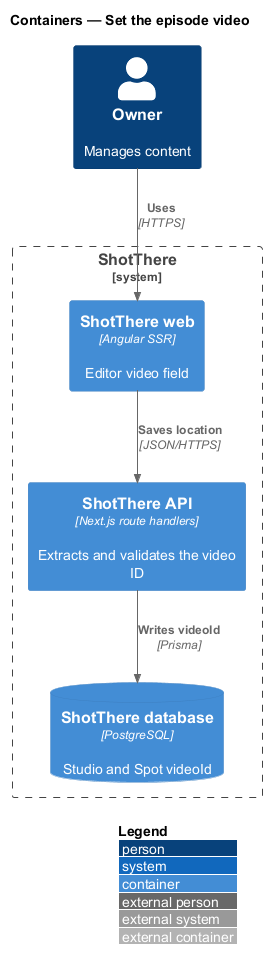
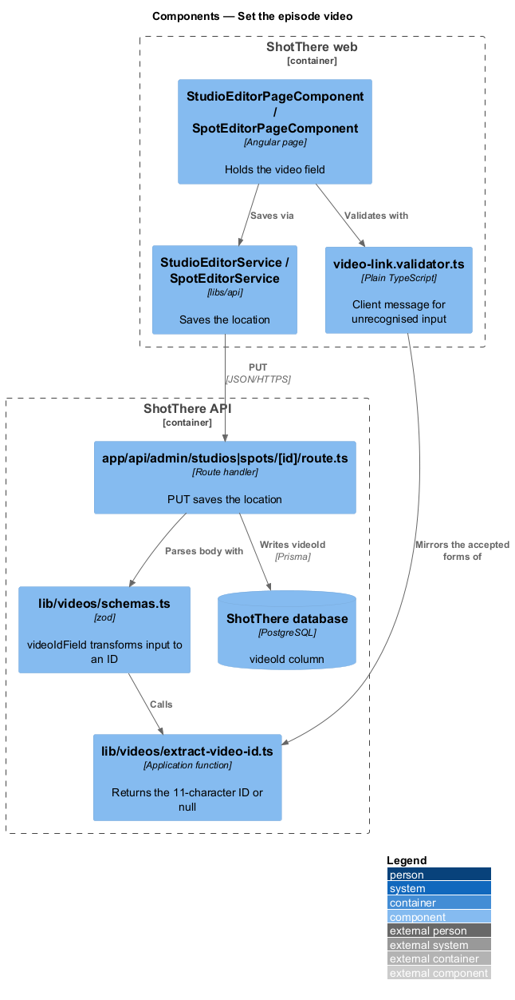
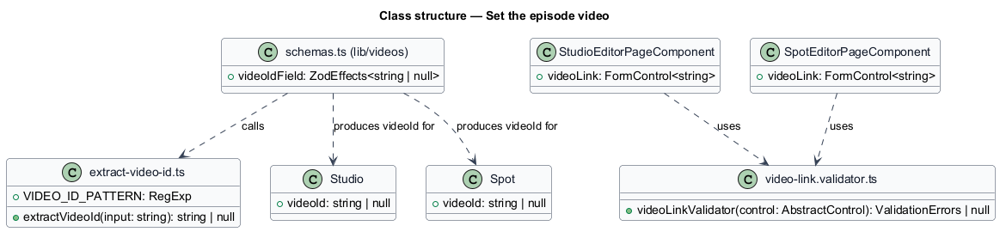
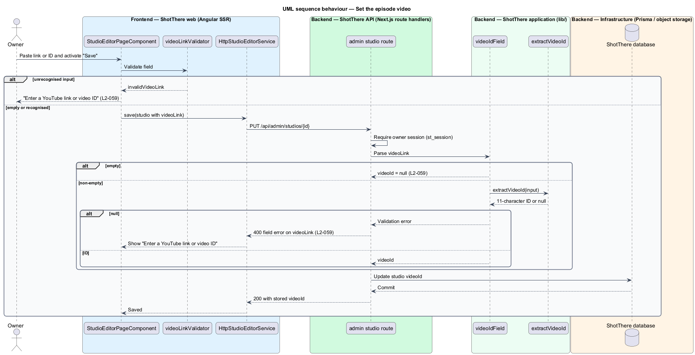

# Set the episode video

## Overview

ShotThere has a companion YouTube channel. Each reviewed location may have an
*episode video*.

- **episode video** — YouTube video in which the owner shoots at a reviewed location
- **video ID** — 11-character YouTube identifier made of letters, digits, `-` and `_`

The owner sets the video by pasting a YouTube URL or a bare video ID into a
field in the studio or outdoor spot editor. The server extracts and stores only
the video ID and rejects any other input. Clearing the field removes the video,
and the public page then shows no video section.

The editors themselves belong to the `edit-studio` and `edit-outdoor-spot`
designs. This feature adds the field rule and the server-side extraction used
by their save endpoints.

## Description

Frontend (`frontend/`):

- **`video-link.validator.ts`** (`features/admin/shared/`) — plain TypeScript Angular validator. It accepts an empty value or a value in an accepted form, and otherwise returns `invalidVideoLink`. The editor shows the i18n-marked message "Enter a YouTube link or video ID".
- **Editor field** — `StudioEditorPageComponent` and `SpotEditorPageComponent` hold a `videoLink` control. Saving goes through the existing `StudioEditorService` and `SpotEditorService` contracts.

Backend (`backend/`):

- **`lib/videos/extract-video-id.ts`** — `extractVideoId(input)` returns the video ID or `null`. Accepted forms:
  - bare ID matching `^[A-Za-z0-9_-]{11}$`
  - `youtube.com/watch?v={id}` on `www.youtube.com`, `youtube.com` or `m.youtube.com`, ignoring other query parameters
  - `youtu.be/{id}`, ignoring query parameters such as `t`
  - Further forms, such as `/shorts/` or `/embed/` paths, are `<TO SUPPLY>`.
- **`lib/videos/schemas.ts`** — zod `videoIdField` trims the input, maps empty to `null`, and otherwise transforms through `extractVideoId`. A `null` result fails with the message "Enter a YouTube link or video ID" (L2-059).
- **Save routes** — `app/api/admin/studios/[id]/route.ts` and `app/api/admin/spots/[id]/route.ts` (owned by the editor designs) include `videoIdField` in their save schemas. They return HTTP 400 with a field error on `videoLink` when parsing fails.

Data (`prisma/schema.prisma`): `Studio.videoId` and `Spot.videoId`, both nullable `String`.

## Requirements

The feature realizes the following level-2 (L2) requirement, which refines the
level-1 (L1) requirement cited.

| L2 ID | Refines (L1) | Requirement |
|-------|--------------|-------------|
| `L2-059` | `L1-014` | The system shall let the owner set a video by pasting a YouTube URL or ID. The server shall extract and store the 11-character video ID and shall reject anything else. |

## Diagrams

### System context

The owner links a location to its episode by pasting a link into ShotThere.
The slice stores only an identifier and makes no call to YouTube.

### Containers

The web app sends the pasted value with the location save. The API extracts the
ID and writes it to the database.

### Components

The save route parses the body with `videoIdField`, which calls
`extractVideoId`. The client validator mirrors the same accepted forms.

### Class structure

The schema field depends on the extraction function. Both editors use the
client validator.

### Behaviour — set the episode video

An empty field stores `null`. A recognised value stores its ID, and any other
value returns a field error.

