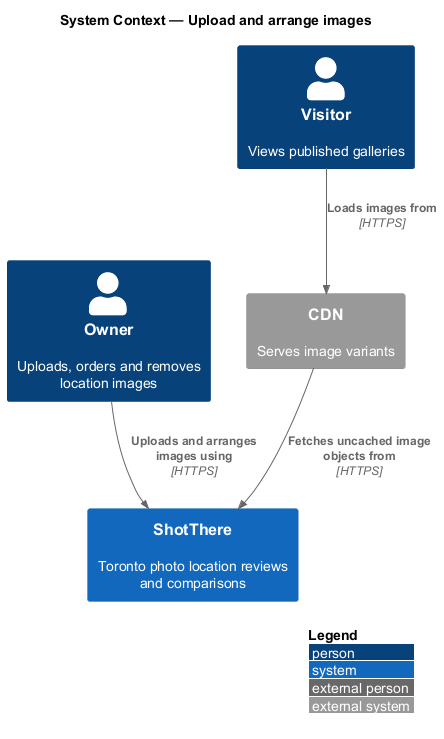
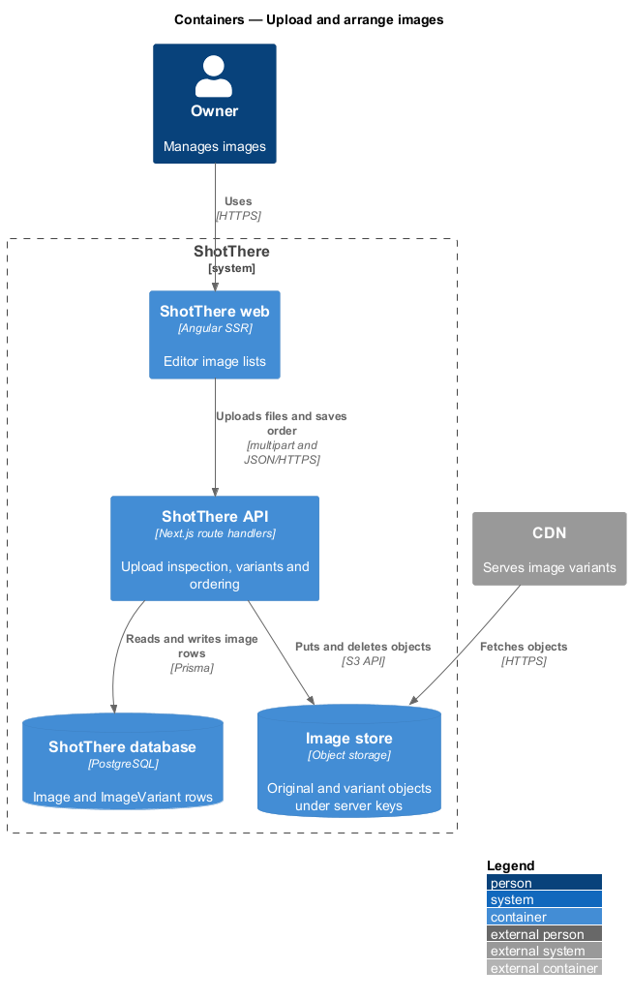
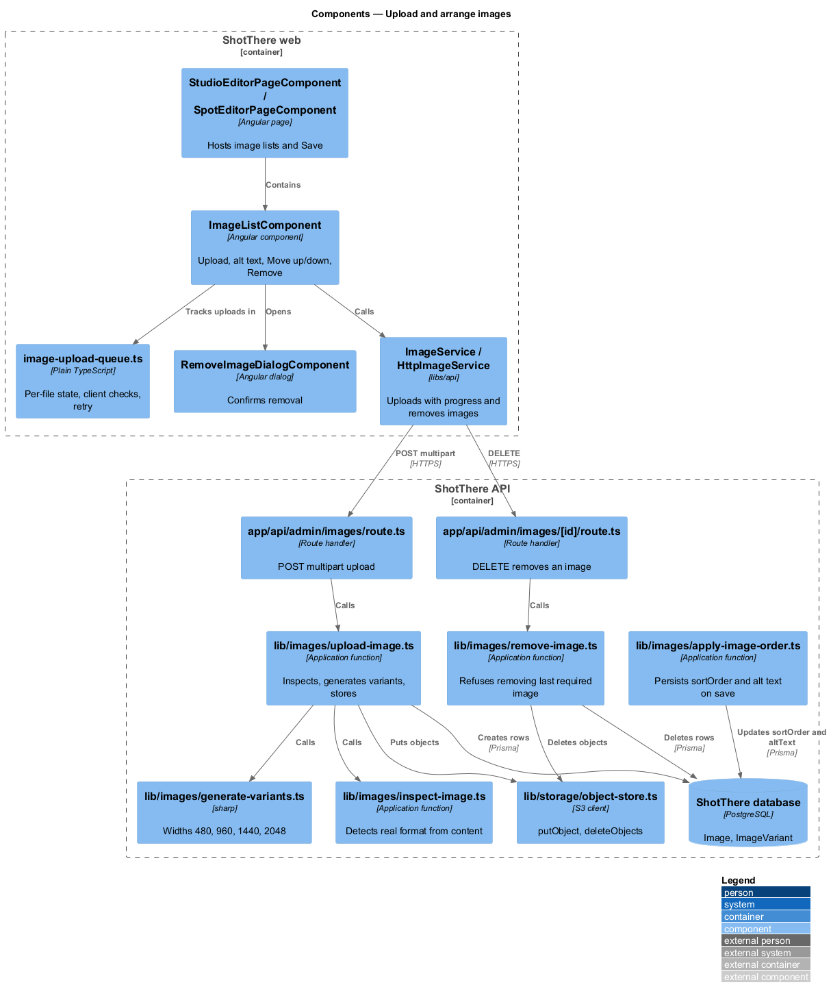
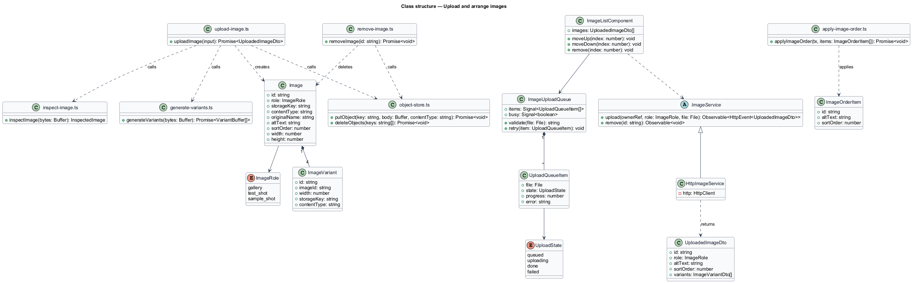
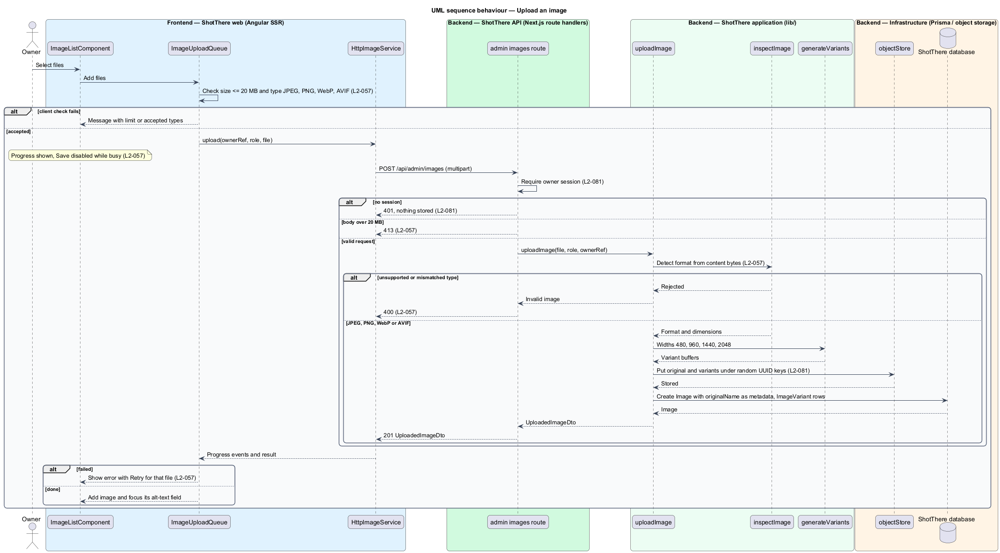
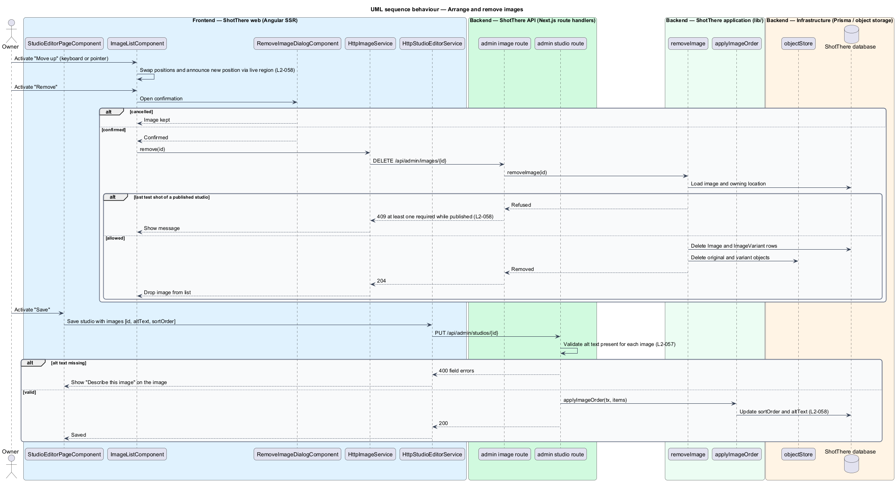

# Upload and arrange images

## Overview

ShotThere reviews photo locations, so images are central evidence. Each studio
or outdoor spot holds images in one of three roles:

- **gallery image** — image showing a location's space for visitors browsing its page
- **standard test shot** — studio image taken with the fixed ShotThere test setup so studios compare side by side
- **sample shot** — outdoor spot image showing what the spot yields

This feature lets the owner upload images, give each one alt text, reorder
them, and remove them. The server treats every upload as untrusted. It inspects
the bytes, rejects anything that is not JPEG, PNG, WebP or AVIF, and generates
responsive variants.

- **variant** — resized copy of an uploaded image at a fixed width of 480, 960, 1440 or 2048 pixels

Originals and variants live in object storage under server-generated keys.

- **server-generated key** — object name made by the server from a random identifier, independent of the uploaded file name

The image list sits inside the studio and outdoor spot editors described by the
`edit-studio` and `edit-outdoor-spot` designs. Order and alt text persist when
the editor saves.

## Description

Frontend (`frontend/`):

- **`ImageService`** (`libs/api/src/images/image.service.ts`) — abstract class and DI token with `upload(ownerRef, role, file)` returning `HttpEvent` progress, and `remove(id)`.
- **`HttpImageService`** (`http-image.service.ts`) — sends `multipart/form-data` with `reportProgress: true`.
- **`ImageListComponent`** (`features/admin/images/`) — lists images of one role with alt-text fields, "Move up", "Move down" and "Remove". Reorder controls are buttons, so keyboard users operate them. A polite live region announces the new position (L2-058).
- **`ImageUploadQueue`** (`image-upload-queue.ts`) — plain TypeScript holding per-file `UploadQueueItem` state as signals. It refuses files over 20 MB and files outside JPEG, PNG, WebP and AVIF before upload. It exposes `busy`, which the editor uses to disable Save, and `retry(item)` for a single failed file (L2-057).
- **`RemoveImageDialogComponent`** — accessible confirmation dialog for removal.
- **Alt-text message** — the editor maps a missing alt-text error to "Describe this image" on the matching field.

Backend (`backend/`):

- **`app/api/admin/images/route.ts`** — `POST` multipart upload with fields `file`, `role` and the owning location reference. It requires the owner session and returns 401 without storing anything (L2-081). Bodies over 20 MB return 413.
- **`app/api/admin/images/[id]/route.ts`** — `DELETE` removes one image. Returns 204, or 409 when the image is the last standard test shot of a published studio (L2-058).
- **`lib/images/upload-image.ts`** — `uploadImage` coordinates inspection, variant generation, storage and the database write.
- **`lib/images/inspect-image.ts`** — `inspectImage` reads the format from the content with `sharp` metadata. It rejects unsupported formats and a mismatch with the declared type with HTTP 400. The detected format sets the stored `contentType` (L2-057, L2-081).
- **`lib/images/generate-variants.ts`** — `generateVariants` uses `sharp` to resize to 480, 960, 1440 and 2048 pixels wide. Upscaling of smaller originals is `<TO SUPPLY>`.
- **`lib/images/remove-image.ts`** — `removeImage` applies the published-studio rule, deletes the rows, then deletes the objects.
- **`lib/images/apply-image-order.ts`** — `applyImageOrder(tx, items)` writes `sortOrder` and `altText` inside the editor save transaction.
- **`lib/images/schemas.ts`** — zod `imageOrderItemSchema` requiring non-empty `altText` (L2-057).
- **`lib/storage/object-store.ts`** — S3-compatible client with `putObject(key, body, contentType)` and `deleteObjects(keys)`. Keys take the form `images/{uuid}/original` and `images/{uuid}/{width}`, with `uuid` from `crypto.randomUUID()`. Each object stores the detected `Content-Type`. The original name is kept only in `Image.originalName` (L2-081).

Data (`prisma/schema.prisma`): `Image` (`role`, `storageKey`, `contentType`, `originalName`, `altText`, `sortOrder`, `width`, `height`, owning `studioId` or `spotId`) and `ImageVariant` (`imageId`, `width`, `storageKey`, `contentType`). DTOs: `UploadedImageDto`, `ImageVariantDto`, `ImageOrderItem`.

## Requirements

The feature realizes the following level-2 (L2) requirements. Each refines the
level-1 (L1) requirement cited.

| L2 ID | Refines (L1) | Requirement |
|-------|--------------|-------------|
| `L2-057` | `L1-014` | The system shall let the owner upload images for galleries, standard test shots and sample shots, each with required alt text. The server shall validate type and size and shall generate responsive variants. |
| `L2-058` | `L1-014` | The system shall let the owner reorder images within a gallery or shot set and remove an image, with the order persisted. |
| `L2-081` | `L1-019` | Uploaded files shall be stored outside the web root or in object storage under server-generated names, served with fixed content types, and never executed. |

## Diagrams

### System context

The owner manages images through ShotThere. Visitors load image variants
through the CDN.

### Containers

The API writes image rows to the database and objects to the image store. The
CDN fetches objects from the image store.

### Components

`ImageListComponent` tracks uploads in `ImageUploadQueue` and calls
`ImageService`. The upload route delegates to inspection, variant generation and
the object store.

### Class structure

Each `Image` owns four `ImageVariant` rows. `HttpImageService` implements the
`ImageService` contract.

### Behaviour — upload an image

The client checks size and type first. The server checks the session, size and
content, then stores the original and variants under random keys.

### Behaviour — arrange and remove images

Reordering happens in the list and persists on save. Removal deletes at once
after confirmation, except the last test shot of a published studio.

