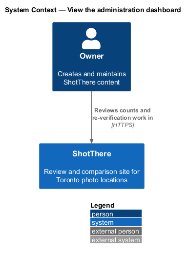
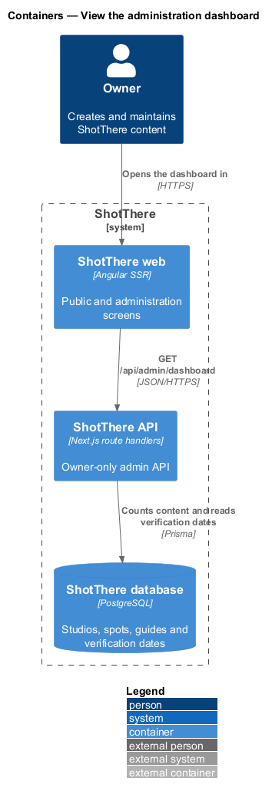
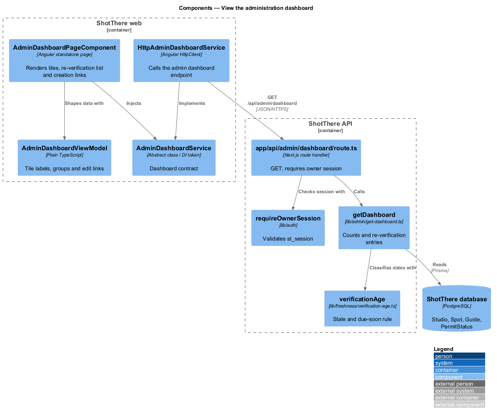
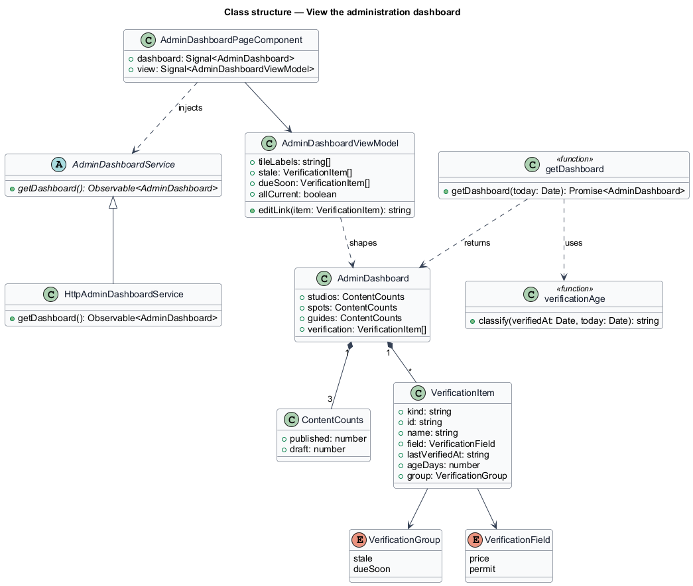
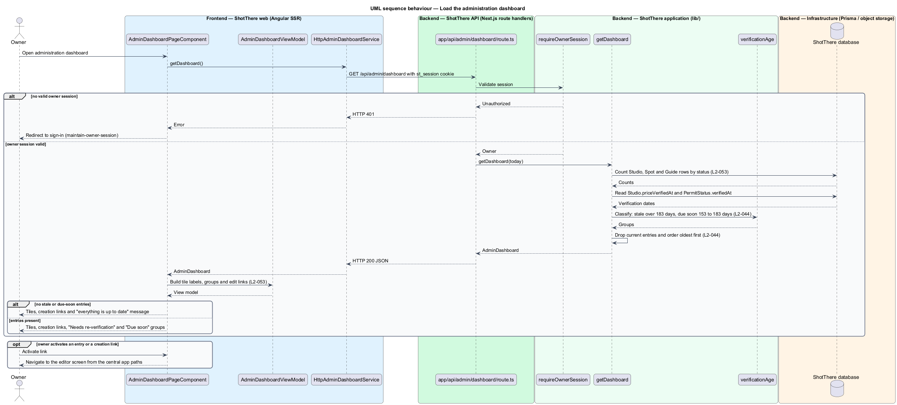

# View the administration dashboard

## Overview

ShotThere is a review site for Toronto photo locations. The *owner* is the single signed-in person who creates and maintains all content. The *administration area* is the set of owner-only screens where that work happens.

The *administration dashboard* is the landing screen of the administration area. It summarizes the catalogue and presents a work list. The summary shows how many studios, outdoor spots and guides are published and how many remain drafts. A *draft* is saved content that visitors cannot see.

The work list is the *re-verification list*: a list of locations whose price or permit data is old enough to check again. Data is *stale* when its last-verified date is more than 183 days before today. Data is *due soon* when it is between 153 and 183 days old. Studios carry a price last-verified date; outdoor spots carry a permit last-verified date.

The dashboard also offers links to create each content type. The creation screens belong to the `edit-studio`, `edit-outdoor-spot` and `edit-guide` features. Access requires an owner session, provided by `owner-access/maintain-owner-session`.

## Description

- **`AdminDashboardPageComponent`** — standalone Angular page in `frontend/src/app/features/admin/dashboard/`. It loads the dashboard through `AdminDashboardService`, holds the result in a signal, and renders three count tiles, the re-verification list and the creation links. Tiles stack in one column at XS.
- **`AdminDashboardViewModel`** — plain TypeScript in `admin-dashboard-view-model.ts` beside the page. It builds tile labels such as "3 published, 2 draft", splits entries into the "Needs re-verification" and "Due soon" groups, and builds each edit link from the central app paths.
- **`AdminDashboardService`** — abstract class in `libs/api/src/admin-dashboard.service.ts` and its own DI token. It declares `getDashboard(): Observable<AdminDashboard>`.
- **`HttpAdminDashboardService`** — implementation in `libs/api/src/http-admin-dashboard.service.ts`. It calls `GET /api/admin/dashboard` with credentials. The app registers `{ provide: AdminDashboardService, useClass: HttpAdminDashboardService }`.
- **`AdminDashboard`, `ContentCounts`, `VerificationItem`** — DTO types in `libs/api`, one file each. `VerificationItem` carries the location kind, id, name, field (`price` or `permit`), last-verified date, age in days and group (`stale` or `dueSoon`).
- **Route** — the dashboard route lives in `features/admin/routes.ts`. It takes its path and title from the central app paths and uses the owner route guard from `maintain-owner-session`.
- **`app/api/admin/dashboard/route.ts`** — Next.js `GET` handler. It calls `requireOwnerSession` from `owner-access/maintain-owner-session` and returns HTTP 401 without a valid `st_session` cookie.
- **`lib/admin/get-dashboard.ts`** — application function. It counts `Studio`, `Spot` and `Guide` rows by status. It reads `Studio.priceVerifiedAt` and the oldest `PermitStatus.verifiedAt` per `Spot`, and returns stale and due-soon entries ordered oldest first.
- **`lib/freshness/verification-age.ts`** — shared function that computes age in days against today. It classifies the age as `stale` (more than 183 days), `dueSoon` (153 to 183 days) or `current`, matching the rule behind `priceStale` and `permitStale`.
- **Prisma models** — `Studio`, `Spot`, `Guide` and `PermitStatus`, read only.

## Requirements

The feature realizes the following level-2 (L2) requirements. Each refines the cited level-1 (L1) requirement.

| L2 ID | Refines (L1) | Requirement |
|-------|--------------|-------------|
| `L2-053` | `L1-014` | The administration dashboard shall show counts of published and draft studios, spots and guides, the re-verification list, and links to create each content type. At XS, tiles shall stack in one column and the list shall be readable without horizontal scroll. |
| `L2-044` | `L1-010` | The administration dashboard shall list every location with stale price or permit data, oldest first, with a link to edit, and a "Due soon" group for data between 153 and 183 days old. With no stale or due-soon data, the list shall state that everything is up to date. |

## Diagrams

### System context

The owner reads the dashboard in ShotThere; no external system takes part.

### Containers

The web app requests the dashboard from the API, which reads counts and verification dates from the database.

### Components

The page reads through the service contract. The route handler checks the owner session, then delegates to `getDashboard`, which applies the shared freshness rule.

### Class structure

`AdminDashboard` aggregates per-type `ContentCounts` and a list of `VerificationItem` entries; the view model shapes them for the page.

### Behaviour — load the dashboard

The handler rejects requests without an owner session, then returns counts and re-verification entries ordered oldest first. The page shows the up-to-date message when no entries exist.

