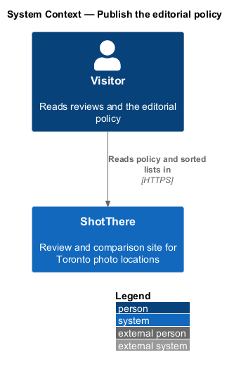
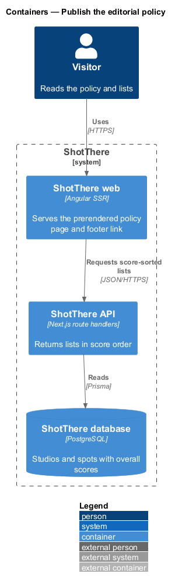
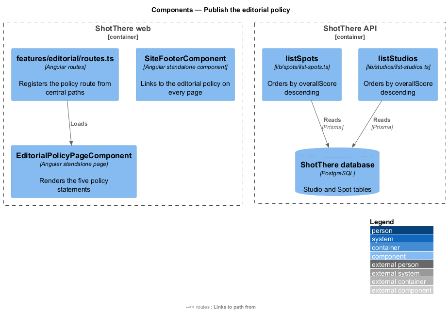
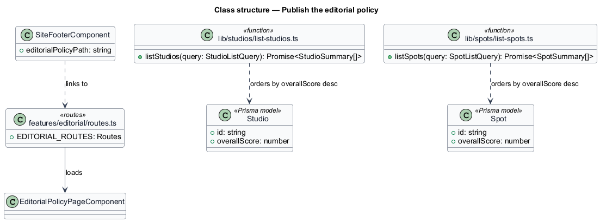
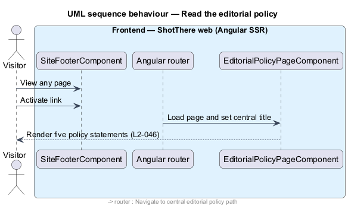
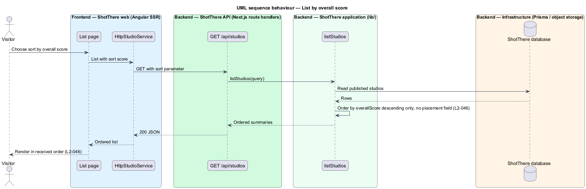

# Publish the editorial policy

## Overview

ShotThere reviews Toronto photo locations first-hand and compares them side by side. Its value depends on readers trusting that money does not shape what they see.

**editorial policy** — public page that states the rules governing what ShotThere lists and how it scores

**paid placement** — list position granted for payment or promotion rather than by the visitor's chosen sort

**overall score** — server-computed rating `overallScore` that ranks a location in score-sorted lists

The feature belongs to the editorial subsystem. It publishes the editorial policy as a static page linked from the footer of every page. It also fixes one ordering rule for lists: a list sorted by overall score orders entries by `overallScore` descending and by nothing else. The site has no sponsored, promoted or pinned positions, so no data model or code path exists that could move an entry ahead.

## Description

- **`EditorialPolicyPageComponent`** — standalone Angular page in `features/editorial/` with `editorial-policy-page.component.html` and `editorial-policy-page.component.css`. It renders fixed, i18n-marked text. The text states five rules: only locations the reviewer has shot at are listed, scores are never for sale, and comped sessions are disclosed. It also states that studio owners can correct facts but not edit reviews, and that negative findings are published. The page prerenders and makes no API call.
- **`features/editorial/routes.ts`** — registers the route for `EditorialPolicyPageComponent`. The path and page title come from the central app paths and titles; the exact path value is `<TO SUPPLY>`.
- **`SiteFooterComponent`** — the shared footer in `core/layout/`, owned by the app shell. This slice adds an i18n-marked link to the editorial policy page, built from the central path.
- **Score ordering in list functions** — `lib/studios/list-studios.ts` and `lib/spots/list-spots.ts` sort by `overallScore` descending when the requested sort is score. No sponsored, promoted or weight field exists on `Studio` or `Spot`. The order of entries with equal scores is `<TO SUPPLY>`.
- **No new API endpoint, DTO or Prisma model** — the policy page is static content in the web app.

## Requirements

The feature satisfies the following L2 requirement.

| L2 ID | Refines (L1) | Requirement |
|-------|--------------|-------------|
| `L2-046` | `L1-011` | The public site shall contain no sponsored, promoted, or paid positions; list order shall be determined only by the visitor's chosen sort. A list sorted by overall score shall match score descending exactly. The footer of every page shall link to an editorial policy page. The policy page shall state that only locations the reviewer has shot at are listed, that scores are never for sale, and that comped sessions are disclosed. It shall also state that studio owners can correct facts but not edit reviews, and that negative findings are published. |

## Diagrams

### System context

A visitor reads the editorial policy and browses score-sorted lists in ShotThere. No external system takes part.

### Containers

The web app serves the policy page without calling the API. Score-sorted lists come from the API, which reads PostgreSQL.

### Components

`SiteFooterComponent` links to `EditorialPolicyPageComponent`. The list functions in the API apply the score-only ordering.

### Class structure

The policy page has no dependencies beyond the central paths. The list functions read `overallScore` and no placement field.

### Behaviour — read the editorial policy

The visitor follows the footer link, and the web app renders the prerendered policy text.

### Behaviour — list by overall score

The API sorts the published entries by `overallScore` descending and returns them in that order.

