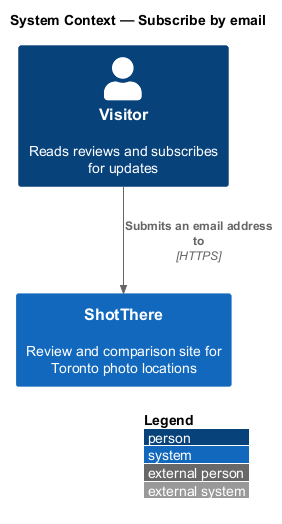
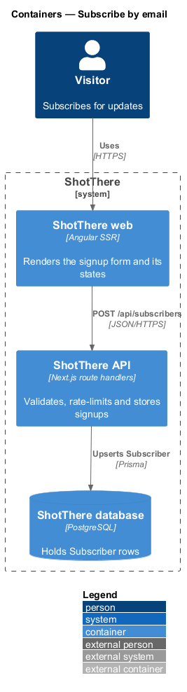
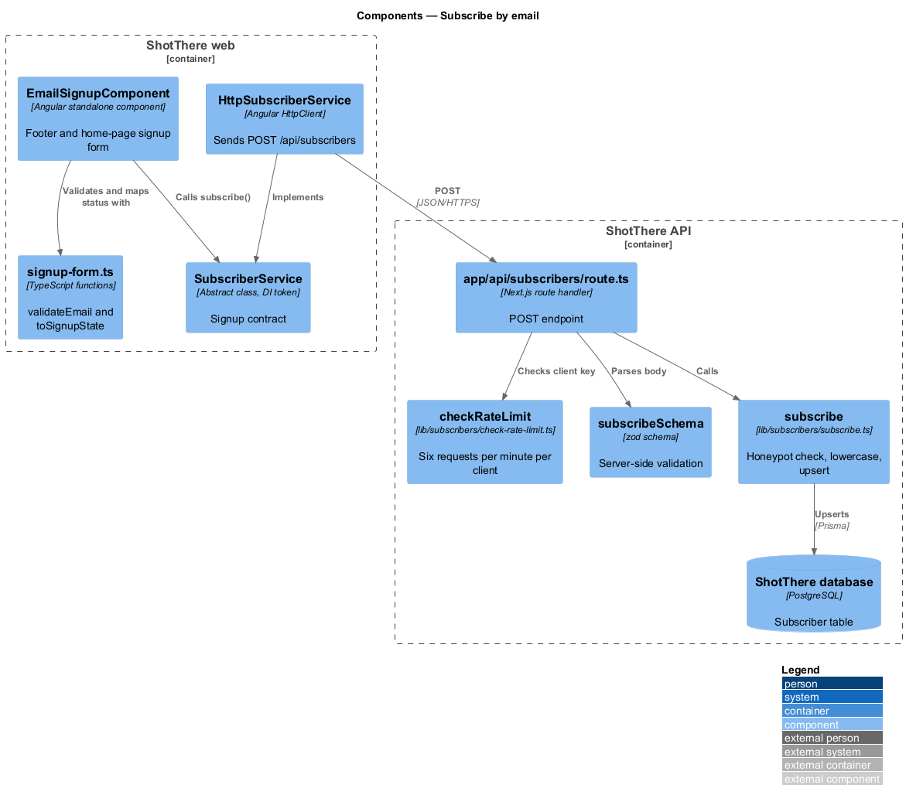
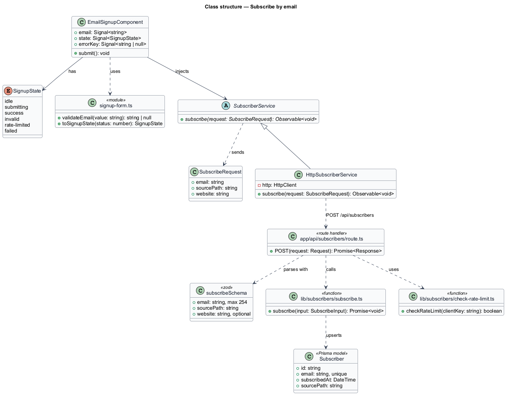
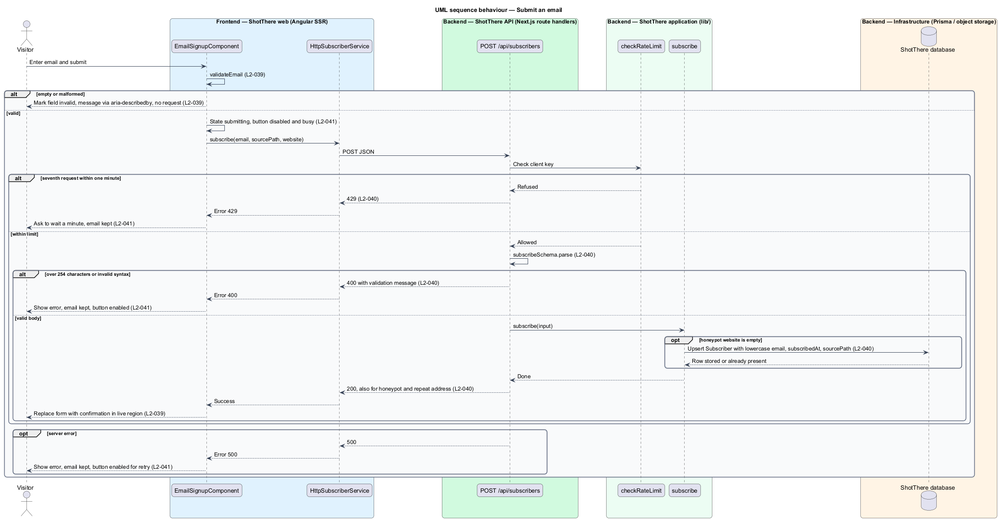

# Subscribe by email

## Overview

ShotThere publishes reviews of places to shoot photos in Toronto. Visitors who want to hear about new reviews leave an email address through a signup form.

**signup form** — footer and home-page form that collects one email address and posts it to the server

**subscriber** — stored email address with the time it was subscribed and the page path it came from

**honeypot field** — visually hidden form input that people leave empty and automated scripts tend to fill

The feature belongs to the email-signup subsystem. The form validates input in the browser for fast feedback. The server remains the authority. It validates again, rejects oversized or malformed addresses, and limits each client to six requests per minute. It discards submissions with a filled honeypot field without storing them. A repeat subscription returns the same success as a new one, so the response does not reveal which addresses are already stored.

## Description

- **`EmailSignupComponent`** — standalone Angular component in `features/email-signup/` with `email-signup.component.html` and `email-signup.component.css`. It renders the email input, the hidden honeypot input `website`, and the submit button. The site footer and `HomePageComponent` both place it. A signal holds the view state. At XS the input and button stack vertically at full width.
- **`signup-form.ts`** — plain TypeScript beside the component. `validateEmail(value)` returns the message key for an empty or malformed address, or `null`. `toSignupState(status)` maps an HTTP status to a view state: `200` to `success`, `429` to `rate-limited`, any other failure to `failed`.
- **`SignupState`** — type alias in `signup-state.ts` for the view states `idle`, `submitting`, `success`, `invalid`, `rate-limited` and `failed`.
- **`SubscriberService`** — `abstract class` in `libs/api/subscriber.service.ts` and its own DI token. It declares `subscribe(request: SubscribeRequest): Observable<void>`.
- **`HttpSubscriberService`** — `class HttpSubscriberService extends SubscriberService` in `libs/api/http-subscriber.service.ts`. It sends `POST /api/subscribers`. The app registers `{ provide: SubscriberService, useClass: HttpSubscriberService }`.
- **`SubscribeRequest`** — DTO in `libs/api/subscribe-request.ts` with `email`, `sourcePath` and `website` (the honeypot value).
- **`app/api/subscribers/route.ts`** — Next.js `POST` route handler. It checks the rate limit, parses the body with `subscribeSchema`, and calls `subscribe`. It returns `200` on success or honeypot, `400` with a validation message on invalid input, and `429` when the limit is exceeded.
- **`subscribeSchema`** — zod schema in `lib/subscribers/schemas.ts`. `email` is a trimmed string of at most 254 characters in email syntax. `sourcePath` is a string starting with `/`. `website` is an optional string.
- **`subscribe`** — application function in `lib/subscribers/subscribe.ts`. It returns without writing when `website` is non-empty. Otherwise it lowercases the email and upserts a `Subscriber` row keyed on the email. A repeat address leaves the original row unchanged.
- **`checkRateLimit`** — function in `lib/subscribers/check-rate-limit.ts`. It counts requests per client key in a one-minute window and refuses the seventh. The client key is the request IP address. The counter store is `<TO SUPPLY>`; a single-instance deployment may hold it in process memory.
- **`Subscriber`** — Prisma model in `prisma/schema.prisma` with `id`, `email` (unique, lowercase), `subscribedAt` and `sourcePath`.
- **Accessibility and i18n** — every label, validation message, confirmation, rate-limit and failure message is marked for Angular i18n. The confirmation sits in an `aria-live="polite"` region. Each field error links to the input through `aria-describedby`.

## Requirements

The feature satisfies the following L2 requirements.

| L2 ID | Refines (L1) | Requirement |
|-------|--------------|-------------|
| `L2-039` | `L1-009` | A signup form in the site footer and on the home page shall accept an email address, submit it to the server, and confirm success inline without leaving the page. An empty or malformed address shall be marked invalid and no request shall be sent. A repeat address shall receive the same confirmation as a new one. At XS the input and button shall stack vertically at full width. |
| `L2-040` | `L1-009` | The signup endpoint shall validate the email server-side, store it with a timestamp and source page, reject malformed input, and rate-limit by client. An email over 254 characters or with invalid syntax shall receive HTTP 400. A seventh request within one minute shall receive HTTP 429. A filled honeypot shall receive HTTP 200 with nothing stored. A stored email shall be lowercase. |
| `L2-041` | `L1-009` | When the signup request fails, the form shall remain filled and show an error with a retry. HTTP 429 shall produce a message asking the visitor to wait a minute. The submit button shall be disabled with a busy state while a submission is in progress. |

## Diagrams

### System context

A visitor subscribes through ShotThere. No external system takes part in this slice.

### Containers

The Angular web app posts the signup to the API. The API stores the subscriber in PostgreSQL.

### Components

`EmailSignupComponent` calls `SubscriberService`, whose HTTP implementation reaches the route handler. The handler applies `checkRateLimit`, `subscribeSchema` and `subscribe` in that order.

### Class structure

The frontend types connect to the backend types through `SubscribeRequest`, the wire contract for `POST /api/subscribers`.

### Behaviour — submit an email

The form validates locally, shows a busy state, and posts the request. The server answers `429`, `400`, `500` or `200`, and the form maps each status to a view state.

