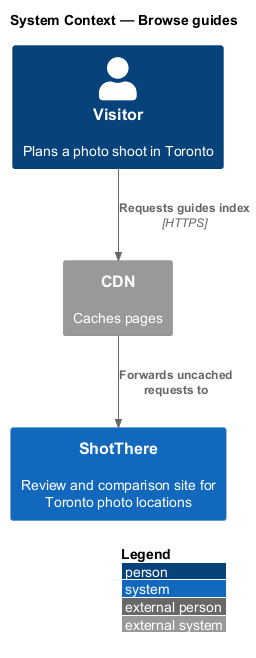
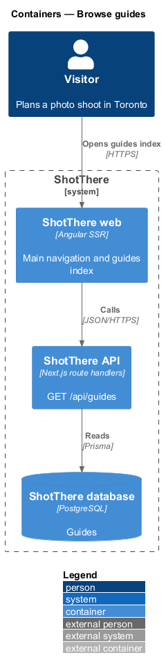
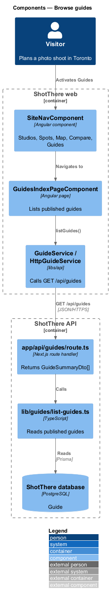
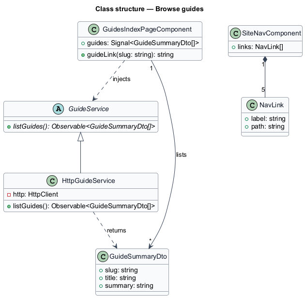
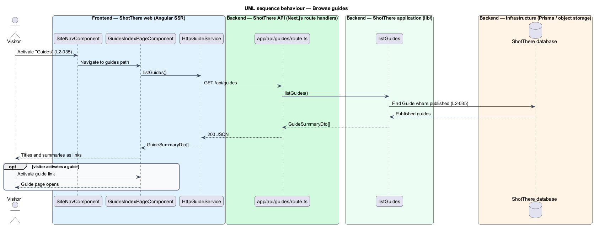

# Browse guides

## Overview

ShotThere publishes guides that answer "best for" questions. The guides index gives visitors one place to find them, and the main navigation links to it from every public page.

- **guide** — editor-curated, published page that ranks reviewed locations for one purpose
- **guides index** — public page that lists every published guide with its title and summary
- **main navigation** — site-wide link list in the app shell header

Draft guides never appear in the index.

## Description

The slice runs from the guides index to the database and adds one navigation link.

- **`GuidesIndexPageComponent`** — standalone page in `features/guides`, routed from `features/guides/routes.ts` at the guides path in `AppPaths`. It lists each guide as a link with title and summary.
- **`GuideService.listGuides()`** — method on the abstract `GuideService` in `libs/api` returning `Observable<GuideSummaryDto[]>`; `HttpGuideService` calls `GET /api/guides`.
- **`app/api/guides/route.ts`** — `GET` handler that returns `GuideSummaryDto[]`.
- **`lib/guides/list-guides.ts`** — `listGuides()` reads published `Guide` rows through Prisma. The index order is `<TO SUPPLY>`.
- **`GuideSummaryDto`** — `slug`, `title`, `summary`.
- **`SiteNavComponent`** — main navigation in the app shell. This slice ensures it links to Studios, Spots, Map, Compare and Guides, with paths from `AppPaths` and i18n-marked labels.
- **Prisma model** — `Guide`.

## Requirements

The feature realizes the following level-2 (L2) requirements. Each L2 requirement refines a level-1 (L1) requirement, cited by identifier.

| L2 ID | Refines (L1) | Requirement |
|-------|--------------|-------------|
| `L2-035` | `L1-007` | The site shall provide a guides index listing all published guides with title and summary, and the site navigation shall link to it. |

## Diagrams

### System context

The visitor browses guides on ShotThere through the CDN.

### Containers

The web container renders the index and calls the API, which reads published guides from the database.

### Components

`GuidesIndexPageComponent` calls `GuideService.listGuides`; `SiteNavComponent` links to the index from every public page.

### Class structure

`HttpGuideService` extends `GuideService` and returns `GuideSummaryDto` values. `SiteNavComponent` holds its 5 links.

### Behaviour — browse guides

`listGuides` returns only published guides (`L2-035`), and each item links to its guide page.

