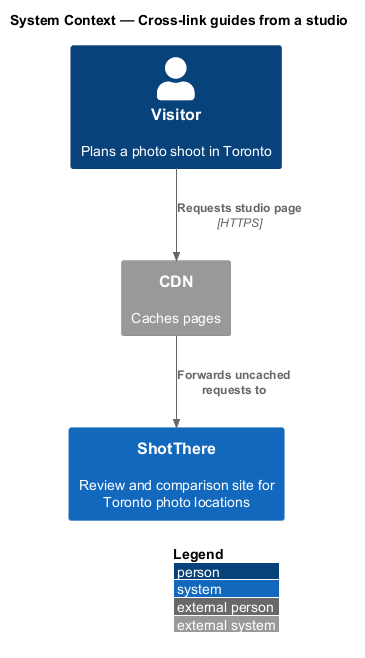
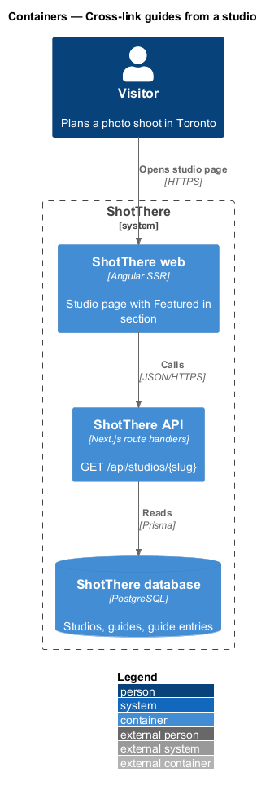
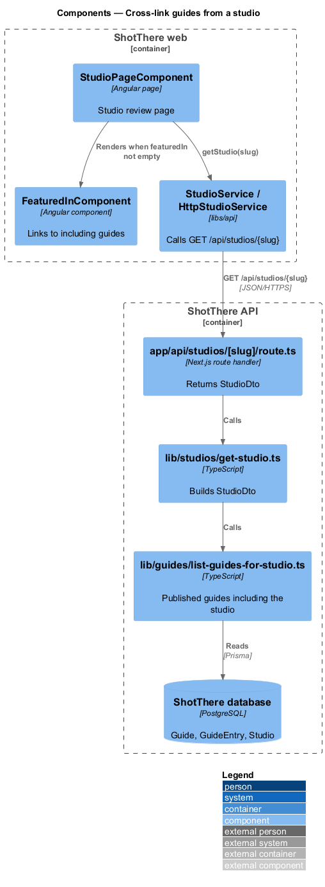
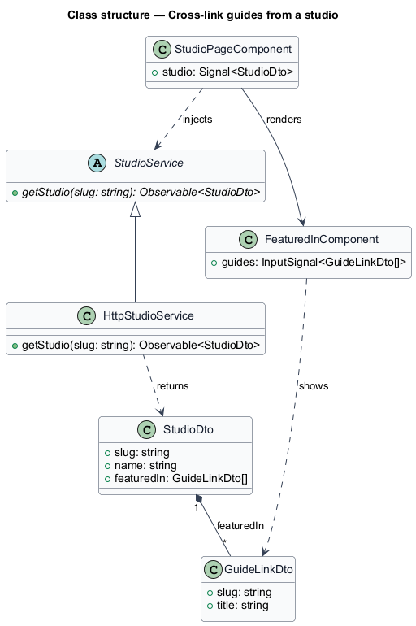
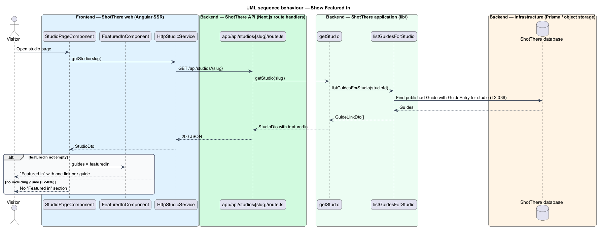

# Cross-link guides from a studio

## Overview

A studio review page on ShotThere describes one studio. Guides rank studios for a purpose. This feature links the two in the opposite direction: a studio page names the published guides that include it.

- **guide** — editor-curated, published page that ranks reviewed locations for one purpose
- **"Featured in" section** — part of a studio page that links to every published guide containing that studio

The section appears only when at least one published guide includes the studio. It reads guide membership at render time, so adding a studio to a guide leaves the studio record unchanged.

## Description

The slice extends the existing studio page and its API response.

- **`FeaturedInComponent`** — standalone component in `features/studios`. It takes `guides: GuideLinkDto[]` and renders a "Featured in" heading with one link per guide. `StudioPageComponent` renders it only when the list is not empty.
- **`GuideLinkDto`** — `slug` and `title`.
- **`StudioDto.featuredIn`** — new field `GuideLinkDto[]` on the studio response returned by `StudioService.getStudio` and `HttpStudioService`.
- **`lib/guides/list-guides-for-studio.ts`** — `listGuidesForStudio(studioId)` reads published `Guide` rows that hold a `GuideEntry` for the studio. Its order is `<TO SUPPLY>`.
- **`lib/studios/get-studio.ts`** — existing function behind `app/api/studios/[slug]/route.ts`; it calls `listGuidesForStudio` and sets `featuredIn`.
- **Prisma models** — `Guide`, `GuideEntry`, `Studio`.
- The heading and link text are marked for Angular i18n; guide links use the guide path from `AppPaths`.

## Requirements

The feature realizes the following level-2 (L2) requirements. Each L2 requirement refines a level-1 (L1) requirement, cited by identifier.

| L2 ID | Refines (L1) | Requirement |
|-------|--------------|-------------|
| `L2-036` | `L1-007` | Each studio page shall list the published guides that include it, and shall render no "Featured in" section when no published guide includes it. |

## Diagrams

### System context

The visitor reads a studio page on ShotThere through the CDN.

### Containers

The web container renders the studio page from the API, which reads the studio and its guide membership from the database.

### Components

`getStudio` calls `listGuidesForStudio`, and `StudioPageComponent` passes the result to `FeaturedInComponent`.

### Class structure

`StudioDto` gains `featuredIn`, a list of `GuideLinkDto` values that `FeaturedInComponent` renders.

### Behaviour — show "Featured in"

The section renders only when `featuredIn` holds at least one published guide (`L2-036`).

