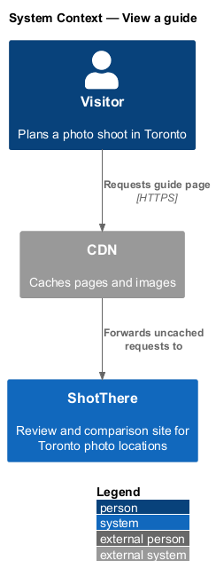
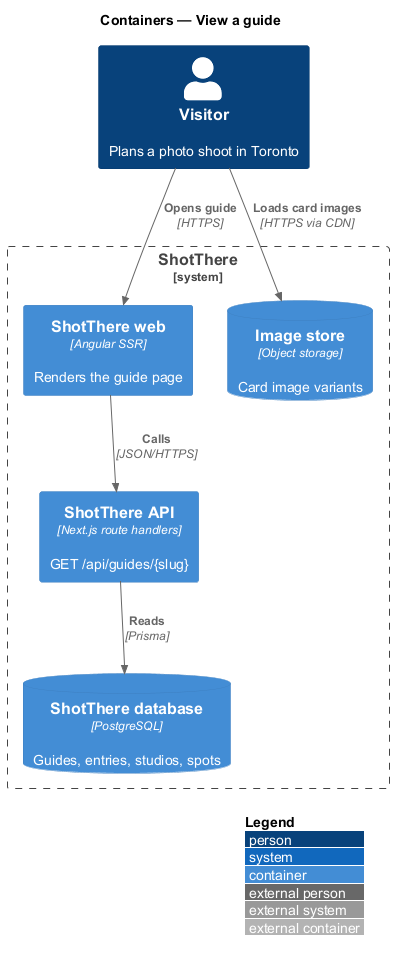
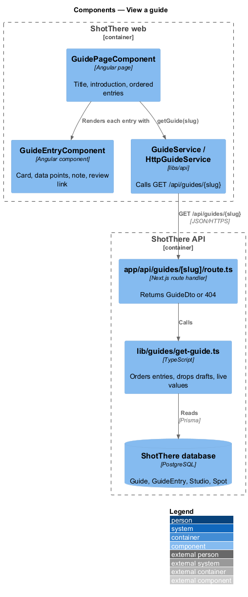
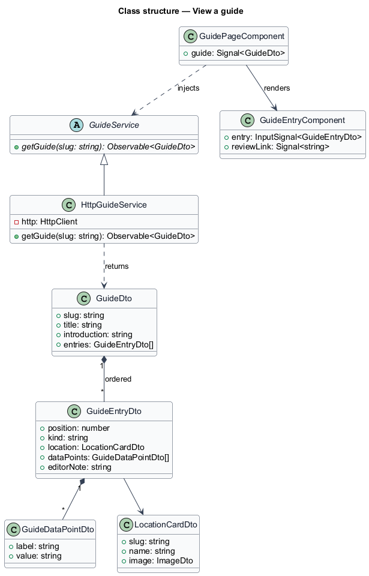
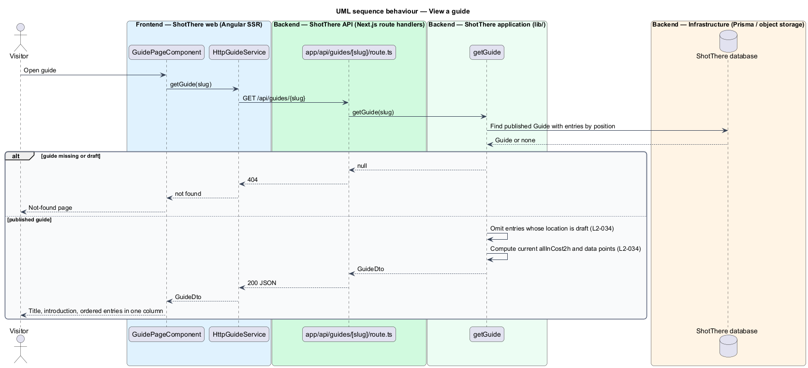

# View a guide

## Overview

A guide is the ShotThere answer to a "best for" question, such as the best studios under $120 for 2 hours.

- **guide** — editor-curated, published page that ranks reviewed locations for one purpose
- **guide entry** — one ordered position in a guide that points at a studio or spot and carries an editor's note
- **guide data point** — studio or spot value that the guide is about, such as all-in cost for a price guide

A guide stores only the ordering, the notes and the references. Each entry reads its card and data points from the live studio or spot at render time. A price change therefore shows on the guide without editing it. An entry whose location is no longer published is left out.

## Description

The slice runs from the guide page to the database.

- **`GuidePageComponent`** — standalone page in `features/guides`, routed from `features/guides/routes.ts` at the guide path in `AppPaths`. It reads the slug, calls `GuideService.getGuide`, and renders the title, introduction and an ordered list of entries in one column at XS.
- **`GuideEntryComponent`** — standalone component that shows the studio or spot card, the guide's data points, the editor's note and a link to the review page.
- **`guide-view-model.ts`** — plain TypeScript beside the page that formats data points and builds the review link from `AppPaths`.
- **`GuideService`** — abstract class and DI token in `libs/api` (`guide.service.ts`) with `getGuide(slug: string): Observable<GuideDto>`.
- **`HttpGuideService`** — implementation in `http-guide.service.ts`; it calls `GET /api/guides/{slug}`.
- **`app/api/guides/[slug]/route.ts`** — `GET` handler. It returns `GuideDto`, or `404` for an unknown or draft guide.
- **`lib/guides/get-guide.ts`** — `getGuide(slug)` loads a published `Guide` with its `GuideEntry` rows in configured order. It drops entries whose `Studio` or `Spot` is draft and computes `allInCost2h` for studio entries at read time.
- **Prisma models** — `Guide`, `GuideEntry`, `Studio`, `StudioFee`, `Spot`, `Image` and `ImageVariant` (card image).
- **`GuideDto`** — `slug`, `title`, `introduction`, `entries: GuideEntryDto[]`.
- **`GuideEntryDto`** — `position`, `kind` (`studio` or `spot`), `location: LocationCardDto`, `dataPoints: GuideDataPointDto[]`, `editorNote`.
- **`GuideDataPointDto`** — `label` and `value`.
- How a guide declares which data points it is about is `<TO SUPPLY>`. The design assumes a field on `Guide` naming the data-point keys.

## Requirements

The feature realizes the following level-2 (L2) requirements. Each L2 requirement refines a level-1 (L1) requirement, cited by identifier.

| L2 ID | Refines (L1) | Requirement |
|-------|--------------|-------------|
| `L2-034` | `L1-007` | Each guide page shall show a title, an introduction, and an ordered list of entries, each entry showing the studio or spot card, the data points the guide is about, and the editor's note, linking to the underlying review. Entries whose location is draft shall be omitted, and data points shall reflect the current location values on each render. |

## Diagrams

### System context

The visitor reads a guide on ShotThere through the CDN.

### Containers

The web container renders the guide and calls the API, which reads guides and their locations from the database. Card images load from the image store.

### Components

`GuidePageComponent` calls `GuideService`; the route handler delegates to `getGuide`, which joins live location data.

### Class structure

`HttpGuideService` extends `GuideService` and returns `GuideDto`, composed of ordered `GuideEntryDto` values.

### Behaviour — view a guide

`getGuide` omits entries with draft locations and computes current values on each request (`L2-034`).

