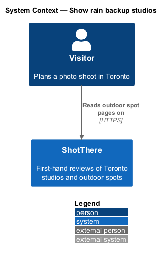
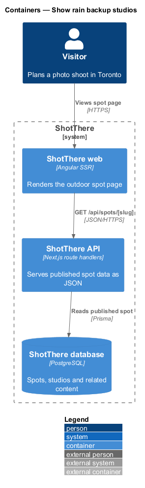
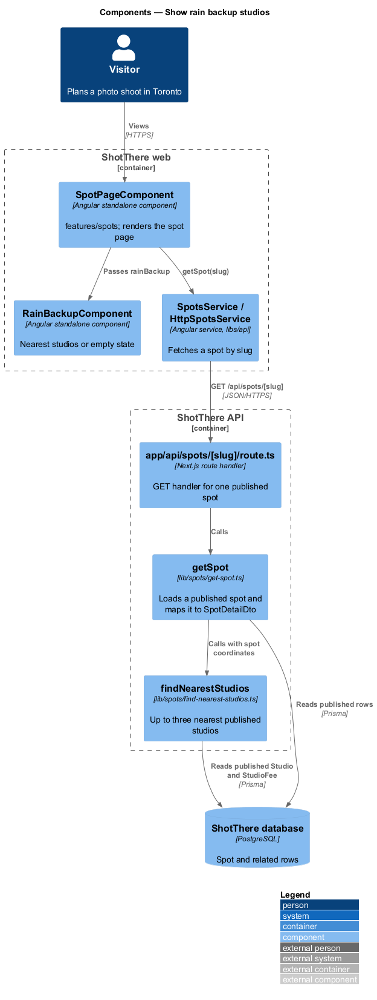
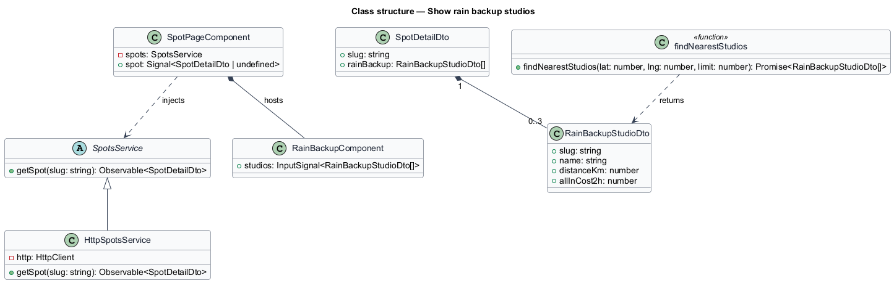
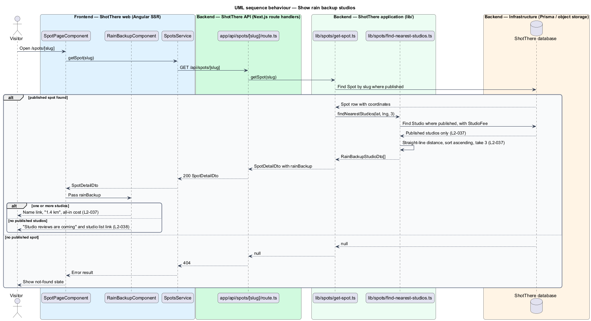

# Show rain backup studios

## Overview

ShotThere is a review and comparison site for places to shoot photos in Toronto. An *outdoor spot* is a public place, such as a park or a plaza, that ShotThere has shot at first-hand and reviewed. Each published spot has one *spot page* at `/spots/[slug]`, where a *slug* is the short URL-safe name that identifies the spot. Outdoor shoots depend on weather, so each spot page suggests indoor alternatives.

*Rain backup* is the spot page section that lists up to three published rental studios nearest to the spot. *Straight-line distance* is the great-circle distance between the spot's and the studio's coordinates, shown in kilometres to one decimal, such as "1.4 km". The server computes distance and order; draft studios never appear. When no published studio exists, the section still renders and states that studio reviews are coming, with a link to the studio list.

## Description

The page component, service, route handler and `getSpot` are shared by all outdoor spot features; this slice adds the parts listed below.

- **`SpotPageComponent`** — Angular standalone page component in `features/spots/`, shared by every outdoor spot section. It reads the `slug` route parameter, holds the loaded spot in a signal, and renders each section from a view model built in plain TypeScript beside the page (`spot-page.view-model.ts`).
- **`SpotsService`** — abstract class in `libs/api/.../spots.service.ts` and its own DI token, exposing `getSpot(slug: string): Observable<SpotDetailDto>`.
- **`HttpSpotsService`** — implementation in `http-spots.service.ts`, registered as `{ provide: SpotsService, useClass: HttpSpotsService }`. It calls `GET /api/spots/[slug]`.
- **`app/api/spots/[slug]/route.ts`** — Next.js route handler. It returns `200` with `SpotDetailDto`, or `404` when no published spot matches the slug.
- **`getSpot`** — application function in `lib/spots/get-spot.ts`. It loads a published `Spot` by slug through Prisma, never returns draft content, and maps the row to `SpotDetailDto`.
- **`RainBackupComponent`** — standalone component in `features/spots/` that renders the "Rain backup" heading and, per studio, the name linking to the studio page, the distance formatted to one decimal with "km", and the all-in cost. With an empty list it renders the empty-state message and a link to the studio list. Paths come from the central app paths module.
- **`findNearestStudios`** — application function in `lib/spots/find-nearest-studios.ts`. It loads published `Studio` rows with coordinates, computes the straight-line distance from the spot, orders ascending and returns at most three. The distance formula is the haversine formula on a spherical Earth; the earth radius constant is `<TO SUPPLY>`.
- **`getSpot`** — calls `findNearestStudios` and sets `rainBackup` on `SpotDetailDto`.
- **`RainBackupStudioDto`** — `slug`, `name`, `distanceKm` and `allInCost2h` (server-computed, as on studio pages).
- **`Studio`** and **`StudioFee`** — Prisma models read for coordinates, publication status and the inputs to `allInCost2h`.

## Requirements

The feature realizes the following level-2 (L2) requirements. Each L2 requirement refines a level-1 (L1) requirement, cited by identifier.

| L2 ID | Refines (L1) | Requirement |
|-------|--------------|-------------|
| `L2-037` | `L1-008` | Each outdoor spot page shall show up to three published studios nearest to the spot by straight-line distance, each with name, distance in kilometres to one decimal, all-in cost, and a link to the studio page. |
| `L2-038` | `L1-008` | When no published studios exist, the rain backup section shall still render with a message rather than disappearing. |

## Diagrams

### System context

The visitor reads a spot page on ShotThere. No external system takes part.

### Containers

The ShotThere API reads the spot and published studios from the database and returns the nearest ones with the spot.

### Components

`getSpot` delegates to `findNearestStudios`; `SpotPageComponent` passes the list to `RainBackupComponent`.

### Class structure

`SpotDetailDto` holds up to three `RainBackupStudioDto` entries; `findNearestStudios` reads `Studio` and `StudioFee`.

### Behaviour — show rain backup studios

`findNearestStudios` excludes drafts, orders by distance and keeps three. The component renders the list, or the empty-state message when the list is empty.

