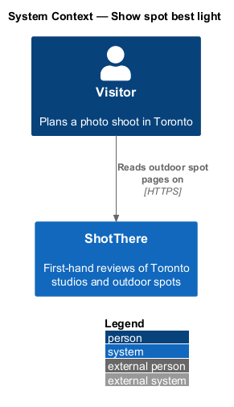
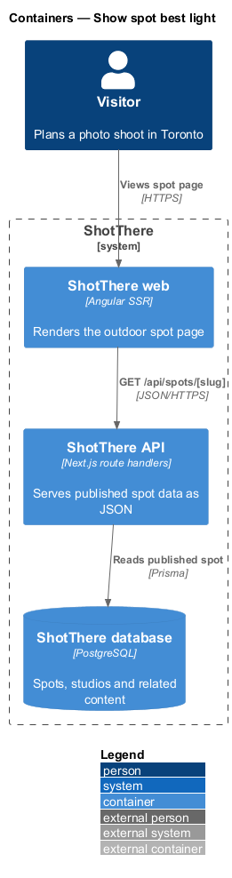
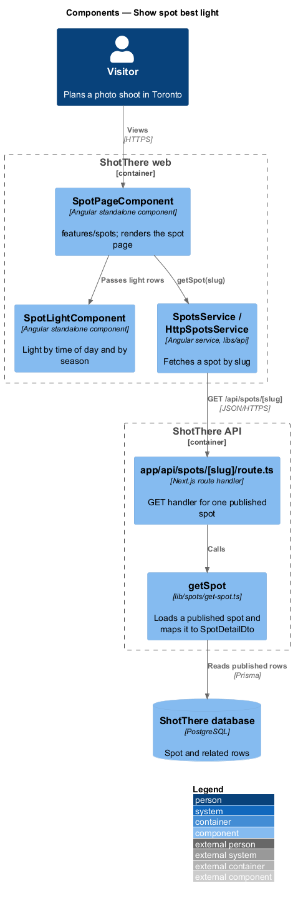
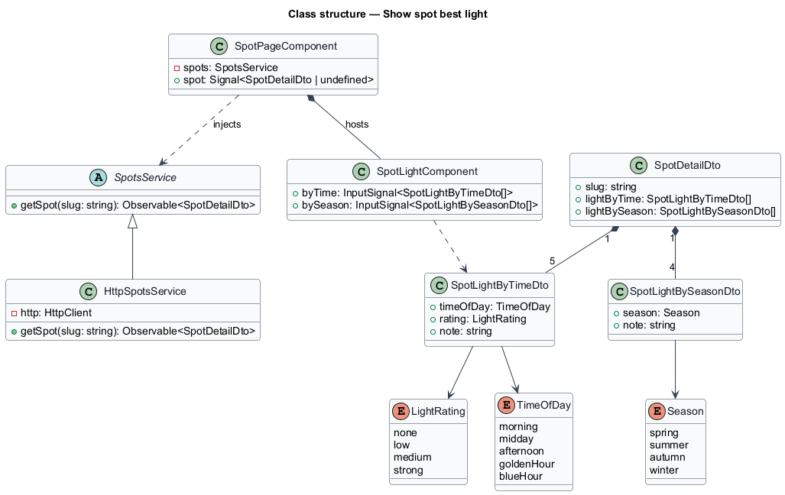
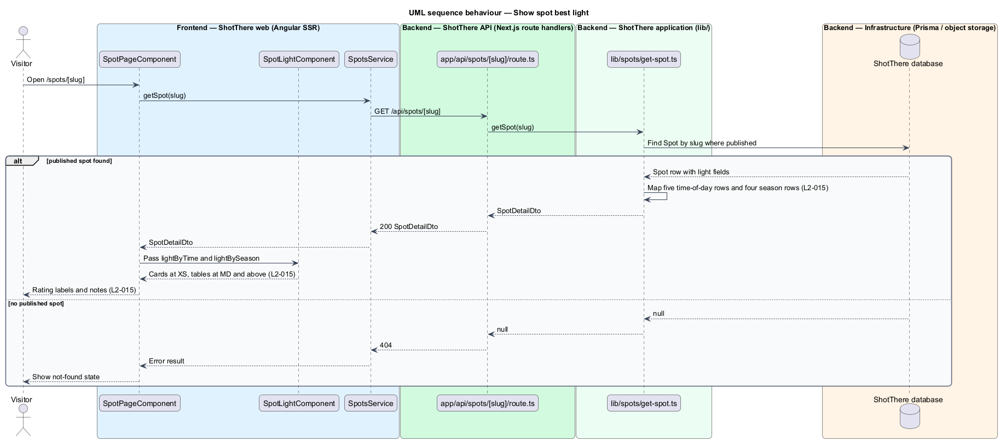

# Show spot best light

## Overview

ShotThere is a review and comparison site for places to shoot photos in Toronto. An *outdoor spot* is a public place, such as a park or a plaza, that ShotThere has shot at first-hand and reviewed. Each published spot has one *spot page* at `/spots/[slug]`, where a *slug* is the short URL-safe name that identifies the spot. Light decides when a spot is worth visiting, so each spot page carries a best light block.

*Best light by time of day* is a rating for five periods (morning, midday, afternoon, golden hour, blue hour), each `none`, `low`, `medium` or `strong`, with a note. *Best light by season* is a note for each of spring, summer, autumn and winter. At XS both read as stacked cards; at MD and above both read as tables.

## Description

The page component, service, route handler and `getSpot` are shared by all outdoor spot features; this slice adds the parts listed below.

- **`SpotPageComponent`** — Angular standalone page component in `features/spots/`, shared by every outdoor spot section. It reads the `slug` route parameter, holds the loaded spot in a signal, and renders each section from a view model built in plain TypeScript beside the page (`spot-page.view-model.ts`).
- **`SpotsService`** — abstract class in `libs/api/.../spots.service.ts` and its own DI token, exposing `getSpot(slug: string): Observable<SpotDetailDto>`.
- **`HttpSpotsService`** — implementation in `http-spots.service.ts`, registered as `{ provide: SpotsService, useClass: HttpSpotsService }`. It calls `GET /api/spots/[slug]`.
- **`app/api/spots/[slug]/route.ts`** — Next.js route handler. It returns `200` with `SpotDetailDto`, or `404` when no published spot matches the slug.
- **`getSpot`** — application function in `lib/spots/get-spot.ts`. It loads a published `Spot` by slug through Prisma, never returns draft content, and maps the row to `SpotDetailDto`.
- **`SpotLightComponent`** — standalone component in `features/spots/` that renders the time-of-day and season blocks. A CSS breakpoint switches between stacked cards (XS) and tables (MD and above). Rating labels such as "Strong" are i18n-marked text chosen in the view model.
- **`LightRating`** — type alias `'none' | 'low' | 'medium' | 'strong'` in `libs/api`.
- **`TimeOfDay`** — type alias `'morning' | 'midday' | 'afternoon' | 'goldenHour' | 'blueHour'`; **`Season`** — `'spring' | 'summer' | 'autumn' | 'winter'`.
- **`SpotLightByTimeDto`** (`timeOfDay`, `rating`, `note`) and **`SpotLightBySeasonDto`** (`season`, `note`) — added to `SpotDetailDto` as `lightByTime` and `lightBySeason`.
- **`Spot`** — Prisma model gains the light fields. Their storage shape (columns or JSON) is `<TO SUPPLY>`; `getSpot` maps them to the DTOs in a fixed order.

## Requirements

The feature realizes the following level-2 (L2) requirements. Each L2 requirement refines a level-1 (L1) requirement, cited by identifier.

| L2 ID | Refines (L1) | Requirement |
|-------|--------------|-------------|
| `L2-015` | `L1-003` | Each outdoor spot page shall show best light by time of day (morning, midday, afternoon, golden hour, blue hour, each rated none, low, medium or strong with a note) and by season (spring, summer, autumn, winter, each with a note). |

## Diagrams

### System context

The visitor reads a spot page on ShotThere. No external system takes part.

### Containers

The ShotThere web container renders the light block from data the ShotThere API reads from the database.

### Components

`SpotPageComponent` passes the light data to `SpotLightComponent`; `getSpot` maps the stored light fields.

### Class structure

`SpotDetailDto` holds lists of `SpotLightByTimeDto` and `SpotLightBySeasonDto`, typed by `LightRating`, `TimeOfDay` and `Season`.

### Behaviour — show best light

`getSpot` returns the five time-of-day rows and four season rows in fixed order; the component renders cards or tables by breakpoint.

