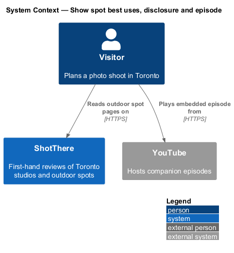
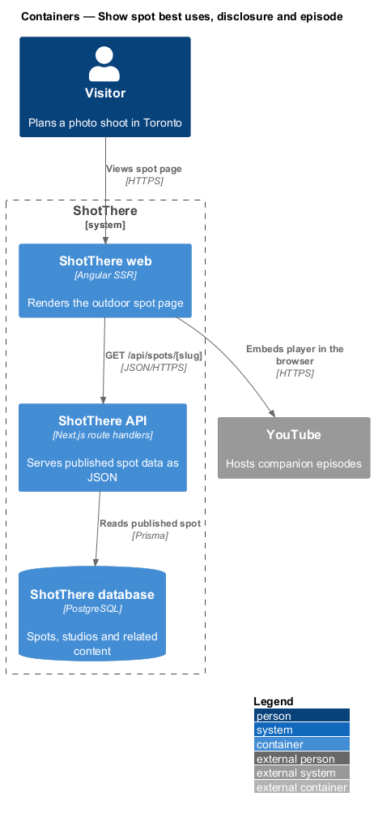
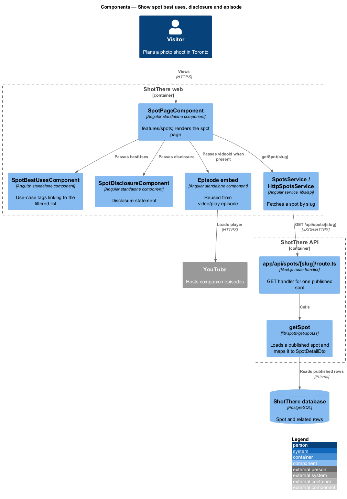
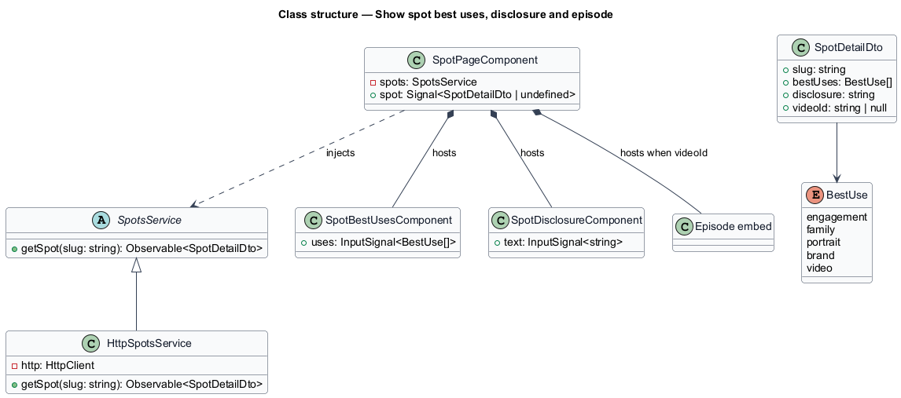
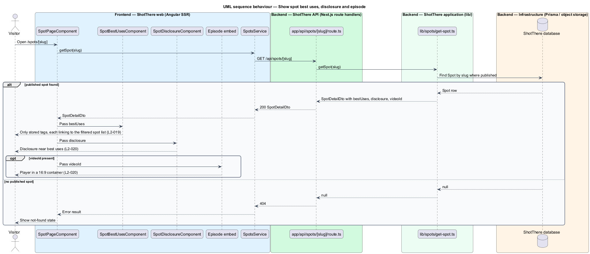

# Show spot best uses, disclosure and episode

## Overview

ShotThere is a review and comparison site for places to shoot photos in Toronto. An *outdoor spot* is a public place, such as a park or a plaza, that ShotThere has shot at first-hand and reviewed. Each published spot has one *spot page* at `/spots/[slug]`, where a *slug* is the short URL-safe name that identifies the spot. This slice tells the visitor what a spot suits, how the review was made, and links the companion video.

*Best uses* are tags from a fixed set: engagement, family, portrait, brand and video. Each tag links to the spot list filtered to that use. The *disclosure statement* is the editorial text that states how the review was produced; it sits near the best uses. The *episode* is the companion YouTube video for the spot, shown only when a video ID is stored. The embed follows the same rules as studio pages and is designed in [play-episode](../../video/play-episode/README.md).

## Description

The page component, service, route handler and `getSpot` are shared by all outdoor spot features; this slice adds the parts listed below.

- **`SpotPageComponent`** — Angular standalone page component in `features/spots/`, shared by every outdoor spot section. It reads the `slug` route parameter, holds the loaded spot in a signal, and renders each section from a view model built in plain TypeScript beside the page (`spot-page.view-model.ts`).
- **`SpotsService`** — abstract class in `libs/api/.../spots.service.ts` and its own DI token, exposing `getSpot(slug: string): Observable<SpotDetailDto>`.
- **`HttpSpotsService`** — implementation in `http-spots.service.ts`, registered as `{ provide: SpotsService, useClass: HttpSpotsService }`. It calls `GET /api/spots/[slug]`.
- **`app/api/spots/[slug]/route.ts`** — Next.js route handler. It returns `200` with `SpotDetailDto`, or `404` when no published spot matches the slug.
- **`getSpot`** — application function in `lib/spots/get-spot.ts`. It loads a published `Spot` by slug through Prisma, never returns draft content, and maps the row to `SpotDetailDto`.
- **`SpotBestUsesComponent`** — standalone component in `features/spots/` that renders one link per stored tag and no others. Each link targets the spot list with the use-case filter in the URL; the path and query come from the central app paths module.
- **`SpotDisclosureComponent`** — standalone component that renders the disclosure statement near the best uses. The statement text source is `<TO SUPPLY>` (per spot or site-wide).
- **Episode embed** — the YouTube embed component from `video/play-episode`, reused unchanged. The page renders it in a 16:9 container only when `videoId` is present; otherwise no video section exists in the DOM.
- **`BestUse`** — `'engagement' | 'family' | 'portrait' | 'brand' | 'video'`.
- **`SpotDetailDto`** gains `bestUses: BestUse[]`, `disclosure: string` and `videoId: string | null`.
- **`Spot`** — Prisma model gains `bestUses`, the disclosure field (if per spot) and `videoId`.

## Requirements

The feature realizes the following level-2 (L2) requirements. Each L2 requirement refines a level-1 (L1) requirement, cited by identifier.

| L2 ID | Refines (L1) | Requirement |
|-------|--------------|-------------|
| `L2-019` | `L1-003` | Each outdoor spot page shall show its best uses from the fixed set: engagement, family, portrait, brand and video. |
| `L2-020` | `L1-003` | Each outdoor spot page shall show the disclosure statement and, when a video ID is stored, the embedded episode, following the same rules as studio pages. |

## Diagrams

### System context

The visitor reads a spot page on ShotThere; when a video ID is stored the browser loads the embedded player from YouTube.

### Containers

The ShotThere web container renders tags, disclosure and the episode embed from data the ShotThere API reads from the database.

### Components

`SpotPageComponent` hosts `SpotBestUsesComponent`, `SpotDisclosureComponent` and the reused episode embed.

### Class structure

`SpotDetailDto` carries `bestUses` typed by `BestUse`, `disclosure` and a nullable `videoId`.

### Behaviour — show best uses, disclosure and episode

The page renders tags and the disclosure for every spot and adds the episode embed only when `videoId` is present. Activating a tag opens the filtered spot list.

