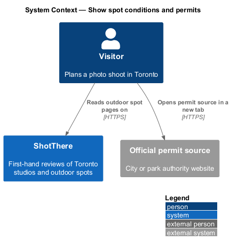
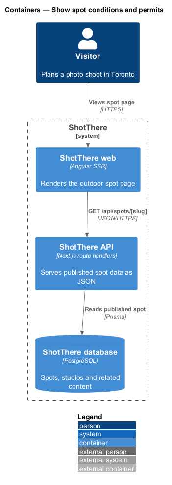
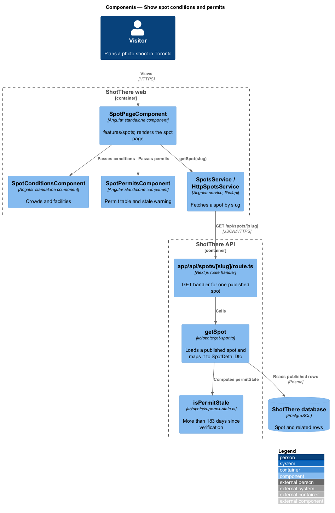
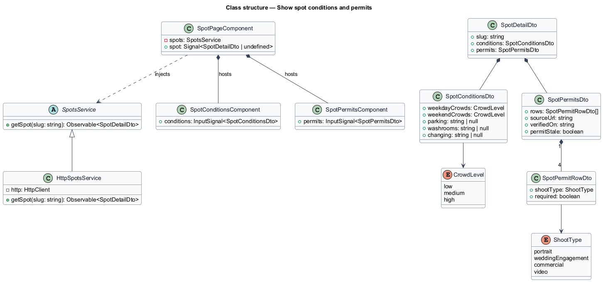
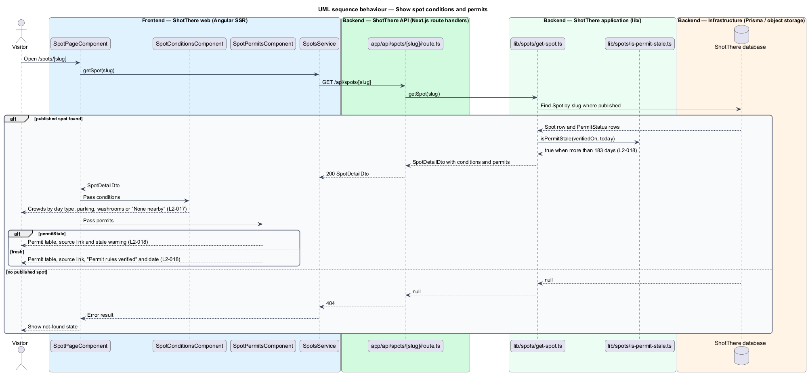

# Show spot conditions and permits

## Overview

ShotThere is a review and comparison site for places to shoot photos in Toronto. An *outdoor spot* is a public place, such as a park or a plaza, that ShotThere has shot at first-hand and reviewed. Each published spot has one *spot page* at `/spots/[slug]`, where a *slug* is the short URL-safe name that identifies the spot. Before a shoot, a photographer checks crowds, facilities and whether a permit applies.

*Practical conditions* are crowds by weekday and weekend (each `low`, `medium` or `high`), parking, washrooms and changing options. A missing facility shows a value such as "None nearby" rather than an empty row. *Permit status* is, for each shoot type (portrait, wedding or engagement, commercial, video), whether a permit is required, with a link to the official source and the date the status was last verified. *Permit stale* is a server-computed flag that is true when that date is more than 183 days before today; the page then shows a stale warning.

## Description

The page component, service, route handler and `getSpot` are shared by all outdoor spot features; this slice adds the parts listed below.

- **`SpotPageComponent`** — Angular standalone page component in `features/spots/`, shared by every outdoor spot section. It reads the `slug` route parameter, holds the loaded spot in a signal, and renders each section from a view model built in plain TypeScript beside the page (`spot-page.view-model.ts`).
- **`SpotsService`** — abstract class in `libs/api/.../spots.service.ts` and its own DI token, exposing `getSpot(slug: string): Observable<SpotDetailDto>`.
- **`HttpSpotsService`** — implementation in `http-spots.service.ts`, registered as `{ provide: SpotsService, useClass: HttpSpotsService }`. It calls `GET /api/spots/[slug]`.
- **`app/api/spots/[slug]/route.ts`** — Next.js route handler. It returns `200` with `SpotDetailDto`, or `404` when no published spot matches the slug.
- **`getSpot`** — application function in `lib/spots/get-spot.ts`. It loads a published `Spot` by slug through Prisma, never returns draft content, and maps the row to `SpotDetailDto`.
- **`SpotConditionsComponent`** — standalone component in `features/spots/` that renders crowd ratings with their day type, parking, washrooms and changing options. At XS each row places the label above the value with no horizontal scroll. Fallback text such as "None nearby" comes from the view model.
- **`SpotPermitsComponent`** — standalone component that renders a row per shoot type ("Required" or "Not required"), the official source link with `target="_blank"` and `rel="noopener"`, and either "Permit rules verified" with the date or a visible stale warning.
- **`CrowdLevel`** — `'low' | 'medium' | 'high'`; **`ShootType`** — `'portrait' | 'weddingEngagement' | 'commercial' | 'video'`.
- **`SpotConditionsDto`** — `weekdayCrowds`, `weekendCrowds`, `parking`, `washrooms`, `changing` (nullable strings for absent facilities).
- **`SpotPermitsDto`** — `rows: SpotPermitRowDto[]` (`shootType`, `required`), `sourceUrl`, `verifiedOn` and `permitStale`.
- **`PermitStatus`** — Prisma model holding one row per spot and shoot type plus the source URL and verification date. **`Spot`** gains the condition fields.
- **`isPermitStale`** — function in `lib/spots/is-permit-stale.ts` that returns true when `verifiedOn` is more than 183 days before today. `getSpot` sets `permitStale` from it; the client never computes staleness.

## Requirements

The feature realizes the following level-2 (L2) requirements. Each L2 requirement refines a level-1 (L1) requirement, cited by identifier.

| L2 ID | Refines (L1) | Requirement |
|-------|--------------|-------------|
| `L2-017` | `L1-003` | Each outdoor spot page shall show crowds (by weekday and weekend, rated low, medium or high), parking, washrooms and changing options. |
| `L2-018` | `L1-003` | Each outdoor spot page shall show the permit status for each shoot type (portrait, wedding or engagement, commercial, video), a link to the official source, and the date it was last verified, with a stale warning when stale. |

## Diagrams

### System context

The visitor reads a spot page on ShotThere and may follow the permit source link to an external official site, which ShotThere does not call.

### Containers

The ShotThere API reads conditions and `PermitStatus` rows from the database and computes `permitStale`.

### Components

`getSpot` calls `isPermitStale`; the page passes conditions to `SpotConditionsComponent` and permits to `SpotPermitsComponent`.

### Class structure

`SpotDetailDto` holds `SpotConditionsDto` and `SpotPermitsDto`; permit rows are typed by `ShootType`.

### Behaviour — show conditions and permits

`getSpot` loads conditions and permit rows and computes `permitStale` on the server; the page shows either the verified date or the stale warning.

