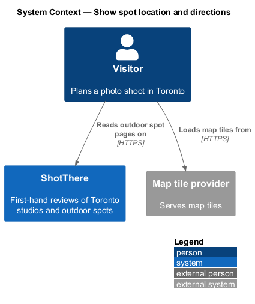
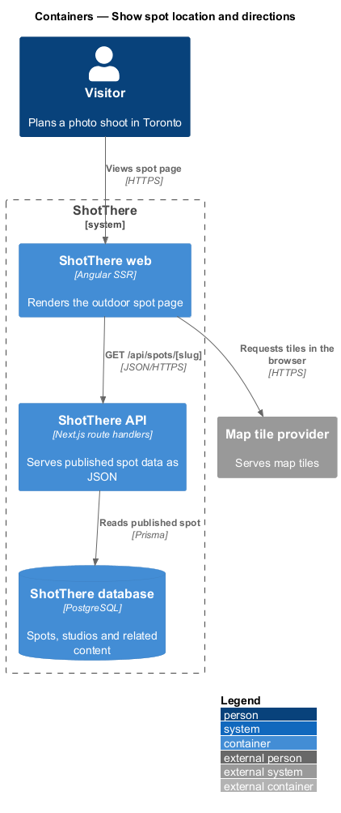
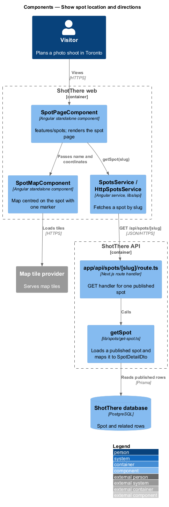
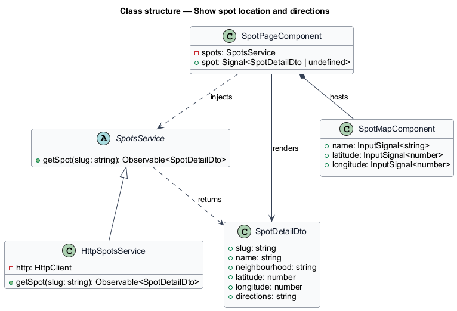
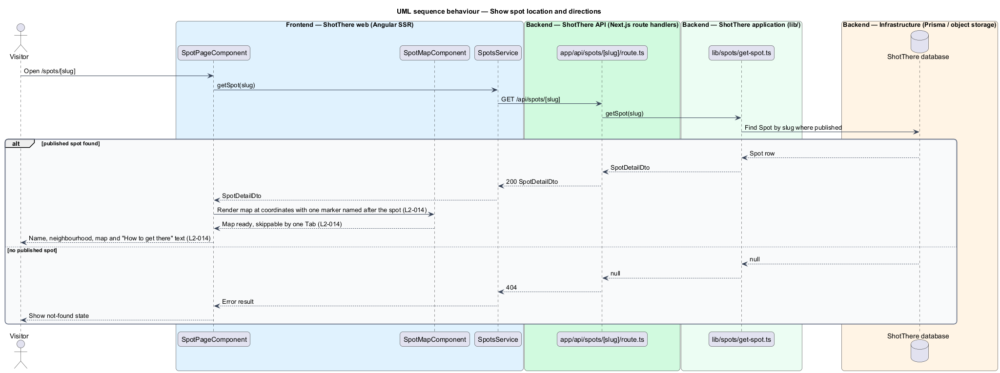

# Show spot location and directions

## Overview

ShotThere is a review and comparison site for places to shoot photos in Toronto. An *outdoor spot* is a public place, such as a park or a plaza, that ShotThere has shot at first-hand and reviewed. Each published spot has one *spot page* at `/spots/[slug]`, where a *slug* is the short URL-safe name that identifies the spot. This feature is the first slice of the spot page and introduces the page itself.

The slice shows where the spot is and how to reach it: the spot name, its neighbourhood, an embedded map centred on the spot's coordinates with a single marker, and "How to get there" text. *Directions text* is free text entered by the owner that covers transit, driving and walking; the page shows it as entered.

## Description

The page component, service, route handler and `getSpot` are shared by all outdoor spot features; this slice adds the parts listed below.

- **`SpotPageComponent`** — Angular standalone page component in `features/spots/`, shared by every outdoor spot section. It reads the `slug` route parameter, holds the loaded spot in a signal, and renders each section from a view model built in plain TypeScript beside the page (`spot-page.view-model.ts`).
- **`SpotsService`** — abstract class in `libs/api/.../spots.service.ts` and its own DI token, exposing `getSpot(slug: string): Observable<SpotDetailDto>`.
- **`HttpSpotsService`** — implementation in `http-spots.service.ts`, registered as `{ provide: SpotsService, useClass: HttpSpotsService }`. It calls `GET /api/spots/[slug]`.
- **`app/api/spots/[slug]/route.ts`** — Next.js route handler. It returns `200` with `SpotDetailDto`, or `404` when no published spot matches the slug.
- **`getSpot`** — application function in `lib/spots/get-spot.ts`. It loads a published `Spot` by slug through Prisma, never returns draft content, and maps the row to `SpotDetailDto`.
- **`SpotMapComponent`** — standalone component in `features/spots/` that renders an embedded map centred on `latitude` and `longitude` with one marker whose accessible name is the spot name. The map region is followed by a focusable element so a keyboard user leaves it with one Tab press, and the map shall not trap focus. At XS the map is at least 240px tall and full content width. The map library is `<TO SUPPLY>`; tiles come from the map tile provider (`<TO SUPPLY>`).
- **`SpotDetailDto`** — response type in `libs/api` with `slug`, `name`, `neighbourhood`, `latitude`, `longitude` and `directions` for this slice. Later spot slices add their own fields.
- **`Spot`** — Prisma model with `slug`, `name`, `neighbourhood`, `latitude`, `longitude`, `directions` and a publication status.
- **Route and title** — the `/spots/:slug` route lives in `features/spots/routes.ts`; its path and page title suffix come from the central app paths and titles module.

## Requirements

The feature realizes the following level-2 (L2) requirements. Each L2 requirement refines a level-1 (L1) requirement, cited by identifier.

| L2 ID | Refines (L1) | Requirement |
|-------|--------------|-------------|
| `L2-014` | `L1-003` | Each outdoor spot page shall show the spot's name, neighbourhood, an embedded map centred on its coordinates with a single marker, and "How to get there" text covering transit, driving and walking as entered. |

## Diagrams

### System context

The visitor reads a spot page on ShotThere; the visitor's browser loads map tiles from the map tile provider.

### Containers

The ShotThere web container renders the page and fetches the spot from the ShotThere API, which reads the published `Spot` from the database.

### Components

`SpotPageComponent` loads the spot through `SpotsService` and passes coordinates and name to `SpotMapComponent`. The route handler delegates to `getSpot`.

### Class structure

`HttpSpotsService` implements the `SpotsService` contract. `SpotPageComponent` and `SpotMapComponent` consume `SpotDetailDto`.

### Behaviour — load the spot location

The page fetches the spot; on success it renders name, neighbourhood, the map and the directions text, and a missing or draft spot yields a not-found state.

