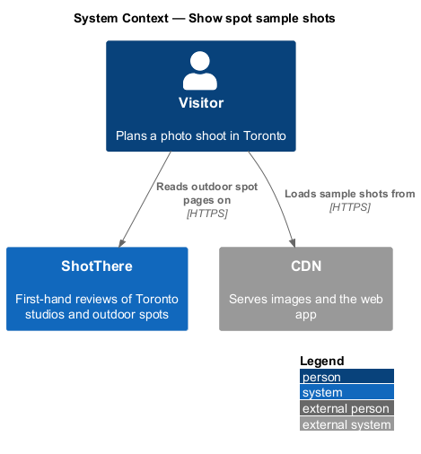
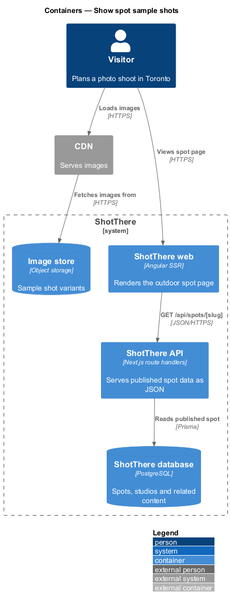
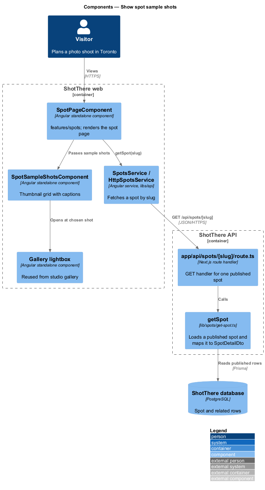
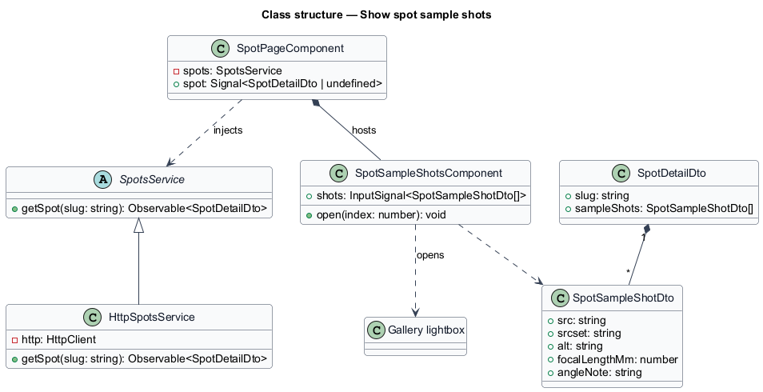
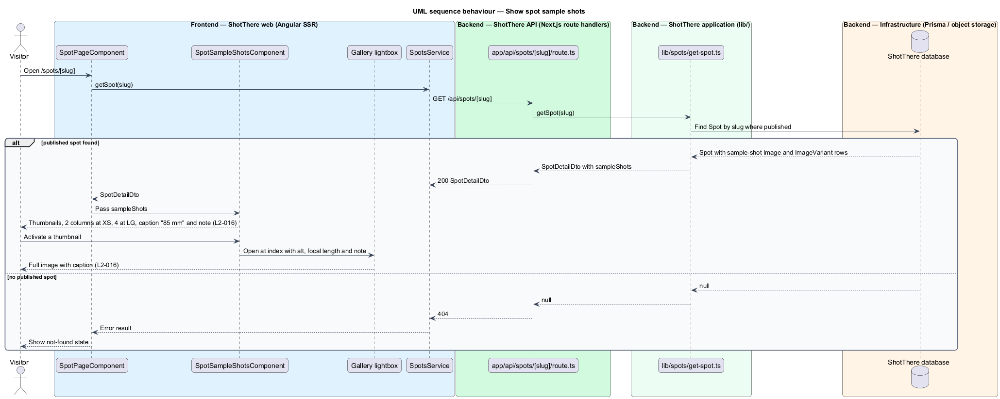

# Show spot sample shots

## Overview

ShotThere is a review and comparison site for places to shoot photos in Toronto. An *outdoor spot* is a public place, such as a park or a plaza, that ShotThere has shot at first-hand and reviewed. Each published spot has one *spot page* at `/spots/[slug]`, where a *slug* is the short URL-safe name that identifies the spot. Sample shots show what the spot looks like through a camera.

A *sample shot* is a photo taken at the spot during the review, stored as an `Image` with alt text, a focal length in millimetres and an angle or position note. The page shows sample shots as thumbnails; activating one opens the *gallery lightbox*, a full-screen image viewer already designed for studio galleries in [show-studio-test-shots-and-gallery](../../studio-reviews/show-studio-test-shots-and-gallery/README.md). This slice reuses that lightbox rather than adding a second one.

## Description

The page component, service, route handler and `getSpot` are shared by all outdoor spot features; this slice adds the parts listed below.

- **`SpotPageComponent`** — Angular standalone page component in `features/spots/`, shared by every outdoor spot section. It reads the `slug` route parameter, holds the loaded spot in a signal, and renders each section from a view model built in plain TypeScript beside the page (`spot-page.view-model.ts`).
- **`SpotsService`** — abstract class in `libs/api/.../spots.service.ts` and its own DI token, exposing `getSpot(slug: string): Observable<SpotDetailDto>`.
- **`HttpSpotsService`** — implementation in `http-spots.service.ts`, registered as `{ provide: SpotsService, useClass: HttpSpotsService }`. It calls `GET /api/spots/[slug]`.
- **`app/api/spots/[slug]/route.ts`** — Next.js route handler. It returns `200` with `SpotDetailDto`, or `404` when no published spot matches the slug.
- **`getSpot`** — application function in `lib/spots/get-spot.ts`. It loads a published `Spot` by slug through Prisma, never returns draft content, and maps the row to `SpotDetailDto`.
- **`SpotSampleShotsComponent`** — standalone component in `features/spots/` that renders thumbnails in 2 columns at XS and 4 columns at LG and above. Each caption shows the focal length (for example "85 mm") and the angle note. Activating a thumbnail opens the gallery lightbox at that image.
- **Gallery lightbox** — the lightbox component and its accessible dialog primitive from `studio-reviews/show-studio-test-shots-and-gallery`, reused unchanged. Its caption input receives the focal length and note.
- **`SpotSampleShotDto`** — `src`, `srcset` (variants 480/960/1440/2048), `alt`, `focalLengthMm` and `angleNote`; added to `SpotDetailDto` as `sampleShots`.
- **`Image`** and **`ImageVariant`** — Prisma models for the stored photo and its `sharp` variants in the image store. The link from `Spot` to its sample-shot `Image` rows and their order is `<TO SUPPLY>`.
- **`getSpot`** — includes the sample-shot images and variants and maps them to `SpotSampleShotDto` with CDN URLs.

## Requirements

The feature realizes the following level-2 (L2) requirements. Each L2 requirement refines a level-1 (L1) requirement, cited by identifier.

| L2 ID | Refines (L1) | Requirement |
|-------|--------------|-------------|
| `L2-016` | `L1-003` | Each outdoor spot page shall show sample shots, each with alt text, focal length, and an angle or position note, openable in the same lightbox as the studio gallery. |

## Diagrams

### System context

The visitor reads a spot page on ShotThere; image files reach the browser through the CDN.

### Containers

The ShotThere API reads image metadata from the database. Image files live in the image store behind the CDN.

### Components

`SpotSampleShotsComponent` renders thumbnails and hands the chosen shot to the reused gallery lightbox.

### Class structure

`SpotDetailDto` holds a list of `SpotSampleShotDto`; `SpotSampleShotsComponent` consumes it and opens the lightbox.

### Behaviour — open a sample shot

The page loads sample shots with the spot. When the visitor activates a thumbnail, the lightbox opens with a caption that includes the focal length and note.

