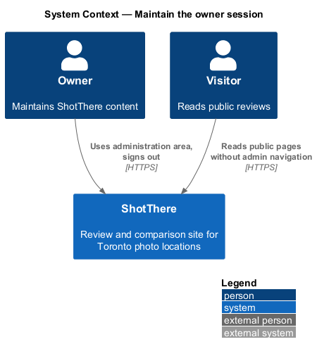
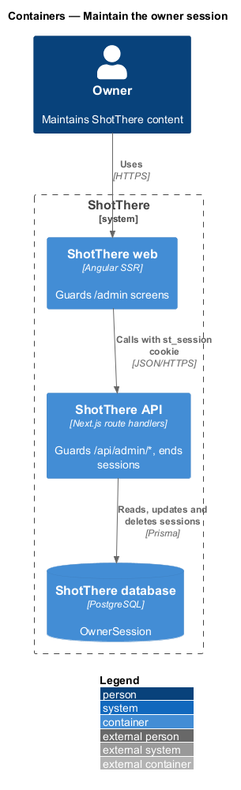
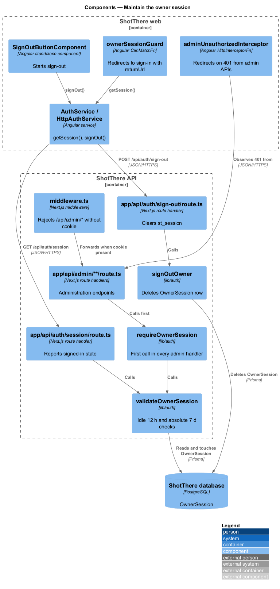
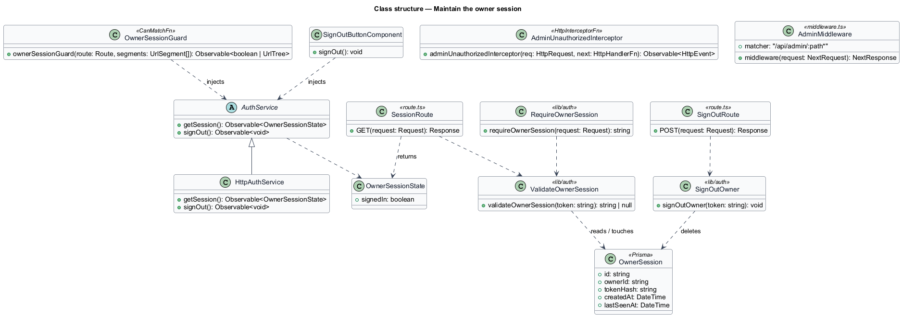
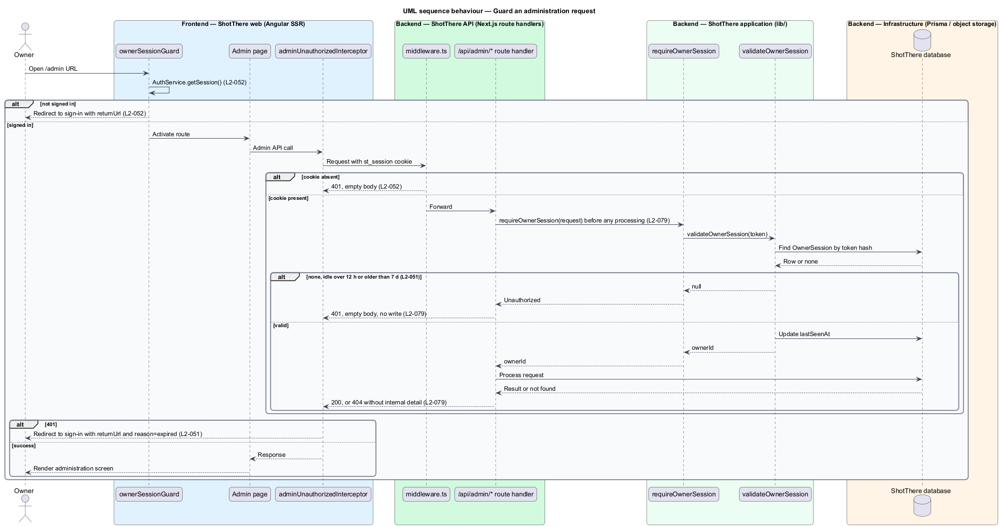
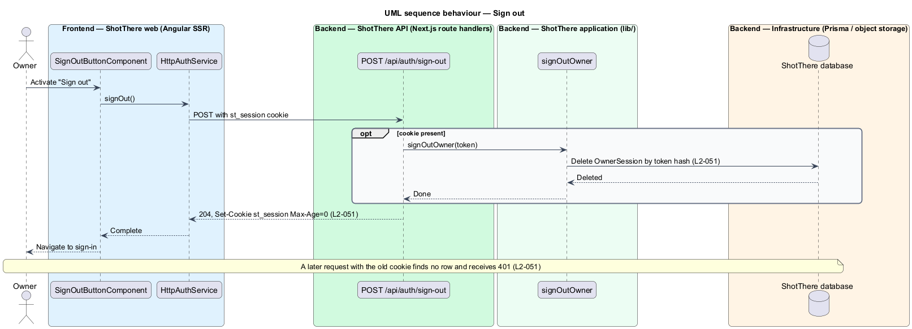

# Maintain the owner session

## Overview

ShotThere is a review and comparison site for photo locations in Toronto. One owner maintains its content through an administration area. The sibling feature `sign-in-as-owner` creates an owner session at sign-in. This feature keeps that session safe for its lifetime and ends it on sign-out.

- **owner session** — server-side record, held in the `OwnerSession` table, that marks a browser as signed in as the owner
- **session cookie** — HttpOnly, Secure, SameSite=Lax cookie `st_session` that carries the random token of one owner session
- **idle timeout** — maximum gap of 12 hours between two uses of a session before it stops being valid
- **absolute lifetime** — maximum age of 7 days after which a session stops being valid regardless of activity
- **session guard** — server check that rejects any administration API request lacking a valid owner session
- **return destination** — administration URL the owner originally requested, kept so sign-in can return there

Every administration screen under `/admin` and every endpoint under `/api/admin/*` requires a valid owner session. The API rejects a missing, forged, idle or expired session with HTTP 401 before any processing. The Angular route guard sends a visitor without a session to the sign-in screen and preserves the return destination. Sign-out deletes the session row and clears the cookie, so the old cookie stops working. Public pages show no administration navigation to visitors without a session.

## Description

The slice spans the Angular route guard, the Next.js middleware and the session functions in `lib/auth`.

- **`ownerSessionGuard`** — functional `CanMatchFn` in `frontend/src/app/core/auth/owner-session.guard.ts`, applied to the `/admin` routes in `features/admin/routes.ts`. It calls `AuthService.getSession()`. Without a session it redirects to the sign-in path with a `returnUrl` query parameter and, after expiry, a `reason=expired` parameter.
- **`AuthService`** — abstract class in `libs/api/src/auth.service.ts`, shared with `sign-in-as-owner`. This slice adds `getSession(): Observable<OwnerSessionState>` and `signOut(): Observable<void>`.
- **`HttpAuthService`** — implementation in `libs/api/src/http-auth.service.ts`. It calls `GET /api/auth/session` and `POST /api/auth/sign-out` with credentials included.
- **`OwnerSessionState`** — DTO with `signedIn: boolean`. It carries no token, email or other owner identity.
- **`adminUnauthorizedInterceptor`** — functional `HttpInterceptorFn` in `frontend/src/app/core/auth/`. On HTTP 401 from an `/api/admin/*` call it redirects to sign-in with the current URL and `reason=expired`.
- **`SignOutButtonComponent`** — standalone component in the administration shell. It calls `AuthService.signOut()` and then navigates to the sign-in screen.
- **Sign-in message** — `SignInPageComponent` from `sign-in-as-owner` reads `reason=expired` through its view model and shows an i18n-marked session-expired message. On success it returns to the validated `returnUrl` when that URL starts with `/admin`.
- **Admin navigation** — the public shell renders administration navigation only when `getSession()` reports `signedIn: true` (`L2-052`).
- **`backend/middleware.ts`** — Next.js middleware with matcher `/api/admin/:path*`. It answers HTTP 401 with an empty body when the `st_session` cookie is absent. It runs before every route handler (`L2-079`).
- **`lib/auth/require-owner-session.ts`** — `requireOwnerSession(request)` called first in every `/api/admin/*` route handler, since the middleware does not reach the database. It hashes the cookie token and loads the `OwnerSession` row through `validateOwnerSession`. It throws an unauthorized error, mapped to HTTP 401 with no body, before any read or write.
- **`lib/auth/validate-owner-session.ts`** — `validateOwnerSession(token)` rejects a missing row, a `lastSeenAt` older than 12 hours or a `createdAt` older than 7 days. On success it updates `lastSeenAt` and returns the owner identifier.
- **`app/api/auth/session/route.ts`** — `GET` route handler that returns `OwnerSessionState` using `validateOwnerSession`.
- **`app/api/auth/sign-out/route.ts`** — `POST` route handler. It calls `signOutOwner` and clears `st_session` with `Max-Age=0`. It answers HTTP 204.
- **`lib/auth/sign-out-owner.ts`** — `signOutOwner(token)` deletes the matching `OwnerSession` row.
- **Error responses** — admin route handlers map a missing record to HTTP 404 with a generic body and no internal identifiers or stack traces (`L2-079`).
- **Public DTOs** — public read endpoints return DTOs that exclude owner email, password hash, session and subscriber fields (`L2-079`).
- **Prisma model** — `OwnerSession` (`id`, `ownerId`, `tokenHash`, `createdAt`, `lastSeenAt`), introduced by `sign-in-as-owner`.
- **Expired row cleanup** — the schedule that deletes expired `OwnerSession` rows is `<TO SUPPLY>`.

## Requirements

The feature realizes the following level-2 (L2) requirements. Each L2 requirement refines a level-1 (L1) requirement, cited by identifier.

| L2 ID | Refines (L1) | Requirement |
|-------|--------------|-------------|
| `L2-051` | `L1-013` | The session shall be carried in an HTTP-only, Secure, SameSite cookie, shall expire after 12 hours of inactivity and 7 days absolute, and sign-out shall invalidate it server-side. |
| `L2-052` | `L1-013` | Every administration screen and every administration API endpoint shall require a valid owner session. |
| `L2-079` | `L1-019` | Every administration API endpoint shall check for a valid owner session before any processing, and public read endpoints shall never expose draft content, owner identity, or subscriber data. |

## Diagrams

### System context

The owner uses ShotThere's administration area. No external system takes part in session handling.

### Containers

The Angular web app guards `/admin` screens. The API guards `/api/admin/*` and reads session rows in PostgreSQL.

### Components

The route guard and interceptor protect screens. The middleware and `requireOwnerSession` protect endpoints, and the sign-out handler deletes the session.

### Class structure

The frontend depends on the `AuthService` contract. The backend session functions share the `OwnerSession` model.

### Behaviour — guard an administration request

An admin API call passes through the middleware and `requireOwnerSession`. A missing, idle or expired session ends in HTTP 401 and a redirect to sign-in.

### Behaviour — sign out

Sign-out deletes the session row and clears the cookie. A later request with the old cookie is rejected.

