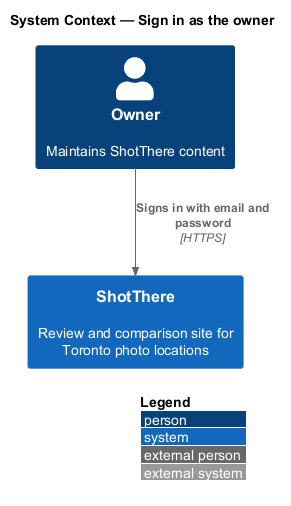
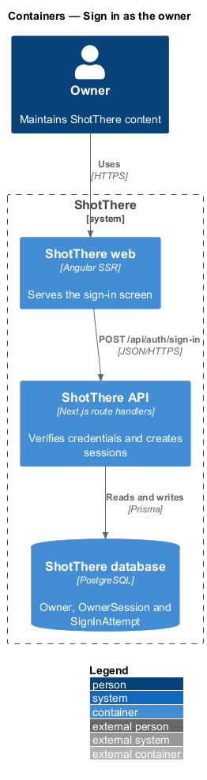
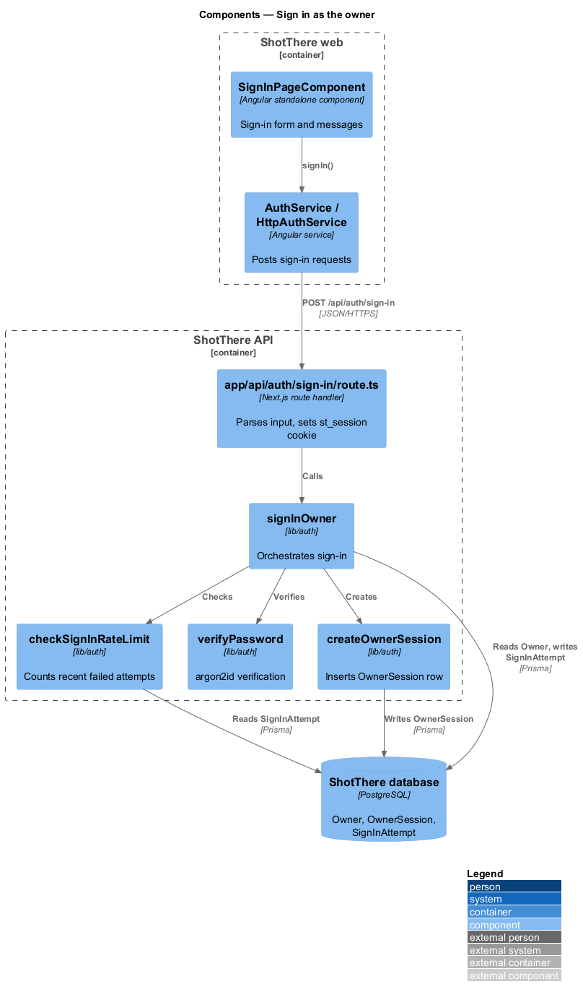
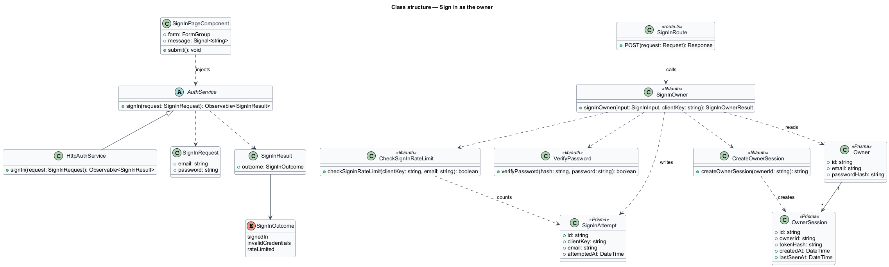
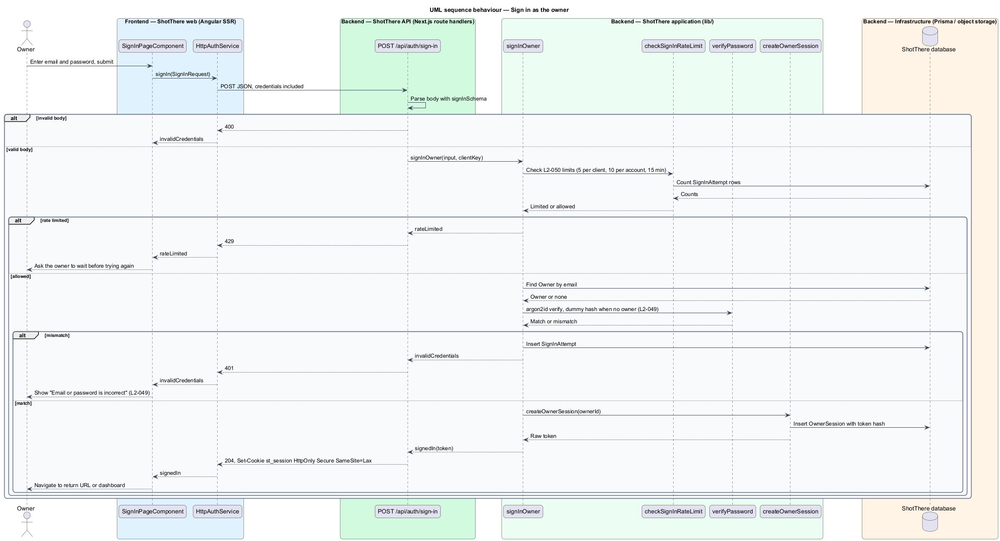

# Sign in as the owner

## Overview

ShotThere is a review and comparison site for photo locations in Toronto. One person maintains its content through an administration area. This feature covers how that person proves identity and opens a session.

- **owner** — single account holder permitted to maintain ShotThere content
- **owner account** — stored record of the owner's email address and password hash, held in the `Owner` table
- **password hash** — salted output of a deliberately slow one-way function, stored in place of the password
- **owner session** — server-side record that marks a browser as signed in as the owner, held in the `OwnerSession` table
- **sign-in attempt** — stored record of one failed credential check, keyed by client and by account, held in the `SignInAttempt` table

The sign-in screen takes an email address and a password. The API verifies both against the owner account and answers with one generic message on any mismatch. A failed check never reveals which field was wrong. A rate limit slows repeated failures from one client, or against the account from any client. A successful check creates an owner session and sets the `st_session` cookie. Session lifetime, sign-out and route protection belong to the sibling feature `maintain-owner-session`.

## Description

The slice runs from the Angular sign-in page to the PostgreSQL database.

- **`SignInPageComponent`** — standalone Angular page in `frontend/src/app/features/admin-auth/`. It holds a reactive form with email and password fields, full width at XS. It shows "Email or password is incorrect" on HTTP 401 and a wait message on HTTP 429. On success it navigates to the return destination or the administration dashboard.
- **`sign-in-view-model.ts`** — plain TypeScript beside the page. It maps API outcomes to i18n-marked messages and resolves the post-sign-in destination.
- **`AuthService`** — abstract class in `libs/api/src/auth.service.ts` and its own DI token. It declares `signIn(request: SignInRequest): Observable<SignInResult>`.
- **`HttpAuthService`** — implementation in `libs/api/src/http-auth.service.ts`. It posts to `/api/auth/sign-in` with credentials included and maps HTTP 204, 401 and 429 to `SignInResult`.
- **`SignInRequest`** — DTO with `email: string` and `password: string`.
- **`SignInResult`** — result type whose `outcome` is one of `signedIn`, `invalidCredentials` and `rateLimited`.
- **`app/api/auth/sign-in/route.ts`** — Next.js `POST` route handler. It parses the body with `signInSchema`, calls `signInOwner`, sets the `st_session` cookie and the readable `st_csrf` cookie on success (see [secure-requests](../../platform/secure-requests/README.md)), and answers 204, 400, 401 or 429. The response body never carries the session identifier.
- **`signInSchema`** — zod schema in `lib/auth/schemas.ts`. It requires a well-formed email and a non-empty password.
- **`lib/auth/sign-in-owner.ts`** — application function `signInOwner(input, clientKey)`. It checks the rate limit, verifies credentials, then records a failed attempt or creates the session.
- **`lib/auth/check-sign-in-rate-limit.ts`** — counts `SignInAttempt` rows from the last 15 minutes. It reports a limit when the client has 5 failures or the account has 10 failures.
- **`lib/auth/verify-password.ts`** — wraps `argon2id` verification. When no owner matches the email, it verifies against a fixed dummy hash so every path takes comparable time (`L2-049`).
- **`lib/auth/create-owner-session.ts`** — inserts an `OwnerSession` row holding a hash of a random token and a `csrfToken`, and returns the raw token for the cookie.
- **Prisma models** — `Owner` (`id`, `email`, `passwordHash`), `OwnerSession` (`id`, `ownerId`, `tokenHash`, `createdAt`, `lastSeenAt`) and `SignInAttempt` (`id`, `clientKey`, `email`, `attemptedAt`).
- **Client key** — derived from the client IP address. The trusted proxy header that carries it behind the CDN is `<TO SUPPLY>`.
- **Password algorithm** — `argon2id` is the design choice for the slow, salted hash. Its cost parameters are `<TO SUPPLY>`.
- **Owner provisioning** — the mechanism that creates the single owner row and its initial hash is `<TO SUPPLY>`.

## Requirements

The feature realizes the following level-2 (L2) requirements. Each L2 requirement refines a level-1 (L1) requirement, cited by identifier.

| L2 ID | Refines (L1) | Requirement |
|-------|--------------|-------------|
| `L2-049` | `L1-013` | The administration area shall provide a sign-in screen that takes an email and password, verified against a single owner account whose password is stored as a salted, slow hash. Sign-in shall not reveal which of the two fields was wrong. |
| `L2-050` | `L1-013` | Sign-in attempts shall be rate-limited per client and per account to slow credential guessing. |

## Diagrams

### System context

The owner signs in to ShotThere directly. No external system takes part in sign-in.

### Containers

The Angular web app posts credentials to the API. The API reads the owner account and writes attempts and sessions in PostgreSQL.

### Components

The route handler delegates to `signInOwner`, which composes the rate-limit check, password verification and session creation.

### Class structure

The frontend depends only on the `AuthService` contract. The backend functions read and write three Prisma models.

### Behaviour — sign in

A successful sign-in sets the cookie and navigates onward. Rate-limited and invalid attempts return 429 and 401 and create no session.

