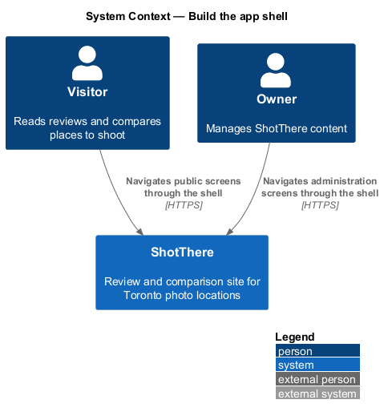
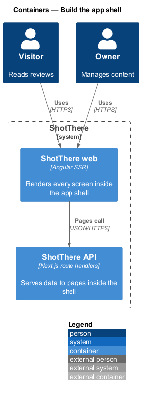
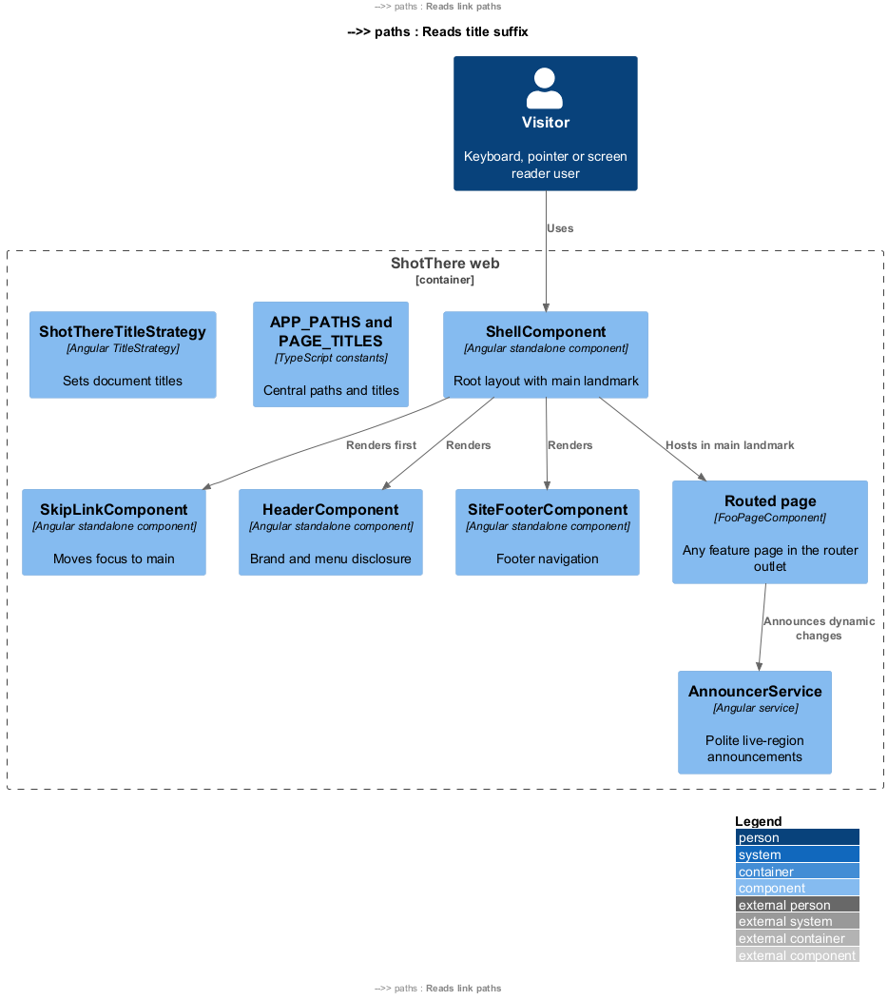
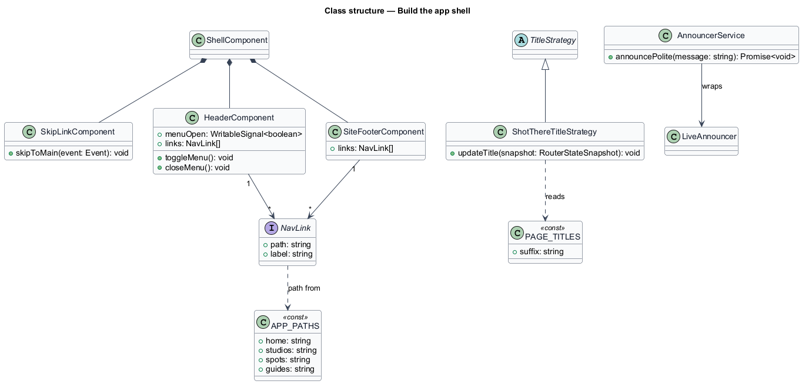
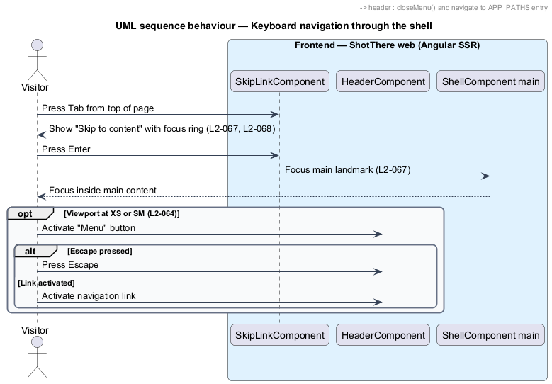
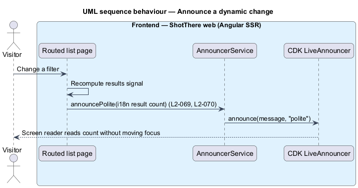

# Build the app shell

## Overview

ShotThere is a review and comparison site for places to shoot photos in Toronto. One Angular application in `frontend/` renders every public and administration screen. The *app shell* is the frame around every screen: the header, the main landmark, the footer, and the shared foundations that each page relies on.

The shell solves layout, keyboard access, focus visibility, announcements, and language markup once instead of per page. A *breakpoint* is a named viewport width range (XS, SM, MD, LG, XL) at which the layout changes. A *menu disclosure* is a button that shows or hides a list of navigation links and reports its state through `aria-expanded`. A *skip link* is the first focusable link on a page that moves focus past the header to the main content. A *live region* is an element whose text changes screen readers read aloud without moving focus.

The shell has no backend dependency. Pages from every other feature render inside it and use its announcer, layout container, and focus styles.

## Description

- **`ShellComponent`** (`core/shell/shell.component.ts`, `.html`, `.css`) — standalone root layout. It renders `SkipLinkComponent`, `HeaderComponent`, one `<main id="main" tabindex="-1">` holding the `<router-outlet>`, and `SiteFooterComponent`. Its styles add `env(safe-area-inset-*)` padding to the header and footer.
- **`SkipLinkComponent`** (`core/shell/skip-link.component.ts`) — renders a "Skip to content" link as the first focusable element. Activation moves focus to `#main`. The link stays visually hidden until it receives focus.
- **`HeaderComponent`** (`core/shell/header.component.ts`) — renders the brand link and primary navigation. Below MD it shows a "Menu" button with `aria-expanded` and `aria-controls` that toggles the link list through a `menuOpen` signal. At MD and above the links render inline and the button is hidden. Escape closes the open menu and returns focus to the button. Each link and the button are at least 44px tall.
- **`SiteFooterComponent`** (`core/layout/site-footer.component.ts`) — renders footer navigation and the copyright line inside the `contentinfo` landmark.
- **`NavLink`** (`core/shell/nav-link.ts`) — interface with `path: string` and `label: string` for one header or footer link.
- **`APP_PATHS`** (`core/routing/app-paths.ts`) and **`PAGE_TITLES`** (`core/routing/page-titles.ts`) — the central constants for every app path and page title. Navigation links and route definitions read paths from `APP_PATHS`.
- **`ShotThereTitleStrategy`** (`core/routing/shot-there-title-strategy.ts`) — extends the Angular `TitleStrategy` and appends the site suffix from `PAGE_TITLES` to each route title.
- **`AnnouncerService`** (`core/a11y/announcer.service.ts`) — root-provided service that wraps the Angular CDK `LiveAnnouncer`. Its `announcePolite(message)` method writes to a polite live region. List pages call it with the result count after a filter change.
- **Global foundations** (`src/styles/`) — `layout.css` defines the `.st-container` utility with `max-width: 1280px`, centred with side gutters. `focus.css` defines one `:focus-visible` outline of at least 2px from the `--st-color-focus-ring` role token. `a11y.css` defines `.st-visually-hidden`. Styles read tokens by role, never by hex value.
- **`index.html`** — declares `<html lang="en-CA">`. **`app.config.ts`** provides `LOCALE_ID` as `en-CA`, zoneless change detection, `provideRouter` with `ShotThereTitleStrategy`, and client hydration. Date and currency pipes then format for `en-CA`.
- **Template i18n lint** — `eslint.config.js` enables the `@angular-eslint/template/i18n` rule with `checkText: true`. The frontend lint then fails on unmarked template text. All shell text carries `i18n` attributes.
- **`ShellPage`** (`e2e/pages/shell.page.ts`) — Playwright page object owning the skip link, menu button, navigation links, main landmark, and footer. Acceptance tests run in Chromium at 320px, 200% zoom, and landscape SM, and include an axe-core scan of the shell.
- Dialog focus trapping and the contrast of individual components belong to the components that own them; the shell supplies the focus style and tokens they use. Theme token values come from `docs/design-system/` `<TO SUPPLY>`.

## Requirements

The shell realizes the following level-2 (L2) requirements. Each refines the level-1 (L1) requirement cited.

| L2 ID | Refines (L1) | Requirement |
|-------|--------------|-------------|
| `L2-064` | `L1-015` | Every public and administration screen shall lay out correctly at XS, SM, MD, LG, and XL, with navigation collapsing to a menu button at XS and SM. |
| `L2-065` | `L1-015` | Fixed and sticky elements shall respect device safe-area insets; interactive targets shall be at least 24px by 24px, and pointer targets in primary flows shall be at least 44px by 44px. |
| `L2-066` | `L1-015` | Screens shall work in portrait and landscape and at 200% browser zoom without loss of content or function. |
| `L2-067` | `L1-016` | Every interactive element shall be reachable and operable by keyboard in a logical order with a visible focus indicator, and every page shall offer a skip link to main content. |
| `L2-068` | `L1-016` | Text shall meet 4.5:1 contrast (3:1 for large text), UI components and graphical indicators shall meet 3:1, and every informative image shall have alt text, in both light and dark themes. |
| `L2-069` | `L1-016` | Pages shall use landmarks and a correct heading outline, form controls shall have programmatic labels and error associations, and dynamic changes shall be announced. |
| `L2-070` | `L1-016` | All user-facing text shall be marked for translation and the document language shall be declared. |

## Diagrams

### System context

Visitors and the owner reach every ShotThere screen through the same shell.

### Containers

The shell lives in the ShotThere web container. The API appears only because pages inside the shell call it.

### Components

`ShellComponent` composes the skip link, header, and footer around the routed page. Pages call `AnnouncerService` for dynamic changes.

### Class structure

The header and footer read paths from `APP_PATHS`, and `ShotThereTitleStrategy` reads the title suffix from `PAGE_TITLES`.

### Behaviour — keyboard navigation

A keyboard user tabs to the skip link to reach the main landmark and, at XS or SM, opens and closes the menu disclosure.

### Behaviour — announce a dynamic change

A list page reports a new result count through `AnnouncerService`, which writes to a polite live region.

