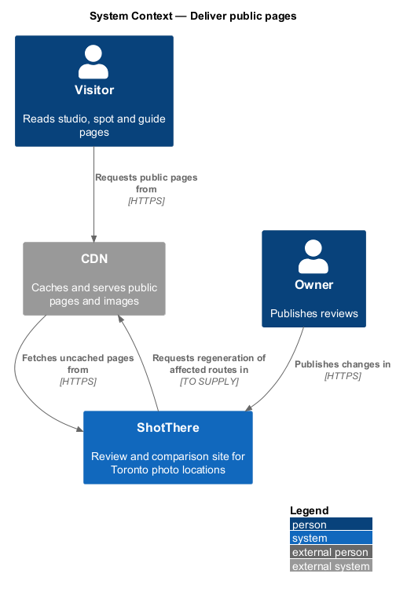
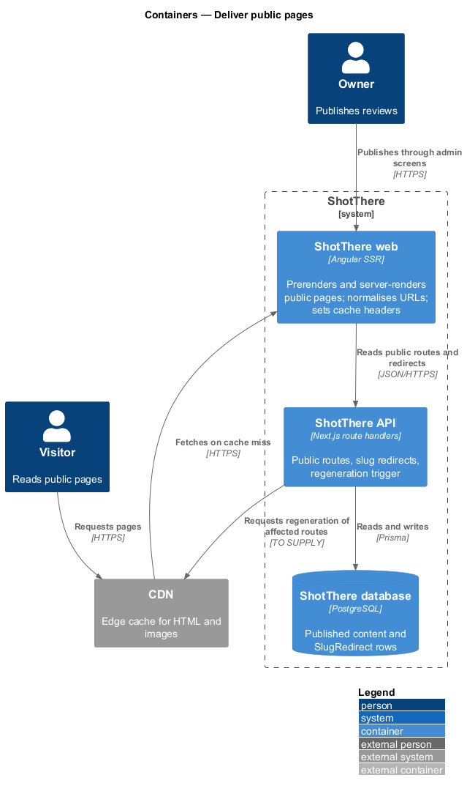
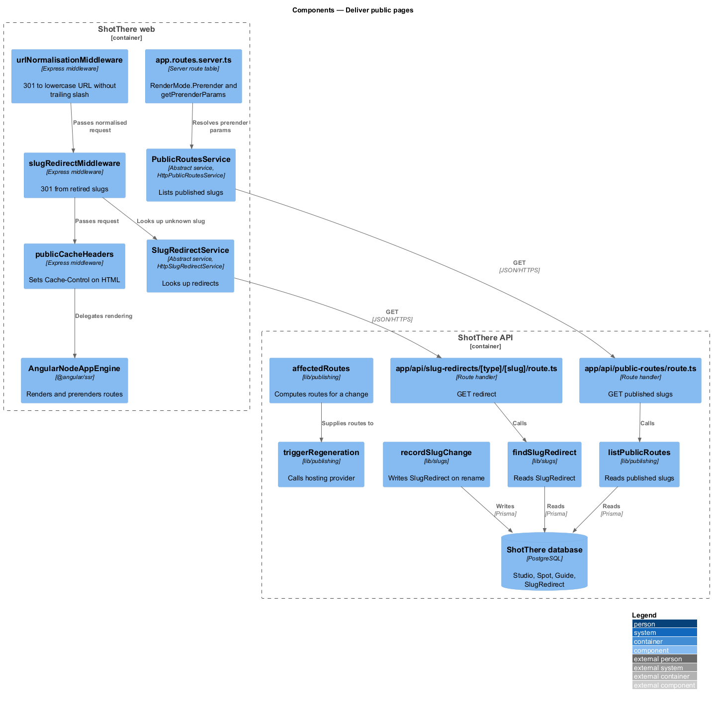
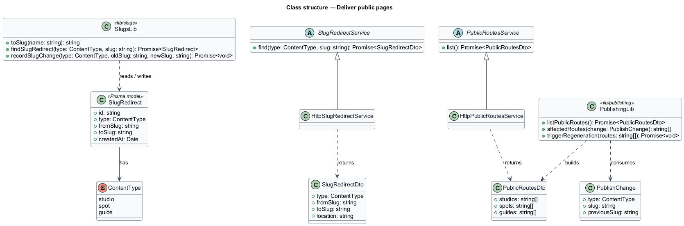
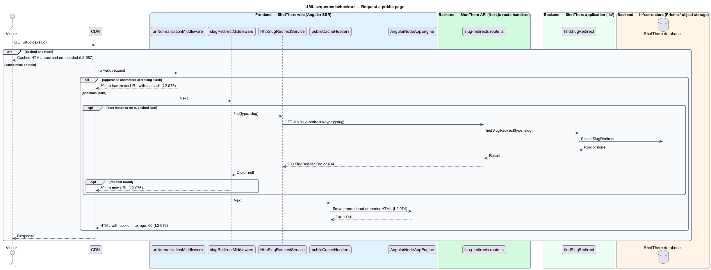
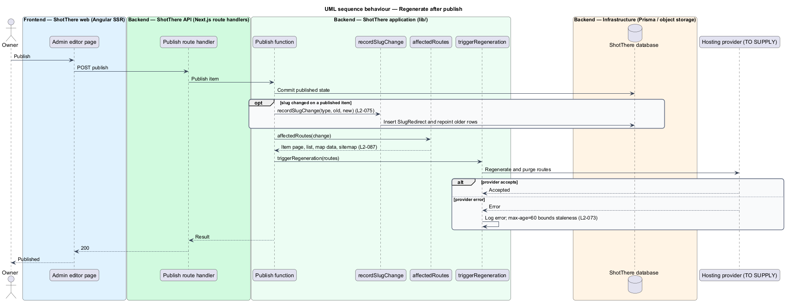

# Deliver public pages

## Overview

ShotThere is a review and comparison site for places to shoot photos in Toronto. A *public page* is a page that a visitor reaches without signing in, such as a studio page, a spot page, a guide, the studio list, the comparison page or the map. This feature covers how those pages reach the visitor: rendered as HTML on the server, cached at the edge, and kept current after the owner publishes a change.

*Prerendering* is server-side rendering performed at build time that writes each known public route to a static HTML file. *Regeneration* is a re-render of a chosen set of routes after the build, triggered when published content changes. A *slug* is the lowercase, hyphenated, URL-safe form of an item name, such as `the-junction-loft`. A *slug redirect* is a stored mapping from a retired slug to the current slug of the same item.

The feature sits in the `platform` subsystem. It gives the public page of every other feature the same delivery path, URL rules and cache policy. The dynamic backend serves only administration, signup and regeneration. Cached public pages stay available when the backend is stopped.

## Description

The slice spans the Angular SSR server, the Next.js API, the database and the CDN.

- **Angular SSR server (`frontend/src/server.ts`)** — Express host created by `@angular/ssr`. It renders public routes on the server, so primary content is present without client-side JavaScript (L2-074). It runs the URL, redirect and cache middleware before rendering.
- **Server route table (`frontend/src/app/app.routes.server.ts`)** — marks public routes with `RenderMode.Prerender`. Parameterised routes (`/studios/:slug`, `/spots/:slug`, `/guides/:slug`) resolve their slugs through `getPrerenderParams`, which calls `PublicRoutesService`. The build writes a route report listing every generated route (L2-087).
- **`PublicRoutesService` / `HttpPublicRoutesService`** — abstract contract and HTTP implementation in `libs/api`. The service returns the published slugs per content type from `GET /api/public-routes`.
- **`urlNormalisationMiddleware`** — Express middleware in `frontend/src/server/url-normalisation.middleware.ts`. It responds HTTP 301 to the lowercase URL for a path with uppercase characters, and HTTP 301 to the path without a trailing slash (L2-075).
- **`slugRedirectMiddleware`** — Express middleware in `frontend/src/server/slug-redirect.middleware.ts`. For a `/studios/{slug}`, `/spots/{slug}` or `/guides/{slug}` request that matches no published item, it calls `SlugRedirectService`. It responds HTTP 301 to the new URL when a mapping exists; otherwise rendering continues to the not-found page.
- **`SlugRedirectService` / `HttpSlugRedirectService`** — abstract contract and HTTP implementation in `libs/api`. The service calls `GET /api/slug-redirects/{type}/{slug}` and returns a `SlugRedirectDto` or `null`.
- **`publicCacheHeaders`** — Express middleware in `frontend/src/server/public-cache-headers.ts`. It sets `Cache-Control: public, max-age=60, stale-while-revalidate=<TO SUPPLY>` on public HTML, so the CDN caches each page for 60 seconds with revalidation (L2-073). Routes under `/admin` receive `Cache-Control: private, no-store`.
- **`app/api/slug-redirects/[type]/[slug]/route.ts`** — Next.js route handler. It validates `type` and `slug` with `slugRedirectParamsSchema`, calls `findSlugRedirect`, and returns HTTP 200 with a `SlugRedirectDto` or HTTP 404.
- **`app/api/public-routes/route.ts`** — Next.js route handler. It calls `listPublicRoutes` and returns a `PublicRoutesDto`. It never returns draft content.
- **`lib/slugs/to-slug.ts`** — `toSlug(name)` lowercases a name, replaces each run of non-alphanumeric characters with one hyphen, and trims edge hyphens. "The Junction Loft" yields `the-junction-loft` (L2-075).
- **`lib/slugs/record-slug-change.ts`** — `recordSlugChange(type, oldSlug, newSlug)` writes a `SlugRedirect` row when the slug of a published item changes. It also repoints older rows whose `toSlug` equals `oldSlug`, so redirects never chain.
- **`lib/slugs/find-slug-redirect.ts`** — `findSlugRedirect(type, slug)` reads one `SlugRedirect` row.
- **`lib/slugs/schemas.ts`** — zod `slugRedirectParamsSchema`. It restricts `type` to `studio`, `spot` or `guide` and `slug` to the lowercase hyphenated pattern.
- **`lib/publishing/list-public-routes.ts`** — `listPublicRoutes()` reads published `Studio`, `Spot` and `Guide` slugs.
- **`lib/publishing/affected-routes.ts`** — `affectedRoutes(change)` returns the routes one publish change touches: the item page, its list page, the map data, `/compare` for a studio change, and `/sitemap.xml` (L2-087).
- **`lib/publishing/trigger-regeneration.ts`** — `triggerRegeneration(routes)` asks the hosting provider to re-render and purge only the given routes. The provider, its API and its credentials are `<TO SUPPLY>`. Publish functions in other features call it after a successful commit, so a change is visible within 60 seconds (L2-073).
- **`SlugRedirect` (Prisma model)** — fields `id`, `type` (`ContentType` enum: `studio`, `spot`, `guide`), `fromSlug`, `toSlug` and `createdAt`. A unique index on (`type`, `fromSlug`) backs the lookup.
- **DTO types** — `SlugRedirectDto { type, fromSlug, toSlug, location }` and `PublicRoutesDto { studios, spots, guides }`, each in its own file in `libs/api`.
- **Immutable image caching** — variant URLs include a content hash. The object store serves them with `Cache-Control: public, max-age=31536000, immutable` (L2-073). Variant generation belongs to the `serve-responsive-images` feature.
- **Performance checks** — Lighthouse CI runs in mobile mode against the studio page, studio list, map and comparison page. It fails the build when LCP exceeds 2.5 s, CLS exceeds 0.1, INP exceeds 200 ms or first-load JavaScript exceeds 250 KB compressed (L2-071). A k6 script checks the public studio list API at 50 concurrent requests against a 300 ms 95th percentile (L2-073).
- **Hosting** — the hosting provider and CDN tier are `<TO SUPPLY>`. The design assumes a provider that serves prerendered HTML from the CDN and accepts a per-route regeneration call. It shall fit the free or lowest tier at 10,000 page views per day (L2-087).

## Requirements

The feature realizes the following level-2 (L2) requirements. Each L2 requirement refines a level-1 (L1) requirement, cited by identifier.

| L2 ID | Refines (L1) | Requirement |
|-------|--------------|-------------|
| `L2-071` | `L1-017` | Public pages shall meet performance budgets on a simulated mid-range mobile device over throttled 4G: LCP at most 2.5 s, CLS at most 0.1, INP at most 200 ms, and first-load JavaScript at most 250 KB compressed. |
| `L2-073` | `L1-017` | Public pages and API responses shall be cacheable, image assets shall be immutable, and the public API shall respond quickly; a published change shall be visible within 60 seconds. |
| `L2-074` | `L1-018` | Every public page shall deliver its full content as HTML without requiring client-side JavaScript to display primary content. |
| `L2-075` | `L1-018` | Public URLs shall be lowercase, hyphenated slugs under fixed paths, shall not change once published, and renamed items shall redirect from old slugs. |
| `L2-087` | `L1-021` | Public pages shall be deliverable as statically generated or incrementally regenerated output behind a CDN, with the dynamic backend needed only for administration, signup, and regeneration. |

## Diagrams

### System context

The visitor reaches ShotThere through the CDN, which serves cached public pages even when the backend is stopped. Owner publish actions trigger regeneration.

### Containers

The web container renders and prerenders public pages and calls the API for slugs and redirects. The API reads the database and asks the hosting provider to regenerate affected routes.

### Components

Express middleware in the web container normalises URLs, resolves slug redirects and sets cache headers before Angular renders. The API holds the slug and publishing functions.

### Class structure

The `SlugRedirect` model stores retired slugs per content type. Abstract service contracts in `libs/api` keep the server middleware independent of the HTTP implementation.

### Behaviour — request a public page

A request passes URL normalisation and slug redirect lookup before the cached or rendered HTML returns with the public cache header.

### Behaviour — regenerate after publish

After a publish commits, the API records any slug change, computes the affected routes and asks the hosting provider to regenerate only those routes.

