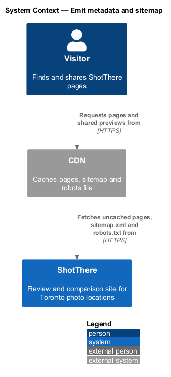
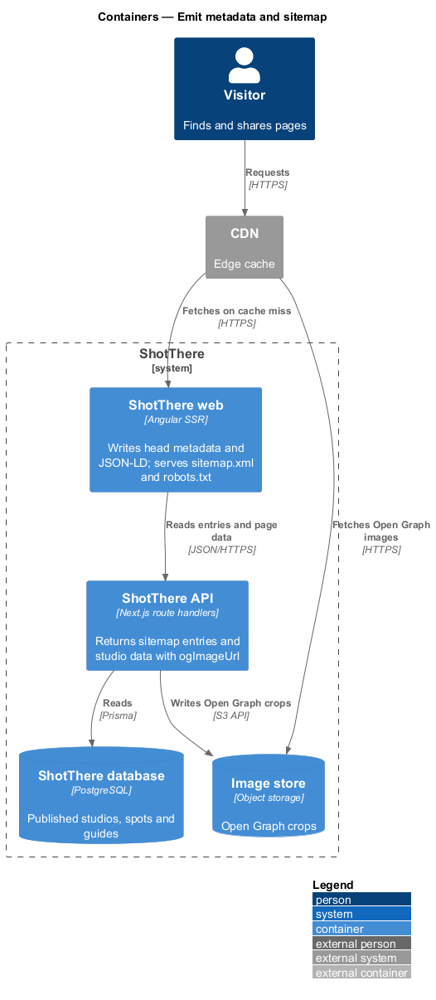
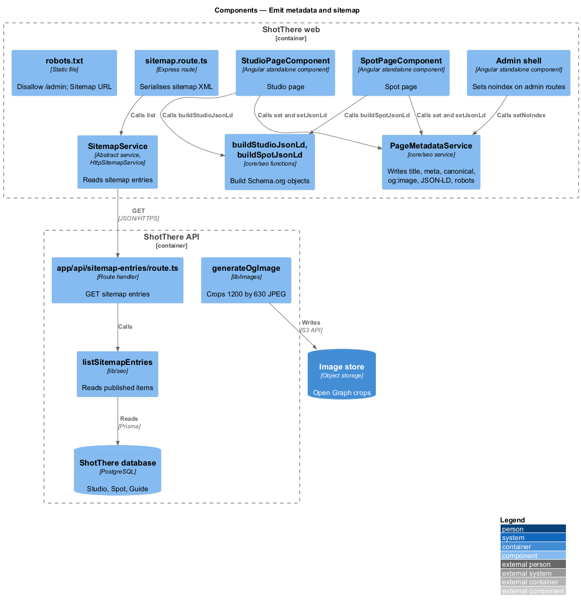
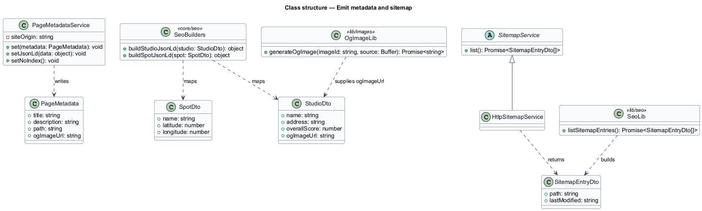
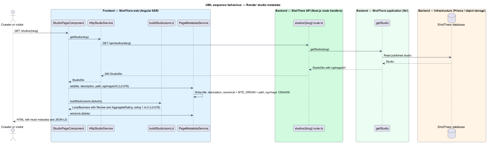
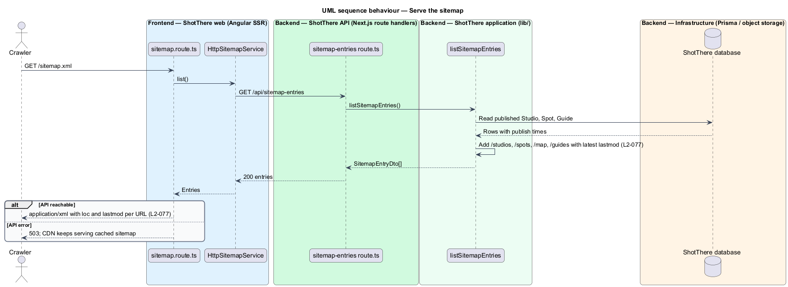

# Emit metadata and sitemap

## Overview

ShotThere reviews photo studios and outdoor spots in Toronto, and most visitors arrive from search engines and shared links. Search engines and link previews read machine-readable data from each page, not the visible layout. This feature supplies that data.

*Page metadata* is the set of `head` elements that describe a page to crawlers: `title`, `meta[name=description]`, `link[rel=canonical]` and `meta[property=og:image]`. A *canonical URL* is the one preferred address of a page. *JSON-LD* is a `script type="application/ld+json"` element holding Schema.org structured data; studio pages emit a `LocalBusiness` with a `Review` and `AggregateRating`, and spot pages emit a `Place`. An *Open Graph image* is the preview image that link-sharing services show for a page. A *sitemap* is an XML list of every published URL with its last-modified date. A *robots file* is the plain-text `/robots.txt` that tells crawlers which paths to skip.

The feature sits in the `platform` subsystem. Public pages render on the server (`deliver-public-pages`), so all metadata is present in the first HTML response.

## Description

The slice spans the Angular core, the Angular SSR server, the API and the image pipeline.

- **`PageMetadataService`** — injectable class in `frontend/src/app/core/seo/page-metadata.service.ts`. It is not backend-facing. `set(metadata)` writes `title`, `meta[name=description]`, `link[rel=canonical]` and `meta[property=og:image]` with Angular `Title`, `Meta` and `DOCUMENT` (L2-076). It builds the canonical URL from `SITE_ORIGIN` plus the page path, so the canonical equals the page URL. `setJsonLd(data)` writes or replaces one JSON-LD `script` element. `setNoIndex()` writes `meta[name=robots][content="noindex, nofollow"]` (L2-077).
- **`PageMetadata`** — type with `title`, `description`, `path` and `ogImageUrl`. Page titles come from the central title registry required by `AGENTS.md`.
- **`SITE_ORIGIN`** — injection token holding the production origin. The value is `<TO SUPPLY>`.
- **`DEFAULT_OG_IMAGE_URL`** — the site-wide Open Graph image for pages without their own image, such as list pages and the map. The asset is `<TO SUPPLY>`.
- **`buildStudioJsonLd`** — function in `frontend/src/app/core/seo/build-studio-json-ld.ts`. It maps a `StudioDto` to a `LocalBusiness` with `name`, `address`, an `AggregateRating`, and a `Review` whose `reviewRating.ratingValue` equals `overallScore` with `bestRating` 5 and `worstRating` 1 (L2-076).
- **`buildSpotJsonLd`** — function in `frontend/src/app/core/seo/build-spot-json-ld.ts`. It maps a `SpotDto` to a `Place` with `name` and `geo` as `GeoCoordinates` (L2-076).
- **Page usage** — each public page component calls `PageMetadataService.set` once its data resolves. `StudioPageComponent` and `SpotPageComponent` also call `setJsonLd`. Admin routes carry route data `noIndex: true`, and the admin shell calls `setNoIndex()` (L2-077).
- **`ogImageUrl` on `StudioDto`** — URL of the 1200 by 630 pixel Open Graph crop of the first gallery image (L2-076).
- **`lib/images/generate-og-image.ts`** — `generateOgImage(imageId, source)` uses `sharp` to crop and resize to 1200 by 630 pixels as JPEG. It writes the file under a content-hashed key in the object store. The studio publish path calls it for the first gallery image.
- **`/sitemap.xml` handler** — Express route in `frontend/src/server/sitemap.route.ts`, registered in `server.ts` before Angular rendering. It calls `SitemapService` and serialises the entries to sitemap XML with `Content-Type: application/xml`.
- **`SitemapService` / `HttpSitemapService`** — abstract contract and HTTP implementation in `libs/api`. The service calls `GET /api/sitemap-entries` and returns `SitemapEntryDto[]`.
- **`SitemapEntryDto`** — type with `path` and `lastModified` (ISO date).
- **`app/api/sitemap-entries/route.ts`** — Next.js route handler that calls `listSitemapEntries` and returns the entries.
- **`lib/seo/list-sitemap-entries.ts`** — `listSitemapEntries()` reads published `Studio`, `Spot` and `Guide` rows and returns one entry per item with its last published time. It adds `/studios`, `/spots`, `/map` and `/guides`, each dated with the latest change among its items (L2-077). It never returns draft content.
- **`robots.txt`** — static file in `frontend/public/robots.txt`. It contains `Disallow: /admin` and `Sitemap: <SITE_ORIGIN>/sitemap.xml` (L2-077).
- **Regeneration** — `affectedRoutes` in `deliver-public-pages` already includes `/sitemap.xml`, so a publish refreshes the cached sitemap.

## Requirements

The feature realizes the following level-2 (L2) requirements. Each L2 requirement refines a level-1 (L1) requirement, cited by identifier.

| L2 ID | Refines (L1) | Requirement |
|-------|--------------|-------------|
| `L2-076` | `L1-018` | Each studio page shall emit JSON-LD for a `LocalBusiness` with an embedded `Review` and `AggregateRating`; each spot page shall emit JSON-LD for a `Place`; every public page shall carry a unique title, description, canonical URL, and Open Graph image. |
| `L2-077` | `L1-018` | The site shall serve a sitemap listing every published page with last-modified dates and a robots file that disallows the administration area. |

## Diagrams

### System context

Search engines and link-preview services read metadata, the sitemap and the robots file from ShotThere. Visitors see the same pages.

### Containers

The web container writes metadata during server rendering and serves `/sitemap.xml` and `/robots.txt`. The API supplies sitemap entries from the database.

### Components

`PageMetadataService` and the JSON-LD builders sit in the Angular core. The sitemap route reads entries through `SitemapService` from `listSitemapEntries`.

### Class structure

Page components depend on `PageMetadataService` and the JSON-LD builders. The sitemap path uses an abstract service contract and a plain entry DTO.

### Behaviour — render studio metadata

During server rendering the studio page sets its title, description, canonical URL, Open Graph image and `LocalBusiness` JSON-LD.

### Behaviour — serve the sitemap

A request for `/sitemap.xml` reads published entries from the API and returns XML with a `lastmod` per URL.

