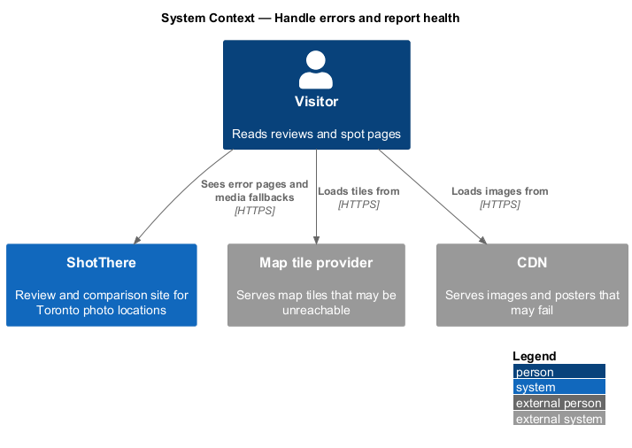
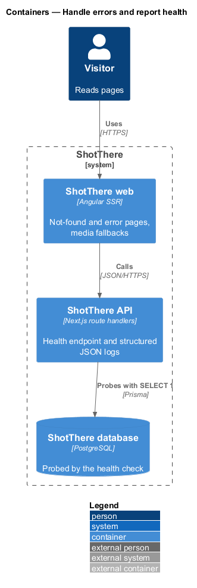
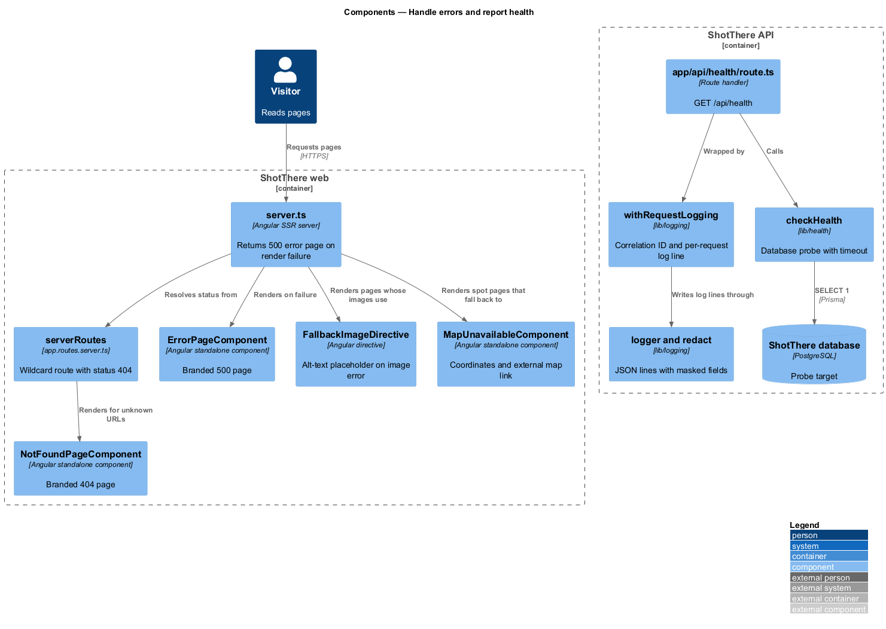
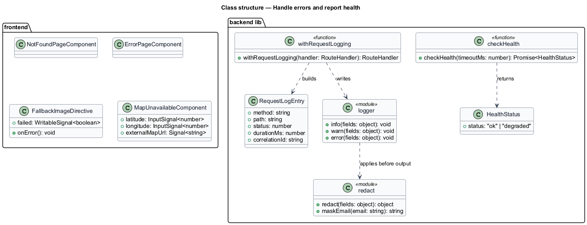
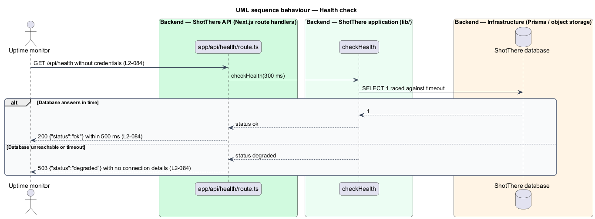
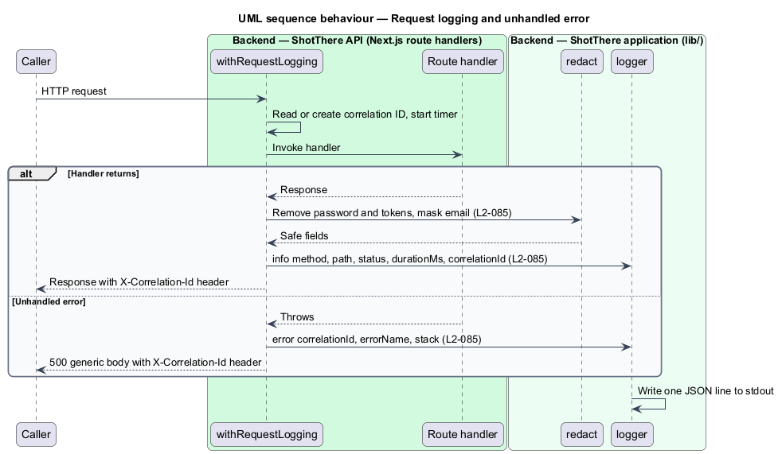
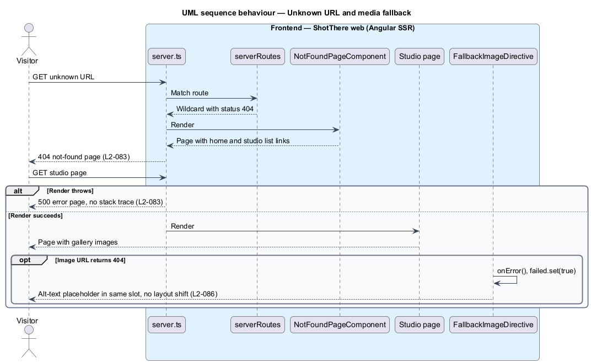

# Handle errors and report health

## Overview

ShotThere is a review and comparison site for Toronto photo locations. The ShotThere web application is an Angular SSR server that renders every screen. The ShotThere API is a set of Next.js route handlers backed by PostgreSQL.

This feature covers how the system behaves when something goes wrong and how operators see its state. An *error page* is a branded page shown in place of the requested content, returned with the matching HTTP status. A *health check* is an unauthenticated endpoint that reports whether the API and its data store are reachable. A *structured log line* is one JSON object written to standard output per event. A *correlation ID* is a unique identifier assigned to one request, written into every log line for that request and returned in a response header. A *media fallback* is the content shown in place of an image, map, or video poster that fails to load.

## Description

- **`NotFoundPageComponent`** (`features/errors/not-found-page.component.ts`, `.html`, `.css`) — branded page with one level-one heading and links to the home page and the studio list from `APP_PATHS`. The wildcard route `**` in `features/errors/routes.ts` renders it.
- **`ErrorPageComponent`** (`features/errors/error-page.component.ts`) — branded page with a generic message and a link to the home page. It shows no stack trace or internal detail.
- **`serverRoutes`** (`frontend/src/app/app.routes.server.ts`) — Angular SSR server route configuration. The `**` entry uses `RenderMode.Server` with `status: 404`, so unknown URLs return HTTP 404.
- **SSR error handler** (`frontend/src/server.ts`) — catches an unhandled render error, logs it, and responds HTTP 500 with the prerendered `ErrorPageComponent` output. The body carries no stack trace.
- **`app/api/health/route.ts`** — unauthenticated `GET /api/health` handler. It calls `checkHealth` and returns HTTP 200 with `{"status":"ok"}` or HTTP 503 with `{"status":"degraded"}`. The body never includes connection details.
- **`checkHealth`** (`backend/lib/health/check-health.ts`) — runs `prisma.$queryRaw` `SELECT 1` raced against a 300 ms timeout so the endpoint answers within 500 ms. It returns a `HealthStatus` of `ok` or `degraded`.
- **`HealthStatus`** (`backend/lib/health/health-status.ts`) — type `{ status: 'ok' | 'degraded' }`.
- **`logger`** (`backend/lib/logging/logger.ts`) — writes one JSON line per call to standard output with `time`, `level`, `correlationId`, and the given fields. Levels are `info`, `warn`, and `error`.
- **`redact`** (`backend/lib/logging/redact.ts`) — removes `password`, `token`, `cookie`, and `authorization` fields from logged objects. `maskEmail` reduces an email to its first character and domain, for example `j***@example.com`.
- **`withRequestLogging`** (`backend/lib/logging/with-request-logging.ts`) — wraps every route handler. It reads or creates a correlation ID with `crypto.randomUUID()`, times the handler, sets the `X-Correlation-Id` response header, and logs `method`, `path`, `status`, and `durationMs` at `info`. An unhandled error is logged at `error` with `correlationId`, `errorName`, and `stack`, and the response becomes HTTP 500 with no internal detail.
- **`RequestLogEntry`** (`backend/lib/logging/request-log-entry.ts`) — type for the per-request log line fields.
- **`FallbackImageDirective`** (`frontend/libs/components/fallback-image.directive.ts`, selector `img[stFallbackImage]`) — on the `error` event it hides the broken image and shows a placeholder holding the image's alt text in the same slot. The slot keeps its `width`, `height`, and `aspect-ratio`, so layout does not shift. Gallery and card images apply it.
- **`MapUnavailableComponent`** (`frontend/libs/components/map-unavailable.component.ts`) — shows a message, the spot coordinates, and an external map link. The spot map component renders it when tile loading fails; the tile failure signal depends on the map library, which is `<TO SUPPLY>`. The external map URL format is `<TO SUPPLY>`.
- **Video poster fallback** — the episode player renders "Play episode" as a real button independent of the poster image. The poster `img` uses `stFallbackImage`, so a failed poster leaves the button usable.
- **Tests** — `NotFoundPage` and `ErrorPage` Playwright page objects check status, links, and 320px layout. Playwright route interception forces image 404s, tile failures, and poster failures. API tests cover `GET /api/health` with the database up and down, and assert log lines for sign-in, signup, and an unhandled error.

## Requirements

The feature realizes the following level-2 (L2) requirements. Each refines the level-1 (L1) requirement cited.

| L2 ID | Refines (L1) | Requirement |
|-------|--------------|-------------|
| `L2-083` | `L1-020` | The site shall show a branded not-found page for unknown URLs and a branded error page for server failures, each with navigation back to the home page, and shall return the matching HTTP status. |
| `L2-084` | `L1-020` | The backend shall expose an unauthenticated health endpoint reporting its own status and the data store's reachability. |
| `L2-085` | `L1-020` | The backend shall emit one structured log line per request and per error, with a correlation ID, and shall never log secrets, session tokens, passwords, or subscriber emails in full. |
| `L2-086` | `L1-020` | Pages shall render correctly when an image, map tile service, or video poster fails to load. |

## Diagrams

### System context

Visitors see error pages and media fallbacks. The map tile provider and the CDN are the external sources whose failures the pages tolerate.

### Containers

The web container renders error pages and fallbacks. The API container reports health, writes structured logs, and probes the database.

### Components

Every API route handler runs inside `withRequestLogging`. The health handler calls `checkHealth`, which probes the database with a timeout.

### Class structure

The logging types redact sensitive fields before output, and the frontend fallback parts attach to existing media elements.

### Behaviour — health check

The health handler returns HTTP 200 when the probe succeeds and HTTP 503 when it fails or times out.

### Behaviour — request logging and unhandled error

Each request receives a correlation ID and one log line. An unhandled error produces an `error` line and a generic HTTP 500.

### Behaviour — unknown URL and media fallback

An unknown URL renders the not-found page with HTTP 404. A failed image swaps to its alt-text placeholder in the same slot.

