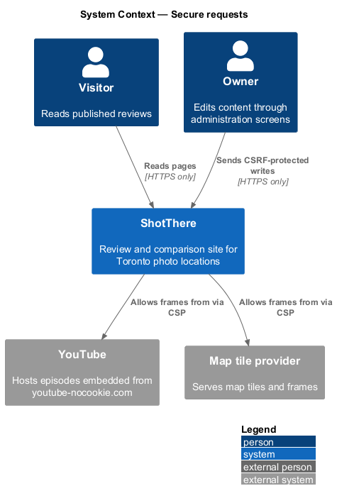
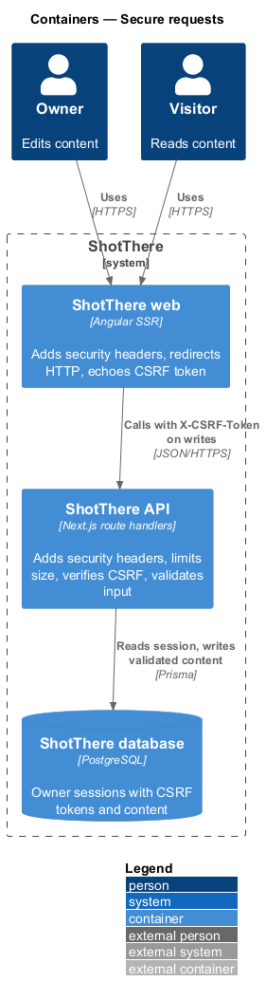
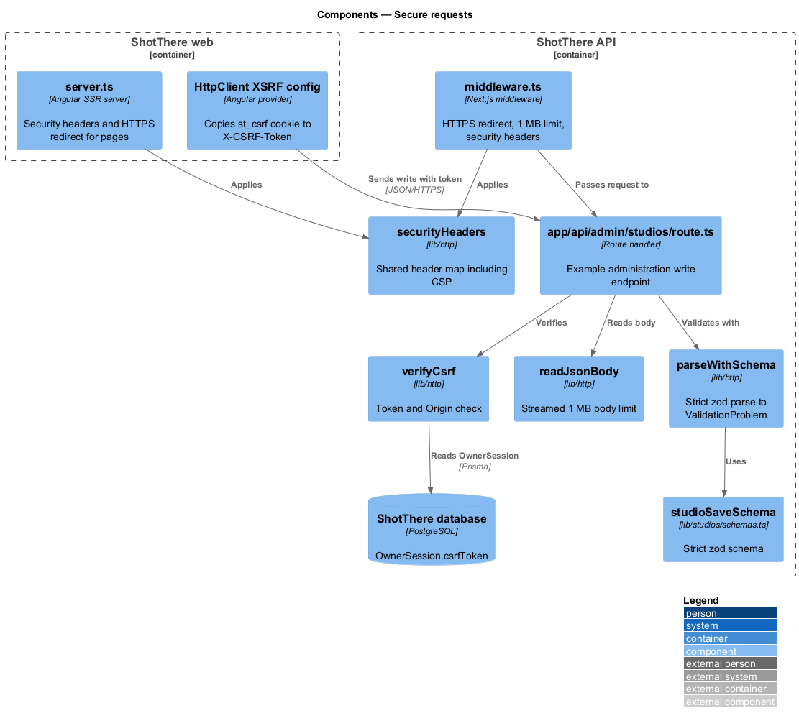
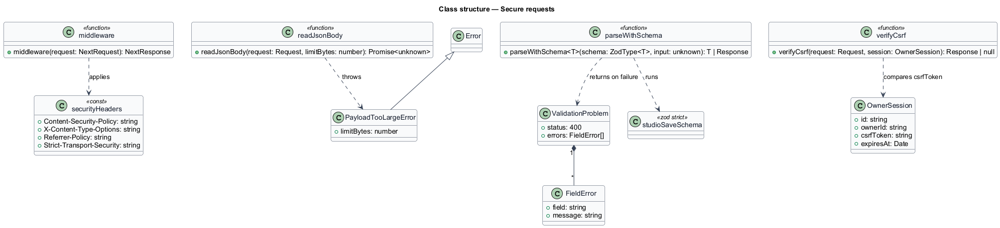
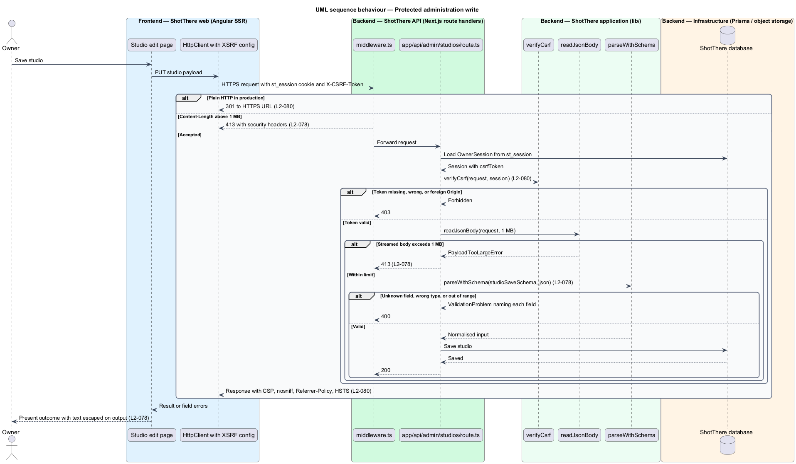
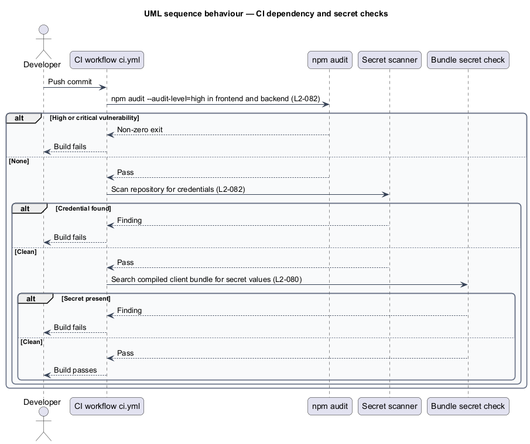

# Secure requests

## Overview

ShotThere is a review and comparison site for Toronto photo locations. Visitors read published content, and one owner edits it through administration screens. The ShotThere web application is an Angular SSR server; the ShotThere API is a set of Next.js route handlers backed by PostgreSQL.

This feature sets the request-level protections that every other feature depends on. A *write endpoint* is an API route handler that accepts `POST`, `PUT`, `PATCH`, or `DELETE` and changes stored state. A *strict schema* is a zod schema that rejects any field it does not declare. *Cross-site request forgery (CSRF)* is an attack in which another site causes a signed-in browser to send a state-changing request. An *anti-forgery token* is a per-session secret that the frontend echoes in a request header, which a forged cross-origin request cannot read. *Security headers* are HTTP response headers, including the `Content-Security-Policy` (CSP), that restrict what a browser loads and how it treats a response.

The feature also covers the delivery pipeline: continuous integration (CI) fails on high or critical dependency vulnerabilities and on committed secrets.

## Description

- **`middleware.ts`** (`backend/middleware.ts`) — Next.js middleware matching `/api/:path*`. In production it answers plain HTTP requests, read from `x-forwarded-proto`, with HTTP 301 to the HTTPS URL. For write methods it rejects a `Content-Length` above 1 MB with HTTP 413, except on the image upload route. It adds the security headers to every API response.
- **`securityHeaders`** (`backend/lib/http/security-headers.ts`) — one constant map shared by the API middleware and the web server. It sets `Content-Security-Policy` with `script-src 'self'` and `frame-src https://www.youtube-nocookie.com <map provider origin>`, `X-Content-Type-Options: nosniff`, `Referrer-Policy: strict-origin-when-cross-origin`, and `Strict-Transport-Security: max-age=31536000; includeSubDomains`. The map provider origin is `<TO SUPPLY>`.
- **`readJsonBody`** (`backend/lib/http/read-json-body.ts`) — reads the request body as a stream with a 1 MB limit, independent of `Content-Length`. It throws `PayloadTooLargeError` past the limit and parses JSON.
- **`parseWithSchema`** (`backend/lib/http/parse-with-schema.ts`) — runs a zod schema with `safeParse`. On failure it returns HTTP 400 with a `ValidationProblem` body that lists each failing field path and message, including unrecognised keys.
- **Strict schemas** (`backend/lib/<area>/schemas.ts`) — each write endpoint declares a `z.object({...}).strict()` schema that trims strings, coerces nothing implicitly, and bounds lengths and numeric ranges. For example, `studioSaveSchema` in `lib/studios/schemas.ts` rejects `isSponsored` as an unknown field and `hourlyRate: "abc"` as a wrong type.
- **`ValidationProblem`** (`backend/lib/http/validation-problem.ts`) — response type `{ status: 400, errors: { field: string; message: string }[] }`.
- **`verifyCsrf`** (`backend/lib/http/verify-csrf.ts`) — called by every administration write handler after session lookup. It compares the `X-CSRF-Token` header with `OwnerSession.csrfToken` in constant time and checks the `Origin` header against the site origin. A mismatch or missing token returns HTTP 403.
- **`OwnerSession.csrfToken`** (`prisma/schema.prisma`) — a random token column set when the session is created. Sign-in also sets it in a readable `st_csrf` cookie, `Secure`, `SameSite=Lax`, beside the HttpOnly `st_session` cookie.
- **Frontend CSRF configuration** (`frontend/src/app/app.config.ts`) — `provideHttpClient(withFetch(), withXsrfConfiguration({ cookieName: 'st_csrf', headerName: 'X-CSRF-Token' }))`. Angular copies the cookie into the header on same-origin write requests.
- **Web server headers and HTTPS redirect** (`frontend/src/server.ts`) — the Angular SSR server applies `securityHeaders` to every response and redirects plain HTTP to HTTPS in production with HTTP 301.
- **Output escaping** — Angular interpolation escapes stored text on output. Templates shall not bind user-supplied text to `innerHTML`, so stored HTML renders as text and no script executes.
- **Environment configuration** (`backend/.env.example`, `frontend/.env.example`) — documents every variable name, for example `DATABASE_URL`, `SESSION_SECRET`, `STORAGE_ACCESS_KEY`, and `MAP_PROVIDER_KEY`. Secrets are read only from `process.env` on the server; the client bundle receives only the domain-restricted map key, if any.
- **CI workflow** (`.github/workflows/ci.yml`) — runs `npm audit --audit-level=high` in `frontend/` and `backend/` and fails on any finding. A secret-scanning step runs over the repository and fails on any detected credential; the scanner is `<TO SUPPLY>`. A bundle check searches the compiled client bundle for the secret variable values.
- **Tests** — API tests call write handlers with unknown fields, wrong types, oversized bodies, and missing or foreign-origin CSRF tokens. A Playwright test via the `StudioEditPage` page object saves HTML in a text field and asserts it renders as text. A header test asserts the CSP and other headers on a page and an API response.

## Requirements

The feature realizes the following level-2 (L2) requirements. Each refines the level-1 (L1) requirement cited.

| L2 ID | Refines (L1) | Requirement |
|-------|--------------|-------------|
| `L2-078` | `L1-019` | Every write endpoint shall validate and normalise its input on the server against a schema, rejecting unknown fields, wrong types, out-of-range values, and oversized payloads, independent of client validation. |
| `L2-080` | `L1-019` | State-changing requests shall be protected against cross-site request forgery, all responses shall carry security headers, and all traffic shall be over HTTPS. |
| `L2-082` | `L1-019` | The build shall fail on known high-severity vulnerabilities in dependencies, and secrets shall be supplied through environment configuration. |

## Diagrams

### System context

Visitors and the owner use ShotThere over HTTPS. The CSP allows frames only from YouTube's no-cookie domain and the map tile provider.

### Containers

Both the web server and the API apply the shared security headers. The API alone validates input, checks CSRF tokens, and writes to the database.

### Components

Inside the API, middleware enforces transport, size, and headers before a route handler runs. The handler then verifies the CSRF token and parses the body with a strict schema.

### Class structure

The request helpers share one error vocabulary: `ValidationProblem` for HTTP 400, `PayloadTooLargeError` for HTTP 413, and a forbidden result for HTTP 403.

### Behaviour — protected administration write

An administration save passes the HTTPS, size, CSRF, and schema checks in order. Each failed check stops the request with its own status.

### Behaviour — CI dependency and secret checks

On each push, CI audits dependencies and scans for secrets, and fails the build on a finding.

