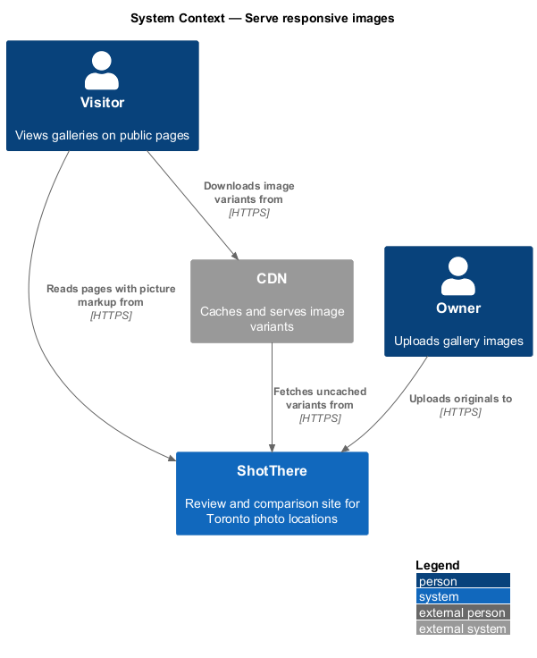
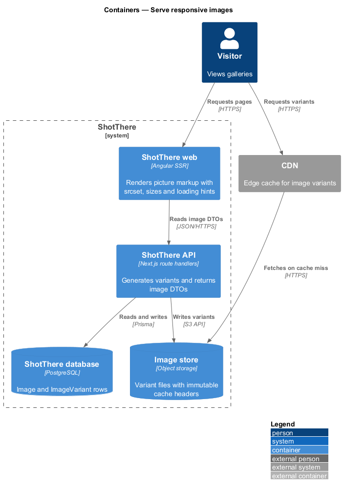
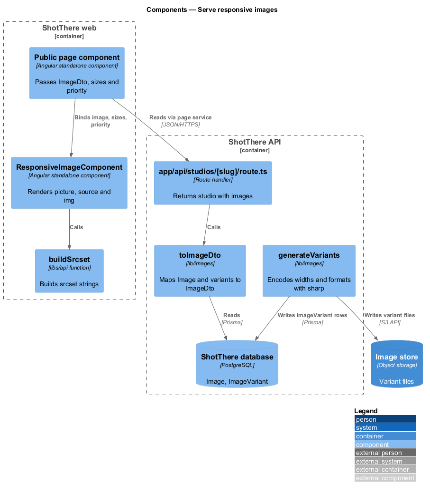
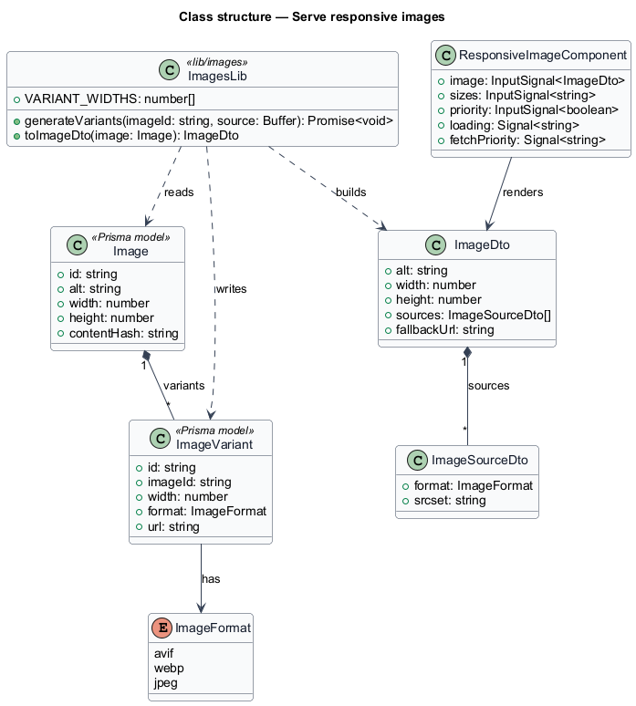
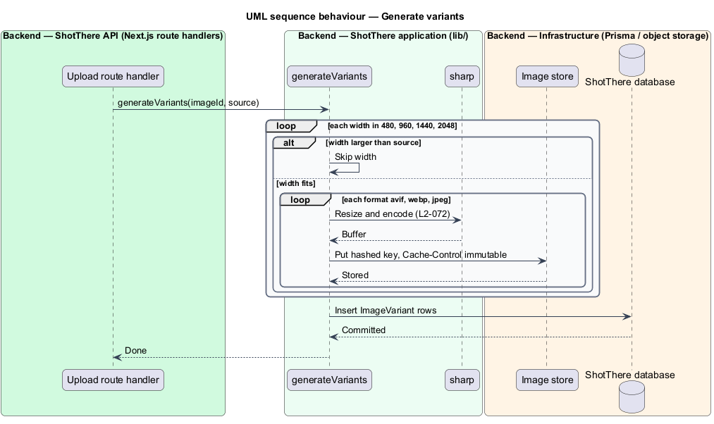
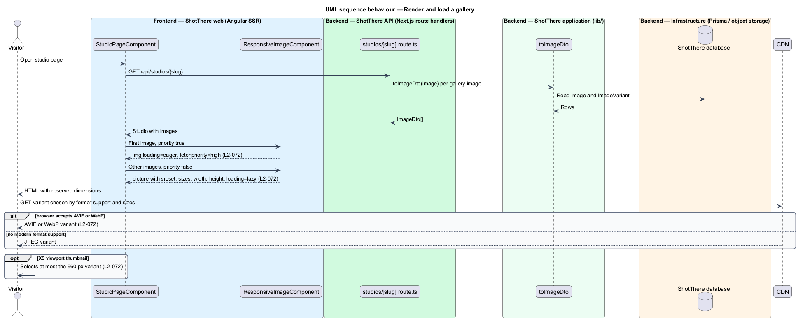

# Serve responsive images

## Overview

ShotThere reviews photo studios and outdoor spots, and each review carries a gallery of test photographs. Galleries are the heaviest part of a public page, so image delivery decides most of the page weight and layout stability on a phone.

A *variant* is a resized and re-encoded copy of an uploaded image at one fixed width and one format. ShotThere generates variants at 480, 960, 1440 and 2048 pixels wide, in AVIF, WebP and JPEG. A *responsive image* is an image element that lists its variants in `srcset` and declares its display width in `sizes`, so the browser downloads the smallest variant that fills the slot. *Lazy loading* is deferring the download of an image until it nears the viewport.

The feature sits in the `platform` subsystem. It gives every public page one image component and one variant pipeline. Upload and gallery management belong to other features; this feature covers variant generation, the image DTO and the rendered markup.

## Description

The slice spans the upload pipeline in the API, the object store, and a shared Angular component.

- **`lib/images/generate-variants.ts`** — `generateVariants(imageId, source)` uses `sharp` to produce each width in `VARIANT_WIDTHS` (480, 960, 1440, 2048) in AVIF, WebP and JPEG. It skips widths larger than the source. It writes each variant to the object store under a key containing the content hash, and records one `ImageVariant` row per file. The upload feature calls it after storing the original.
- **`lib/images/variant-widths.ts`** — the `VARIANT_WIDTHS` constant.
- **`lib/images/to-image-dto.ts`** — `toImageDto(image)` maps an `Image` and its `ImageVariant` rows to an `ImageDto`. Public route handlers that return images, such as `app/api/studios/[slug]/route.ts`, use it.
- **Object store upload headers** — each variant is written with `Content-Type` for its format and `Cache-Control: public, max-age=31536000, immutable`. The CDN fronts the store.
- **`Image` (Prisma model)** — fields `id`, `alt`, `width`, `height` and `contentHash`. Intrinsic `width` and `height` come from the original upload.
- **`ImageVariant` (Prisma model)** — fields `id`, `imageId`, `width`, `format` (`ImageFormat` enum: `avif`, `webp`, `jpeg`) and `url`.
- **`ImageDto`** — `libs/api` type with `alt`, `width`, `height` and `sources`, an array of `ImageSourceDto { format, srcset }`. It also carries `fallbackUrl`, the 960-pixel JPEG.
- **`buildSrcset`** — function in `libs/api/src/build-srcset.ts`. It joins variant URLs and widths into a `srcset` string such as `.../480.avif 480w, .../960.avif 960w`.
- **`ResponsiveImageComponent`** — standalone component in the components library (`responsive-image.component.ts` with `.html` and `.css`). Inputs: `image` (`ImageDto`), `sizes` (string) and `priority` (boolean, default `false`). It renders a `picture` element with one `source` per format, ordered AVIF, WebP, then JPEG, so a browser that accepts AVIF or WebP receives that format (L2-072). The inner `img` carries `src`, `srcset`, `sizes`, `alt`, `width` and `height`. With `priority` false it sets `loading="lazy"`; with `priority` true it sets `loading="eager"` and `fetchpriority="high"`.
- **Gallery `sizes` values** — gallery thumbnails use `sizes="(max-width: <TO SUPPLY>px) 50vw, 25vw"` or equivalent from the design system breakpoints. At the XS breakpoint the value resolves to at most 480 CSS pixels, so a 2x screen requests no variant wider than 960 pixels (L2-072). The exact breakpoint values come from the design system and are `<TO SUPPLY>`.
- **Page usage** — public page components pass `priority` true to the first image above the fold and false to all others.

## Requirements

The feature realizes the following level-2 (L2) requirement. It refines a level-1 (L1) requirement, cited by identifier.

| L2 ID | Refines (L1) | Requirement |
|-------|--------------|-------------|
| `L2-072` | `L1-017` | Images shall be served as responsive variants in modern formats sized to the viewport, with below-the-fold images lazy-loaded and dimensions reserved to prevent layout shift. |

## Diagrams

### System context

The visitor receives images through the CDN in front of the ShotThere image store. The owner supplies the originals.

### Containers

The API generates variants into the image store and returns image DTOs. The web container renders the `picture` markup, and the browser fetches variants from the CDN.

### Components

`generateVariants` writes variants and rows; `toImageDto` shapes them for public handlers. `ResponsiveImageComponent` turns the DTO into markup with `buildSrcset`.

### Class structure

One `Image` owns many `ImageVariant` rows, one per width and format. The `ImageDto` groups variants by format for the component.

### Behaviour — generate variants

After the upload feature stores an original, `generateVariants` encodes each width and format and records the variant rows.

### Behaviour — render and load a gallery

The server renders the `picture` markup; the browser picks the format and width and lazy-loads below-the-fold images from the CDN.

