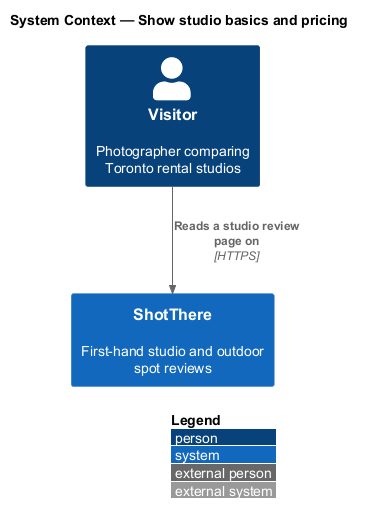
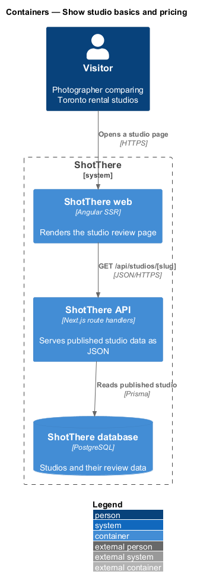
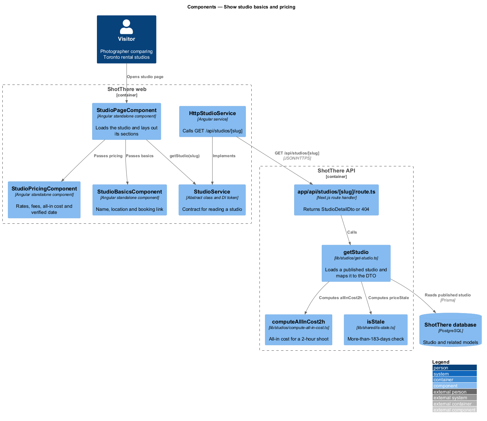
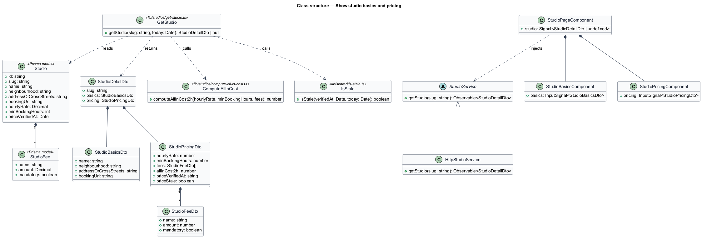
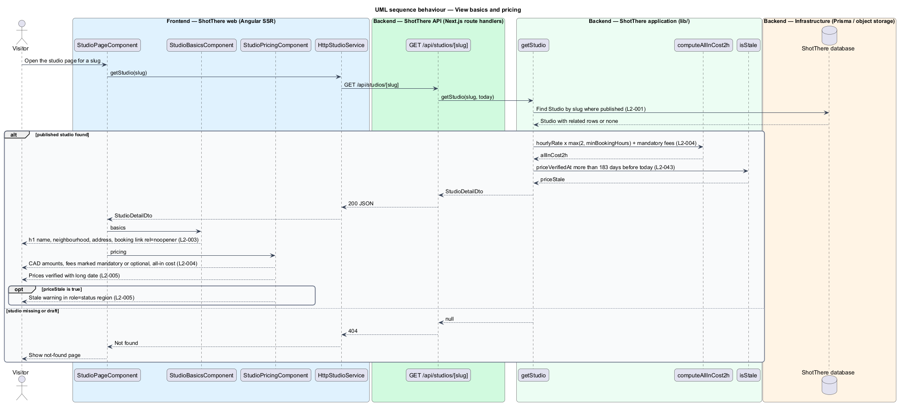

# Show studio basics and pricing

## Overview

ShotThere is a review and comparison site for places to shoot photos in Toronto. A *studio review page* — public page that presents one first-hand rental studio review — is built from a fixed sequence of sections. One `StudioPageComponent` renders those sections from one response of `GET /api/studios/[slug]`. Every studio page uses the same measurements and section order, so studios compare side by side.

This feature delivers the top of the page: the studio basics and the pricing block. The basics name the studio, say where it is, and link to its booking page. The pricing block lists the hourly rate, the minimum booking, each extra fee, the all-in cost and the date the prices were last verified.

- **all-in cost** — server-computed price of a standard 2-hour shoot, `allInCost2h`, equal to the hourly rate times the larger of 2 and the minimum booking hours, plus every mandatory fee
- **mandatory fee** — `StudioFee` that every booking pays and that the all-in cost includes
- **optional fee** — `StudioFee` that a booking may add and that the all-in cost excludes
- **stale** — state of a last-verified date that lies more than 183 days before today

The server owns both computed rules. The page only formats the values it receives, so the page, list cards and comparisons show the same numbers and the same stale flag.

## Description

The feature introduces the shared page, service and endpoint, adds two section components, and adds the server-computed pricing fields.

- **`StudioPageComponent`** — standalone, zoneless Angular page component in `features/studios/`, routed from `features/studios/routes.ts` with the path and title taken from the central app-paths constants. It reads the `slug` route parameter, calls `StudioService`, holds the result in a signal, and passes each part of the `StudioDetailDto` to its section component. Every studio-reviews feature shares it.
- **`StudioService`** — `abstract class` in `libs/api/src/studio.service.ts` that serves as its own DI token, with `getStudio(slug: string): Observable<StudioDetailDto>`. Pages inject this contract only.
- **`HttpStudioService`** — `class HttpStudioService extends StudioService` in `libs/api/src/http-studio.service.ts`, registered as `{ provide: StudioService, useClass: HttpStudioService }`. It issues `GET /api/studios/{slug}`.
- **`app/api/studios/[slug]/route.ts`** — Next.js `GET` route handler in `backend/`. It calls `getStudio` and returns `200` with `StudioDetailDto`, or `404` when no published studio has the slug.
- **`getStudio(slug, today)`** — application function in `lib/studios/get-studio.ts`. It loads a published `Studio` with Prisma, never a draft (`L2-001`), and maps it to `StudioDetailDto`, including the server-computed fields.
- **`StudioDetailDto`** — JSON contract for the whole page, declared once per side: `backend/lib/studios/studio-detail-dto.ts` and `libs/api/src/studio-detail-dto.ts`. Each feature reads only its own part, listed below.
- **`StudioBasicsComponent`** — section component in `features/studios/studio-basics/`. Input: `basics` (`name`, `neighbourhood`, `addressOrCrossStreets`, `bookingUrl`). It renders the name as the page's only `h1`, the neighbourhood and address beneath it, and the booking link with `target="_blank"` and `rel="noopener"`. The block is a single column at XS.
- **`StudioPricingComponent`** — section component in `features/studios/studio-pricing/`. Input: `pricing` (`hourlyRate`, `minBookingHours`, `fees[]`, `allInCost2h`, `priceVerifiedAt`, `priceStale`). It formats amounts as Canadian dollars with two decimals, labels each fee mandatory or optional, and shows "Prices verified" with the date in long format. When `priceStale` is true it renders a warning inside a `role="status"` region.
- **`studio-pricing.view-model.ts`** — plain TypeScript beside the pricing component. It splits fees into mandatory and optional lists and builds their labels. It performs no arithmetic on the all-in cost.
- **`computeAllInCost2h(hourlyRate, minBookingHours, fees)`** — pure function in `lib/studios/compute-all-in-cost.ts`. It returns `hourlyRate × max(2, minBookingHours)` plus the sum of mandatory fee amounts, rounded to cents (`L2-004`).
- **`isStale(verifiedAt, today)`** — pure function in `lib/shared/is-stale.ts`. It returns true when `verifiedAt` lies more than 183 days before `today` (`L2-043`). A date exactly 183 days old is not stale.
- **Prisma models** — `Studio` (`slug`, `name`, `neighbourhood`, `addressOrCrossStreets`, `bookingUrl`, `hourlyRate`, `minBookingHours`, `priceVerifiedAt`) and `StudioFee` (`name`, `amount`, `mandatory`). Money is stored as `Decimal`.
- **DTO parts used** — `basics` and `pricing`. `getStudio` computes `pricing.allInCost2h` and `pricing.priceStale` on each request; neither is stored.
- **Time zone for today** — `<TO SUPPLY>`: the zone in which the server takes today's date for staleness. The design assumes `America/Toronto`.

## Requirements

The feature realizes the following level-2 (L2) requirements. Each L2 requirement refines a level-1 (L1) requirement, cited by identifier.

| L2 ID | Refines (L1) | Requirement |
|-------|--------------|-------------|
| `L2-003` | `L1-002` | Each studio page shall show the studio's name, neighbourhood, address or cross streets, and a link to the studio's own booking page that opens in a new tab with `rel="noopener"`. |
| `L2-004` | `L1-002` | Each studio page shall show the hourly rate, minimum booking hours, each extra fee with whether it is mandatory or optional, and a calculated all-in cost for a standard 2-hour shoot, computed by the server from the stored values. |
| `L2-005` | `L1-002` | The pricing block shall show the date the pricing was last verified in a long date format and shall carry a stale warning when that date is stale. |
| `L2-043` | `L1-010` | The server shall compute whether each price and permit date is stale, and public pages, list cards, and comparisons shall show the stale flag from that computed value. |

## Diagrams

### System context

The visitor reads the studio basics and pricing on ShotThere. The booking link leaves ShotThere for the studio's own site, which lies outside this slice.

### Containers

The Angular SSR web container requests the studio from the API. The API reads the database and computes the pricing fields.

### Components

Two section components render the `basics` and `pricing` parts of the DTO. On the server, `getStudio` calls `computeAllInCost2h` and `isStale` before it returns.

### Class structure

`StudioDetailDto` carries a `StudioBasicsDto` and a `StudioPricingDto`, and the pricing DTO holds a list of `StudioFeeDto`. The Prisma `Studio` owns its `StudioFee` rows.

### Behaviour — View basics and pricing

The visitor opens a studio page. The server computes the all-in cost and the stale flag, and the page renders both without recalculating.

