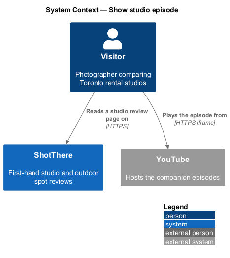
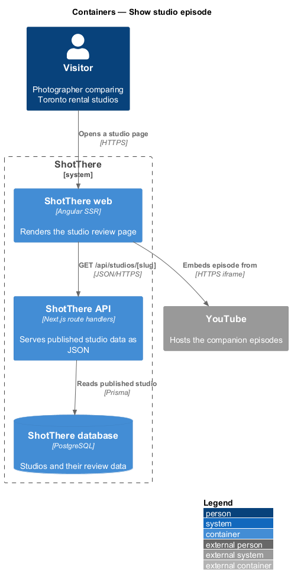
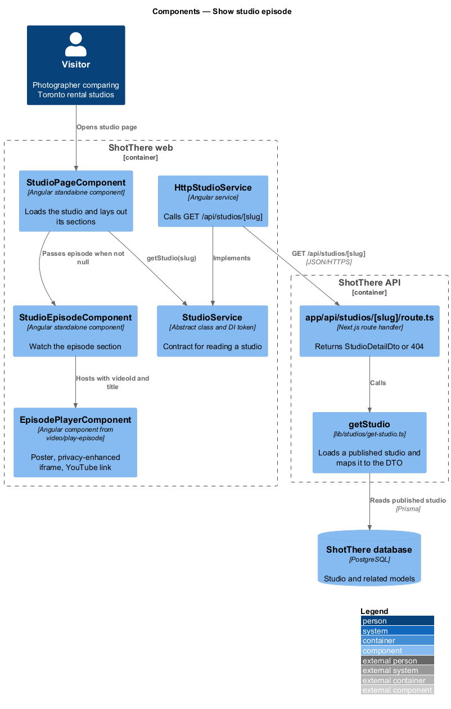
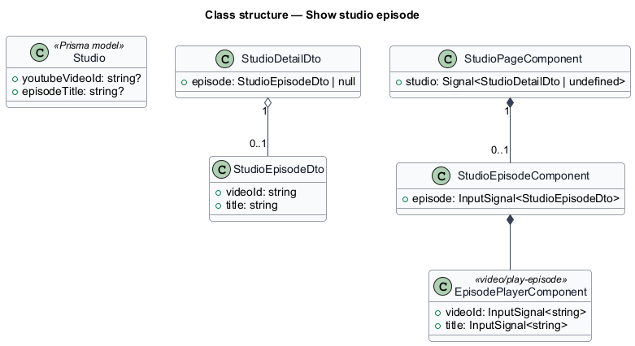
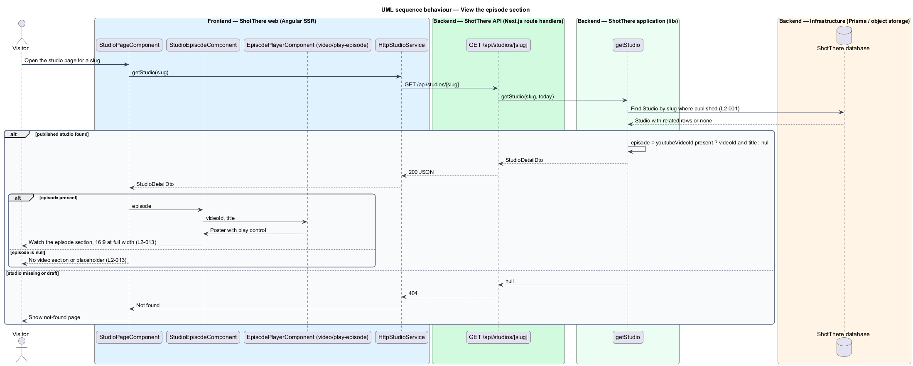

# Show studio episode

## Overview

ShotThere is a review and comparison site for places to shoot photos in Toronto. A *studio review page* — public page that presents one first-hand rental studio review — is built from a fixed sequence of sections. One `StudioPageComponent` renders those sections from one response of `GET /api/studios/[slug]`. Every studio page uses the same measurements and section order, so studios compare side by side.

This feature delivers the episode section. ShotThere has a companion YouTube channel, and a studio may have an episode filmed during its review.

- **episode** — companion YouTube video for one studio review, identified by a stored YouTube video ID
- **episode section** — page section titled "Watch the episode" that holds the episode player, present only when the studio has an episode

When the studio has no stored video ID, the page renders no video section and no placeholder. The play-on-poster player, with its privacy-enhanced embed and "Watch on YouTube" link, is designed in [video/play-episode](../../video/play-episode/README.md). This feature places that player on the studio page.

## Description

The feature adds one section component to the shared studio page and the `episode` part of the shared DTO.

- **`StudioPageComponent`** — standalone, zoneless Angular page component in `features/studios/`, routed from `features/studios/routes.ts` with the path and title taken from the central app-paths constants. It reads the `slug` route parameter, calls `StudioService`, holds the result in a signal, and passes each part of the `StudioDetailDto` to its section component. Every studio-reviews feature shares it.
- **`StudioService`** — `abstract class` in `libs/api/src/studio.service.ts` that serves as its own DI token, with `getStudio(slug: string): Observable<StudioDetailDto>`. Pages inject this contract only.
- **`HttpStudioService`** — `class HttpStudioService extends StudioService` in `libs/api/src/http-studio.service.ts`, registered as `{ provide: StudioService, useClass: HttpStudioService }`. It issues `GET /api/studios/{slug}`.
- **`app/api/studios/[slug]/route.ts`** — Next.js `GET` route handler in `backend/`. It calls `getStudio` and returns `200` with `StudioDetailDto`, or `404` when no published studio has the slug.
- **`getStudio(slug, today)`** — application function in `lib/studios/get-studio.ts`. It loads a published `Studio` with Prisma, never a draft (`L2-001`), and maps it to `StudioDetailDto`, including the server-computed fields.
- **`StudioDetailDto`** — JSON contract for the whole page, declared once per side: `backend/lib/studios/studio-detail-dto.ts` and `libs/api/src/studio-detail-dto.ts`. Each feature reads only its own part, listed below.
- **`StudioEpisodeComponent`** — section component in `features/studios/studio-episode/`. Input: `episode`. It renders a section titled "Watch the episode" containing the episode player in a container that keeps a 16:9 ratio at full content width. `StudioPageComponent` renders it only when `episode` is not null.
- **`EpisodePlayerComponent`** — reusable play-on-poster component designed in [video/play-episode](../../video/play-episode/README.md). It owns the poster, the `youtube-nocookie.com` iframe and the episode link. This feature passes it the video ID and the episode title.
- **Prisma model** — `Studio` fields `youtubeVideoId` and `episodeTitle`, both nullable.
- **DTO part used** — `episode` (`videoId`, `title`), or `null` when no video ID is stored.
- **Episode title source** — `<TO SUPPLY>`: whether the episode title is entered by the owner or derived from the studio name. The design assumes the stored `episodeTitle`.

## Requirements

The feature realizes the following level-2 (L2) requirements. Each L2 requirement refines a level-1 (L1) requirement, cited by identifier.

| L2 ID | Refines (L1) | Requirement |
|-------|--------------|-------------|
| `L2-013` | `L1-002` | Each studio page shall embed the companion YouTube episode when a video ID is stored and shall omit the video section entirely when none is stored. |

## Diagrams

### System context

The visitor reads the studio page on ShotThere and plays the episode, which YouTube hosts.

### Containers

The API returns the stored video ID. The web container embeds the YouTube player only after the visitor activates the poster, as designed in video/play-episode.

### Components

`StudioEpisodeComponent` renders when the `episode` part is present and hosts the episode player from video/play-episode.

### Class structure

`StudioDetailDto` holds an optional `StudioEpisodeDto`. `StudioPageComponent` composes `StudioEpisodeComponent` only when it is present.

### Behaviour — View the episode section

The page renders the episode section only when the DTO carries an episode. Otherwise the page renders nothing in its place.

