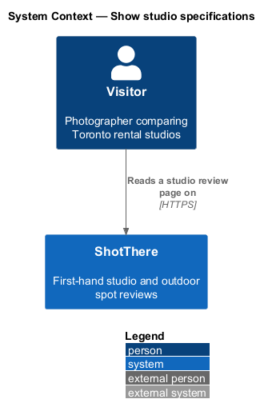
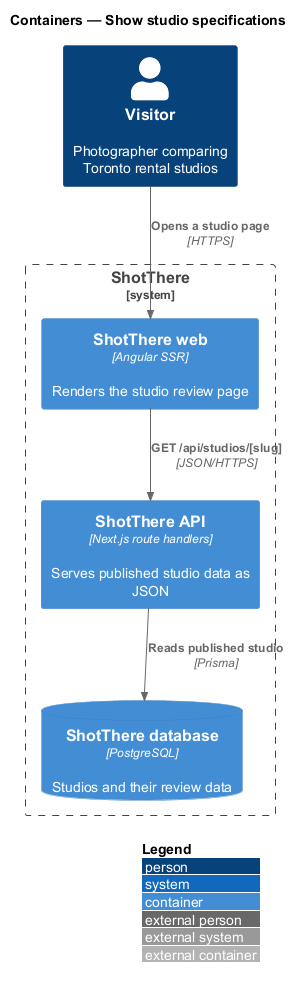
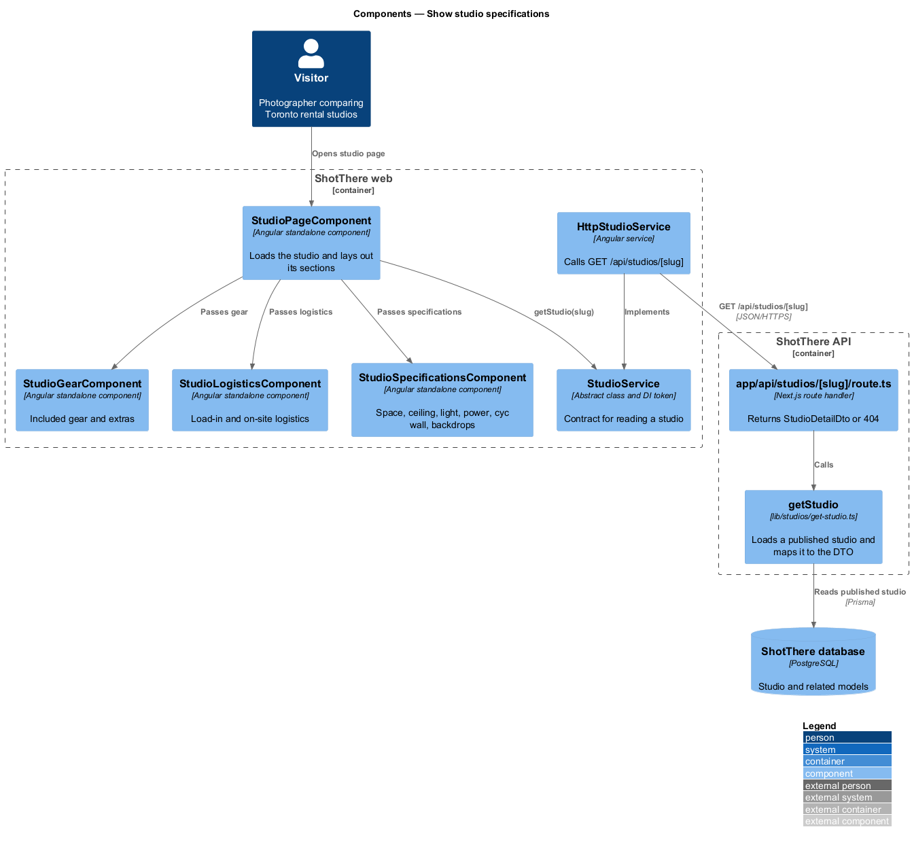
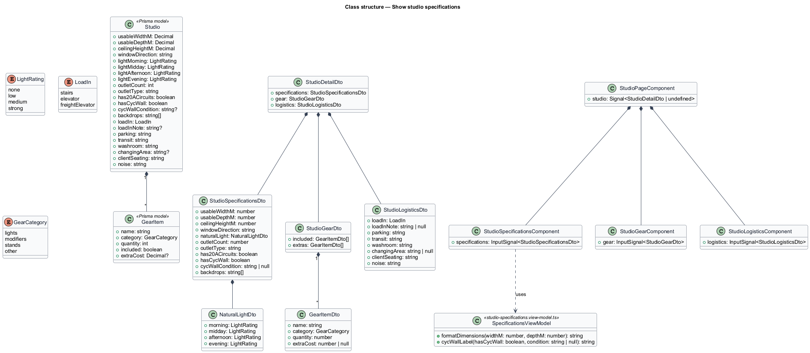
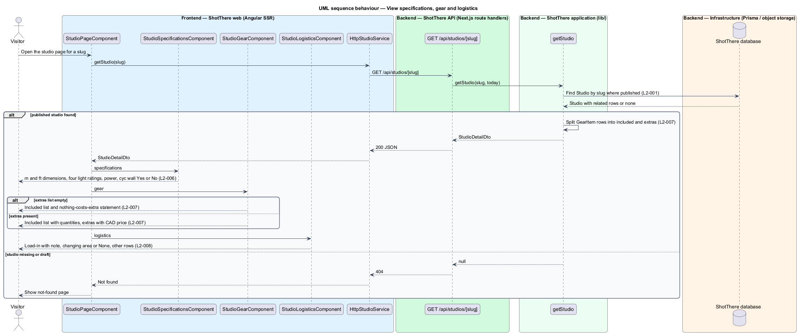

# Show studio specifications

## Overview

ShotThere is a review and comparison site for places to shoot photos in Toronto. A *studio review page* — public page that presents one first-hand rental studio review — is built from a fixed sequence of sections. One `StudioPageComponent` renders those sections from one response of `GET /api/studios/[slug]`. Every studio page uses the same measurements and section order, so studios compare side by side.

This feature delivers three sections: measured specifications, included gear and extras, and logistics. Each one presents data that the reviewer records in person with the same method at every studio.

- **measured specification** — studio property recorded first-hand with a fixed method, such as usable space, ceiling height or natural light
- **natural-light rating** — one of `none`, `low`, `medium` or `strong`, recorded for each of morning, midday, afternoon and evening
- **included gear** — `GearItem` that the hourly rate covers
- **extra** — `GearItem` that costs extra, with a price per item
- **load-in** — route by which gear reaches the studio: stairs, elevator or freight elevator, with notes

Stored dimensions are metric. The page shows metres and feet together on the same row.

## Description

The feature adds three section components to the shared studio page and their parts of the shared DTO.

- **`StudioPageComponent`** — standalone, zoneless Angular page component in `features/studios/`, routed from `features/studios/routes.ts` with the path and title taken from the central app-paths constants. It reads the `slug` route parameter, calls `StudioService`, holds the result in a signal, and passes each part of the `StudioDetailDto` to its section component. Every studio-reviews feature shares it.
- **`StudioService`** — `abstract class` in `libs/api/src/studio.service.ts` that serves as its own DI token, with `getStudio(slug: string): Observable<StudioDetailDto>`. Pages inject this contract only.
- **`HttpStudioService`** — `class HttpStudioService extends StudioService` in `libs/api/src/http-studio.service.ts`, registered as `{ provide: StudioService, useClass: HttpStudioService }`. It issues `GET /api/studios/{slug}`.
- **`app/api/studios/[slug]/route.ts`** — Next.js `GET` route handler in `backend/`. It calls `getStudio` and returns `200` with `StudioDetailDto`, or `404` when no published studio has the slug.
- **`getStudio(slug, today)`** — application function in `lib/studios/get-studio.ts`. It loads a published `Studio` with Prisma, never a draft (`L2-001`), and maps it to `StudioDetailDto`, including the server-computed fields.
- **`StudioDetailDto`** — JSON contract for the whole page, declared once per side: `backend/lib/studios/studio-detail-dto.ts` and `libs/api/src/studio-detail-dto.ts`. Each feature reads only its own part, listed below.
- **`StudioSpecificationsComponent`** — section component in `features/studios/studio-specifications/`. Input: `specifications`. It renders usable space and ceiling height in metres and feet, window direction, power, the cyc wall row, backdrops and the natural-light row. The natural-light row stacks to one column at XS and shows four columns at MD and above.
- **`studio-specifications.view-model.ts`** — plain TypeScript beside the component. It formats `6.1 m × 4.3 m (20 ft × 14 ft)` by converting metres to feet and rounding to the nearest whole foot. It maps the cyc wall to "Yes" with its condition, or to "No" with no condition.
- **`StudioGearComponent`** — section component in `features/studios/studio-gear/`. Input: `gear`. It lists included items by category (lights, modifiers, stands, other) with any quantity beside the name. It lists extras with their price in Canadian dollars. When no extras exist it states that nothing costs extra.
- **`StudioLogisticsComponent`** — section component in `features/studios/studio-logistics/`. Input: `logistics`. It renders load-in with its note, parking, transit, washroom, changing area, client seating and noise. An absent changing area reads "None". Rows place the label above the value at XS and form a two-column grid at MD and above.
- **Prisma models** — `Studio` holds the specification and logistics fields (`usableWidthM`, `usableDepthM`, `ceilingHeightM`, `windowDirection`, `lightMorning`, `lightMidday`, `lightAfternoon`, `lightEvening`, `outletCount`, `outletType`, `has20ACircuits`, `hasCycWall`, `cycWallCondition`, `backdrops`, `loadIn`, `loadInNote`, `parking`, `transit`, `washroom`, `changingArea`, `clientSeating`, `noise`). `GearItem` holds `name`, `category`, `quantity`, `included` and `extraCost`.
- **DTO parts used** — `specifications`, `gear` (`included[]`, `extras[]`) and `logistics`. `getStudio` splits `GearItem` rows by `included`.
- **Enumerations** — `LightRating`, `LoadIn` and `GearCategory`, each in its own file on both sides.
- **Logistics value lists** — `<TO SUPPLY>`: whether parking, transit, washroom, client seating and noise are free text or fixed value lists. The design assumes free text.

## Requirements

The feature realizes the following level-2 (L2) requirements. Each L2 requirement refines a level-1 (L1) requirement, cited by identifier.

| L2 ID | Refines (L1) | Requirement |
|-------|--------------|-------------|
| `L2-006` | `L1-002` | Each studio page shall show the measured specifications: usable shooting space (metres and feet), ceiling height (metres and feet), window direction, natural light by time of day (morning, midday, afternoon, evening, each rated none, low, medium, or strong), power (number and type of outlets, and whether 20A circuits are available), cyc wall presence and condition, and available backdrops. |
| `L2-007` | `L1-002` | Each studio page shall list the gear included in the hourly rate (lights, modifiers, stands, other) separately from gear that costs extra, with the extra cost per item. |
| `L2-008` | `L1-002` | Each studio page shall show logistics: load-in (stairs, elevator, freight elevator, with notes), parking, transit, washroom, changing area, client seating, and noise. |

## Diagrams

### System context

The visitor reads the measured specifications, gear and logistics of a studio on ShotThere. No external system takes part.

### Containers

The web container receives the three DTO parts from the API, which reads them from the database.

### Components

Three section components render the `specifications`, `gear` and `logistics` parts. `getStudio` maps `Studio` columns and `GearItem` rows into those parts.

### Class structure

`StudioDetailDto` composes the three section DTOs. `StudioGearDto` holds two lists of `GearItemDto`, and the Prisma `Studio` owns its `GearItem` rows.

### Behaviour — View specifications, gear and logistics

The page loads the studio once and hands each part to its section. Unit formatting, the empty-extras sentence and absent values are handled in the frontend.

