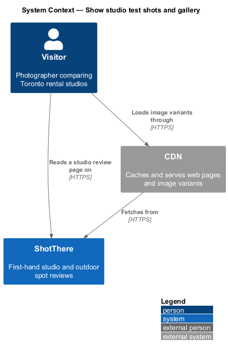
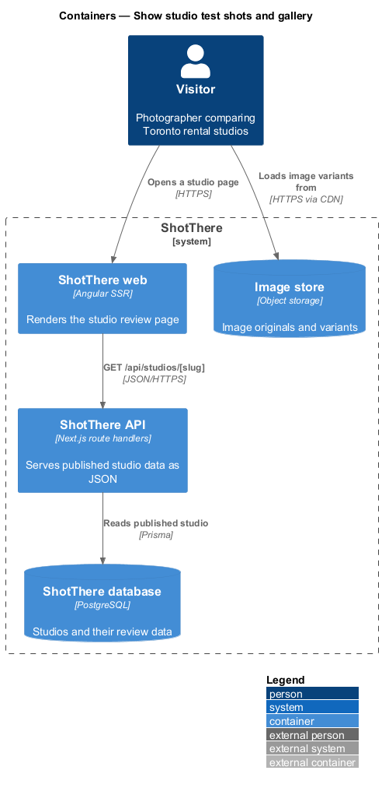
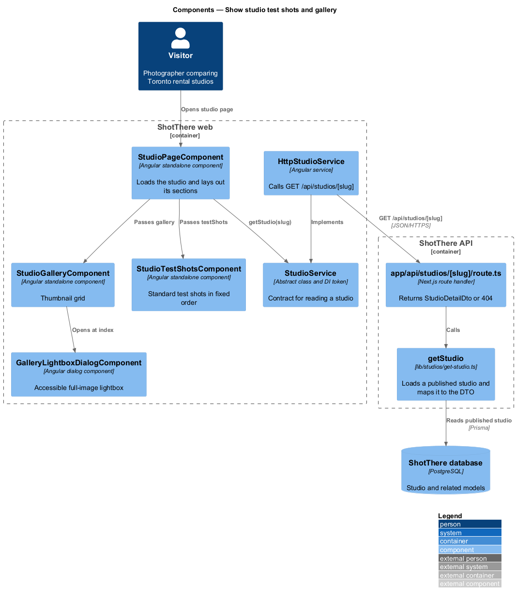
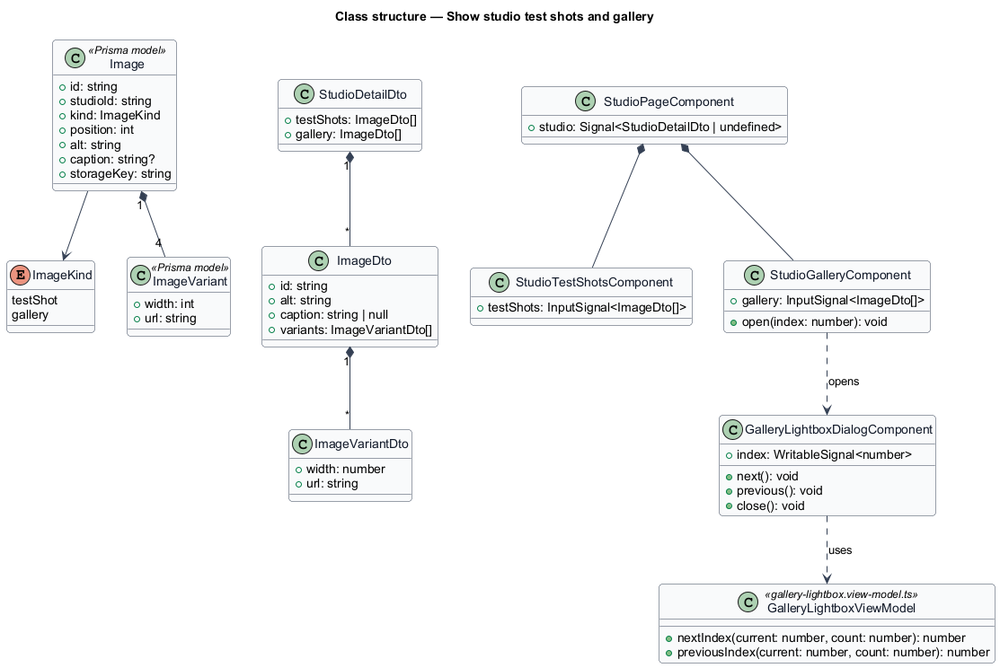
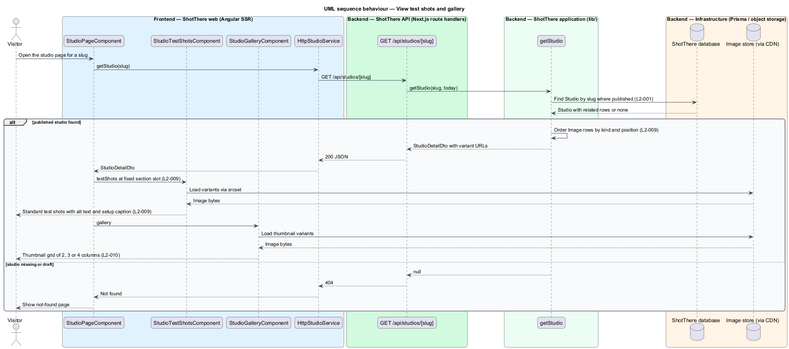
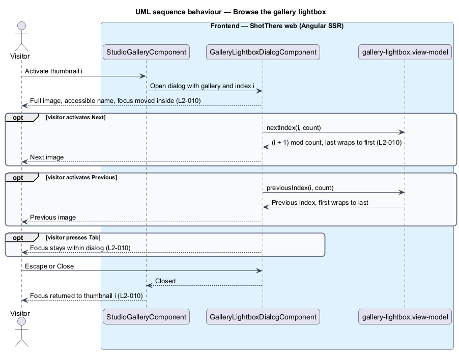

# Show studio test shots and gallery

## Overview

ShotThere is a review and comparison site for places to shoot photos in Toronto. A *studio review page* — public page that presents one first-hand rental studio review — is built from a fixed sequence of sections. One `StudioPageComponent` renders those sections from one response of `GET /api/studios/[slug]`. Every studio page uses the same measurements and section order, so studios compare side by side.

This feature delivers two image sections. The standard test shots let a visitor compare studios on identical setups. The gallery shows what a real shoot in the studio produced.

- **standard test shot** — image taken with the standard setup at every studio, shown in a fixed order with the standard setup caption
- **gallery image** — image from a real shoot in the studio, shown as a thumbnail that opens in a lightbox
- **lightbox** — modal dialog that shows one full-size gallery image with next, previous and close controls
- **image variant** — resized copy of an image at 480, 960, 1440 or 2048 pixels wide, produced by `sharp` and served through the CDN

The test-shot section sits at the same position in the page outline on every studio page.

## Description

The feature adds two section components and a lightbox dialog to the shared studio page, and adds the image parts of the shared DTO.

- **`StudioPageComponent`** — standalone, zoneless Angular page component in `features/studios/`, routed from `features/studios/routes.ts` with the path and title taken from the central app-paths constants. It reads the `slug` route parameter, calls `StudioService`, holds the result in a signal, and passes each part of the `StudioDetailDto` to its section component. Every studio-reviews feature shares it.
- **`StudioService`** — `abstract class` in `libs/api/src/studio.service.ts` that serves as its own DI token, with `getStudio(slug: string): Observable<StudioDetailDto>`. Pages inject this contract only.
- **`HttpStudioService`** — `class HttpStudioService extends StudioService` in `libs/api/src/http-studio.service.ts`, registered as `{ provide: StudioService, useClass: HttpStudioService }`. It issues `GET /api/studios/{slug}`.
- **`app/api/studios/[slug]/route.ts`** — Next.js `GET` route handler in `backend/`. It calls `getStudio` and returns `200` with `StudioDetailDto`, or `404` when no published studio has the slug.
- **`getStudio(slug, today)`** — application function in `lib/studios/get-studio.ts`. It loads a published `Studio` with Prisma, never a draft (`L2-001`), and maps it to `StudioDetailDto`, including the server-computed fields.
- **`StudioDetailDto`** — JSON contract for the whole page, declared once per side: `backend/lib/studios/studio-detail-dto.ts` and `libs/api/src/studio-detail-dto.ts`. Each feature reads only its own part, listed below.
- **`StudioTestShotsComponent`** — section component in `features/studios/studio-test-shots/`. Input: `testShots`. It renders a section titled "Standard test shots" with each image in stored order, its `alt` text and the standard setup caption through the library `ShotGridComponent`. Activating a thumbnail opens the library lightbox on that shot. `StudioPageComponent` places it at a fixed slot in the section order.
- **`StudioGalleryComponent`** — section component in `features/studios/studio-gallery/`. Input: `gallery`. It renders thumbnails as buttons in a grid of 2 columns at XS, 3 at MD and 4 at LG and above, with `srcset` over the image variants.
- **`GalleryLightboxDialogComponent`** — dialog component in `features/studios/gallery-lightbox-dialog/`, opened through the UI framework's accessible dialog primitive (`<TO SUPPLY>`: confirm Angular CDK `Dialog`). It has an accessible name, keeps focus inside, and offers Next, Previous and Close. Next on the last image shows the first. Escape closes it and returns focus to the opening thumbnail.
- **`gallery-lightbox.view-model.ts`** — plain TypeScript holding the wrap-around next and previous index rules.
- **Prisma models** — `Image` (`studioId`, `kind` of `testShot` or `gallery`, `position`, `alt`, `caption`, `storageKey`) and `ImageVariant` (`width`, `url`). `getStudio` orders each kind by `position`.
- **DTO parts used** — `testShots[]` and `gallery[]`, each an `ImageDto` with `alt`, `caption` and `variants[]`.
- **Standard setup caption source** — `<TO SUPPLY>`: whether the caption is one site-wide text per test-shot position or stored per image. The design assumes a `caption` field on each test-shot image.

## Requirements

The feature realizes the following level-2 (L2) requirements. Each L2 requirement refines a level-1 (L1) requirement, cited by identifier.

| L2 ID | Refines (L1) | Requirement |
|-------|--------------|-------------|
| `L2-009` | `L1-002` | Each studio page shall show the standard test shots, captioned with the standard setup description, in the same order on every studio page. |
| `L2-010` | `L1-002` | Each studio page shall show a gallery of images from a real shoot, each with alt text, openable in an accessible lightbox with next, previous, and close controls. |

## Diagrams

### System context

The visitor reads the page on ShotThere and loads image variants through the CDN that fronts the image store.

### Containers

The API returns image metadata and variant URLs. The browser fetches the image bytes from the image store through the CDN.

### Components

Two section components render the image lists, and the gallery opens `GalleryLightboxDialogComponent`. `getStudio` reads `Image` and `ImageVariant` rows.

### Class structure

`StudioDetailDto` holds two lists of `ImageDto`, each with its `ImageVariantDto` list. The lightbox receives the gallery list and a start index.

### Behaviour — View test shots and gallery

The page loads image metadata from the API, and the browser fetches the variants through the CDN.

### Behaviour — Browse the gallery lightbox

Activating a thumbnail opens the lightbox dialog. Navigation wraps, focus stays inside, and Escape returns focus to the thumbnail.

