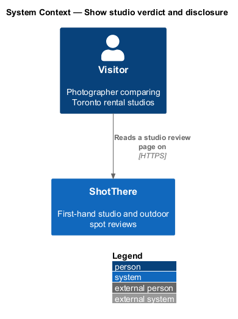
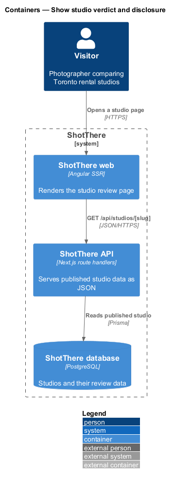
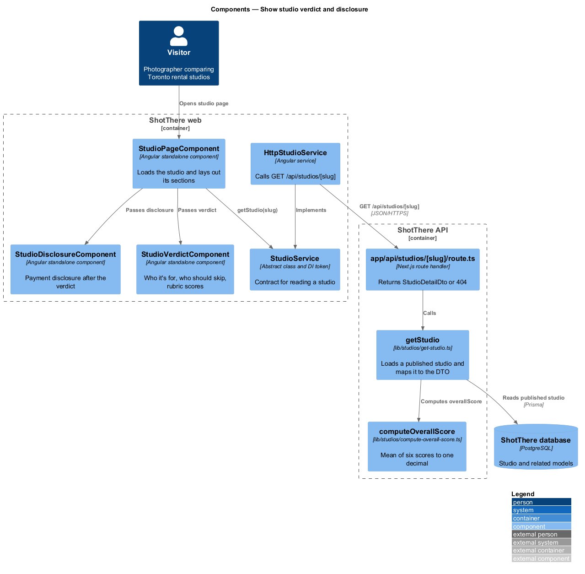
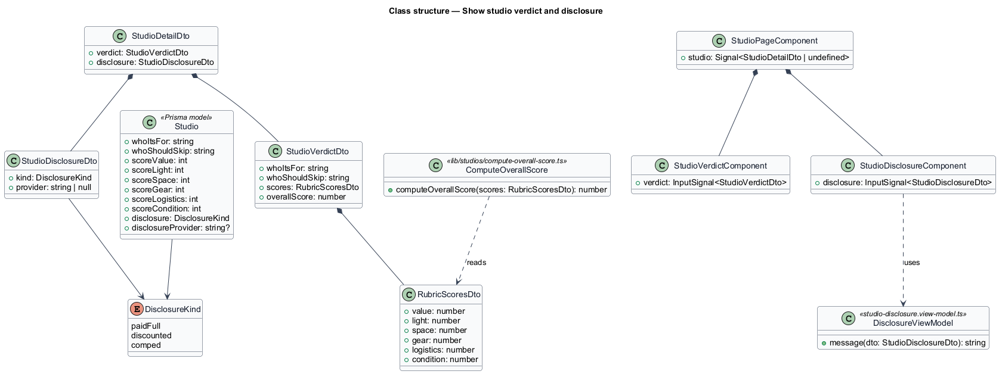
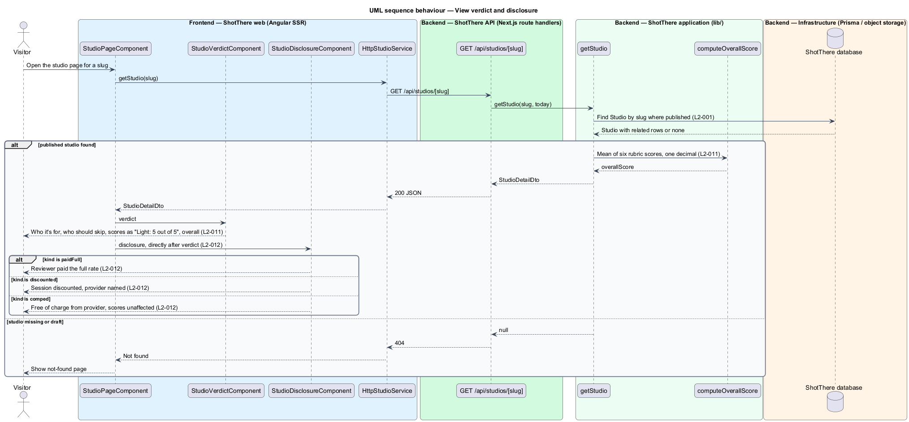

# Show studio verdict and disclosure

## Overview

ShotThere is a review and comparison site for places to shoot photos in Toronto. A *studio review page* — public page that presents one first-hand rental studio review — is built from a fixed sequence of sections. One `StudioPageComponent` renders those sections from one response of `GET /api/studios/[slug]`. Every studio page uses the same measurements and section order, so studios compare side by side.

This feature delivers the verdict and the disclosure statement beside it. The verdict says who the studio suits and who should skip it, and scores it on a fixed rubric. The disclosure states how the review session was paid for.

- **rubric** — fixed set of six scoring categories: Value, Light, Space, Gear, Logistics and Condition, each scored out of 5
- **overall score** — server-computed mean of the six rubric scores, `overallScore`, shown to one decimal place
- **disclosure** — statement of whether the session was paid in full, discounted or comped, and by whom when not paid in full

The disclosure sits at a fixed position directly after the verdict on every studio page, so a reader sees both together.

## Description

The feature adds two section components to the shared studio page and the verdict, score and disclosure parts of the shared DTO.

- **`StudioPageComponent`** — standalone, zoneless Angular page component in `features/studios/`, routed from `features/studios/routes.ts` with the path and title taken from the central app-paths constants. It reads the `slug` route parameter, calls `StudioService`, holds the result in a signal, and passes each part of the `StudioDetailDto` to its section component. Every studio-reviews feature shares it.
- **`StudioService`** — `abstract class` in `libs/api/src/studio.service.ts` that serves as its own DI token, with `getStudio(slug: string): Observable<StudioDetailDto>`. Pages inject this contract only.
- **`HttpStudioService`** — `class HttpStudioService extends StudioService` in `libs/api/src/http-studio.service.ts`, registered as `{ provide: StudioService, useClass: HttpStudioService }`. It issues `GET /api/studios/{slug}`.
- **`app/api/studios/[slug]/route.ts`** — Next.js `GET` route handler in `backend/`. It calls `getStudio` and returns `200` with `StudioDetailDto`, or `404` when no published studio has the slug.
- **`getStudio(slug, today)`** — application function in `lib/studios/get-studio.ts`. It loads a published `Studio` with Prisma, never a draft (`L2-001`), and maps it to `StudioDetailDto`, including the server-computed fields.
- **`StudioDetailDto`** — JSON contract for the whole page, declared once per side: `backend/lib/studios/studio-detail-dto.ts` and `libs/api/src/studio-detail-dto.ts`. Each feature reads only its own part, listed below.
- **`StudioVerdictComponent`** — section component in `features/studios/studio-verdict/`. Input: `verdict`. It renders "Who it's for", "Who should skip it", each rubric score out of 5, and the overall score with one decimal. Each score carries visually hidden text in the form "Light: 5 out of 5".
- **`StudioDisclosureComponent`** — section component in `features/studios/studio-disclosure/`. Input: `disclosure`. `StudioPageComponent` renders it directly after the verdict on every page.
- **`studio-disclosure.view-model.ts`** — plain TypeScript that selects the i18n message for `paidFull`, `discounted` or `comped`. The comped message states that the provider gave the session free of charge and that this did not affect the scores. The discounted message names the provider.
- **`computeOverallScore(scores)`** — pure function in `lib/studios/compute-overall-score.ts`. It returns the mean of the six scores rounded to one decimal place (`L2-011`).
- **Prisma model** — `Studio` fields `whoItsFor`, `whoShouldSkip`, `scoreValue`, `scoreLight`, `scoreSpace`, `scoreGear`, `scoreLogistics`, `scoreCondition`, `disclosure` and `disclosureProvider`.
- **DTO parts used** — `verdict` (`whoItsFor`, `whoShouldSkip`, `scores`, `overallScore`) and `disclosure` (`kind`, `provider`). `getStudio` computes `overallScore` on each request; it is not stored.
- **Rounding of halves** — `<TO SUPPLY>`: how a mean ending in exactly .x5 rounds. The six integer scores make such a mean possible only at .x5 boundaries such as 3.25; the design assumes round half up.

## Requirements

The feature realizes the following level-2 (L2) requirements. Each L2 requirement refines a level-1 (L1) requirement, cited by identifier.

| L2 ID | Refines (L1) | Requirement |
|-------|--------------|-------------|
| `L2-011` | `L1-002` | Each studio page shall show a verdict with "Who it's for", "Who should skip it", the six rubric scores, and the overall score computed by the server. |
| `L2-012` | `L1-002` | Each studio page shall show a disclosure statement in a fixed position near the verdict stating whether the session was paid for at full price, discounted, or comped, and by whom when not paid in full. |

## Diagrams

### System context

The visitor reads the verdict and the disclosure on ShotThere. No external system takes part.

### Containers

The API computes the overall score and returns it with the verdict and disclosure to the web container.

### Components

`StudioVerdictComponent` and `StudioDisclosureComponent` render their DTO parts. `getStudio` calls `computeOverallScore`.

### Class structure

`StudioDetailDto` composes `StudioVerdictDto` and `StudioDisclosureDto`. The Prisma model and the DTO share the `DisclosureKind` enumeration.

### Behaviour — View verdict and disclosure

The server computes the overall score. The page renders the verdict and then the disclosure message chosen by the disclosure kind.

