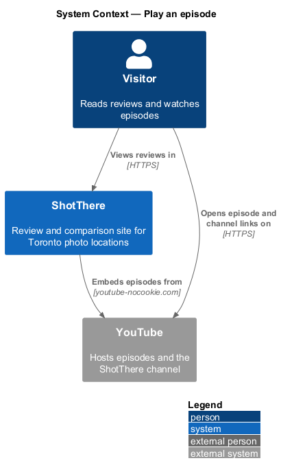
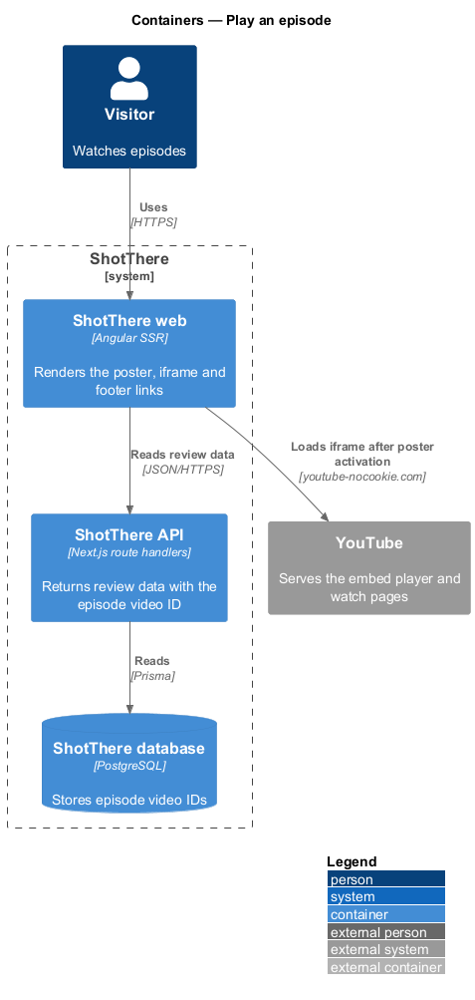
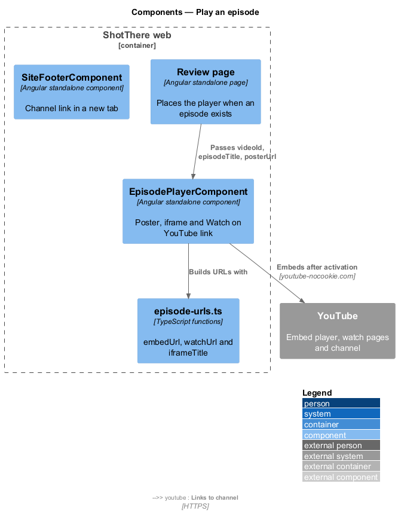
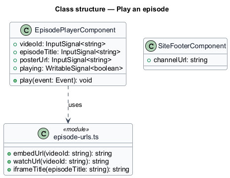
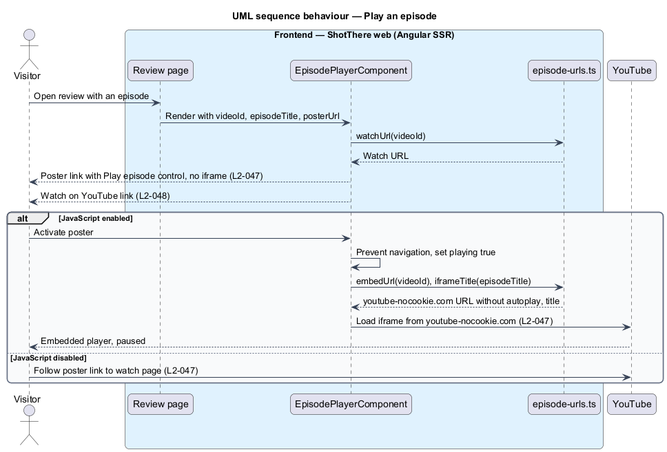

# Play an episode

## Overview

Each ShotThere review has a companion episode on the ShotThere YouTube channel. Review pages show the episode so a visitor can watch the location being shot without leaving the site.

**episode** — YouTube video that documents the shoot at one reviewed location

**episode player** — page section that shows a poster for an episode and swaps in the embedded video when activated

**poster** — still image with a "Play episode" control that stands in for the video until the visitor activates it

**privacy-enhanced embed** — YouTube iframe served from the `youtube-nocookie.com` origin

The feature belongs to the video subsystem. A page with an episode loads no YouTube iframe at first. The iframe appears only after the visitor activates the poster, and it never autoplays. Without JavaScript the poster is a plain link to the episode on YouTube. Every video section also carries a "Watch on YouTube" link, and the footer of every public page links to the channel.

## Description

- **`EpisodePlayerComponent`** — standalone Angular component in `features/video/` with `episode-player.component.html` and `episode-player.component.css`. Inputs: `videoId`, `episodeTitle` and `posterUrl`. A `playing` signal starts `false`. While `false`, the component renders the poster as an `<a>` to the episode watch URL with an i18n-marked "Play episode" label. Activating the poster prevents navigation and sets `playing` to `true`. The template then renders an `<iframe>` with the embed URL and a `title` naming the episode. The section always shows a "Watch on YouTube" link to the watch URL. Review pages place the component only when an episode exists.
- **`episode-urls.ts`** — plain TypeScript beside the component. `embedUrl(videoId)` returns `https://www.youtube-nocookie.com/embed/{videoId}` with no `autoplay` parameter. `watchUrl(videoId)` returns `https://www.youtube.com/watch?v={videoId}`. `iframeTitle(episodeTitle)` returns the i18n-marked iframe title.
- **`SiteFooterComponent`** — the shared footer in `core/layout/`, owned by the app shell. This slice adds an i18n-marked link to the YouTube channel with `target="_blank"` and `rel="noopener"`. The channel URL is `<TO SUPPLY>` and sits in one central constant.
- **Episode data** — the review DTOs already carry the episode video ID and title, set through the set-episode-video slice. This slice adds no API endpoint, DTO field or Prisma model.
- **Poster image source** — `<TO SUPPLY>`; either an uploaded `Image` with its variants or a YouTube thumbnail.

## Requirements

The feature satisfies the following L2 requirements.

| L2 ID | Refines (L1) | Requirement |
|-------|--------------|-------------|
| `L2-047` | `L1-012` | Video embeds shall use the privacy-enhanced YouTube domain, shall not autoplay, shall load only after the visitor activates a poster image, and shall have an accessible title. On first load no YouTube iframe shall be present and a poster with a "Play episode" control shall show. Activation shall insert a `youtube-nocookie.com` iframe whose `title` names the episode, with no autoplay parameter. Without JavaScript the poster shall link directly to the video on YouTube. |
| `L2-048` | `L1-012` | The site footer shall link to the YouTube channel, opening in a new tab with `rel="noopener"`. Each video section shall contain a "Watch on YouTube" link to the episode. |

## Diagrams

### System context

A visitor watches an episode through ShotThere. YouTube serves the embedded video and the channel.

### Containers

The web app renders the poster from review data supplied by the API. The browser loads the iframe from YouTube only after activation.

### Components

`EpisodePlayerComponent` builds its URLs with `episode-urls.ts`. `SiteFooterComponent` holds the channel link.

### Class structure

The player owns one `playing` signal and depends only on the URL functions. The footer reads the central channel URL.

### Behaviour — play an episode

The page shows the poster first. Activation inserts the privacy-enhanced iframe, and without JavaScript the poster link opens YouTube.

