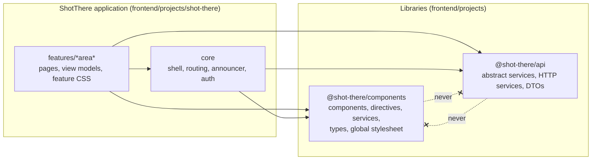

# ICD-002: components library ↔ ShotThere application

| Field | Value |
|---|---|
| Document | ICD-002, Interface Control Document |
| Version | 1.1.0 |
| Status | Baseline. Takes effect when merged to `main`. |
| Date | Wednesday 14 October 2026 |
| Interface provider | Components library `@shot-there/components` (`frontend/projects/components/`) |
| Interface consumer | ShotThere application project `shot-there` (`frontend/projects/shot-there/`) |
| Adjacent party | API library `@shot-there/api` (`frontend/projects/api/`) |
| Governs | Every import, selector, input, output, slot, type, service, CSS class, token, string and behaviour that crosses the boundary between the two projects |

---

## Contents

1. [Purpose](#1-purpose)
2. [Scope](#2-scope)
3. [Parties and responsibilities](#3-parties-and-responsibilities)
4. [Normative references and precedence](#4-normative-references-and-precedence)
5. [Terms](#5-terms)
6. [Interface overview](#6-interface-overview)
7. [Interface requirements](#7-interface-requirements)
8. [Shared types](#8-shared-types)
9. [Component catalogue](#9-component-catalogue)
10. [Services](#10-services)
11. [Styles: global stylesheet and CSS ownership](#11-styles-global-stylesheet-and-css-ownership)
12. [Library strings](#12-library-strings)
13. [Integration example](#13-integration-example)
14. [Responsibility matrix](#14-responsibility-matrix)
15. [Change control](#15-change-control)
16. [Conformance checklists](#16-conformance-checklists)
17. [Traceability to L2](#17-traceability-to-l2)
18. [Decisions](#18-decisions)
19. [Revision history](#19-revision-history)

---

## 1. Purpose

ShotThere builds its components library first and the application second. The
two are built at different times, often by different people or agents, and
must fit together on the first attempt. This document is the contract between
them. It fixes:

- what the library exports and how the application imports it;
- the API of every exported component, directive, service and type;
- the DOM, CSS classes, design tokens and ARIA the library renders, which the
  application's page objects rely on;
- who owns each concern (copy, formatting, validation, focus, announcements,
  routing, layout, theming) so nothing is done twice or not at all.

The rule for both sides: **if it crosses the boundary, it is written here.**
If the library needs something this document does not allow, or the
application needs something it does not provide, change this document first
([§15](#15-change-control)), then the code.

## 2. Scope

**In scope**

- The package boundary between `frontend/projects/components/` and `frontend/projects/shot-there/`.
- The public TypeScript API of `@shot-there/components`.
- The rendered DOM and CSS contract: block, element and modifier class names,
  state attributes, design tokens, the global stylesheet.
- Cross-cutting behaviour at the boundary: forms, overlays, focus,
  announcements, internationalisation, images and media, server-side rendering
  and hydration, performance, security.
- How the application gets API data (`@shot-there/api` DTOs) into components
  without the two libraries depending on each other.

**Out of scope**

- The HTTP contract between `@shot-there/api` and the backend, which
  [ICD-001](README.md) governs.
- The internal design of individual components, including their states and
  acceptance criteria.
- Page and feature behaviour (filters, URL state, publishing rules), which
  belongs to L2 and the detailed designs.
- The interactive map engine. The detailed designs leave the map library open;
  this interface is built so the components library never depends on it
  (D-6).

## 3. Parties and responsibilities

| Party | Owns | Must not |
|---|---|---|
| **Components library** (provider) | Presentational, reusable building blocks from the design system; their DOM, styles, keyboard and ARIA behaviour; the global stylesheet; overlay and toast services. | Fetch data, know about routes or DTOs, compute business values, format locale data, hold product copy, or import the application or the API library. |
| **ShotThere application** (consumer) | Pages, routing, URL state, data loading, view models, validation rules and messages, all product copy, number/date/currency formatting, page landmarks and headings, theme selection, feature layouts. | Re-implement a component the library provides, style library internals, import library internals, or write design-system markup by hand for something the library renders. |
| **API library** (adjacent) | Services and DTOs for the backend. | Import the components library. |

## 4. Normative references and precedence

| Source | Path | Governs |
|---|---|---|
| L1 and L2 requirements | `docs/specs/L1.md`, `docs/specs/L2.md` | Product behaviour, accessibility, performance, security |
| Design system | `docs/design-system/` | Visuals, tokens, class names, states, patterns |
| Mocks | `docs/mocks/` | Every screen and state that must be buildable |
| This ICD | `docs/icd/components-library-application.md` | The boundary: exports, APIs, ownership |
| ICD-001 | `docs/icd/backend-frontend-api.md` | The HTTP contract between the application (through `@shot-there/api`) and the Next.js API, including every DTO |
| Detailed designs | `docs/detailed-designs/` | Feature design; for boundary matters this ICD wins (§18) |
| Working agreement | `AGENTS.md` | Repository rules both parties follow |

Precedence when two sources disagree:

1. L2 decides **what must happen**.
2. The design system decides **how it looks** and **which classes and tokens
   render it**.
3. This ICD decides **which side does it and through what API**.

If L2 and the design system conflict, neither party resolves it in code. Raise
it, settle it upstream, then update this ICD if the boundary changes.

## 5. Terms

| Term | Meaning |
|---|---|
| **Boundary** | Anything one project uses from the other. |
| **Public API** | Exactly what `frontend/projects/components/src/public-api.ts` exports, plus the global stylesheet and the rendered DOM contract in §7.4. |
| **DS** | The design system in `docs/design-system/`. |
| **Block / element / modifier** | BEM class parts as used by the DS: `.location-card`, `.location-card__name`, `.location-card--skeleton`. |
| **Slot** | A named content projection point: `<ng-content select="[slot=actions]" />`. The consumer writes `slot="actions"` on the projected element. |
| **Library string** | User-facing text the library renders itself (a close button's name, "Skip to content"). Listed in §12. |
| **Display string** | A value the application has already formatted for display (`"$145.00"`, `"3 Oct 2026"`). |
| **View model** | A plain object the application builds from a DTO to feed a component's inputs. |
| **Component object** | A Playwright object for one library component, composed by page objects. |
| **XS–XL** | The L2 viewport classes; DS breakpoints sm 36rem, md 48rem, lg 62rem, xl 75rem. |

## 6. Interface overview



The interface has eight channels. Each has its own requirements in §7.

| # | Channel | Direction | Carried by |
|---|---|---|---|
| 1 | Package | app → library | `@shot-there/components` entry point, built output |
| 2 | TypeScript API | app → library | Component inputs, outputs, slots; services; types |
| 3 | DOM contract | library → app | Classes, roles, ARIA and state attributes the library renders |
| 4 | Styles | library → app | Global stylesheet, tokens, utilities |
| 5 | Strings | both | Library strings (§12); product copy through inputs and slots |
| 6 | Forms | both | `ControlValueAccessor` on every form control |
| 7 | Overlays and notifications | app → library | `DialogService`, `ToastService`, `DialogRef`, `DIALOG_DATA` |
| 8 | Tests | library → app | Component objects composed by page objects |

---

## 7. Interface requirements

Each requirement is a "must" statement with an identifier and a verification
method:

- **B** Build: the library build or the application build fails if it is broken.
- **L** Lint: an ESLint or Angular template rule fails.
- **T** Test: a Playwright acceptance test (Chromium only), written first per
  `AGENTS.md`.
- **R** Review: checked in pull-request review against §16.

Per `AGENTS.md`, structure is verified by the compiler, lint and review, never
by architecture tests.

### 7.1 Package and build (PKG)

| ID | Requirement | Verify |
|---|---|---|
| ICD-PKG-1 | The library is the Angular workspace project `components`, rooted at `frontend/projects/components/`, built with ng-packagr in partial compilation mode to `frontend/dist/components/`, with package name `@shot-there/components`. | B |
| ICD-PKG-2 | The library has exactly one entry point, `frontend/projects/components/src/public-api.ts`. Only what it exports is public. No secondary entry points. | B, R |
| ICD-PKG-3 | The application resolves `@shot-there/components` through `frontend/tsconfig.json` `paths` to `dist/components`, so it compiles against the built package, not the library source. CI builds `components` before `shot-there`. | B |
| ICD-PKG-4 | The application imports only from `@shot-there/components`. Deep imports (`@shot-there/components/src/...`, relative paths into `projects/components`) are forbidden. | L (`no-restricted-imports`) |
| ICD-PKG-5 | The package publishes the global stylesheet at `styles/shot-there.css` (ng-package `assets`). The application lists `dist/components/styles/shot-there.css` as the **first** entry of its `styles` in `angular.json`. | B |
| ICD-PKG-6 | The library `package.json` declares `"sideEffects": ["*.css"]` and lists `@angular/core`, `@angular/common`, `@angular/forms`, `@angular/router`, `@angular/cdk` and `@angular/localize` as `peerDependencies` at the workspace's Angular version. It has no other runtime dependencies. | B, R |
| ICD-PKG-7 | The library and the application build with the same `@angular/*` and `@angular/cdk` version from the single `frontend/package.json`. | B |
| ICD-PKG-8 | The library `package.json` `version` equals this document's version. A release that changes the boundary changes both in the same pull request. | R |

### 7.2 Dependencies (DEP)

| ID | Requirement | Verify |
|---|---|---|
| ICD-DEP-1 | The library imports only from `@angular/core`, `@angular/common`, `@angular/forms` (accessor interfaces only), `@angular/router` (`RouterLink`, `RouterLinkActive` only), `@angular/cdk` (`a11y`, `dialog`, `overlay`, `portal`, `platform`), `@angular/localize` and `@angular/platform-browser` (`DomSanitizer` types only), and its own files. | L, R |
| ICD-DEP-2 | The library never imports `@shot-there/api`, the application, `HttpClient`, the backend, or any map, carousel or video library. | L |
| ICD-DEP-3 | `@shot-there/api` never imports `@shot-there/components`. | L |
| ICD-DEP-4 | Library types never reference API DTOs. Where a component shows API data, its input type is a library type that the DTO satisfies structurally, so the application passes the DTO or a view model with no casts ([§8](#8-shared-types), D-5). | B |
| ICD-DEP-5 | The application's dependency direction stays `features/<area>` → `core` → libraries (`AGENTS.md`). Library components are used from both `features` and `core`. | L, R |

### 7.3 Component API conventions (API)

| ID | Requirement | Verify |
|---|---|---|
| ICD-API-1 | Every component and directive is standalone, uses `ChangeDetectionStrategy.OnPush`, and works without zone.js: state changes go through signals, and no code depends on `NgZone`. | B, R |
| ICD-API-2 | Inputs are signal inputs: `input()`, `input.required()`. Boolean inputs use `booleanAttribute` and number inputs `numberAttribute`, so `<st-x block>` works. Two-way values use `model()`. | B |
| ICD-API-3 | Outputs use `output()`. Names describe what the user did, in the past tense or as `<value>Change` (`removed`, `dismissed`, `filesSelected`, `valueChange`). Names never repeat a native DOM event (`click`, `change`, `input`, `close`, `submit`) and never start with `on`. | R |
| ICD-API-4 | Selectors use the `st` prefix. Components: `st-` plus the DS slug, kebab case (`st-empty-state`). A component that enhances a native element uses an attribute selector on that element (`button[st-button]`, `table[st-table]`) so native semantics, `type`, `disabled`, `routerLink` and form submission keep working. Directives: `st` plus camel case (`img[stFallbackImage]`). | L (`@angular-eslint/component-selector`, `directive-selector`) |
| ICD-API-5 | TypeScript names have no prefix: `ButtonComponent`, `FallbackImageDirective`, `DialogService`, `ResponsiveImage`. One type per kebab-case file (`button.component.ts`, `responsive-image.ts`). | L, R |
| ICD-API-6 | Every component keeps its template in `<file>.html` (`templateUrl`) and its styles in `<file>.css` (`styleUrl`). No inline `template` or `styles`. | L, R |
| ICD-API-7 | Each input, output and slot in [§9](#9-component-catalogue) is implemented with exactly the stated name, type, default and required flag. A component exports nothing that §9 does not list. | B, R |
| ICD-API-8 | Optional inputs have a default that renders a valid, accessible result. Required inputs are `input.required()`, so a missing one fails the application build. | B |
| ICD-API-9 | Slots are declared once each and selected by `[slot=<name>]`. The default slot has no selector. A component never queries or mutates projected content except where §9 says so. | R |
| ICD-API-10 | Components hold no business rules: no price or score arithmetic, no staleness checks, no URL building, no validation logic, no sorting or filtering of data. They render what they are given and report what the user did. | R |
| ICD-API-11 | Components never call the router imperatively (`Router.navigate`), read the URL, or read `ActivatedRoute`. Links use `RouterLink` bound to a path string the application supplies. | R |
| ICD-API-12 | Components never read or write `document.title`, `<html data-theme>`, `lang`, cookies or storage. | R |
| ICD-API-13 | Inputs that render a heading take `headingLevel` (type `HeadingLevel`), because the application owns the page outline (L2-069.1). Defaults are listed per component. | T |

### 7.4 DOM contract (DOM)

| ID | Requirement | Verify |
|---|---|---|
| ICD-DOM-1 | Each component renders the markup on its DS page's **Code** section and in the mocks: the same elements, block, element and modifier classes, roles and ARIA attributes. The host element carries the DS block class (`<st-empty-state class="empty">`), except where the block must be a specific native element, in which case the component renders that element and the host adds no box of its own. | T, R |
| ICD-DOM-2 | State is expressed with real attributes: `disabled`, `aria-pressed`, `aria-current`, `aria-invalid`, `aria-expanded`, `aria-busy`, `aria-disabled`, `aria-sort`, `open`. `data-state` exists only in DS documentation pages and is never rendered by the library. | T |
| ICD-DOM-3 | Class names, roles, accessible names and state attributes in rendered DOM are public API. Renaming or removing one is a breaking change ([§15](#15-change-control)). Element and attribute names of hosts (`st-…`) and Angular's `_ngcontent-*`/`_nghost-*` attributes are **not** public API; page objects never select them. | R |
| ICD-DOM-4 | The application never writes DS markup for something the library renders (for example, it never hand-writes `<div class="empty">`). It may use the global utilities in [§11](#11-styles-global-stylesheet-and-css-ownership). | R |
| ICD-DOM-5 | The application never styles library internals: no application selector may target a library-owned class. The application may position a library host with global utilities or with its own feature classes on the host element, limited to `margin`, grid and flex placement, and `width`; and it sets the inline `left` and `top` that place `st-map-popup` over its marker (D-6). | R |

### 7.5 Styles, tokens and theming (STY)

| ID | Requirement | Verify |
|---|---|---|
| ICD-STY-1 | `docs/design-system/tokens/tokens.css` is copied without edits to `frontend/projects/components/styles/tokens.css` and is the first part of `shot-there.css`. Token names are public API. A token change is made in the DS first, then copied. | R |
| ICD-STY-2 | Both projects read tokens by role (`var(--color-fg-muted)`), never by value. No hex, `rgb()` or `hsl()` colour literals in either project's CSS. | L (stylelint `color-no-hex`, `color-named`), R |
| ICD-STY-3 | Component styles are encapsulated (`ViewEncapsulation.Emulated`, the default). `ViewEncapsulation.None`, `ShadowDom` and `::ng-deep` are forbidden in both projects. | L, R |
| ICD-STY-4 | Global CSS is only `shot-there.css`: tokens, foundations and utilities listed in §11. The application's `frontend/projects/shot-there/src/styles.css` adds no global rules except page-independent fixes agreed through §15. | R |
| ICD-STY-5 | Theme: the application sets `data-theme="light|dark"` on `<html>` (or leaves it unset to follow the OS) and runs the DS no-flash snippet in `index.html` before first paint. The library has no theme input; components get both themes through tokens. | T |
| ICD-STY-6 | Breakpoints in library CSS are the DS values written as literals in `@media` queries (`36rem`, `48rem`, `62rem`, `75rem`), mobile first (`min-width`). | R |
| ICD-STY-7 | Fixed and sticky library parts (compare bar, sticky form actions, toast region, sheets, full-screen dialogs) pad with `env(safe-area-inset-*)`. The application's `index.html` viewport meta includes `viewport-fit=cover`. | T |
| ICD-STY-8 | The application loads the Figtree font files (self-hosted under `frontend/projects/shot-there/public/fonts/`, `font-display: swap`). The library references fonts only through `--font-*` tokens and ships no font files. | R |

### 7.6 Internationalisation and copy (I18N)

| ID | Requirement | Verify |
|---|---|---|
| ICD-I18N-1 | Both projects use Angular built-in i18n (`@angular/localize`). | B |
| ICD-I18N-2 | Product copy reaches the library only through inputs and slots. The application marks it: `i18n-<input>` for static input values, `i18n` on projected text, `$localize` for values set in TypeScript. | L (`@angular-eslint/template/i18n` with `checkText`) |
| ICD-I18N-3 | The library renders no static text in templates. Its own strings (§12) are `$localize` tagged strings with a custom ID `@@st.<component>.<key>`, and each has an input that replaces it. | L, R |
| ICD-I18N-4 | The library never formats numbers, money, dates, times or distances. The application formats them for `en-CA` (L2-070.3) and passes display strings. Machine-readable dates are passed as `DisplayDate` so the library can render `<time datetime>`. | R |
| ICD-I18N-5 | Library strings with counts (`"Photo 3 of 8"`) use `$localize` placeholders, never string concatenation. | R |
| ICD-I18N-6 | The application declares `<html lang="en-CA">` and provides `LOCALE_ID` `en-CA` (L2-070.1). | T |

### 7.7 Accessibility (A11Y)

The full split is in [§14](#14-responsibility-matrix). These are the boundary rules.

| ID | Requirement | Verify |
|---|---|---|
| ICD-A11Y-1 | Each component meets WCAG 2.2 AA on its own in both themes: name, role, value, keyboard operation, visible focus (`--color-focus-ring`, at least 2px, L2-067.2), contrast (L2-068), target size (24px minimum, 44px for primary flows at XS, L2-065). | T |
| ICD-A11Y-2 | Every interactive library part has an accessible name. Where the name is product copy it is a required input (`label`) or the default slot; where it is a library string it has a default (§12) and an override input. | B, T |
| ICD-A11Y-3 | The application owns landmarks (one `main`, `id="main"`, `tabindex="-1"`), the single `h1`, the heading outline, and page-level announcements through its `AnnouncerService`. Components never render `main`, never render an `h1` except `st-page-header` and `st-error-page`, and render other headings only at the `headingLevel` they are given. | T |
| ICD-A11Y-4 | Components with a built-in live region (§9 marks them "live") are the only announcer for that change. The application does not also announce it through `AnnouncerService` (D-7). | T |
| ICD-A11Y-5 | Overlays trap focus, close on Escape unless busy, and return focus to the invoking control or to `returnFocusTo` (L2-067.3). | T |
| ICD-A11Y-6 | Components honour `prefers-reduced-motion` and forced colours through the tokens. | T |
| ICD-A11Y-7 | Decorative images and icons are hidden from assistive technology (`alt=""`, `aria-hidden="true"`). Informative images use the alt text the application supplies (L2-068.2). | T |

### 7.8 Forms (FORM)

| ID | Requirement | Verify |
|---|---|---|
| ICD-FORM-1 | Every form control in §9.2 implements `ControlValueAccessor` (provided with `NG_VALUE_ACCESSOR`), so it works with `formControlName`, `[formControl]` and `ngModel`. The application uses typed reactive forms. | B, T |
| ICD-FORM-2 | Value types are fixed: text field, textarea, select, radio group and search field `string` (empty is `''`, never `null`); checkbox `boolean`; checkbox group `string[]`. The application parses numbers and dates from strings. | B |
| ICD-FORM-3 | Disabled state comes only from the forms API (`setDisabledState`). Controls have no `disabled` input. | B |
| ICD-FORM-4 | A control marks itself touched on blur and reports value changes on input (text) or change (choice, select). | T |
| ICD-FORM-5 | Validation is the application's. A control receives `error: string \| null`. When it is a non-empty string the control renders it in `.field__error`, sets `aria-invalid="true"` on the native control, and adds the error's ID to `aria-describedby` (L2-069.2). Controls never read `AbstractControl.errors`. | T |
| ICD-FORM-6 | Each control has an `inputId` input that becomes the native control's `id`. Without it the library generates an ID that is the same on the server and in the browser during hydration. The application sets `inputId` on every field that an error summary links to. | T |
| ICD-FORM-7 | `st-error-summary` moves focus to itself when its `items` change from empty to non-empty, and activating an item moves focus to the element with that item's `targetId`. | T |
| ICD-FORM-8 | Buttons that submit use `button[st-button]` with `type="submit"` inside the application's `<form>`. While `busy` is true the button ignores activation and no consumer listener receives the click. | T |

### 7.9 Overlays and notifications (OVL)

| ID | Requirement | Verify |
|---|---|---|
| ICD-OVL-1 | Overlays are built on Angular CDK (`@angular/cdk/dialog`, `overlay`, `a11y`) (D-4). Neither project hand-rolls a modal. | R |
| ICD-OVL-2 | The application opens every dialog, sheet and viewer through the library's `DialogService` ([§10.1](#101-dialogservice)). It never calls CDK `Dialog.open` directly, so backdrop, panel classes, scroll blocking, phone layout and focus return are the same everywhere. | L (`no-restricted-imports` of `Dialog` in the app), R |
| ICD-OVL-3 | A dialog's content is an application component (for example `DeleteContentDialogComponent`) whose template root is `st-dialog` or `st-sheet`. It receives data with `inject(DIALOG_DATA)` and closes with `inject(DialogRef).close(result)`, both imported from `@shot-there/components` (which re-exports CDK's). The app never imports `@angular/cdk/dialog`. | B |
| ICD-OVL-4 | No dialog opens another dialog (DS pattern: no stacking). | R |
| ICD-OVL-5 | Toasts are raised only through `ToastService` ([§10.2](#102-toastservice)). The application renders `st-toast-region` exactly once, in the shell. | T |
| ICD-OVL-6 | Toast rules (DS notifications pattern): at most 3 visible, newest last; `danger` never auto-dismisses and uses `role="alert"`; other tones dismiss after 8 s, pausing while hovered or focused, and are announced politely. | T |

### 7.10 Images and media (MEDIA)

| ID | Requirement | Verify |
|---|---|---|
| ICD-MEDIA-1 | Every content photo is rendered by `st-responsive-image` or a component that uses it, with `sizes` from the application and `width`/`height` from the data, so layout is reserved (L2-072). | T |
| ICD-MEDIA-2 | Exactly the first above-the-fold image on a page gets `priority` (`loading="eager"`, `fetchpriority="high"`). The application decides which one. All others lazy-load (L2-072.1–2). | T |
| ICD-MEDIA-3 | A failed image keeps its slot and shows the alt text in a `.media-fallback` placeholder with no layout shift (L2-086.1). `st-responsive-image` does this itself; plain `` elements in the application use `img[stFallbackImage]`. | T |
| ICD-MEDIA-4 | The application builds video embed URLs (`https://www.youtube-nocookie.com/embed/<id>`, no autoplay parameter, L2-047) and passes them to `st-video-poster` as `SafeResourceUrl`. The library never calls `bypassSecurityTrust*` and never builds a URL. | R, T |

### 7.11 Server rendering and hydration (SSR)

| ID | Requirement | Verify |
|---|---|---|
| ICD-SSR-1 | Every component renders on the server without touching `window`, `document`, `navigator`, `localStorage` or layout APIs. Browser-only work runs in `afterNextRender` or behind `isPlatformBrowser`, and the document comes from `inject(DOCUMENT)`. | T (SSR build of the harness and the app) |
| ICD-SSR-2 | Components hydrate without mismatch: deterministic IDs (ICD-FORM-6), no DOM changes outside Angular's renderer except CDK overlays, no `ngSkipHydration`. | T |
| ICD-SSR-3 | Content that must work without JavaScript works from server HTML: links are real `<a href>`, the video poster links to YouTube (L2-047.3), the skip link targets `#main`. | T |

### 7.12 Performance (PERF)

| ID | Requirement | Verify |
|---|---|---|
| ICD-PERF-1 | The library is tree-shakable: no top-level side effects in TypeScript, services `providedIn: 'root'`, no barrel re-exports of third-party code. An unused component adds nothing to the application bundle. | B |
| ICD-PERF-2 | No component work happens in templates that a `computed` could hold. Lists use `@for` with a `track` expression supplied by the component (index or a stable key named in §9). | R |
| ICD-PERF-3 | Overlay content is loaded only when opened. The application lazy-loads dialog components with dynamic `import()` where the dialog is not on the first view. | R |
| ICD-PERF-4 | Together the library and application keep each public page within L2-071 (LCP ≤ 2.5 s, CLS ≤ 0.1, INP ≤ 200 ms, first-load JavaScript ≤ 250 KB compressed). Skeletons match final layout dimensions. | T |

### 7.13 Security (SEC)

| ID | Requirement | Verify |
|---|---|---|
| ICD-SEC-1 | The library never binds `[innerHTML]`, never uses `bypassSecurityTrust*`, and never evaluates strings as code. | L, R |
| ICD-SEC-2 | External links rendered by the library (`a[st-link][external]`, external `NavLink`s) get `target="_blank"` and `rel="noopener"` (L2-048.1). | T |
| ICD-SEC-3 | The library holds no secrets, keys or environment configuration. | R |

### 7.14 Tests (TEST)

| ID | Requirement | Verify |
|---|---|---|
| ICD-TEST-1 | Each library component is built test-first against its acceptance criteria with Playwright in Chromium, mounted in the harness application `components-harness` (`frontend/projects/components-harness/`, one route per component state, never deployed) (D-12). | T |
| ICD-TEST-2 | Each component has one component object in `frontend/e2e/components/<component>.component.ts` that owns its selectors and interactions. Application page objects in `frontend/e2e/pages/` compose component objects and never repeat their selectors. Tests never contain selectors. | R |
| ICD-TEST-3 | Component objects locate elements by role and accessible name first, then by DS classes and state attributes (§7.4). Never by `st-` tag names or Angular attributes. | R |
| ICD-TEST-4 | The application's acceptance tests run against the built package (ICD-PKG-3), so a passing application suite proves the integration. | B, T |

---

## 8. Shared types

All types are exported from `public-api.ts`, one per file in
`frontend/projects/components/src/lib/types/`. They are the vocabulary of the
interface. Arrays in inputs are `readonly`.

```ts
// Variants and sizes
export type ButtonVariant = 'secondary' | 'primary' | 'ghost' | 'ghost-danger' | 'link' | 'danger';
export type ControlSize = 'sm' | 'md' | 'lg';
export type Tone = 'neutral' | 'info' | 'success' | 'warning' | 'danger';
export type HeadingLevel = 2 | 3 | 4;
export type IconSize = 'sm' | 'md' | 'lg' | 'xl';
export type IconName =
  | 'search' | 'menu' | 'close' | 'chevron-left' | 'chevron-right' | 'chevron-down'
  | 'filters' | 'map-pin' | 'check' | 'mail' | 'lock' | 'sign-out' | 'home' | 'plus'
  | 'edit' | 'trash' | 'arrow-up' | 'arrow-down' | 'camera' | 'upload' | 'eye'
  | 'clock' | 'refresh' | 'offline' | 'info' | 'success' | 'warning' | 'danger'
  | 'external' | 'play'
  | 'copy' | 'image' | 'image-failed' | 'tree' | 'compare' | 'guide' | 'list';
export type ContentStatus = 'draft' | 'published';
export type LightLevel = 'none' | 'low' | 'medium' | 'strong';
export type SaveState = 'idle' | 'dirty' | 'saving' | 'saved' | 'error';
export type DialogKind = 'dialog' | 'sheet' | 'viewer';
export type DialogSize = 'sm' | 'md' | 'form' | 'lg';
export type ImageRowState = 'ready' | 'uploading' | 'failed';

// Navigation
export interface NavLink { label: string; link: string; external?: boolean; exact?: boolean; }
export interface BreadcrumbItem { label: string; link?: string; }      // last item is the current page
export interface SectionLink { label: string; meta?: string; link: string; exact?: boolean; attention?: boolean; }

// Form options
export interface SelectOption { value: string; label: string; disabled?: boolean; }
export interface ChoiceOption { value: string; label: string; description?: string; disabled?: boolean; }
export interface SegmentedOption { value: string; label: string; }
export interface SuggestionOption { value: string; label: string; meta?: string; }
export interface ErrorSummaryItem { targetId: string; message: string; }

// Data display
export interface DisplayDate { datetime: string; text: string; }     // ISO 8601 + formatted text
export interface Fact { term: string; detail: string; numeric?: boolean; badge?: string; srSuffix?: string; }
export interface ActiveFilter { key: string; label: string; }
export interface RubricScore { label: string; value: number; }       // integer 0–5

// Media
export interface ResponsiveImageSource { format: string; srcset: string; }   // 'avif' | 'webp' | 'jpeg'
export interface ResponsiveImage {
  alt: string; width: number; height: number;
  sources: readonly ResponsiveImageSource[]; fallbackUrl: string;
}
export interface Shot { image: ResponsiveImage; caption: string; title?: string; }
export interface LightboxData { title: string; shots: readonly Shot[]; startIndex: number; }

// Services
export interface DialogOptions<D = unknown> {
  kind?: DialogKind;            // default 'dialog'
  data?: D;
  ariaLabelledBy?: string;      // ID of the content's title
  returnFocusTo?: HTMLElement | string;  // element or CSS selector; default: the invoking element
}
export interface ToastOptions {
  tone: Exclude<Tone, 'neutral'>;
  title: string;
  text?: string;
  actionLabel?: string;
  action?: () => void;          // runs, then the toast dismisses
  actionLink?: string;          // application path: the action is a link; wins over action
                                // actionLabel needs action or actionLink
}
export interface ToastRef { dismiss(): void; }
```

Rules for shared types:

- `LightLevel` matches `LightRating` in `@shot-there/api`, and
  `ResponsiveImage`/`ResponsiveImageSource` match `ImageDto`/`ImageSourceDto`,
  structurally, as [ICD-001](README.md) §13 and §14 define them.
  The API library keeps its DTOs assignable to these types; if
  one drifts, the application build fails where it passes the DTO (ICD-DEP-4).
- `NavLink` replaces the application-side `NavLink` planned in
  `core/shell/nav-link.ts` (D-11). `link` is an application path from
  `APP_PATHS`, or an absolute URL when `external` is true.
- `Fact.srSuffix` is visually hidden text after `detail` (`" out of 5"`).
- `SectionLink.exact` asks for exact `RouterLinkActive` matching; `attention`
  renders the row's `data-highlight` (the dashboard's stale-items link).
- Adding a member to a union used only as an **input** is additive. Adding a
  member to a type the library **emits** is breaking (§15).

## 9. Component catalogue

This catalogue is the complete public component surface for Phase 1. It covers
every component the design system defines that the ShotThere mocks use. Each
entry fixes the boundary; states, styling and acceptance criteria
are added per component.

Legend: **req** required input · **live** has a built-in live region
(ICD-A11Y-4) · `—` none. Defaults in `code`. All string inputs that hold copy
are marked for translation by the application.

### 9.1 Actions

#### `ButtonComponent` — `button[st-button]`, `a[st-button]`

DS: `components/button.html` · Block `.btn` · Used by: every page, dialog and form.

| Member | Kind | Type | Default | Rule |
|---|---|---|---|---|
| `variant` | input | `ButtonVariant` | `'secondary'` | Adds `.btn--{variant}`; secondary adds none. One `primary` per screen (DS). |
| `size` | input | `ControlSize` | `'md'` | `sm` → `.btn--sm`, `lg` → `.btn--lg`. |
| `block` | input | `boolean` | `false` | `.btn--block`. |
| `busy` | input | `boolean` | `false` | Sets `aria-busy` and `aria-disabled`, shows the spinner, keeps width and label, swallows activation (ICD-FORM-8). |
| `softDisabled` | input | `boolean` | `false` | Sets `aria-disabled="true"`, keeps focusability, swallows activation (editor "Move up" on the first row). Use native `disabled` to remove from tab order. |
| `pressed` | input | `boolean \| undefined` | `undefined` | When defined, renders `aria-pressed`. `true` shows the DS selected look (compare toggle, password "Show") (D-9). |
| `iconOnly` | input | `boolean` | `false` | `.btn--icon`: square, icon only. The consumer sets `aria-label` (dialog and sheet Close). |
| default slot | slot | text, optional `st-icon` before or after | — | Accessible name. Visually hidden context goes in `<span class="visually-hidden">`. |

Native attributes stay on the host and are the consumer's: `type`, `disabled`,
`href`, `routerLink`, `aria-haspopup`, `aria-controls`, `aria-expanded`.

#### `IconButtonComponent` — `button[st-icon-button]`, `a[st-icon-button]`

DS: `components/icon-button.html` · Block `.icon-btn` · Used by: lightbox, map popup.

| Member | Kind | Type | Default | Rule |
|---|---|---|---|---|
| `icon` | input req | `IconName` | — | |
| `label` | input req | `string` | — | Becomes `aria-label`. Includes the object in lists ("Remove test shot 2"). |
| `outline` | input | `boolean` | `false` | `.icon-btn--outline`. |
| `pressed` | input | `boolean \| undefined` | `undefined` | As `ButtonComponent`. |

#### `LinkComponent` — `a[st-link]`

DS: `components/link.html` · Classes `.link--standalone`, `.link--external` · Used by: review pages, guides, footer, summaries.

| Member | Kind | Type | Default | Rule |
|---|---|---|---|---|
| `standalone` | input | `boolean` | `false` | `.link--standalone`. |
| `external` | input | `boolean` | `false` | Adds `target="_blank"`, `rel="noopener"`, the `external` icon and the hidden suffix `externalHint`. |
| `externalHint` | input | `string` | §12 `st.link.external` | |
| default slot | slot | text | — | Link text. |

#### `FilterTriggerComponent` — `button[st-filter-trigger]`, `a[st-filter-trigger]`

DS: `.filter-trigger` · Used by: studios, spots (below LG).

| Member | Kind | Type | Default | Rule |
|---|---|---|---|---|
| `count` | input | `number` | `0` | Shows an `aria-hidden` count badge above 0 and composes the exact accessible name from the localized §12 `st.filterTrigger.label` and `st.filterTrigger.count` strings. |
| default slot | slot | text | — | "Filters". The component adds the `filters` icon and `aria-haspopup="dialog"`. Visibility per breakpoint is the application's (`.until-lg`). |

#### `SegmentedControlComponent` — `st-segmented`

DS: `components/button-group.html` (segmented) · Block `.segmented` (`role="group"`, `aria-pressed` buttons) · Used by: map (Both / Studios / Spots; Map / List).

| Member | Kind | Type | Default | Rule |
|---|---|---|---|---|
| `label` | input req | `string` | — | Group `aria-label` ("Show", "View as"). |
| `options` | input req | `readonly SegmentedOption[]` | — | Tracked by `value`. |
| `value` | model | `string` | `''` | Emits `valueChange` when the user picks an option. Not a form control. |

### 9.2 Form controls

All controls in this section follow ICD-FORM-1 to ICD-FORM-6 and share these
inputs unless stated otherwise:

| Shared input | Type | Default | Rule |
|---|---|---|---|
| `label` | `string` (req) | — | Visible label (`.field__label`). |
| `inputId` | `string` | generated | ICD-FORM-6. |
| `name` | `string` | `''` | Native `name`. |
| `help` | `string \| null` | `null` | Help text, joined to `aria-describedby`. |
| `error` | `string \| null` | `null` | ICD-FORM-5. |
| `optional` | `boolean` | `false` | Appends `optionalLabel` to the label (DS: "(optional)", no asterisks). |
| `optionalLabel` | `string` | §12 `st.field.optional` | |
| `warning` | `string \| null` | `null` | Renders `.field__warning` and `.field--warning`; first in `aria-describedby`; never sets `aria-invalid`; ignored while `error` is non-empty. |
| `labelSuffix` | `string \| null` | `null` | Visually hidden text inside the label after one space (" for Leslieville Daylight Studio"); part of the accessible name. |

#### `TextFieldComponent` — `st-text-field`

DS: `components/text-field.html`, `form-field.html` · Blocks `.field`, `.input`, `.input-group`, `.addon`, `.search` · Value `string` · Used by: sign-in, signup, filters (cost), editors, image alt text.

| Member | Kind | Type | Default | Rule |
|---|---|---|---|---|
| `type` | input | `'text' \| 'email' \| 'password' \| 'search' \| 'tel' \| 'url' \| 'number' \| 'date'` | `'text'` | |
| `size` | input | `ControlSize` | `'md'` | `.input--sm`, `.input--lg`. |
| `autocomplete` | input | `string` | `'off'` | |
| `inputmode` | input | `string \| null` | `null` | |
| `spellcheck` | input | `boolean` | `true` | |
| `min`, `max`, `step` | input | `string \| null` | `null` | Native attributes for `number` and `date`. |
| `maxlength` | input | `number \| null` | `null` | |
| `prefix` | input | `string \| null` | `null` | Visual addon (`$`), `aria-hidden`. |
| `readonly` | input | `boolean` | `false` | |
| `revealLabel`, `concealLabel`, `revealContext` | input | `string` | §12 `st.textField.*` | Only with `type="password"`: renders the "Show" toggle (`aria-pressed`, `aria-controls`). |
| `inline` | input | `boolean` | `false` | `.field--inline` (label beside control). |

#### `TextareaComponent` — `st-textarea`

DS: `components/textarea.html` · Block `.textarea` · Value `string` · Used by: editors (verdict, notes, directions).

| Member | Kind | Type | Default | Rule |
|---|---|---|---|---|
| `rows` | input | `number` | `4` | |
| `maxlength` | input | `number \| null` | `null` | With a value, shows the counter `st.textarea.counter` (polite, throttled) and the over-limit state. |

#### `SelectComponent` — `st-select`

DS: `components/select.html` · Block `.select` · Value `string` · Used by: sort, filters (minimum space), editors.

| Member | Kind | Type | Default | Rule |
|---|---|---|---|---|
| `options` | input req | `readonly SelectOption[]` | — | Include an "Any" option with value `''` where the screen needs one. |
| `size` | input | `ControlSize` | `'md'` | |
| `inline` | input | `boolean` | `false` | `.field--inline` ("Sort by"). |

#### `CheckboxComponent` — `st-checkbox`

DS: `components/checkbox.html` · Block `.choice` · Value `boolean` · Used by: filters (cyc wall), editors (yes/no fields).

| Member | Kind | Type | Default | Rule |
|---|---|---|---|---|
| `description` | input | `string \| null` | `null` | Small line under the label (`.choice__text small`). |

#### `CheckboxGroupComponent` — `st-checkbox-group`

DS: `components/checkbox.html` (fieldset) · Blocks `fieldset`, `.filter-group`, `.choice` · Value `string[]` · Used by: studio filters (neighbourhood, gear), spot filters (type, use), editors (best uses).

| Member | Kind | Type | Default | Rule |
|---|---|---|---|---|
| `label` | input req | `string` | — | Rendered as `<legend>`. |
| `options` | input req | `readonly ChoiceOption[]` | — | Tracked by `value`. Value order follows `options` order. |
| `appearance` | input | `'form' \| 'filter'` | `'form'` | `filter` adds `.filter-group` classes. |
| default slot | slot | form controls answering the same question (`st-select` "Minimum usable space") | — | Rendered inside the fieldset after the options; not part of the group's value. |

#### `RadioGroupComponent` — `st-radio-group`

DS: `components/radio-group.html` · Value `string` · Used by: studio filters (parking), editors (disclosure, permit status).

Inputs as `CheckboxGroupComponent` (`label` is the legend, `options`, `appearance`).
Arrow keys move selection within the group (native radios).

#### `SearchFieldComponent` — `st-search-field`

DS: `.search`, `.search-field`, `.suggestions`, `.suggestion` (combobox) · Value `string` (the query) · Used by: guide editor's "Add guide entry" dialog.

| Member | Kind | Type | Default | Rule |
|---|---|---|---|---|
| `options` | input | `readonly SuggestionOption[]` | `[]` | The listbox. The application filters; the component never does. |
| `busy` | input | `boolean` | `false` | `aria-busy` on the listbox; shows the spinner. |
| `listLabel` | input req | `string` | — | Listbox `aria-label` ("Matching studios and spots"). |
| `noResultsText` | input | `string \| null` | `null` | Shown and announced when `options` is empty and the query is not. |
| `resultsText` | input | `string \| null` | `null` | Announced while the list is expanded ("3 results"); formatted by the application. |
| `busyLabel` | input | `string` | §12 `st.searchField.busy` | Busy text and its announcement. |
| `optionSelected` | output | `SuggestionOption` | — | Enter or click on an option. |

Keyboard: ArrowDown/ArrowUp move `aria-activedescendant`, Enter selects, Escape
collapses the list. The value (query) updates on input.

#### `FileUploadComponent` — `st-file-upload`

DS: `components/file-upload.html` · Blocks `.upload-drop`, `.file-input` · Not a form control · Used by: studio and spot editors (test shots, gallery, sample shots).

| Member | Kind | Type | Default | Rule |
|---|---|---|---|---|
| `buttonLabel` | input req | `string` | — | "Add test shots". The label is the visible trigger for a visually hidden `<input type="file">`. |
| `hint` | input | `string \| null` | `null` | "JPEG, PNG, WebP or AVIF, up to 20 MB each." |
| `accept` | input | `string` | `''` | Native `accept`. |
| `multiple` | input | `boolean` | `false` | |
| `disabled` | input | `boolean` | `false` | Full or uploading. |
| `errors` | input | `readonly string[]` | `[]` | Refused files: one `p.field__error` each, in a `role="alert"` group inside `.upload-drop`. The application writes the messages. |
| `filesSelected` | output | `File[]` | — | From the picker or a drop. Type and size checks are the application's and the server's. |

#### `ErrorSummaryComponent` — `st-error-summary`

DS: `patterns/forms.html` · Block `.form-summary` (`role="alert"`, `tabindex="-1"`) · Used by: sign-in, editors.

| Member | Kind | Type | Default | Rule |
|---|---|---|---|---|
| `title` | input req | `string` | — | "Fix 2 things to sign in". The application writes the count. |
| `items` | input req | `readonly ErrorSummaryItem[]` | — | Renders nothing when empty. ICD-FORM-7. |
| `headingLevel` | input | `HeadingLevel` | `2` | |

#### `FormActionsComponent` — `st-form-actions`

DS: `components/form-layout.html` · Block `.form-actions` · Used by: editors.

| Member | Kind | Type | Default | Rule |
|---|---|---|---|---|
| `sticky` | input | `boolean` | `false` | `.form-actions--sticky` with safe-area padding. |
| default slot | slot | buttons, `st-save-status` | — | Order is the consumer's: primary first. |

#### `SaveStatusComponent` — `st-save-status` (live)

DS: `.save-status` (`role="status"`) · Used by: editors.

| Member | Kind | Type | Default | Rule |
|---|---|---|---|---|
| `state` | input | `SaveState` | `'idle'` | `saved` → `.save-status--saved`, `error` → `.save-status--error`. |
| `text` | input | `string` | `''` | "Unsaved changes", "Saved 4:12 pm". Formatted by the application. |

### 9.3 Navigation and page structure

#### `SkipLinkComponent` — `st-skip-link`

DS: `components/skip-link.html` · Block `.skip-link` · Used by: shell (once).

| Member | Kind | Type | Default | Rule |
|---|---|---|---|---|
| `targetId` | input | `string` | `'main'` | Renders `href="#main"`; activation moves focus to the target. |
| `label` | input | `string` | §12 `st.skipLink.label` | |

#### `SiteHeaderComponent` — `st-site-header`

DS: `components/site-header.html` · Blocks `.site-header`, `.wordmark`, `.site-nav` · Used by: shell (public and administration).

| Member | Kind | Type | Default | Rule |
|---|---|---|---|---|
| `brand` | input req | `string` | — | "ShotThere". |
| `brandTag` | input | `string \| null` | `null` | "Toronto", "Admin" (`.wordmark__tag`). |
| `homeLink` | input req | `string` | — | Wordmark link. |
| `links` | input req | `readonly NavLink[]` | — | `aria-current="page"` via `RouterLinkActive` (`exact` respected). |
| `navLabel` | input req | `string` | — | "Primary", "Administration". |
| `menuLabel` | input | `string` | §12 `st.siteHeader.menu` | The button shown below MD (L2-064.2). |
| `menuExpanded` | input | `boolean` | `false` | `aria-expanded` on the menu button. |
| `menuControls` | input | `string \| null` | `null` | `aria-controls` on the menu button. |
| `menuToggled` | output | `void` | — | The application opens and closes its menu sheet (D-8). |
| `externalHint` | input | `string` | §12 `st.link.external` | Hidden suffix on external links. |
| `actions` | slot | e.g. sign-out button | — | Rendered inside the nav after the links. |

#### `SiteFooterComponent` — `st-site-footer`

DS: `components/footer.html` · Block `.site-footer` · Used by: shell (public).

| Member | Kind | Type | Default | Rule |
|---|---|---|---|---|
| `brand` | input req | `string` | — | |
| `tagline` | input | `string \| null` | `null` | |
| `links` | input req | `readonly NavLink[]` | — | External links per ICD-SEC-2 (YouTube channel, L2-048.1). |
| `navLabel` | input req | `string` | — | "Footer". |
| `copy` | input | `string \| null` | `null` | `.site-footer__copy`. |
| `externalHint` | input | `string` | §12 `st.link.external` | Hidden suffix on external links. |
| `signup` | slot | the application's `EmailSignupComponent` | — | |

#### `BreadcrumbComponent` — `st-breadcrumb`

DS: `.breadcrumb` · Used by: editors.

| Member | Kind | Type | Default | Rule |
|---|---|---|---|---|
| `items` | input req | `readonly BreadcrumbItem[]` | — | Last item renders with `aria-current="page"` and no link. |
| `label` | input | `string` | §12 `st.breadcrumb.label` | `nav` `aria-label`. |
| `current` | input | `boolean` | `true` | `false`: no item is current and items with a link stay links (editor error state). |
| `loading` | input | `boolean` | `false` | The last item shows an `aria-hidden` text skeleton; its label stays visually hidden. |
| `collapse` | input | `boolean` | `false` | `.breadcrumb--collapse` (phones). |

#### `SectionLinksComponent` — `st-section-links`

DS: `.section-list`, `.section-link` · Used by: site menu sheet.

| Member | Kind | Type | Default | Rule |
|---|---|---|---|---|
| `items` | input req | `readonly SectionLink[]` | — | `aria-current="page"` via `RouterLinkActive`. |
| `navLabel` | input req | `string` | — | |

#### `PageHeaderComponent` — `st-page-header`

DS: `.page-header` · Used by: administration screens, editors.

| Member | Kind | Type | Default | Rule |
|---|---|---|---|---|
| `title` | input req | `string` | — | Renders the page's `h1`. |
| `loading` | input | `boolean` | `false` | The `h1` holds the title as visually hidden text followed by `st-skeleton shape="title"`. |
| `subtitle` | slot | status, last saved | — | `.subtitle`. |
| `actions` | slot | buttons | — | |

### 9.4 Overlays, containers and sections

#### `DialogComponent` — `st-dialog`

DS: `components/dialog.html`, `patterns/dialogs-and-overlays.html` · Blocks `.dialog__panel`, `__header`, `__title`, `__desc`, `__body`, `__footer` · Used by: delete, unpublish, missing fields, remove image, discard changes, guide entry picker.

Template root of an application dialog component opened with
`DialogService.open(..., { kind: 'dialog' })`.

| Member | Kind | Type | Default | Rule |
|---|---|---|---|---|
| `title` | input req | `string` | — | `h2.dialog__title`; wired to `aria-labelledby`. |
| `description` | input | `string \| null` | `null` | Wired to `aria-describedby`. |
| `size` | input | `DialogSize` | `'md'` | `.dialog__panel--{size}`. |
| `fullScreenBelowSm` | input | `boolean` | `false` | Full-height at XS (filters, L2-022.5). |
| `busy` | input | `boolean` | `false` | Disables the close button, ignores Escape and backdrop. Footer buttons are the consumer's to disable. |
| `closeLabel` | input | `string` | §12 `st.dialog.close` | |
| `describedBy` | input | `string \| null` | `null` | ID of an element in the projected body that describes the dialog; used as `aria-describedby` only when `description` is `null`. |
| default slot | slot | body | — | `.dialog__body`. |
| `footer` | slot | buttons | — | `.dialog__footer`. |

#### `SheetComponent` — `st-sheet`

DS: `components/sheet.html` · Block `.sheet` · Used by: site menu, studio and spot filters.

Template root of a component opened with `kind: 'sheet'`. Inputs `title` (req),
`description`, `describedBy`, `closeLabel`; default slot and `footer` slot, as `st-dialog`.

#### `LightboxComponent` — opened with `kind: 'viewer'`

DS: `.viewer`, `.lightbox` · Used by: studio test shots and gallery, spot sample shots (L2-010, L2-016).

The library's own dialog content component. The application opens it with
`dialog.open(LightboxComponent, { kind: 'viewer', data: LightboxData })`.
It shows one shot at a time with "Photo n of total" (live), previous and next
buttons, Left/Right arrow keys, the caption, and the failed-image placeholder.
`DialogRef.closed` emits the index shown last. Library strings: §12 `st.lightbox.*`.

#### `EditorSectionComponent` — `st-editor-section`

DS: `.editor-section` (`<details>` with `<summary><hN>`) · Used by: studio, spot and guide editors.

| Member | Kind | Type | Default | Rule |
|---|---|---|---|---|
| `title` | input req | `string` | — | |
| `headingLevel` | input | `HeadingLevel` | `2` | |
| `open` | model | `boolean` | `true` | |
| `errorText` | input | `string \| null` | `null` | When non-empty: `data-invalid` on the `details` and `span.editor-section__errors` at the end of the summary. |
| `loading` | input | `boolean` | `false` | Renders only `div.editor-section.editor-section--skeleton` (`aria-hidden`). |
| default slot | slot | fields | — | `.editor-section__body`. |

#### `SummaryPanelComponent` — `st-summary-panel`

DS: `.summary-panel` · Used by: studio and spot pages.

| Member | Kind | Type | Default | Rule |
|---|---|---|---|---|
| `label` | input req | `string` | — | `aside` `aria-label` ("Summary"). |
| `facts` | input req | `readonly Fact[]` | — | `.summary-panel__row`. |
| default slot | slot | tags, primary button, caption | — | |

#### `DescriptionListComponent` — `st-description-list`

DS: `components/description-list.html` · Block `.kv` · Used by: pricing, logistics, directions, conditions, specifications.

| Member | Kind | Type | Default | Rule |
|---|---|---|---|---|
| `items` | input req | `readonly Fact[]` | — | `numeric` → `.num`; `badge` renders `st-badge` after the detail. |

#### `TableComponent` — `table[st-table]`

DS: `components/table.html` · Block `.table` · Used by: administration lists, specifications, conditions, permits.

| Member | Kind | Type | Default | Rule |
|---|---|---|---|---|
| `stack` | input | `boolean` | `false` | `.table--stack`: label-over-value below MD. The application sets `data-label` on every `td`. |
| `dense` | input | `boolean` | `false` | `.table--dense`. |

The application writes the native `caption`, `thead`, `tbody`, `th scope` and
`aria-sort` and wraps the table in the global `.table-wrap` utility.

#### `CompareBarComponent` — `st-compare-bar` (live)

DS: `.compare-bar` · Used by: studios, studio page, compare (L2-030).

| Member | Kind | Type | Default | Rule |
|---|---|---|---|---|
| `label` | input req | `string` | — | `aside` `aria-label` ("Studios to compare"). |
| `countText` | input req | `string` | — | "4 selected". Announced politely when it changes. |
| `hint` | input | `string \| null` | `null` | `.compare-bar__hint`. |
| `hintId` | input | `string` | `'compare-hint'` | `id` of `.compare-bar__hint`, so the projected Compare can reference it with `aria-describedby`. |
| `names` | input | `string \| null` | `null` | `.compare-bar__names`. |
| `actions` | slot | Clear, Compare buttons | — | |

The application renders it only when at least one studio is selected and adds
the global `.has-compare-bar` class to `<body>`.

### 9.5 Data display

#### `IconComponent` — `st-icon`

DS: `foundations/iconography.html` · Renders `<svg class="icon" aria-hidden="true" viewBox="0 0 24 24">` · Used by: everywhere.

| Member | Kind | Type | Default | Rule |
|---|---|---|---|---|
| `name` | input req | `IconName` | — | Path data copied exactly from the DS icon sheet and the mocks. |
| `size` | input | `IconSize` | `'md'` | `.icon--sm`, `.icon--lg`, `.icon--xl`. |

Icons are always decorative. Meaning comes from adjacent text or the parent's accessible name.

#### `BadgeComponent` — `st-badge`

DS: `components/badge.html` · Block `.badge` · Used by: pricing ("Mandatory"), stale flags, administration.

| Member | Kind | Type | Default | Rule |
|---|---|---|---|---|
| `tone` | input | `Tone` | `'neutral'` | `.badge--{tone}`; neutral adds none. |
| `solid` | input | `boolean` | `false` | `.badge--solid`. |
| default slot | slot | text | — | |

#### `StatusComponent` — `st-status`

DS: `.status` · Used by: administration lists, editors.

| Member | Kind | Type | Default | Rule |
|---|---|---|---|---|
| `status` | input req | `ContentStatus` | — | `.status--draft`, `.status--published`. |
| default slot | slot | text | — | "Draft", "Published". |

#### `TagListComponent` — `st-tag-list`

DS: `.tags`, `.tag` · Used by: best uses (links, L2-019), summary panel, cards.

| Member | Kind | Type | Default | Rule |
|---|---|---|---|---|
| `items` | input req | `readonly { label: string; link?: string }[]` | — | Tracked by `label`. With `link`, the tag is a `RouterLink`. |
| `label` | input | `string \| null` | `null` | List `aria-label`. |

#### `ActiveFiltersComponent` — `st-active-filters`

DS: `components/chip.html` (filter chip) · Blocks `.active-filters`, `.chip--filter` · Used by: studios, spots (filtered).

| Member | Kind | Type | Default | Rule |
|---|---|---|---|---|
| `filters` | input req | `readonly ActiveFilter[]` | — | Renders nothing when empty. Tracked by `key`. |
| `label` | input | `string` | §12 `st.activeFilters.label` | Visually hidden lead-in. |
| `removeLabel` | input | `string` | §12 `st.activeFilters.remove` | Per chip, with the filter label as placeholder. |
| `clearLabel` | input | `string` | §12 `st.activeFilters.clear` | |
| `filterRemoved` | output | `ActiveFilter` | — | The application updates the URL and moves focus (next chip, else the results heading). |
| `cleared` | output | `void` | — | |

#### `ResultCountComponent` — `st-result-count` (live)

DS: `.result-count` (`role="status"`, `aria-live="polite"`) · Used by: studios, spots, administration lists.

| Member | Kind | Type | Default | Rule |
|---|---|---|---|---|
| `text` | input req | `string` | — | "7 studios" (ICU plural in the application). The only announcer of list counts (D-7, L2-069.3). |
| `srSuffix` | input | `string \| null` | `null` | Visually hidden text after `text`, announced with it (", sorted by all-in cost"). |

#### `LocationCardComponent` — `st-location-card`

DS: `.location-card` (SHOTTHERE components) · Used by: studio and spot lists, guide entries, home.

| Member | Kind | Type | Default | Rule |
|---|---|---|---|---|
| `name` | input req | `string` | — | Link text; the link covers the card. |
| `link` | input req | `string` | — | Router path to the review. |
| `image` | input | `ResponsiveImage \| null` | `null` | Decorative in the card (`alt=""`, the name is the link). `null` shows the sunken placeholder. |
| `imageSizes` | input | `string` | `'(min-width: 62rem) 33vw, (min-width: 36rem) 50vw, 100vw'` | |
| `priority` | input | `boolean` | `false` | ICD-MEDIA-2. |
| `headingLevel` | input | `HeadingLevel` | `3` | `2` in guide entries. |
| `meta` | input | `string \| null` | `null` | "Kensington Market · Reviewed 3 Oct 2026". |
| `facts` | input | `readonly Fact[]` | `[]` | `.location-card__facts`. `badge` renders a warning badge for stale data (L2-043). |
| `rank` | input | `number \| null` | `null` | Guide rank (`.guide-entry__rank`, `aria-hidden`). |
| `secondaryMeta` | input | `string \| null` | `null` | A second `.location-card__meta` line after the body. |
| `badge` | input | `string \| null` | `null` | Warning badge for stale data not tied to a fact. |
| default slot | slot | non-interactive body: `st-tag-list` or one `<p>` | — | Between the facts and `secondaryMeta`; stays under the stretched link. |
| `actions` | slot | compare toggle | — | Above the stretched link, stays clickable. |

#### `LocationCardSkeletonComponent` — `st-location-card-skeleton`

Block `.location-card--skeleton` · No inputs. The application renders six while a list loads (mocks assumption 6) inside a region with `aria-busy="true"` (L2-026.1).

#### `LocationGridComponent` — `ul[st-location-grid]`

Block `.location-grid` · No inputs. 1 column at XS, 2 from SM, 3 from LG (L2-021.4). Children are `<li>` elements written by the application.

#### `ScoreListComponent` — `st-score-list`

DS: `.score-list`, `.score`, `.pips` · Used by: studio verdict (L2-011).

| Member | Kind | Type | Default | Rule |
|---|---|---|---|---|
| `label` | input req | `string` | — | List `aria-label` ("Rubric scores"). |
| `scores` | input req | `readonly RubricScore[]` | — | Tracked by `label`. Each row shows pips and the number, and reads `st.score.text` (L2-068.3). |
| `max` | input | `number` | `5` | |

#### `ScoreOverallComponent` — `st-score-overall`

DS: `.score-overall` · Used by: studio verdict, compare.

| Member | Kind | Type | Default | Rule |
|---|---|---|---|---|
| `value` | input req | `string` | — | "3.8", formatted by the application. |
| `maxText` | input req | `string` | — | "out of 5". |

#### `LightRatingComponent` — `st-light-rating`

DS: `.light-rating`, `.pips` · Used by: studio natural light, spot best light (L2-006, L2-015).

| Member | Kind | Type | Default | Rule |
|---|---|---|---|---|
| `level` | input req | `LightLevel` | — | 0–3 filled pips; pips are `aria-hidden`. |
| `text` | input req | `string` | — | "Medium". The visible and accessible value. |

#### `PriceBlockComponent` — `st-price-block`

DS: `.price-block` · Used by: studio pricing (L2-004, L2-005).

| Member | Kind | Type | Default | Rule |
|---|---|---|---|---|
| `allIn` | input req | `string` | — | "$145.00". |
| `allInText` | input req | `string` | — | The explanation line. |
| `items` | input | `readonly Fact[]` | `[]` | Rate, minimum, fees, with badges. |
| `verifiedLabel` | input req | `string` | — | "Prices verified". |
| `verified` | input req | `DisplayDate` | — | Rendered as `<time>`. |
| default slot | slot | the stale `st-alert` (`tone="warning"`, `role` status) | — | The application decides staleness from the API's `priceStale`. |

#### `DisclosureComponent` — `st-disclosure`

DS: `.disclosure` · Used by: studio and spot pages (L2-012, L2-020).

| Member | Kind | Type | Default | Rule |
|---|---|---|---|---|
| `title` | input req | `string` | — | "How this visit was paid for". |
| default slot | slot | statement and policy link | — | |

#### `ShotGridComponent` — `st-shot-grid`

DS: `.shot-grid`, `.shot` · Used by: test shots, gallery, sample shots (L2-009, L2-010, L2-016).

| Member | Kind | Type | Default | Rule |
|---|---|---|---|---|
| `shots` | input req | `readonly Shot[]` | — | Tracked by index. Each thumbnail is a `button.shot`; its name is the image alt. |
| `setup` | input | `string \| null` | `null` | `.shot-grid__setup` line above the grid. |
| `sizes` | input | `string` | `'(min-width: 62rem) 25vw, (min-width: 48rem) 33vw, 50vw'` | No thumbnail requests a variant wider than 960px at XS (L2-072.4). |
| `shotActivated` | output | `number` | — | Index. The application opens `LightboxComponent`; focus returns to this button. |

#### `StatGridComponent` — `ul[st-stat-grid]` and `StatTileComponent` — `li[st-stat-tile]`

DS: `.stat-grid`, `.stat-tile` · Used by: administration dashboard (L2-053).

| Member (tile) | Kind | Type | Default | Rule |
|---|---|---|---|---|
| `title` | input req | `string` | — | |
| `counts` | input req | `string` | — | "7 published · 2 drafts". |
| `link` | input | `string \| null` | `null` | Makes the title a link. |
| `headingLevel` | input | `HeadingLevel` | `2` | |
| default slot | slot | one `a[st-button]` with a `plus` `st-icon` | — | The tile's action; the consumer picks the variant. |

`StatTileSkeletonComponent` — `li[st-stat-tile-skeleton]`: no members; the
dashboard renders one per tile while it loads.

#### `ImageListComponent` — `ol[st-image-list]` and `ImageRowComponent` — `li[st-image-row]`

DS: `.image-list`, `.image-row` · Used by: editors (L2-057, L2-058).

| Member (row) | Kind | Type | Default | Rule |
|---|---|---|---|---|
| `thumbnailUrl` | input | `string \| null` | `null` | Object URL or variant URL from the application. Decorative. Every image row passes it; guide entry rows (`rank`) leave it out. |
| `rank` | input | `number \| null` | `null` | Guide editor entry row: `.image-row--entry` and a `.guide-entry__rank` disc instead of the thumbnail. |
| `state` | input | `ImageRowState` | `'ready'` | `uploading` → `.image-row--uploading`; `failed` → `.image-row--failed` with a placeholder thumbnail. |
| `statusText` | input | `string \| null` | `null` | Uploading: `span.image-row__meta[aria-hidden]`; failed: `p.field__error[role=alert]`. |
| `meta` | input req | `string` | — | "1 of 2 · headshot.jpg · 3.8 MB". |
| default slot | slot | alt-text `st-text-field`, `st-progress`, `st-inline-message`; entry rows: heading and note `st-textarea` | — | |
| `actions` | slot | Move up, Move down, Remove | — | The application announces the new position (L2-058.3). |

### 9.6 Maps

The map engine and markers it draws are the application's (D-6). The library
provides the surrounding parts and the global marker classes (§11).

#### `MapPopupComponent` — `st-map-popup`

DS: `.popover`, `.map-popup` · Used by: map (L2-028).

| Member | Kind | Type | Default | Rule |
|---|---|---|---|---|
| `kind` | input req | `string` | — | "Studio", "Outdoor spot". |
| `name` | input req | `string` | — | Heading; `aria-labelledby` of the popup. |
| `fact` | input | `string \| null` | `null` | "All-in for 2 hours: $145.00". |
| `link` | input req | `string` | — | Router path. |
| `linkText` | input req | `string` | — | "View the review". The name is appended as hidden context. |
| `headingLevel` | input | `HeadingLevel` | `2` | |
| `dock` | input | `boolean` | `false` | Bottom card on phones (mocks assumption 9). |
| `closeLabel` | input | `string` | §12 `st.dialog.close` | |
| `closed` | output | `void` | — | Close button or Escape. The application positions the popup and returns focus to the marker. |

#### `MapLegendComponent` — `st-map-legend`

| Member | Kind | Type | Default | Rule |
|---|---|---|---|---|
| `studioLabel` | input req | `string` | — | |
| `spotLabel` | input req | `string` | — | |
| `overlay` | input | `boolean` | `false` | `.map-legend--overlay`. |
| `label` | input | `string` | §12 `st.mapLegend.label` | The list's `aria-label`. |

#### `MapUnavailableComponent` — `st-map-unavailable` (live)

Block `.map-unavailable` · Used by: map, spot page (L2-086.2).

| Member | Kind | Type | Default | Rule |
|---|---|---|---|---|
| `title` | input req | `string` | — | "The map didn't load". |
| `text` | input | `string \| null` | `null` | Coordinates or reassurance, formatted by the application. |
| `actions` | slot | external map link, "Show the list" | — | |

### 9.7 Feedback

#### `AlertComponent` — `st-alert`

DS: `components/alert.html` · Blocks `.alert`, `.banner` · Used by: dialogs (failed), stale data, editors, sign-in.

| Member | Kind | Type | Default | Rule |
|---|---|---|---|---|
| `tone` | input | `Exclude<Tone, 'neutral'>` | `'info'` | Icon chosen from the tone. |
| `title` | input | `string \| null` | `null` | `.alert__title`. |
| `role` | input | `'alert' \| 'status' \| null` | `null` | `alert` for failures the user must act on now, `status` for advisory text (stale prices). `null` for static text present at load. |
| `banner` | input | `boolean` | `false` | `.banner`. |
| `dismissible` | input | `boolean` | `false` | Shows a close button. |
| `dismissLabel` | input | `string` | §12 `st.alert.dismiss` | |
| `dismissed` | output | `void` | — | The application removes the alert. |
| default slot | slot | body | — | |
| `action` | slot | link or button | — | |

#### `ToastRegionComponent` — `st-toast-region`

DS: `components/toast.html`, `patterns/notifications.html` · Blocks `.toast-region`, `.toast` · Rendered once by the shell. No inputs. Renders what `ToastService` holds. Library strings §12 `st.toast.dismiss`.

#### `SpinnerComponent` — `st-spinner`

| Member | Kind | Type | Default | Rule |
|---|---|---|---|---|
| `size` | input | `'sm' \| 'md' \| 'lg'` | `'md'` | |
| `label` | input | `string` | §12 `st.spinner.label` | Visually hidden. |

#### `SkeletonComponent` — `st-skeleton`

| Member | Kind | Type | Default | Rule |
|---|---|---|---|---|
| `shape` | input | `'text' \| 'title' \| 'pill' \| 'rect' \| 'circle'` | `'text'` | `.skeleton--{shape}`. `aria-hidden`; the application marks the region busy. |

#### `ProgressComponent` — `st-progress`

DS: `components/progress.html` · Used by: image upload.

| Member | Kind | Type | Default | Rule |
|---|---|---|---|---|
| `value` | input | `number \| null` | `null` | 0–100; `null` is indeterminate. |
| `label` | input req | `string` | — | `aria-label` ("Uploading gallery-02.jpg"). |
| `tone` | input | `'neutral' \| 'success' \| 'danger'` | `'neutral'` | |

#### `EmptyStateComponent` — `st-empty-state`

DS: `components/empty-state.html`, `patterns/empty-and-error-states.html` · Block `.empty` · Used by: every list, dashboard, compare, guides, rain backup (L2-026, L2-038).

| Member | Kind | Type | Default | Rule |
|---|---|---|---|---|
| `title` | input req | `string` | — | |
| `text` | input | `string \| null` | `null` | |
| `icon` | input | `IconName \| null` | `null` | |
| `tone` | input | `'neutral' \| 'info' \| 'success' \| 'error'` | `'neutral'` | `.empty--{tone}`. |
| `compact` | input | `boolean` | `false` | `.empty--compact`. |
| `headingLevel` | input | `HeadingLevel` | `2` | |
| `actions` | slot | retry, clear filters, create | — | |

#### `InlineMessageComponent` — `p[st-inline-message]`

DS: `components/inline-message.html` · Used by: failed uploads, refused files, section help (L2-057).

| Member | Kind | Type | Default | Rule |
|---|---|---|---|---|
| `tone` | input | `'help' \| 'error'` | `'help'` | `.field__help` or `.field__error`. The consumer writes `role` and `id`. |
| default slot | slot | text | — | |

#### `ErrorPageComponent` — `st-error-page`

DS: `components/error-page.html` · Block `.system-page` · Used by: not found, server error (L2-083).

| Member | Kind | Type | Default | Rule |
|---|---|---|---|---|
| `code` | input | `string \| null` | `null` | "Error 404". |
| `title` | input req | `string` | — | The page's `h1`. |
| `text` | input | `string \| null` | `null` | |
| `reference` | input | `string \| null` | `null` | Support reference on 500; never a stack trace. |
| default slot | slot | one `<p>` with inline links ("tell us at hello@shotthere.ca") | — | After `text`, before `reference`. |
| `actions` | slot | home and studio links | — | |

### 9.8 Media

#### `ResponsiveImageComponent` — `st-responsive-image`

Design: `platform/serve-responsive-images` · Used by: cards, review hero, shots, lightbox, guides.

| Member | Kind | Type | Default | Rule |
|---|---|---|---|---|
| `image` | input req | `ResponsiveImage` | — | `ImageDto` is assignable. |
| `sizes` | input req | `string` | — | |
| `priority` | input | `boolean` | `false` | `loading="eager"` and `fetchpriority="high"`; otherwise `loading="lazy"`. |
| `decorative` | input | `boolean` | `false` | Forces `alt=""`; the failed placeholder shows no text. |

Renders `<picture>` with one `<source type="image/{format}">` per source in
AVIF, WebP, JPEG order, and an `` with `src` = `fallbackUrl`, `srcset`,
`sizes`, `alt`, `width`, `height`.

#### `FallbackImageDirective` — `img[stFallbackImage]`

No inputs. On `error`, hides the image and shows a `.media-fallback` placeholder
with the alt text in the same box. For images not rendered by
`st-responsive-image` (map tiles, poster fallbacks).

#### `VideoPosterComponent` — `st-video-poster`

DS: `.video-poster`, `.video-frame` · Used by: studio and spot episodes (L2-013, L2-020, L2-047).

| Member | Kind | Type | Default | Rule |
|---|---|---|---|---|
| `poster` | input | `ResponsiveImage \| null` | `null` | Decorative. A failed or missing poster keeps the play control usable (L2-086.3). |
| `watchUrl` | input req | `string` | — | YouTube watch URL; the poster is an `<a href>` to it, so it works without JavaScript. |
| `embedUrl` | input req | `SafeResourceUrl` | — | ICD-MEDIA-4. |
| `title` | input req | `string` | — | The iframe `title` ("Episode 4: The Junction Loft — …"). |
| `playLabel` | input | `string` | §12 `st.video.play` | "Play episode". |
| `playContext` | input | `string \| null` | `null` | Hidden context after the label (": Episode 7, Evergreen Brick Works"). |
| `played` | output | `void` | — | After the iframe replaces the poster and receives focus. |

The "Watch on YouTube" link (L2-048.2) is the application's, using `a[st-link][external]`.

---

## 10. Services

### 10.1 `DialogService`

`providedIn: 'root'`. Wraps CDK `Dialog`.

```ts
open<R = unknown, D = unknown, C = unknown>(
  component: Type<C>,
  options?: DialogOptions<D>,
): DialogRef<R, C>;            // DialogRef from @angular/cdk/dialog
```

The service guarantees, for every kind:

- `role="dialog"`, `aria-modal="true"`, labelled by `ariaLabelledBy`;
- the DS backdrop (`.backdrop`) and panel classes for the `kind`; `sheet`
  slides up on phones and in from the side from MD; `viewer` is full screen;
- page scroll blocked while open; the rest of the page inert;
- focus moves to the first focusable element, or to an element with
  `cdkFocusInitial`;
- Escape and the backdrop close it, unless the content's `st-dialog` or
  `st-sheet` is `busy`;
- on close, focus returns to `returnFocusTo` or the element that was focused
  when `open` was called (L2-067.3).

### 10.2 `ToastService`

`providedIn: 'root'`.

```ts
show(options: ToastOptions): ToastRef;
```

- Applies ICD-OVL-6.
- `action` runs and the toast dismisses when its action button is activated.
- With `actionLink` the action renders as `a.toast__action` with `routerLink`;
  following it navigates and dismisses the toast ("View public page").
- `show` called during server rendering is ignored.
- The application decides which outcomes toast and their copy (mocks:
  `notifications/admin-toast`, `notifications/public-toast`).

---

## 11. Styles: global stylesheet and CSS ownership

### 11.1 `styles/shot-there.css`

Built from three library files, in this order. This is the only global CSS.

| Part | File | Contents |
|---|---|---|
| Tokens | `styles/tokens.css` | Verbatim copy of `docs/design-system/tokens/tokens.css` (ICD-STY-1): primitives, semantic tokens, light and dark, reduced motion, contrast, forced colours. |
| Foundations | `styles/foundations.css` | Reset, `html`/`body` typography and colours, headings, paragraphs, native links, `:focus-visible` ring, `::selection`, native `fieldset`/`legend`, `time`, `code`, `kbd`. |
| Utilities | `styles/utilities.css` | The classes below. |

Utility classes the application may use directly (their names and behaviour
are public API):

| Group | Classes |
|---|---|
| Layout | `.container`, `.container--narrow`, `.stack`, `.stack--sm`, `.stack--lg`, `.cluster`, `.cluster--between`, `.cluster--end`, `.grid`, `.grid--auto`, `.section-gap`, `.section-head`, `.field-row`, `.field-row--pair`, `.field-row--fit`, `.field-row--fit-sm`, `.table-wrap`, `.has-compare-bar` |
| Tables | `.table`, `.table--stack`, `.table--dense` and their cell rules (global because the application writes the cells as projected content) |
| Overlays | `.backdrop` and the CDK structural rules `.cdk-overlay-container` (at `--z-overlay`), `.cdk-global-overlay-wrapper`, `.cdk-overlay-pane`, `.cdk-overlay-backdrop`, `.cdk-global-scrollblock` (global because CDK creates them outside any component) |
| Text | `.prose`, `.measure`, `.subtitle`, `.eyebrow`, `.overline`, `.text-muted`, `.text-subtle`, `.text-caption`, `.num`, `.truncate`, `.read-only-value` |
| Visibility | `.visually-hidden`, `.until-lg` (and the other DS visibility utilities on `foundations/responsive.html`) |
| Media | `.media-fallback` (used by `img[stFallbackImage]`) |
| Map markers | `.map-marker`, `.map-marker--studio`, `.map-marker--spot`, `.map-legend__key--*` (global because the map engine creates marker elements outside Angular templates, D-6) |

### 11.2 Who owns each DS CSS section

Every rule in `docs/design-system/assets/components.css` that ShotThere uses
has exactly one owner. The library ports its parts into component CSS; the
application ports its parts into feature CSS beside the page.

| Owner | DS blocks |
|---|---|
| Library component CSS | `.btn*`, `.icon-btn*`, `.icon*`, `.link--*`, `.segmented`, `.filter-trigger`, `.field*`, `.input*`, `.input-group`, `.addon`, `.optional`, `.textarea`, `.select`, `.choice*`, `.filter-group*`, `.search-field`, `.suggestions`, `.suggestion`, `.upload-drop`, `.file-input`, `.form-summary`, `.form-actions*`, `.save-status*`, `.skip-link`, `.site-header`, `.wordmark*`, `.site-nav*`, `.site-footer*`, `.breadcrumb`, `.section-list`, `.section-link*`, `.page-header`, `.dialog*`, `.sheet*`, `.viewer*`, `.lightbox*`, `.editor-section*`, `.summary-panel*`, `.kv`, `.dl`, `.compare-bar*`, `.badge*`, `.status*`, `.tags`, `.tag`, `.chip*`, `.active-filters`, `.result-count`, `.location-card*`, `.location-grid`, `.guide-entry__rank`, `.score*`, `.pips`, `.light-rating`, `.price-block*`, `.disclosure*`, `.shot-grid*`, `.shot`, `.stat-grid`, `.stat-tile*`, `.image-list`, `.image-row*`, `.popover`, `.map-popup*`, `.map-legend*`, `.map-unavailable`, `.alert*`, `.banner`, `.toast*`, `.spinner*`, `.skeleton*`, `.progress*`, `.empty*`, `.system-page*`, `.video-poster*`, `.video-frame` |
| Library global (§11.1) | Layout, text, visibility, media fallback and map marker utilities listed above |
| Application feature CSS | `.browse*`, `.home-hero`, `.review-layout`, `.review-main`, `.review-head*`, `.review-hero`, `.review-section`, `.light-grid*`, `.regions`, `.compare-table*`, `.map-page*`, `.static-map*`, `.preview-map`, `.map-list-item*`, `.guide-index`, `.guide-list`, `.guide-entry*` (except `__rank`), `.list`, `.list__*`, `.episode__links`, `.signup*`, `.auth*`, `.editor-layout`, `.editor-form`, `.editor-aside`, `.fee-row`, `.admin-list`, `.admin-row*`, `.mobile-browse-bar` |
| Not ported | Sweet Hand leftovers (`.caterer-*`, `.inbox-*`, `.dish*`, `.message*`, `.thread*`, `.certificate`, `.breach*`, `.enquiry-*`, `.launch-*`, …) and mock-only classes (`.mock-bar`, `.mock-note`) |

A new DS block gets an owner row here before either side ports it.

## 12. Library strings

The only text the library renders on its own. Each is a `$localize` string with
the custom ID shown, extracted by the application's `ng extract-i18n`, and can
be replaced through the listed input.

| ID | Default (en-CA) | Override input |
|---|---|---|
| `st.skipLink.label` | Skip to content | `st-skip-link` `label` |
| `st.siteHeader.menu` | Menu | `st-site-header` `menuLabel` |
| `st.breadcrumb.label` | Breadcrumb | `st-breadcrumb` `label` |
| `st.field.optional` | (optional) | form controls `optionalLabel` |
| `st.textField.reveal` | Show | `st-text-field` `revealLabel` |
| `st.textField.conceal` | Hide | `st-text-field` `concealLabel` |
| `st.textField.revealContext` | password | `st-text-field` `revealContext` (visually hidden) |
| `st.textarea.counter` | {$count} of {$max} characters | — (placeholders) |
| `st.link.external` | (opens in a new tab) | `a[st-link]`, `st-site-header`, `st-site-footer` `externalHint` |
| `st.dialog.close` | Close | `st-dialog`, `st-sheet`, `st-map-popup` `closeLabel` |
| `st.lightbox.close` | Close | — |
| `st.lightbox.previous` | Previous photo | — |
| `st.lightbox.next` | Next photo | — |
| `st.lightbox.count` | Photo {$current} of {$total} | — (placeholders) |
| `st.lightbox.pagerPrevious` | Previous | — (visible pager text; the name stays "Previous photo") |
| `st.lightbox.pagerNext` | Next | — (visible pager text; the name stays "Next photo") |
| `st.activeFilters.label` | Active filters: | `st-active-filters` `label` |
| `st.activeFilters.remove` | Remove filter: {$label} | `st-active-filters` `removeLabel` |
| `st.activeFilters.clear` | Clear all | `st-active-filters` `clearLabel` |
| `st.score.text` | {$label}: {$value} out of {$max} | — (placeholders) |
| `st.alert.dismiss` | Dismiss | `st-alert` `dismissLabel` |
| `st.toast.dismiss` | Dismiss | — |
| `st.spinner.label` | Loading | `st-spinner` `label` |
| `st.searchField.busy` | Searching… | `st-search-field` `busyLabel` |
| `st.mapLegend.label` | Legend | `st-map-legend` `label` |
| `st.filterTrigger.label` | Filters | — |
| `st.filterTrigger.count` | , {$count} active | — (placeholders) |
| `st.video.play` | Play episode | `st-video-poster` `playLabel` |

Adding a library string is a minor change; changing a default is a patch that
the application's translation files pick up on the next extraction.

## 13. Integration example

The studio list page shows how data crosses both boundaries. The page injects
`StudiosService` from `@shot-there/api`, maps each `StudioSummary` to a view
model in plain TypeScript beside the page, and renders library components with
it.

```ts
// features/studios/studio-card/studio-card-view-model.ts  (application)
import { Fact, ResponsiveImage } from '@shot-there/components';

export interface StudioCardViewModel {
  slug: string;
  name: string;
  link: string;              // from APP_PATHS
  image: ResponsiveImage | null;   // ImageDto passes as is
  meta: string;              // "Kensington Market · Reviewed 3 Oct 2026"
  facts: readonly Fact[];    // formatted for en-CA
}
```

```html
<!-- features/studios/studio-list-page/studio-list-page.component.html (application) -->
<st-result-count [text]="countText()" />

<section aria-labelledby="results-heading" [attr.aria-busy]="loading() || null">
<h2 class="visually-hidden" id="results-heading" i18n>Results</h2>
<ul st-location-grid [attr.aria-hidden]="loading() || null">
  @if (loading()) {
    @for (n of skeletons; track n) { <li><st-location-card-skeleton /></li> }
  } @else {
    @for (card of cards(); track card.slug; let first = $first) {
      <li>
        <st-location-card
          [name]="card.name" [link]="card.link" [image]="card.image"
          [priority]="first" [meta]="card.meta" [facts]="card.facts">
          <button st-button size="sm" slot="actions" type="button"
                  [pressed]="isSelected(card.slug)" (click)="toggleCompare(card.slug)">
            @if (isSelected(card.slug)) { <ng-container i18n>Remove</ng-container> }
            @else { <ng-container i18n>Compare</ng-container> }
            <span class="visually-hidden"> {{ card.name }}</span>
          </button>
        </st-location-card>
      </li>
    }
  }
</ul>
</section>

@if (error()) {
  <st-empty-state tone="error" icon="refresh"
    i18n-title title="We couldn't load the studios"
    i18n-text text="Check your connection and try again.">
    <button st-button slot="actions" type="button" (click)="retry()" i18n>Try again</button>
  </st-empty-state>
}
```

What this shows:

- the application imports from two packages and joins them; neither library
  knows the other;
- every string is marked by the application (`i18n`, `i18n-title`);
- formatting, selection state and retry are application logic; the library
  renders and reports;
- page objects find the card by `.location-card` and the toggle by its role and
  name ("Compare Kensington Window Room"), as the mocks render them.

## 14. Responsibility matrix

**L** = library, **A** = application.

| Concern | L | A | Notes |
|---|:-:|:-:|---|
| Data fetching, DTOs | | ✓ | Through `@shot-there/api`. |
| DTO → view model mapping | | ✓ | Plain TypeScript beside the page. |
| Number, money, date, distance formatting (`en-CA`) | | ✓ | ICD-I18N-4. |
| Business rules (all-in, staleness, eligibility, compare limit) | | ✓ | Server is the authority. |
| Validation rules and messages | | ✓ | Passed as `error`. |
| Showing an error and wiring `aria-invalid` / `aria-describedby` | ✓ | | ICD-FORM-5. |
| Form state, submit, busy | | ✓ | Passes `busy`. |
| Routing, URL state, `APP_PATHS`, page titles | | ✓ | |
| Links (render, `aria-current`) | ✓ | | Paths supplied by A. |
| Landmarks, `h1`, heading outline | | ✓ | Components take `headingLevel`. |
| Skip link behaviour | ✓ | | A places it first in the shell. |
| Keyboard behaviour and focus inside a component | ✓ | | |
| Focus after page-level changes (route change, chip removal, deletion) | | ✓ | |
| Focus trap and return in overlays | ✓ | | `DialogService`. |
| Built-in live regions (result count, compare count, save status, toasts, lightbox count, textarea counter) | ✓ | | ICD-A11Y-4. |
| Other announcements | | ✓ | `AnnouncerService` in `core/a11y`. |
| Region busy state while loading | | ✓ | `aria-busy` on the region. |
| Product copy | | ✓ | Through inputs and slots. |
| Library strings | ✓ | | §12. |
| Theme choice and no-flash | | ✓ | |
| Theme rendering | ✓ | | Through tokens. |
| Page and feature layout | | ✓ | Global utilities and feature CSS. |
| Component styles, states, contrast, target sizes | ✓ | | |
| Safe areas for fixed and sticky parts | ✓ | | A sets `viewport-fit=cover`. |
| Image variants, `sizes`, `priority` choice | | ✓ | |
| `<picture>` markup, lazy loading, failed-image placeholder | ✓ | | |
| Video embed URL and trust | | ✓ | |
| Poster-to-iframe swap | ✓ | | |
| Map engine, markers, popup positioning | | ✓ | |
| Popup, legend, unavailable message rendering | ✓ | | |
| Opening and closing overlays, choosing results | | ✓ | Through `DialogService`. |
| Toast rules (stacking, timing, roles) | ✓ | | `ToastService`. |
| Which events toast, and their copy | | ✓ | |
| Component selectors in tests | ✓ | | Component objects. |
| Page selectors and flows in tests | | ✓ | Page objects compose component objects. |

## 15. Change control

This document is versioned with semantic versioning. The library's
`package.json` version equals it (ICD-PKG-8).

| Class | Examples | Version | Process |
|---|---|---|---|
| **Major (breaking)** | Remove or rename a component, selector, input, output, slot, type member, service method, rendered class, role or ARIA attribute, token or utility; narrow an input type; widen an emitted type; change a default; make an optional input required | `x.0.0` | Change this ICD, the library and every application use in **one** pull request. Library and application suites pass on it. |
| **Minor (additive)** | New component, optional input, output, slot, utility, library string, union member on an input-only type | `1.x.0` | Change this ICD first (or in the same pull request), then the library. The application may adopt it later. |
| **Patch** | Wording, typo, clarification that changes no code | `1.0.x` | Edit this ICD. |

Rules:

1. Nothing crosses the boundary unless it is in this document.
2. A change to `public-api.ts` with no matching ICD change is rejected in review.
3. A component that needs an API this ICD does not allow stops and changes
   the ICD first; the component never overrides it.
4. Deprecation: mark the member `@deprecated` with its replacement, list it in
   §19, and remove it in the next major version.
5. Upstream first: a change that comes from L2, the design system or the mocks
   is made there, then here, then in code.

## 16. Conformance checklists

### 16.1 Library: before a component is "done"

- [ ] Selector, inputs, outputs, slots, types and defaults match §9 exactly; nothing extra is exported.
- [ ] Rendered DOM matches the DS Code section and the mocks: classes, roles, ARIA, state attributes.
- [ ] Standalone, `OnPush`, signal inputs, `templateUrl` and `styleUrl`, encapsulated styles, tokens by role.
- [ ] No business rules, formatting, router calls, HTTP or API imports.
- [ ] No static template text; library strings use `$localize` with `@@st.*` IDs and have overrides.
- [ ] Server-renders and hydrates in the harness without errors or mismatches.
- [ ] Every acceptance criterion has a passing Playwright test in Chromium, written first; axe reports no violations in both themes at 320px and 1280px.
- [ ] Component object in `frontend/e2e/components/` owns all its selectors.
- [ ] `ng build components` succeeds; the application builds against the new `dist`.

### 16.2 Application: before a screen is "done"

- [ ] Imports only from `@shot-there/components` and `@shot-there/api`; no deep imports; no direct CDK `Dialog`.
- [ ] No hand-written DS markup for anything §9 provides; no selectors targeting library classes.
- [ ] Every input value and slot text is marked for translation; formatting is `en-CA`.
- [ ] One `main`, one `h1`, correct `headingLevel` on every component that renders a heading.
- [ ] Each change is announced once: by a built-in live region or by `AnnouncerService`, never both.
- [ ] Exactly one `priority` image above the fold.
- [ ] Overlays opened through `DialogService`; `st-toast-region` present once in the shell.
- [ ] Page objects compose component objects; tests contain no selectors.

## 17. Traceability to L2

| ICD requirements | L2 |
|---|---|
| ICD-A11Y-1, ICD-STY-7, §9 target sizes | L2-064, L2-065, L2-066 |
| ICD-A11Y-1, ICD-A11Y-5, ICD-OVL-*, `st-skip-link` | L2-067 |
| ICD-A11Y-1, ICD-A11Y-7, `st-score-list`, `st-light-rating` | L2-068 |
| ICD-A11Y-3, ICD-A11Y-4, ICD-API-13, ICD-FORM-5 | L2-069 |
| ICD-I18N-* | L2-070 |
| ICD-PERF-* | L2-071 |
| ICD-MEDIA-1, ICD-MEDIA-2, `st-responsive-image`, `st-shot-grid` | L2-072 |
| ICD-SSR-* | L2-074, L2-087 |
| ICD-MEDIA-3, `st-map-unavailable`, `st-video-poster` | L2-086 |
| ICD-MEDIA-4, `st-video-poster` | L2-013, L2-020, L2-047 |
| ICD-SEC-2, `st-site-footer` | L2-048 |
| `st-location-card` facts badge, `st-price-block` slot | L2-005, L2-043 |
| `st-compare-bar`, `button[st-button]` `pressed` | L2-030 |
| `st-shot-grid`, `LightboxComponent` | L2-009, L2-010, L2-016 |
| `st-empty-state`, `st-location-card-skeleton` | L2-026, L2-038 |
| `st-active-filters`, `st-result-count`, filter controls | L2-022, L2-024, L2-025, L2-069 |
| `st-error-page` | L2-083 |
| `st-file-upload`, `st-image-row`, `st-progress` | L2-057, L2-058 |
| `st-error-summary`, form controls, `st-form-actions`, `st-save-status` | L2-049, L2-054, L2-055, L2-060, L2-062 |

## 18. Decisions

Where the existing sources disagreed or were silent on a boundary matter, this
ICD decided. Detailed designs and skills that say otherwise are superseded on
these points only.

- **D-1 Workspace layout.** One Angular CLI workspace in `frontend/` with the
  default `newProjectRoot` of `projects`: the libraries `projects/api` and
  `projects/components`, and the application project `projects/shot-there`.
  `README.md` uses this layout. Where a detailed design says
  `libs/api/…` read `frontend/projects/api/src/lib/…`; `frontend/libs/components/…`
  is `frontend/projects/components/src/lib/…`; `frontend/src/…` is
  `frontend/projects/shot-there/src/…`. Components live in
  `frontend/projects/components/src/lib/<component>/`.
- **D-2 Selector prefix.** `st` (`st-button`, `stFallbackImage`), as the
  detailed designs use.
- **D-3 Class and token names.** The DS names are used unchanged: `.container`,
  `.visually-hidden`, `--color-focus-ring`. The `build-app-shell` design's
  `.st-container`, `.st-visually-hidden` and `--st-color-focus-ring` refer to
  these.
- **D-4 Overlay primitive.** Angular CDK, resolving the "`<TO SUPPLY>`: confirm
  Angular CDK `Dialog`" left in the content-management and gallery designs.
- **D-5 No dependency from components to api.** `serve-responsive-images`
  gives `ResponsiveImageComponent` an `ImageDto` input. The library instead
  declares `ResponsiveImage`, which `ImageDto` satisfies structurally, so the
  application passes the DTO unchanged and the libraries stay independent.
- **D-6 Map engine.** The map library is still to be chosen. Wrapping it
  (`LocationsMapComponent`, `SpotMapComponent`) stays in the application's
  `features/map` and `features/spots`, as the designs place it. The library
  ships only engine-independent parts and global marker classes, so choosing
  the engine never changes this interface.
- **D-7 One announcer per change.** The mocks make `.result-count` a polite
  live region; `build-app-shell` says list pages announce the count through
  `AnnouncerService`. Doing both reads the count twice. `st-result-count` is
  the announcer; `AnnouncerService` is for changes with no visible status
  element.
- **D-8 Header menu.** L2-064.2 and `build-app-shell` describe a disclosure;
  the mocks open a sheet (`dialogs/site-menu`). `st-site-header` only reports
  `menuToggled` and reflects `menuExpanded`, so it supports either. The product
  owner chose the modal sheet on 14 Oct 2026; L2-064.2 now says so, and the
  application opens `st-sheet` through `DialogService`.
- **D-9 Pressed buttons.** The DS styles the selected look only on
  `.compare-toggle[aria-pressed="true"]`. The library applies that look to any
  `button[st-button]` with `pressed` true, so one input covers the compare
  toggle and the password "Show" toggle. The DS page catches up at the next
  extraction.
- **D-10 Formatting.** Components accept display strings; the application
  formats with `en-CA` pipes (L2-070.3). This keeps locale data out of the
  library and lets one formatter serve every surface.
- **D-11 `NavLink`.** One type, exported by the library, replaces
  `core/shell/nav-link.ts` in `build-app-shell`.
- **D-12 Test host.** Components are built before the application, so they
  need their own host for Playwright: the `components-harness` application in
  `frontend/projects/components-harness/`, never deployed, one route per component
  state.
- **D-13 One Angular version.** Both projects build from one
  `frontend/package.json`; the library declares peer dependencies only.
- **D-14 Additive changes (1.1.0).** Specifying every component
  in §9 against every mock found usages the 1.0.0 API could not build. Each
  was added here first, all additive (§15): the members and types marked new
  in §8, §9 and §12, the `InlineMessageComponent` and
  `StatTileSkeletonComponent`, and the global table and overlay rules in §11.1
  (encapsulated component CSS cannot reach projected table cells or the
  elements CDK creates).
  Wording fixes in the same release: the filters overlays are `st-sheet`, not
  `st-dialog` (DS and every filter mock); `.has-compare-bar` goes on `<body>`;
  `st-map-unavailable` is live; the "Used by" lines of the icon button and
  location card; the §13 example puts `aria-busy` on the results region.
- **D-15 API with no design-system drawing.** The 1.0.0 API keeps parts the
  design system no longer draws because no mock uses them: `st-alert`
  `banner`, `st-progress` `value: null` and `tone`, `st-spinner` `size: 'lg'`,
  `st-badge` `tone: 'danger'` and `solid`, `table[st-table]` `dense`,
  `st-dialog` `fullScreenBelowSm`, the `sm` size on `st-select` and
  `st-text-field`, `st-text-field` `concealLabel`, and the text utilities
  `.measure`, `.eyebrow`, `.overline`, `.text-subtle`, `.truncate`. The product
  owner decided on 14 Oct 2026 to keep them; they are specified from the
  design system's history so they stay buildable.
- **D-16 Backdrop.** The dialog design-system page says a backdrop click does
  nothing; §10.1 says it closes. The product owner kept §10.1 on 14 Oct 2026:
  a backdrop click closes a dialog or sheet as Escape does, with no result,
  and never while it is busy.

## 19. Revision history

| Version | Date | Change |
|---|---|---|
| 1.0.0 | 13 Oct 2026 | First baseline. |
| 1.1.0 | 14 Oct 2026 | Additive changes found by checking every component against the mocks (D-14); owner decisions on the header menu, unused API and the backdrop (D-8, D-15, D-16). |
